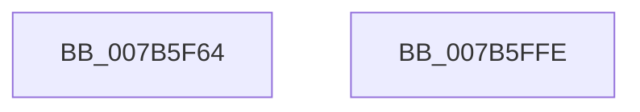

# EtwpEventWriteTemplateBackingFile

- RVA: `0x007B5F64`–`0x007B5FFF` (길이 `155` bytes)
- VA: `0x00000001407B5F64`
- 실행 섹션: `PAGE`
- PDB 이름 있음: `예`; PDB Function 태그: `아니요`
- unwind 정보 RVA: `0x000BD7A0`
- 디코드: `36`개 명령, `155/155` bytes 표시
- 미해석 바이트: `0` (있으면 어셈블리에 `.byte`로 보존)

> 이 문서는 커널 이미지의 기계어와 PDB 기호를 분석해 생성했습니다. 4번과 5번은 함수 원형과 자료형을 바이너리 사용 방식에서 추정한 C 해석이며 원본 소스 복구 결과는 아닙니다.

## 1. Dependencies

- 직접 호출 지점: **2**; 고유 호출 대상: **2**
- 직접 호출자로 확인된 함수: **2**
- RIP 상대 이미지 참조: **4**

### Outgoing calls
- `0x007B5FE4` → [EtwWrite](../../text/41/EtwWrite_function_0041C720.md) (function, `0x0041C720`)
- `0x007B5FF0` → [_security_check_cookie](../../text/6A/_security_check_cookie_function_006AC640.md) (function, `0x006AC640`)

### Direct callers
- [EtwpRealtimeSaveBuffer](../9B/EtwpRealtimeSaveBuffer_function_009BFF48.md) at `0x009C0149`
- [EtwpRealtimeSaveBuffer](../9B/EtwpRealtimeSaveBuffer_function_009BFF48.md) at `0x009C018B`
- [EtwpRealtimeRestoreState](../AC/EtwpRealtimeRestoreState_function_00AC6A74.md) at `0x00AC6CC8`

### Static image references
- `0x007B5F72` → RVA `0x00E0A740` (`.data`; read)
- `0x007B5F84` → RVA `0x00013DB8` (`.rdata`; read)
- `0x007B5F9B` → RVA `0x000105E0` (`.rdata`; read)
- `0x007B5FB9` → RVA `0x00EFF840` (`.data`; read)

## 2. Other-region calls and transfers

- 다른 실행 섹션으로 향하는 call: **2**
  - `0x007B5FE4` → [EtwWrite](../../text/41/EtwWrite_function_0041C720.md) (`PAGE` → `.text`)
  - `0x007B5FF0` → [_security_check_cookie](../../text/6A/_security_check_cookie_function_006AC640.md) (`PAGE` → `.text`)
- 별도 외부 분기/꼬리 이동을 확인하지 못했습니다.

## 3. Assembly (complete function range)

```asm
007B5F64  40 55                           push rbp
007B5F66  48 8D 6C 24 B9                  lea rbp, [rsp - 0x47]
007B5F6B  48 81 EC 90 00 00 00            sub rsp, 0x90
007B5F72  48 8B 05 C7 47 65 00            mov rax, qword ptr [rip + 0x6547c7]
007B5F79  48 33 C4                        xor rax, rsp
007B5F7C  48 89 45 37                     mov qword ptr [rbp + 0x37], rax
007B5F80  49 8B 41 08                     mov rax, qword ptr [r9 + 8]
007B5F84  48 8D 15 2D DE 85 FF            lea rdx, [rip - 0x7a21d3]
007B5F8B  48 89 45 F7                     mov qword ptr [rbp - 9], rax
007B5F8F  33 C9                           xor ecx, ecx
007B5F91  41 0F B7 01                     movzx eax, word ptr [r9]
007B5F95  45 33 C0                        xor r8d, r8d
007B5F98  89 45 FF                        mov dword ptr [rbp - 1], eax
007B5F9B  48 8D 05 3E A6 85 FF            lea rax, [rip - 0x7a59c2]
007B5FA2  48 89 45 07                     mov qword ptr [rbp + 7], rax
007B5FA6  48 8D 45 E7                     lea rax, [rbp - 0x19]
007B5FAA  44 8D 49 04                     lea r9d, [rcx + 4]
007B5FAE  48 89 45 17                     mov qword ptr [rbp + 0x17], rax
007B5FB2  48 8D 45 7F                     lea rax, [rbp + 0x7f]
007B5FB6  89 4D 03                        mov dword ptr [rbp + 3], ecx
007B5FB9  48 8B 0D 80 98 74 00            mov rcx, qword ptr [rip + 0x749880]
007B5FC0  48 89 45 27                     mov qword ptr [rbp + 0x27], rax
007B5FC4  48 8D 45 F7                     lea rax, [rbp - 9]
007B5FC8  48 89 44 24 20                  mov qword ptr [rsp + 0x20], rax
007B5FCD  C7 45 E7 88 01 00 C0            mov dword ptr [rbp - 0x19], 0xc0000188
007B5FD4  48 C7 45 0F 02 00 00 00         mov qword ptr [rbp + 0xf], 2
007B5FDC  4C 89 4D 1F                     mov qword ptr [rbp + 0x1f], r9
007B5FE0  4C 89 4D 2F                     mov qword ptr [rbp + 0x2f], r9
007B5FE4  E8 37 67 C6 FF                  call 0x14041c720
007B5FE9  48 8B 4D 37                     mov rcx, qword ptr [rbp + 0x37]
007B5FED  48 33 CC                        xor rcx, rsp
007B5FF0  E8 4B 66 EF FF                  call 0x1406ac640
007B5FF5  48 81 C4 90 00 00 00            add rsp, 0x90
007B5FFC  5D                              pop rbp
007B5FFD  C3                              ret
007B5FFE  CC                              int3
```

## 4. C-style interpretation (structured pseudocode)

```c
__int64 __fastcall EtwpEventWriteTemplateBackingFile(int a1, __int64 a2, int a3, __int64 a4, __int64 a5, __int64 a6)
{
    __int64 result;
    __int64 v_rsp;
    unsigned __int64 v_stack_m18;
    unsigned __int64 v_stack_m20;
    unsigned __int64 v_stack_m28;
    unsigned __int64 v_stack_m30;
    unsigned __int64 v_stack_m38;
    unsigned __int64 v_stack_m40;
    unsigned __int64 v_stack_m48;
    unsigned int v_stack_m4C;
    unsigned __int64 v_stack_m4F;
    unsigned int v_stack_m50;
    unsigned __int64 v_stack_m58;
    unsigned __int64 v_stack_m68;
    unsigned __int64 v_stack_m78;

    v_rsp = (v_rsp) - (144);
    result = (*(unsigned __int64 *)(v_rip + 6637511)) ^ (v_rsp);
    v_stack_m18 = result;
    v_stack_m58 = *(unsigned __int64 *)(a4 + 8);
    a1 = 0;
    a3 = 0;
    v_stack_m50 = (unsigned int)(*(unsigned __int16 *)(a4));
    v_stack_m48 = v_rip - 8018370;
    v_stack_m38 = v_stack_m68;
    v_stack_m4C = 0;
    v_stack_m28 = a6;
    v_stack_m78 = v_stack_m58;
    v_stack_m68 = 0xC0000188ULL;
    v_stack_m40 = 2;
    v_stack_m30 = a1 + 4;
    v_stack_m20 = a1 + 4;
    result = EtwWrite(*(unsigned __int64 *)(v_rip + 7641216), v_rip - 8004051, a3, a1 + 4);
    a1 = (v_stack_m18) ^ (v_rsp);
    result = _security_check_cookie(a1, v_rip - 8004051, a3, a1 + 4);
    v_rsp = (v_rsp) + (144);
    return result;
}
```

## 5. (Beta) C Style

```c
int64_t EtwpEventWriteTemplateBackingFile(int32_t Arg1, int64_t Arg2, int32_t Arg3, void *Arg4, uint64_t Arg5, int64_t Arg6)
{
    uint8_t *arg4 = (uint8_t *)Arg4;

    int64_t result;
    int64_t local_rsp;
    uint64_t v_stack_m18;
    uint64_t v_stack_m20;
    uint64_t v_stack_m28;
    uint64_t v_stack_m30;
    uint64_t v_stack_m38;
    uint64_t v_stack_m40;
    uint64_t v_stack_m48;
    uint32_t v_stack_m4C;
    uint64_t v_stack_m4F;
    uint32_t v_stack_m50;
    uint64_t v_stack_m58;
    uint64_t v_stack_m68;
    uint64_t v_stack_m78;

    local_rsp = (local_rsp) - (144);
    result = (*(uint64_t *)(v_rip + 0x6547C7)) ^ (local_rsp);
    v_stack_m18 = result;
    v_stack_m58 = *(uint64_t *)(arg4 + 0x8);
    Arg1 = 0;
    Arg3 = 0;
    v_stack_m50 = (uint32_t)(*(uint16_t *)(arg4));
    v_stack_m48 = v_rip - 8018370;
    v_stack_m38 = v_stack_m68;
    v_stack_m4C = 0;
    v_stack_m28 = Arg6;
    v_stack_m78 = v_stack_m58;
    v_stack_m68 = 0xC0000188ULL;
    v_stack_m40 = 2;
    v_stack_m30 = Arg1 + 4;
    v_stack_m20 = Arg1 + 4;
    result = EtwWrite(*(uint64_t *)(v_rip + 0x749880), v_rip - 8004051, Arg3, Arg1 + 4);
    Arg1 = (v_stack_m18) ^ (local_rsp);
    result = _security_check_cookie(Arg1, v_rip - 8004051, Arg3, Arg1 + 4);
    local_rsp = (local_rsp) + (144);
    return result;
}
```

### 관측된 메모리 오프셋

구조체 형식이 확인되지 않은 접근은 인자 기준의 오프셋으로만 기록했습니다.

| 기준 인자 | 오프셋 표현 | 폭 (bit) | 접근 |
|---|---:|---:|---|
| `Arg4` | `+ 0x0` | `16` | `R` |
| `Arg4` | `+ 0x8` | `64` | `R` |

## 6. Execution-region graph

[열기: 2D/3D 그래프와 함수 탐색 컨트롤 패널](../../../control-panel.html?section=page&rva=0x007B5F64&view=graph)

- 2D 그래프는 위에서 아래로 흐르고, 3D 그래프는 빈 공간을 드래그해 회전합니다. Shift+드래그는 이동, 휠은 확대·축소, 함수 노드 선택은 대상 보고서 이동입니다.

### Static fallback


