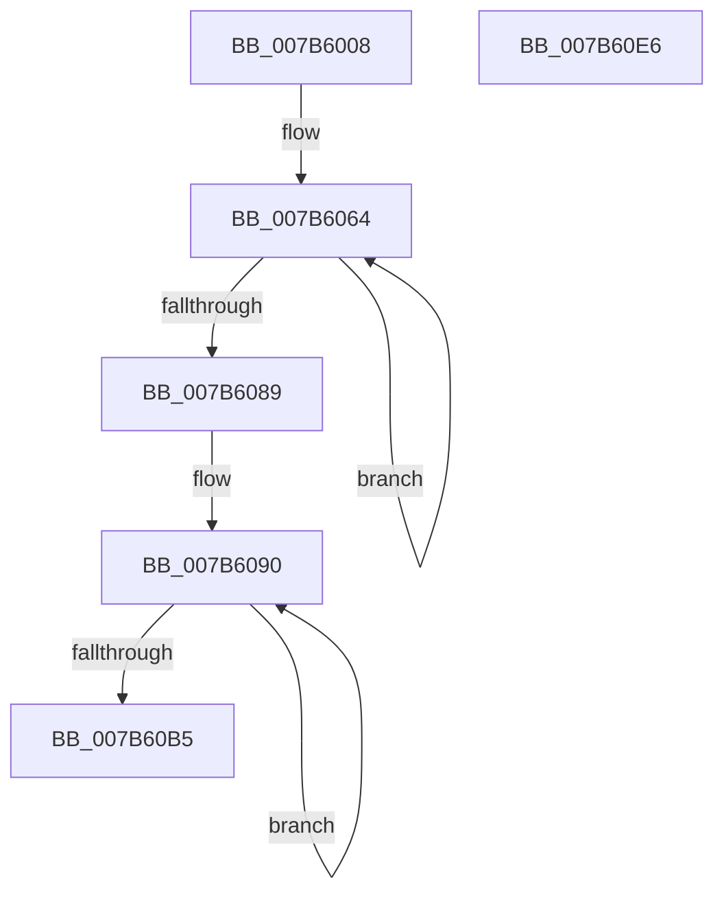

# EtwpEventWriteTemplateInvalidGroupMask

- RVA: `0x007B6008`–`0x007B60E7` (길이 `223` bytes)
- VA: `0x00000001407B6008`
- 실행 섹션: `PAGE`
- PDB 이름 있음: `예`; PDB Function 태그: `아니요`
- unwind 정보 RVA: `0x000D3494`
- 디코드: `48`개 명령, `223/223` bytes 표시
- 미해석 바이트: `0` (있으면 어셈블리에 `.byte`로 보존)

> 이 문서는 커널 이미지의 기계어와 PDB 기호를 분석해 생성했습니다. 4번과 5번은 함수 원형과 자료형을 바이너리 사용 방식에서 추정한 C 해석이며 원본 소스 복구 결과는 아닙니다.

## 1. Dependencies

- 직접 호출 지점: **2**; 고유 호출 대상: **2**
- 직접 호출자로 확인된 함수: **1**
- RIP 상대 이미지 참조: **5**

### Outgoing calls
- `0x007B60C9` → [EtwWrite](../../text/41/EtwWrite_function_0041C720.md) (function, `0x0041C720`)
- `0x007B60D9` → [_security_check_cookie](../../text/6A/_security_check_cookie_function_006AC640.md) (function, `0x006AC640`)

### Direct callers
- [EtwpUpdateSelectedGroupMasks](../../text/49/EtwpUpdateSelectedGroupMasks_function_0049B114.md) at `0x0049B540`

### Static image references
- `0x007B600F` → RVA `0x00E0A740` (`.data`; read)
- `0x007B6033` → RVA `0x00EFF840` (`.data`; read)
- `0x007B6053` → RVA `0x000105E0` (`.rdata`; read)
- `0x007B6089` → RVA `0x00FC6EF8` (`ALMOSTRO`; read)
- `0x007B60BD` → RVA `0x0001AB68` (`.rdata`; read)

## 2. Other-region calls and transfers

- 다른 실행 섹션으로 향하는 call: **2**
  - `0x007B60C9` → [EtwWrite](../../text/41/EtwWrite_function_0041C720.md) (`PAGE` → `.text`)
  - `0x007B60D9` → [_security_check_cookie](../../text/6A/_security_check_cookie_function_006AC640.md) (`PAGE` → `.text`)
- 별도 외부 분기/꼬리 이동을 확인하지 못했습니다.

## 3. Assembly (complete function range)

```asm
007B6008  48 81 EC 68 01 00 00            sub rsp, 0x168
007B600F  48 8B 05 2A 47 65 00            mov rax, qword ptr [rip + 0x65472a]
007B6016  48 33 C4                        xor rax, rsp
007B6019  48 89 84 24 50 01 00 00         mov qword ptr [rsp + 0x150], rax
007B6021  49 8B 40 08                     mov rax, qword ptr [r8 + 8]
007B6025  4D 8B D1                        mov r10, r9
007B6028  83 64 24 3C 00                  and dword ptr [rsp + 0x3c], 0
007B602D  41 B9 02 00 00 00               mov r9d, 2
007B6033  4C 8B 1D 06 98 74 00            mov r11, qword ptr [rip + 0x749806]
007B603A  83 64 24 4C 00                  and dword ptr [rsp + 0x4c], 0
007B603F  48 89 44 24 30                  mov qword ptr [rsp + 0x30], rax
007B6044  41 0F B7 00                     movzx eax, word ptr [r8]
007B6048  45 8D 41 06                     lea r8d, [r9 + 6]
007B604C  89 44 24 38                     mov dword ptr [rsp + 0x38], eax
007B6050  41 8B C8                        mov ecx, r8d
007B6053  48 8D 05 86 A5 85 FF            lea rax, [rip - 0x7a5a7a]
007B605A  44 89 4C 24 48                  mov dword ptr [rsp + 0x48], r9d
007B605F  48 89 44 24 40                  mov qword ptr [rsp + 0x40], rax
007B6064  41 8B C1                        mov eax, r9d
007B6067  41 FF C1                        inc r9d
007B606A  48 03 C0                        add rax, rax
007B606D  83 64 C4 3C 00                  and dword ptr [rsp + rax*8 + 0x3c], 0
007B6072  4C 89 54 C4 30                  mov qword ptr [rsp + rax*8 + 0x30], r10
007B6077  49 83 C2 04                     add r10, 4
007B607B  C7 44 C4 38 04 00 00 00         mov dword ptr [rsp + rax*8 + 0x38], 4
007B6083  48 83 E9 01                     sub rcx, 1
007B6087  75 DB                           jne 0x1407b6064
007B6089  48 8D 15 68 0E 81 00            lea rdx, [rip + 0x810e68]
007B6090  41 8B C1                        mov eax, r9d
007B6093  41 FF C1                        inc r9d
007B6096  48 03 C0                        add rax, rax
007B6099  83 64 C4 3C 00                  and dword ptr [rsp + rax*8 + 0x3c], 0
007B609E  48 89 54 C4 30                  mov qword ptr [rsp + rax*8 + 0x30], rdx
007B60A3  48 83 C2 04                     add rdx, 4
007B60A7  C7 44 C4 38 04 00 00 00         mov dword ptr [rsp + rax*8 + 0x38], 4
007B60AF  49 83 E8 01                     sub r8, 1
007B60B3  75 DB                           jne 0x1407b6090
007B60B5  48 8D 44 24 30                  lea rax, [rsp + 0x30]
007B60BA  49 8B CB                        mov rcx, r11
007B60BD  48 8D 15 A4 4A 86 FF            lea rdx, [rip - 0x79b55c]
007B60C4  48 89 44 24 20                  mov qword ptr [rsp + 0x20], rax
007B60C9  E8 52 66 C6 FF                  call 0x14041c720
007B60CE  48 8B 8C 24 50 01 00 00         mov rcx, qword ptr [rsp + 0x150]
007B60D6  48 33 CC                        xor rcx, rsp
007B60D9  E8 62 65 EF FF                  call 0x1406ac640
007B60DE  48 81 C4 68 01 00 00            add rsp, 0x168
007B60E5  C3                              ret
007B60E6  CC                              int3
```

## 4. C-style interpretation (structured pseudocode)

```c
__int64 __fastcall EtwpEventWriteTemplateInvalidGroupMask(__int64 a1, __int64 a2, __int64 a3, __int64 a4)
{
    __int64 result;
    __int64 v_r10;
    __int64 v_rsp;
    unsigned int v_stack_m11C;
    unsigned int v_stack_m120;
    unsigned __int64 v_stack_m128;
    unsigned int v_stack_m12C;
    unsigned int v_stack_m130;
    unsigned __int64 v_stack_m138;
    unsigned __int64 v_stack_m148;
    unsigned __int64 v_stack_m18;

    v_rsp = (v_rsp) - (360);
    result = (*(unsigned __int64 *)(v_rip + 6637354)) ^ (v_rsp);
    v_stack_m18 = result;
    v_stack_m138 = *(unsigned __int64 *)(a3 + 8);
    v_stack_m130 = (unsigned int)(*(unsigned __int16 *)(a3));
    v_stack_m120 = 2;
    v_stack_m128 = v_rip - 8018554;
loc_007B6064:
    a4 = (unsigned int)((2) + 1);
    result = (2) + (2);
    *(unsigned __int64 *)(v_rsp + result * 8 + 48) = a4;
    v_r10 = (a4) + (4);
    *(unsigned int *)(v_rsp + result * 8 + 56) = 4;
    a1 = ((unsigned int)((unsigned int)(2 + 6))) - (1);
    if (condition_is_not_equal) goto loc_007B6064;
loc_007B6090:
    a4 = (unsigned int)((a4) + 1);
    result = ((unsigned int)((unsigned int)(a4))) + ((unsigned int)((unsigned int)(a4)));
    *(unsigned __int64 *)(v_rsp + result * 8 + 48) = v_rip + 8457832;
    a2 = (v_rip + 8457832) + (4);
    *(unsigned int *)(v_rsp + result * 8 + 56) = 4;
    a3 = (2 + 6) - (1);
    if (condition_is_not_equal) goto loc_007B6090;
    v_stack_m148 = v_stack_m138;
    result = EtwWrite(*(unsigned __int64 *)(v_rip + 7641094), v_rip - 7976284, a3, a4);
    a1 = (v_stack_m18) ^ (v_rsp);
    result = _security_check_cookie(a1, v_rip - 7976284, a3, a4);
    v_rsp = (v_rsp) + (360);
    return result;
}
```

## 5. (Beta) C Style

```c
int64_t EtwpEventWriteTemplateInvalidGroupMask(int64_t Arg1, int64_t Arg2, void *Arg3, int64_t Arg4)
{
    uint8_t *arg3 = (uint8_t *)Arg3;

    int64_t result;
    int64_t local_r10;
    int64_t local_rsp;
    uint32_t v_stack_m11C;
    uint32_t v_stack_m120;
    uint64_t v_stack_m128;
    uint32_t v_stack_m12C;
    uint32_t v_stack_m130;
    uint64_t v_stack_m138;
    uint64_t v_stack_m148;
    uint64_t v_stack_m18;

    local_rsp = (local_rsp) - (360);
    result = (*(uint64_t *)(v_rip + 0x65472A)) ^ (local_rsp);
    v_stack_m18 = result;
    v_stack_m138 = *(uint64_t *)(arg3 + 0x8);
    v_stack_m130 = (uint32_t)(*(uint16_t *)(arg3));
    v_stack_m120 = 2;
    v_stack_m128 = v_rip - 8018554;
loc_007B6064:
    Arg4 = (uint32_t)((2) + 1);
    result = (2) + (2);
    *(uint64_t *)(local_rsp + result * 8 + 0x30) = Arg4;
    local_r10 = (Arg4) + (4);
    *(uint32_t *)(local_rsp + result * 8 + 0x38) = 4;
    Arg1 = ((uint32_t)((uint32_t)(2 + 6))) - (1);
    if (condition_is_not_equal) goto loc_007B6064;
loc_007B6090:
    Arg4 = (uint32_t)((Arg4) + 1);
    result = ((uint32_t)((uint32_t)(Arg4))) + ((uint32_t)((uint32_t)(Arg4)));
    *(uint64_t *)(local_rsp + result * 8 + 0x30) = v_rip + 8457832;
    Arg2 = (v_rip + 8457832) + (4);
    *(uint32_t *)(local_rsp + result * 8 + 0x38) = 4;
    Arg3 = (2 + 6) - (1);
    if (condition_is_not_equal) goto loc_007B6090;
    v_stack_m148 = v_stack_m138;
    result = EtwWrite(*(uint64_t *)(v_rip + 0x749806), v_rip - 7976284, Arg3, Arg4);
    Arg1 = (v_stack_m18) ^ (local_rsp);
    result = _security_check_cookie(Arg1, v_rip - 7976284, Arg3, Arg4);
    local_rsp = (local_rsp) + (360);
    return result;
}
```

### 관측된 메모리 오프셋

구조체 형식이 확인되지 않은 접근은 인자 기준의 오프셋으로만 기록했습니다.

| 기준 인자 | 오프셋 표현 | 폭 (bit) | 접근 |
|---|---:|---:|---|
| `Arg3` | `+ 0x0` | `16` | `R` |
| `Arg3` | `+ 0x8` | `64` | `R` |

## 6. Execution-region graph

[열기: 2D/3D 그래프와 함수 탐색 컨트롤 패널](../../../control-panel.html?section=page&rva=0x007B6008&view=graph)

- 2D 그래프는 위에서 아래로 흐르고, 3D 그래프는 빈 공간을 드래그해 회전합니다. Shift+드래그는 이동, 휠은 확대·축소, 함수 노드 선택은 대상 보고서 이동입니다.

### Static fallback


