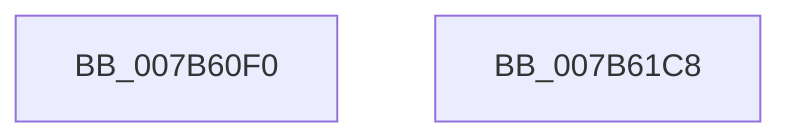

# EtwpEventWriteTemplateMaxFileSize

- RVA: `0x007B60F0`–`0x007B61C9` (길이 `217` bytes)
- VA: `0x00000001407B60F0`
- 실행 섹션: `PAGE`
- PDB 이름 있음: `예`; PDB Function 태그: `아니요`
- unwind 정보 RVA: `0x000AC058`
- 디코드: `47`개 명령, `217/217` bytes 표시
- 미해석 바이트: `0` (있으면 어셈블리에 `.byte`로 보존)

> 이 문서는 커널 이미지의 기계어와 PDB 기호를 분석해 생성했습니다. 4번과 5번은 함수 원형과 자료형을 바이너리 사용 방식에서 추정한 C 해석이며 원본 소스 복구 결과는 아닙니다.

## 1. Dependencies

- 직접 호출 지점: **2**; 고유 호출 대상: **2**
- 직접 호출자로 확인된 함수: **1**
- RIP 상대 이미지 참조: **4**

### Outgoing calls
- `0x007B61AE` → [EtwWrite](../../text/41/EtwWrite_function_0041C720.md) (function, `0x0041C720`)
- `0x007B61BA` → [_security_check_cookie](../../text/6A/_security_check_cookie_function_006AC640.md) (function, `0x006AC640`)

### Direct callers
- [EtwpFlushBufferToLogfile](../9B/EtwpFlushBufferToLogfile_function_009BFC08.md) at `0x009BFDCF`

### Static image references
- `0x007B60FE` → RVA `0x00E0A740` (`.data`; read)
- `0x007B6110` → RVA `0x000105E0` (`.rdata`; read)
- `0x007B611B` → RVA `0x00022738` (`.rdata`; read)
- `0x007B613B` → RVA `0x00EFF840` (`.data`; read)

## 2. Other-region calls and transfers

- 다른 실행 섹션으로 향하는 call: **2**
  - `0x007B61AE` → [EtwWrite](../../text/41/EtwWrite_function_0041C720.md) (`PAGE` → `.text`)
  - `0x007B61BA` → [_security_check_cookie](../../text/6A/_security_check_cookie_function_006AC640.md) (`PAGE` → `.text`)
- 별도 외부 분기/꼬리 이동을 확인하지 못했습니다.

## 3. Assembly (complete function range)

```asm
007B60F0  40 55                           push rbp
007B60F2  48 8D 6C 24 C9                  lea rbp, [rsp - 0x37]
007B60F7  48 81 EC C0 00 00 00            sub rsp, 0xc0
007B60FE  48 8B 05 3B 46 65 00            mov rax, qword ptr [rip + 0x65463b]
007B6105  48 33 C4                        xor rax, rsp
007B6108  48 89 45 27                     mov qword ptr [rbp + 0x27], rax
007B610C  49 8B 41 08                     mov rax, qword ptr [r9 + 8]
007B6110  4C 8D 05 C9 A4 85 FF            lea r8, [rip - 0x7a5b37]
007B6117  48 8B 4D 67                     mov rcx, qword ptr [rbp + 0x67]
007B611B  48 8D 15 16 C6 86 FF            lea rdx, [rip - 0x7939ea]
007B6122  48 89 45 B7                     mov qword ptr [rbp - 0x49], rax
007B6126  41 0F B7 01                     movzx eax, word ptr [r9]
007B612A  45 33 C9                        xor r9d, r9d
007B612D  89 45 BF                        mov dword ptr [rbp - 0x41], eax
007B6130  48 8B 41 08                     mov rax, qword ptr [rcx + 8]
007B6134  48 89 45 D7                     mov qword ptr [rbp - 0x29], rax
007B6138  0F B7 01                        movzx eax, word ptr [rcx]
007B613B  48 8B 0D FE 96 74 00            mov rcx, qword ptr [rip + 0x7496fe]
007B6142  89 45 DF                        mov dword ptr [rbp - 0x21], eax
007B6145  48 8D 45 A7                     lea rax, [rbp - 0x59]
007B6149  48 89 45 F7                     mov qword ptr [rbp - 9], rax
007B614D  48 8D 45 77                     lea rax, [rbp + 0x77]
007B6151  48 89 45 07                     mov qword ptr [rbp + 7], rax
007B6155  48 8D 45 7F                     lea rax, [rbp + 0x7f]
007B6159  48 89 45 17                     mov qword ptr [rbp + 0x17], rax
007B615D  48 8D 45 B7                     lea rax, [rbp - 0x49]
007B6161  44 89 4D C3                     mov dword ptr [rbp - 0x3d], r9d
007B6165  4C 89 45 C7                     mov qword ptr [rbp - 0x39], r8
007B6169  44 89 4D E3                     mov dword ptr [rbp - 0x1d], r9d
007B616D  41 B9 07 00 00 00               mov r9d, 7
007B6173  4C 89 45 E7                     mov qword ptr [rbp - 0x19], r8
007B6177  45 33 C0                        xor r8d, r8d
007B617A  48 89 44 24 20                  mov qword ptr [rsp + 0x20], rax
007B617F  C7 45 A7 88 01 00 C0            mov dword ptr [rbp - 0x59], 0xc0000188
007B6186  48 C7 45 CF 02 00 00 00         mov qword ptr [rbp - 0x31], 2
007B618E  48 C7 45 EF 02 00 00 00         mov qword ptr [rbp - 0x11], 2
007B6196  48 C7 45 FF 04 00 00 00         mov qword ptr [rbp - 1], 4
007B619E  48 C7 45 0F 04 00 00 00         mov qword ptr [rbp + 0xf], 4
007B61A6  48 C7 45 1F 08 00 00 00         mov qword ptr [rbp + 0x1f], 8
007B61AE  E8 6D 65 C6 FF                  call 0x14041c720
007B61B3  48 8B 4D 27                     mov rcx, qword ptr [rbp + 0x27]
007B61B7  48 33 CC                        xor rcx, rsp
007B61BA  E8 81 64 EF FF                  call 0x1406ac640
007B61BF  48 81 C4 C0 00 00 00            add rsp, 0xc0
007B61C6  5D                              pop rbp
007B61C7  C3                              ret
007B61C8  CC                              int3
```

## 4. C-style interpretation (structured pseudocode)

```c
__int64 __fastcall EtwpEventWriteTemplateMaxFileSize(__int64 a1, __int64 a2, __int64 a3, __int64 a4, __int64 a5, __int64 a6, __int64 a7, __int64 a8)
{
    __int64 result;
    __int64 v_rsp;
    unsigned __int64 v_stack_m18;
    unsigned __int64 v_stack_m20;
    unsigned __int64 v_stack_m28;
    unsigned __int64 v_stack_m30;
    unsigned __int64 v_stack_m38;
    unsigned __int64 v_stack_m3F;
    unsigned __int64 v_stack_m40;
    unsigned __int64 v_stack_m48;
    unsigned __int64 v_stack_m50;
    unsigned __int64 v_stack_m58;
    unsigned int v_stack_m5C;
    unsigned int v_stack_m60;
    unsigned __int64 v_stack_m68;
    unsigned __int64 v_stack_m70;
    unsigned __int64 v_stack_m78;
    unsigned int v_stack_m7C;
    unsigned int v_stack_m80;
    unsigned __int64 v_stack_m88;
    unsigned __int64 v_stack_m98;
    unsigned __int64 v_stack_mA8;

    v_rsp = (v_rsp) - (192);
    result = (*(unsigned __int64 *)(v_rip + 6637115)) ^ (v_rsp);
    v_stack_m18 = result;
    v_stack_m88 = *(unsigned __int64 *)(a4 + 8);
    a4 = 0;
    v_stack_m80 = (unsigned int)(*(unsigned __int16 *)(a4));
    v_stack_m68 = *(unsigned __int64 *)(a5 + 8);
    v_stack_m60 = (unsigned int)(*(unsigned __int16 *)(a5));
    v_stack_m48 = v_stack_m98;
    v_stack_m38 = a7;
    v_stack_m28 = a8;
    v_stack_m7C = 0;
    v_stack_m78 = v_rip - 8018743;
    v_stack_m5C = 0;
    v_stack_m58 = v_rip - 8018743;
    a3 = 0;
    v_stack_mA8 = v_stack_m88;
    v_stack_m98 = 0xC0000188ULL;
    v_stack_m70 = 2;
    v_stack_m50 = 2;
    v_stack_m40 = 4;
    v_stack_m30 = 4;
    v_stack_m20 = 8;
    result = EtwWrite(*(unsigned __int64 *)(v_rip + 7640830), v_rip - 7944682, a3, 7);
    a1 = (v_stack_m18) ^ (v_rsp);
    result = _security_check_cookie(a1, v_rip - 7944682, a3, 7);
    v_rsp = (v_rsp) + (192);
    return result;
}
```

## 5. (Beta) C Style

```c
int64_t EtwpEventWriteTemplateMaxFileSize(int64_t Arg1, int64_t Arg2, int64_t Arg3, void *Arg4, void *Arg5, uint64_t Arg6, int64_t Arg7, int64_t Arg8)
{
    uint8_t *arg4 = (uint8_t *)Arg4;
    uint8_t *arg5 = (uint8_t *)Arg5;

    int64_t result;
    int64_t local_rsp;
    uint64_t v_stack_m18;
    uint64_t v_stack_m20;
    uint64_t v_stack_m28;
    uint64_t v_stack_m30;
    uint64_t v_stack_m38;
    uint64_t v_stack_m3F;
    uint64_t v_stack_m40;
    uint64_t v_stack_m48;
    uint64_t v_stack_m50;
    uint64_t v_stack_m58;
    uint32_t v_stack_m5C;
    uint32_t v_stack_m60;
    uint64_t v_stack_m68;
    uint64_t v_stack_m70;
    uint64_t v_stack_m78;
    uint32_t v_stack_m7C;
    uint32_t v_stack_m80;
    uint64_t v_stack_m88;
    uint64_t v_stack_m98;
    uint64_t v_stack_mA8;

    local_rsp = (local_rsp) - (192);
    result = (*(uint64_t *)(v_rip + 0x65463B)) ^ (local_rsp);
    v_stack_m18 = result;
    v_stack_m88 = *(uint64_t *)(arg4 + 0x8);
    Arg4 = 0;
    v_stack_m80 = (uint32_t)(*(uint16_t *)(arg4));
    v_stack_m68 = *(uint64_t *)(arg5 + 0x8);
    v_stack_m60 = (uint32_t)(*(uint16_t *)(arg5));
    v_stack_m48 = v_stack_m98;
    v_stack_m38 = Arg7;
    v_stack_m28 = Arg8;
    v_stack_m7C = 0;
    v_stack_m78 = v_rip - 8018743;
    v_stack_m5C = 0;
    v_stack_m58 = v_rip - 8018743;
    Arg3 = 0;
    v_stack_mA8 = v_stack_m88;
    v_stack_m98 = 0xC0000188ULL;
    v_stack_m70 = 2;
    v_stack_m50 = 2;
    v_stack_m40 = 4;
    v_stack_m30 = 4;
    v_stack_m20 = 8;
    result = EtwWrite(*(uint64_t *)(v_rip + 0x7496FE), v_rip - 7944682, Arg3, 7);
    Arg1 = (v_stack_m18) ^ (local_rsp);
    result = _security_check_cookie(Arg1, v_rip - 7944682, Arg3, 7);
    local_rsp = (local_rsp) + (192);
    return result;
}
```

### 관측된 메모리 오프셋

구조체 형식이 확인되지 않은 접근은 인자 기준의 오프셋으로만 기록했습니다.

| 기준 인자 | 오프셋 표현 | 폭 (bit) | 접근 |
|---|---:|---:|---|
| `Arg4` | `+ 0x0` | `16` | `R` |
| `Arg4` | `+ 0x8` | `64` | `R` |
| `Arg5` | `+ 0x0` | `16` | `R` |
| `Arg5` | `+ 0x8` | `64` | `R` |

## 6. Execution-region graph

[열기: 2D/3D 그래프와 함수 탐색 컨트롤 패널](../../../control-panel.html?section=page&rva=0x007B60F0&view=graph)

- 2D 그래프는 위에서 아래로 흐르고, 3D 그래프는 빈 공간을 드래그해 회전합니다. Shift+드래그는 이동, 휠은 확대·축소, 함수 노드 선택은 대상 보고서 이동입니다.

### Static fallback


