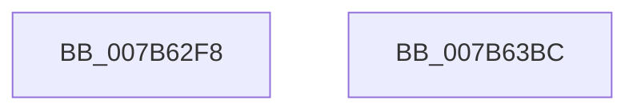

# EtwpEventWriteTemplateSessionFromCapturedData

- RVA: `0x007B62F8`–`0x007B63BD` (길이 `197` bytes)
- VA: `0x00000001407B62F8`
- 실행 섹션: `PAGE`
- PDB 이름 있음: `예`; PDB Function 태그: `아니요`
- unwind 정보 RVA: `0x000C6160`
- 디코드: `44`개 명령, `197/197` bytes 표시
- 미해석 바이트: `0` (있으면 어셈블리에 `.byte`로 보존)

> 이 문서는 커널 이미지의 기계어와 PDB 기호를 분석해 생성했습니다. 4번과 5번은 함수 원형과 자료형을 바이너리 사용 방식에서 추정한 C 해석이며 원본 소스 복구 결과는 아닙니다.

## 1. Dependencies

- 직접 호출 지점: **2**; 고유 호출 대상: **2**
- 직접 호출자로 확인된 함수: **1**
- RIP 상대 이미지 참조: **4**

### Outgoing calls
- `0x007B63A2` → [EtwWrite](../../text/41/EtwWrite_function_0041C720.md) (function, `0x0041C720`)
- `0x007B63AE` → [_security_check_cookie](../../text/6A/_security_check_cookie_function_006AC640.md) (function, `0x006AC640`)

### Direct callers
- [EtwpStartLogger](../A9/EtwpStartLogger_function_00A99D80.md) at `0x00A9A0F9`

### Static image references
- `0x007B630A` → RVA `0x00E0A740` (`.data`; read)
- `0x007B6324` → RVA `0x00022BB8` (`.rdata`; read)
- `0x007B6332` → RVA `0x000105E0` (`.rdata`; read)
- `0x007B6368` → RVA `0x00EFF840` (`.data`; read)

## 2. Other-region calls and transfers

- 다른 실행 섹션으로 향하는 call: **2**
  - `0x007B63A2` → [EtwWrite](../../text/41/EtwWrite_function_0041C720.md) (`PAGE` → `.text`)
  - `0x007B63AE` → [_security_check_cookie](../../text/6A/_security_check_cookie_function_006AC640.md) (`PAGE` → `.text`)
- 별도 외부 분기/꼬리 이동을 확인하지 못했습니다.

## 3. Assembly (complete function range)

```asm
007B62F8  44 89 4C 24 20                  mov dword ptr [rsp + 0x20], r9d
007B62FD  55                              push rbp
007B62FE  48 8D 6C 24 B9                  lea rbp, [rsp - 0x47]
007B6303  48 81 EC A0 00 00 00            sub rsp, 0xa0
007B630A  48 8B 05 2F 44 65 00            mov rax, qword ptr [rip + 0x65442f]
007B6311  48 33 C4                        xor rax, rsp
007B6314  48 89 45 37                     mov qword ptr [rbp + 0x37], rax
007B6318  48 8B 4D 77                     mov rcx, qword ptr [rbp + 0x77]
007B631C  48 8D 45 6F                     lea rax, [rbp + 0x6f]
007B6320  48 89 45 E7                     mov qword ptr [rbp - 0x19], rax
007B6324  48 8D 15 8D C8 86 FF            lea rdx, [rip - 0x793773]
007B632B  45 33 C9                        xor r9d, r9d
007B632E  4C 89 45 D7                     mov qword ptr [rbp - 0x29], r8
007B6332  4C 8D 05 A7 A2 85 FF            lea r8, [rip - 0x7a5d59]
007B6339  44 89 4D 03                     mov dword ptr [rbp + 3], r9d
007B633D  48 8B 41 08                     mov rax, qword ptr [rcx + 8]
007B6341  48 89 45 F7                     mov qword ptr [rbp - 9], rax
007B6345  0F B7 01                        movzx eax, word ptr [rcx]
007B6348  48 8B 4D 7F                     mov rcx, qword ptr [rbp + 0x7f]
007B634C  89 45 FF                        mov dword ptr [rbp - 1], eax
007B634F  4C 89 45 07                     mov qword ptr [rbp + 7], r8
007B6353  44 89 4D 23                     mov dword ptr [rbp + 0x23], r9d
007B6357  41 B9 06 00 00 00               mov r9d, 6
007B635D  48 8B 41 08                     mov rax, qword ptr [rcx + 8]
007B6361  48 89 45 17                     mov qword ptr [rbp + 0x17], rax
007B6365  0F B7 01                        movzx eax, word ptr [rcx]
007B6368  48 8B 0D D1 94 74 00            mov rcx, qword ptr [rip + 0x7494d1]
007B636F  89 45 1F                        mov dword ptr [rbp + 0x1f], eax
007B6372  48 8D 45 D7                     lea rax, [rbp - 0x29]
007B6376  4C 89 45 27                     mov qword ptr [rbp + 0x27], r8
007B637A  45 33 C0                        xor r8d, r8d
007B637D  48 89 44 24 20                  mov qword ptr [rsp + 0x20], rax
007B6382  48 C7 45 DF 10 00 00 00         mov qword ptr [rbp - 0x21], 0x10
007B638A  48 C7 45 EF 04 00 00 00         mov qword ptr [rbp - 0x11], 4
007B6392  48 C7 45 0F 02 00 00 00         mov qword ptr [rbp + 0xf], 2
007B639A  48 C7 45 2F 02 00 00 00         mov qword ptr [rbp + 0x2f], 2
007B63A2  E8 79 63 C6 FF                  call 0x14041c720
007B63A7  48 8B 4D 37                     mov rcx, qword ptr [rbp + 0x37]
007B63AB  48 33 CC                        xor rcx, rsp
007B63AE  E8 8D 62 EF FF                  call 0x1406ac640
007B63B3  48 81 C4 A0 00 00 00            add rsp, 0xa0
007B63BA  5D                              pop rbp
007B63BB  C3                              ret
007B63BC  CC                              int3
```

## 4. C-style interpretation (structured pseudocode)

```c
__int64 __fastcall EtwpEventWriteTemplateSessionFromCapturedData(__int64 a1, __int64 a2, __int64 a3, int a4, __int64 a5, __int64 a6)
{
    __int64 result;
    __int64 v_rsp;
    unsigned __int64 v_stack_m18;
    unsigned __int64 v_stack_m20;
    unsigned __int64 v_stack_m28;
    unsigned int v_stack_m2C;
    unsigned int v_stack_m30;
    unsigned __int64 v_stack_m38;
    unsigned __int64 v_stack_m40;
    unsigned __int64 v_stack_m48;
    unsigned int v_stack_m4C;
    unsigned __int64 v_stack_m4F;
    unsigned int v_stack_m50;
    unsigned __int64 v_stack_m58;
    unsigned __int64 v_stack_m60;
    unsigned __int64 v_stack_m68;
    unsigned __int64 v_stack_m70;
    unsigned __int64 v_stack_m78;
    unsigned __int64 v_stack_m88;
    unsigned int v_stack_p20;

    v_stack_p20 = a4;
    v_rsp = (v_rsp) - (160);
    result = (*(unsigned __int64 *)(v_rip + 6636591)) ^ (v_rsp);
    v_stack_m18 = result;
    v_stack_m68 = v_stack_p20;
    a4 = 0;
    v_stack_m78 = a3;
    v_stack_m4C = 0;
    v_stack_m58 = *(unsigned __int64 *)(a5 + 8);
    v_stack_m50 = (unsigned int)(*(unsigned __int16 *)(a5));
    v_stack_m48 = v_rip - 8019289;
    v_stack_m2C = 0;
    v_stack_m38 = *(unsigned __int64 *)(a6 + 8);
    v_stack_m30 = (unsigned int)(*(unsigned __int16 *)(a6));
    v_stack_m28 = v_rip - 8019289;
    a3 = 0;
    v_stack_m88 = v_stack_m78;
    v_stack_m70 = 16;
    v_stack_m60 = 4;
    v_stack_m40 = 2;
    v_stack_m20 = 2;
    result = EtwWrite(*(unsigned __int64 *)(v_rip + 7640273), v_rip - 7944051, a3, 6);
    a1 = (v_stack_m18) ^ (v_rsp);
    result = _security_check_cookie(a1, v_rip - 7944051, a3, 6);
    v_rsp = (v_rsp) + (160);
    return result;
}
```

## 5. (Beta) C Style

```c
int64_t EtwpEventWriteTemplateSessionFromCapturedData(int64_t Arg1, int64_t Arg2, int64_t Arg3, int32_t Arg4, void *Arg5, void *Arg6)
{
    uint8_t *arg5 = (uint8_t *)Arg5;
    uint8_t *arg6 = (uint8_t *)Arg6;

    int64_t result;
    int64_t local_rsp;
    uint64_t v_stack_m18;
    uint64_t v_stack_m20;
    uint64_t v_stack_m28;
    uint32_t v_stack_m2C;
    uint32_t v_stack_m30;
    uint64_t v_stack_m38;
    uint64_t v_stack_m40;
    uint64_t v_stack_m48;
    uint32_t v_stack_m4C;
    uint64_t v_stack_m4F;
    uint32_t v_stack_m50;
    uint64_t v_stack_m58;
    uint64_t v_stack_m60;
    uint64_t v_stack_m68;
    uint64_t v_stack_m70;
    uint64_t v_stack_m78;
    uint64_t v_stack_m88;
    uint32_t v_stack_p20;

    v_stack_p20 = Arg4;
    local_rsp = (local_rsp) - (160);
    result = (*(uint64_t *)(v_rip + 0x65442F)) ^ (local_rsp);
    v_stack_m18 = result;
    v_stack_m68 = v_stack_p20;
    Arg4 = 0;
    v_stack_m78 = Arg3;
    v_stack_m4C = 0;
    v_stack_m58 = *(uint64_t *)(arg5 + 0x8);
    v_stack_m50 = (uint32_t)(*(uint16_t *)(arg5));
    v_stack_m48 = v_rip - 8019289;
    v_stack_m2C = 0;
    v_stack_m38 = *(uint64_t *)(arg6 + 0x8);
    v_stack_m30 = (uint32_t)(*(uint16_t *)(arg6));
    v_stack_m28 = v_rip - 8019289;
    Arg3 = 0;
    v_stack_m88 = v_stack_m78;
    v_stack_m70 = 16;
    v_stack_m60 = 4;
    v_stack_m40 = 2;
    v_stack_m20 = 2;
    result = EtwWrite(*(uint64_t *)(v_rip + 0x7494D1), v_rip - 7944051, Arg3, 6);
    Arg1 = (v_stack_m18) ^ (local_rsp);
    result = _security_check_cookie(Arg1, v_rip - 7944051, Arg3, 6);
    local_rsp = (local_rsp) + (160);
    return result;
}
```

### 관측된 메모리 오프셋

구조체 형식이 확인되지 않은 접근은 인자 기준의 오프셋으로만 기록했습니다.

| 기준 인자 | 오프셋 표현 | 폭 (bit) | 접근 |
|---|---:|---:|---|
| `Arg5` | `+ 0x0` | `16` | `R` |
| `Arg5` | `+ 0x8` | `64` | `R` |
| `Arg6` | `+ 0x0` | `16` | `R` |
| `Arg6` | `+ 0x8` | `64` | `R` |

## 6. Execution-region graph

[열기: 2D/3D 그래프와 함수 탐색 컨트롤 패널](../../../control-panel.html?section=page&rva=0x007B62F8&view=graph)

- 2D 그래프는 위에서 아래로 흐르고, 3D 그래프는 빈 공간을 드래그해 회전합니다. Shift+드래그는 이동, 휠은 확대·축소, 함수 노드 선택은 대상 보고서 이동입니다.

### Static fallback


