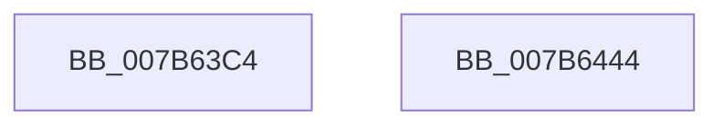

# EtwpEventWriteTemplateSessionMaxLoggers

- RVA: `0x007B63C4`–`0x007B6445` (길이 `129` bytes)
- VA: `0x00000001407B63C4`
- 실행 섹션: `PAGE`
- PDB 이름 있음: `예`; PDB Function 태그: `아니요`
- unwind 정보 RVA: `0x000D34A8`
- 디코드: `32`개 명령, `129/129` bytes 표시
- 미해석 바이트: `0` (있으면 어셈블리에 `.byte`로 보존)

> 이 문서는 커널 이미지의 기계어와 PDB 기호를 분석해 생성했습니다. 4번과 5번은 함수 원형과 자료형을 바이너리 사용 방식에서 추정한 C 해석이며 원본 소스 복구 결과는 아닙니다.

## 1. Dependencies

- 직접 호출 지점: **2**; 고유 호출 대상: **2**
- 직접 호출자로 확인된 함수: **1**
- RIP 상대 이미지 참조: **3**

### Outgoing calls
- `0x007B642D` → [EtwWrite](../../text/41/EtwWrite_function_0041C720.md) (function, `0x0041C720`)
- `0x007B6439` → [_security_check_cookie](../../text/6A/_security_check_cookie_function_006AC640.md) (function, `0x006AC640`)

### Direct callers
- [EtwpStartLogger](../A9/EtwpStartLogger_function_00A99D80.md) at `0x00A9A607`
- [EtwpStartLogger](../A9/EtwpStartLogger_function_00A99D80.md) at `0x00A9A6EE`

### Static image references
- `0x007B63D1` → RVA `0x00E0A740` (`.data`; read)
- `0x007B63F3` → RVA `0x000105E0` (`.rdata`; read)
- `0x007B6409` → RVA `0x00EFF840` (`.data`; read)

## 2. Other-region calls and transfers

- 다른 실행 섹션으로 향하는 call: **2**
  - `0x007B642D` → [EtwWrite](../../text/41/EtwWrite_function_0041C720.md) (`PAGE` → `.text`)
  - `0x007B6439` → [_security_check_cookie](../../text/6A/_security_check_cookie_function_006AC640.md) (`PAGE` → `.text`)
- 별도 외부 분기/꼬리 이동을 확인하지 못했습니다.

## 3. Assembly (complete function range)

```asm
007B63C4  44 89 4C 24 20                  mov dword ptr [rsp + 0x20], r9d
007B63C9  55                              push rbp
007B63CA  48 8B EC                        mov rbp, rsp
007B63CD  48 83 EC 70                     sub rsp, 0x70
007B63D1  48 8B 05 68 43 65 00            mov rax, qword ptr [rip + 0x654368]
007B63D8  48 33 C4                        xor rax, rsp
007B63DB  48 89 45 F0                     mov qword ptr [rbp - 0x10], rax
007B63DF  49 8B 40 08                     mov rax, qword ptr [r8 + 8]
007B63E3  33 C9                           xor ecx, ecx
007B63E5  48 89 45 C0                     mov qword ptr [rbp - 0x40], rax
007B63E9  41 0F B7 00                     movzx eax, word ptr [r8]
007B63ED  45 33 C0                        xor r8d, r8d
007B63F0  89 45 C8                        mov dword ptr [rbp - 0x38], eax
007B63F3  48 8D 05 E6 A1 85 FF            lea rax, [rip - 0x7a5e1a]
007B63FA  48 89 45 D0                     mov qword ptr [rbp - 0x30], rax
007B63FE  44 8D 49 03                     lea r9d, [rcx + 3]
007B6402  48 8D 45 28                     lea rax, [rbp + 0x28]
007B6406  89 4D CC                        mov dword ptr [rbp - 0x34], ecx
007B6409  48 8B 0D 30 94 74 00            mov rcx, qword ptr [rip + 0x749430]
007B6410  48 89 45 E0                     mov qword ptr [rbp - 0x20], rax
007B6414  48 8D 45 C0                     lea rax, [rbp - 0x40]
007B6418  48 89 44 24 20                  mov qword ptr [rsp + 0x20], rax
007B641D  48 C7 45 D8 02 00 00 00         mov qword ptr [rbp - 0x28], 2
007B6425  48 C7 45 E8 04 00 00 00         mov qword ptr [rbp - 0x18], 4
007B642D  E8 EE 62 C6 FF                  call 0x14041c720
007B6432  48 8B 4D F0                     mov rcx, qword ptr [rbp - 0x10]
007B6436  48 33 CC                        xor rcx, rsp
007B6439  E8 02 62 EF FF                  call 0x1406ac640
007B643E  48 83 C4 70                     add rsp, 0x70
007B6442  5D                              pop rbp
007B6443  C3                              ret
007B6444  CC                              int3
```

## 4. C-style interpretation (structured pseudocode)

```c
__int64 __fastcall EtwpEventWriteTemplateSessionMaxLoggers(int a1, __int64 a2, __int64 a3, int a4)
{
    __int64 result;
    __int64 v_rsp;
    unsigned __int64 v_stack_m18;
    unsigned __int64 v_stack_m20;
    unsigned __int64 v_stack_m28;
    unsigned __int64 v_stack_m30;
    unsigned __int64 v_stack_m38;
    unsigned int v_stack_m3C;
    unsigned int v_stack_m40;
    unsigned __int64 v_stack_m48;
    unsigned __int64 v_stack_m58;
    unsigned int v_stack_p20;

    v_stack_p20 = a4;
    v_rsp = (v_rsp) - (112);
    result = (*(unsigned __int64 *)(v_rip + 6636392)) ^ (v_rsp);
    v_stack_m18 = result;
    a1 = 0;
    v_stack_m48 = *(unsigned __int64 *)(a3 + 8);
    a3 = 0;
    v_stack_m40 = (unsigned int)(*(unsigned __int16 *)(a3));
    v_stack_m38 = v_rip - 8019482;
    v_stack_m3C = 0;
    v_stack_m28 = v_stack_p20;
    v_stack_m58 = v_stack_m48;
    v_stack_m30 = 2;
    v_stack_m20 = 4;
    result = EtwWrite(*(unsigned __int64 *)(v_rip + 7640112), a2, a3, a1 + 3);
    a1 = (v_stack_m18) ^ (v_rsp);
    result = _security_check_cookie(a1, a2, a3, a1 + 3);
    v_rsp = (v_rsp) + (112);
    return result;
}
```

## 5. (Beta) C Style

```c
int64_t EtwpEventWriteTemplateSessionMaxLoggers(int32_t Arg1, int64_t Arg2, void *Arg3, int32_t Arg4)
{
    uint8_t *arg3 = (uint8_t *)Arg3;

    int64_t result;
    int64_t local_rsp;
    uint64_t v_stack_m18;
    uint64_t v_stack_m20;
    uint64_t v_stack_m28;
    uint64_t v_stack_m30;
    uint64_t v_stack_m38;
    uint32_t v_stack_m3C;
    uint32_t v_stack_m40;
    uint64_t v_stack_m48;
    uint64_t v_stack_m58;
    uint32_t v_stack_p20;

    v_stack_p20 = Arg4;
    local_rsp = (local_rsp) - (112);
    result = (*(uint64_t *)(v_rip + 0x654368)) ^ (local_rsp);
    v_stack_m18 = result;
    Arg1 = 0;
    v_stack_m48 = *(uint64_t *)(arg3 + 0x8);
    Arg3 = 0;
    v_stack_m40 = (uint32_t)(*(uint16_t *)(arg3));
    v_stack_m38 = v_rip - 8019482;
    v_stack_m3C = 0;
    v_stack_m28 = v_stack_p20;
    v_stack_m58 = v_stack_m48;
    v_stack_m30 = 2;
    v_stack_m20 = 4;
    result = EtwWrite(*(uint64_t *)(v_rip + 0x749430), Arg2, Arg3, Arg1 + 3);
    Arg1 = (v_stack_m18) ^ (local_rsp);
    result = _security_check_cookie(Arg1, Arg2, Arg3, Arg1 + 3);
    local_rsp = (local_rsp) + (112);
    return result;
}
```

### 관측된 메모리 오프셋

구조체 형식이 확인되지 않은 접근은 인자 기준의 오프셋으로만 기록했습니다.

| 기준 인자 | 오프셋 표현 | 폭 (bit) | 접근 |
|---|---:|---:|---|
| `Arg3` | `+ 0x0` | `16` | `R` |
| `Arg3` | `+ 0x8` | `64` | `R` |

## 6. Execution-region graph

[열기: 2D/3D 그래프와 함수 탐색 컨트롤 패널](../../../control-panel.html?section=page&rva=0x007B63C4&view=graph)

- 2D 그래프는 위에서 아래로 흐르고, 3D 그래프는 빈 공간을 드래그해 회전합니다. Shift+드래그는 이동, 휠은 확대·축소, 함수 노드 선택은 대상 보고서 이동입니다.

### Static fallback


