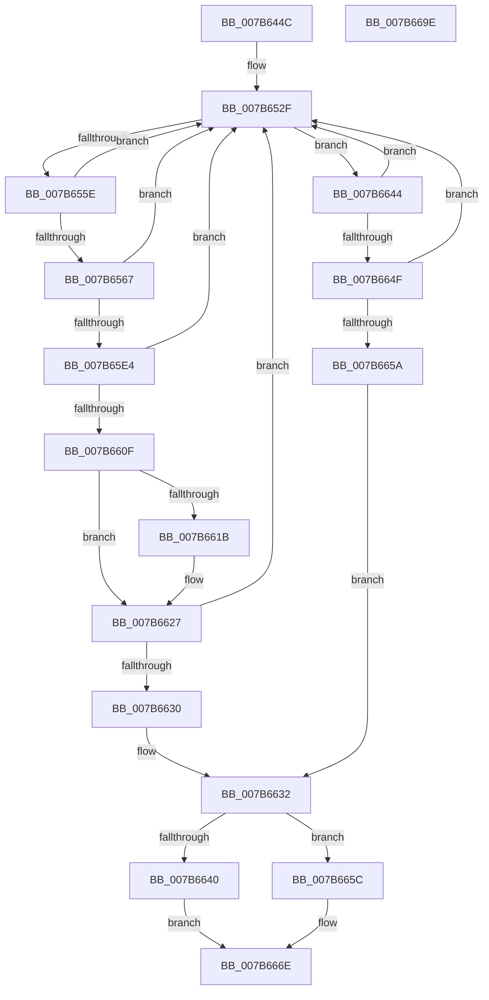

# EtwpFindMatchingPmcRegistryGroup

- RVA: `0x007B644C`–`0x007B669F` (길이 `595` bytes)
- VA: `0x00000001407B644C`
- 실행 섹션: `PAGE`
- PDB 이름 있음: `예`; PDB Function 태그: `아니요`
- unwind 정보 RVA: `0x000D3398`
- 디코드: `138`개 명령, `595/595` bytes 표시
- 미해석 바이트: `0` (있으면 어셈블리에 `.byte`로 보존)

> 이 문서는 커널 이미지의 기계어와 PDB 기호를 분석해 생성했습니다. 4번과 5번은 함수 원형과 자료형을 바이너리 사용 방식에서 추정한 C 해석이며 원본 소스 복구 결과는 아닙니다.

## 1. Dependencies

- 직접 호출 지점: **12**; 고유 호출 대상: **9**
- 직접 호출자로 확인된 함수: **2**
- RIP 상대 이미지 참조: **3**

### Outgoing calls
- `0x007B64A7` → [memset](../../text/6C/memset_function_006C6C40.md) (function, `0x006C6C40`)
- `0x007B64DB` → [RtlInitUnicodeString](../../text/42/RtlInitUnicodeString_function_0042A780.md) (function, `0x0042A780`)
- `0x007B6527` → [ZwCreateKey](../../text/6A/ZwCreateKey_function_006AD470.md) (function, `0x006AD470`)
- `0x007B6551` → [ZwEnumerateKey](../../text/6A/ZwEnumerateKey_function_006AD710.md) (function, `0x006AD710`)
- `0x007B6590` → [RtlStringCbPrintfW](../../text/40/RtlStringCbPrintfW_function_0040FB40.md) (function, `0x0040FB40`)
- `0x007B659D` → [RtlInitUnicodeString](../../text/42/RtlInitUnicodeString_function_0042A780.md) (function, `0x0042A780`)
- `0x007B65D7` → [ZwOpenKey](../../text/6A/ZwOpenKey_function_006AD310.md) (function, `0x006AD310`)
- `0x007B65F5` → [EtwpGetPmcCpuHierarchyRegistry](EtwpGetPmcCpuHierarchyRegistry_function_007B687C.md) (function, `0x007B687C`)
- `0x007B65FF` → [ZwClose](../../text/6A/ZwClose_function_006AD2B0.md) (function, `0x006AD2B0`)
- `0x007B6637` → [ZwClose](../../text/6A/ZwClose_function_006AD2B0.md) (function, `0x006AD2B0`)
- `0x007B6664` → [memset](../../text/6C/memset_function_006C6C40.md) (function, `0x006C6C40`)
- `0x007B6678` → [_security_check_cookie](../../text/6A/_security_check_cookie_function_006AC640.md) (function, `0x006AC640`)

### Direct callers
- [EtwpAddMicroarchitecturalPmcToRegistry](EtwpAddMicroarchitecturalPmcToRegistry_function_007B5558.md) at `0x007B5620`
- [EtwpRemoveMicroarchitecturalPmcFromRegistry](EtwpRemoveMicroarchitecturalPmcFromRegistry_function_007B7ACC.md) at `0x007B7B48`

### Static image references
- `0x007B6472` → RVA `0x00E0A740` (`.data`; read)
- `0x007B64B4` → RVA `0x00B07430` (` ?? ::NNGAKEGL::`string'`; read)
- `0x007B6574` → RVA `0x00B07420` (` ?? ::NNGAKEGL::`string'`; read)

## 2. Other-region calls and transfers

- 다른 실행 섹션으로 향하는 call: **11**
  - `0x007B64A7` → [memset](../../text/6C/memset_function_006C6C40.md) (`PAGE` → `.text`)
  - `0x007B64DB` → [RtlInitUnicodeString](../../text/42/RtlInitUnicodeString_function_0042A780.md) (`PAGE` → `.text`)
  - `0x007B6527` → [ZwCreateKey](../../text/6A/ZwCreateKey_function_006AD470.md) (`PAGE` → `.text`)
  - `0x007B6551` → [ZwEnumerateKey](../../text/6A/ZwEnumerateKey_function_006AD710.md) (`PAGE` → `.text`)
  - `0x007B6590` → [RtlStringCbPrintfW](../../text/40/RtlStringCbPrintfW_function_0040FB40.md) (`PAGE` → `.text`)
  - `0x007B659D` → [RtlInitUnicodeString](../../text/42/RtlInitUnicodeString_function_0042A780.md) (`PAGE` → `.text`)
  - `0x007B65D7` → [ZwOpenKey](../../text/6A/ZwOpenKey_function_006AD310.md) (`PAGE` → `.text`)
  - `0x007B65FF` → [ZwClose](../../text/6A/ZwClose_function_006AD2B0.md) (`PAGE` → `.text`)
  - `0x007B6637` → [ZwClose](../../text/6A/ZwClose_function_006AD2B0.md) (`PAGE` → `.text`)
  - `0x007B6664` → [memset](../../text/6C/memset_function_006C6C40.md) (`PAGE` → `.text`)
  - `0x007B6678` → [_security_check_cookie](../../text/6A/_security_check_cookie_function_006AC640.md) (`PAGE` → `.text`)
- 별도 외부 분기/꼬리 이동을 확인하지 못했습니다.

## 3. Assembly (complete function range)

```asm
007B644C  48 8B C4                        mov rax, rsp
007B644F  48 89 58 08                     mov qword ptr [rax + 8], rbx
007B6453  48 89 70 10                     mov qword ptr [rax + 0x10], rsi
007B6457  48 89 78 18                     mov qword ptr [rax + 0x18], rdi
007B645B  55                              push rbp
007B645C  41 54                           push r12
007B645E  41 55                           push r13
007B6460  41 56                           push r14
007B6462  41 57                           push r15
007B6464  48 8D A8 F8 FD FF FF            lea rbp, [rax - 0x208]
007B646B  48 81 EC E0 02 00 00            sub rsp, 0x2e0
007B6472  48 8B 05 C7 42 65 00            mov rax, qword ptr [rip + 0x6542c7]
007B6479  48 33 C4                        xor rax, rsp
007B647C  48 89 85 D0 01 00 00            mov qword ptr [rbp + 0x1d0], rax
007B6483  4C 8B B5 30 02 00 00            mov r14, qword ptr [rbp + 0x230]
007B648A  48 8D 4D A0                     lea rcx, [rbp - 0x60]
007B648E  49 8B F0                        mov rsi, r8
007B6491  45 8B F9                        mov r15d, r9d
007B6494  44 8B E2                        mov r12d, edx
007B6497  45 33 ED                        xor r13d, r13d
007B649A  33 D2                           xor edx, edx
007B649C  4C 89 6C 24 48                  mov qword ptr [rsp + 0x48], r13
007B64A1  41 B8 18 02 00 00               mov r8d, 0x218
007B64A7  E8 94 07 F1 FF                  call 0x1406c6c40
007B64AC  0F 57 C0                        xorps xmm0, xmm0
007B64AF  44 89 6C 24 6C                  mov dword ptr [rsp + 0x6c], r13d
007B64B4  48 8D 15 75 0F 35 00            lea rdx, [rip + 0x350f75]
007B64BB  44 89 6D 84                     mov dword ptr [rbp - 0x7c], r13d
007B64BF  48 8D 4C 24 58                  lea rcx, [rsp + 0x58]
007B64C4  44 89 6C 24 40                  mov dword ptr [rsp + 0x40], r13d
007B64C9  0F 11 44 24 58                  movups xmmword ptr [rsp + 0x58], xmm0
007B64CE  44 89 6C 24 44                  mov dword ptr [rsp + 0x44], r13d
007B64D3  41 8A DD                        mov bl, r13b
007B64D6  4C 89 6C 24 50                  mov qword ptr [rsp + 0x50], r13
007B64DB  E8 A0 42 C7 FF                  call 0x14042a780
007B64E0  48 8D 44 24 58                  lea rax, [rsp + 0x58]
007B64E5  4C 89 6C 24 30                  mov qword ptr [rsp + 0x30], r13
007B64EA  0F 57 C0                        xorps xmm0, xmm0
007B64ED  44 89 6C 24 28                  mov dword ptr [rsp + 0x28], r13d
007B64F2  45 33 C9                        xor r9d, r9d
007B64F5  48 89 44 24 78                  mov qword ptr [rsp + 0x78], rax
007B64FA  4C 8D 44 24 68                  lea r8, [rsp + 0x68]
007B64FF  C7 44 24 68 30 00 00 00         mov dword ptr [rsp + 0x68], 0x30
007B6507  BA 19 00 02 00                  mov edx, 0x20019
007B650C  4C 89 6C 24 70                  mov qword ptr [rsp + 0x70], r13
007B6511  48 8D 4C 24 50                  lea rcx, [rsp + 0x50]
007B6516  C7 45 80 40 02 00 00            mov dword ptr [rbp - 0x80], 0x240
007B651D  F3 0F 7F 45 88                  movdqu xmmword ptr [rbp - 0x78], xmm0
007B6522  4C 89 6C 24 20                  mov qword ptr [rsp + 0x20], r13
007B6527  E8 44 6F EF FF                  call 0x1406ad470
007B652C  83 CF FF                        or edi, 0xffffffff
007B652F  48 8B 4C 24 50                  mov rcx, qword ptr [rsp + 0x50]
007B6534  48 8D 44 24 44                  lea rax, [rsp + 0x44]
007B6539  48 89 44 24 28                  mov qword ptr [rsp + 0x28], rax
007B653E  4C 8D 4D A0                     lea r9, [rbp - 0x60]
007B6542  FF C7                           inc edi
007B6544  C7 44 24 20 16 02 00 00         mov dword ptr [rsp + 0x20], 0x216
007B654C  8B D7                           mov edx, edi
007B654E  45 33 C0                        xor r8d, r8d
007B6551  E8 BA 71 EF FF                  call 0x1406ad710
007B6556  85 C0                           test eax, eax
007B6558  0F 88 E6 00 00 00               js 0x1407b6644
007B655E  81 7D AC FF 00 00 00            cmp dword ptr [rbp - 0x54], 0xff
007B6565  73 C8                           jae 0x1407b652f
007B6567  8B 45 AC                        mov eax, dword ptr [rbp - 0x54]
007B656A  4C 8D 0D BF 0E 35 00            lea r9, [rip + 0x350ebf]
007B6571  48 D1 E8                        shr rax, 1
007B6574  4C 8D 05 A5 0E 35 00            lea r8, [rip + 0x350ea5]
007B657B  49 8B D7                        mov rdx, r15
007B657E  49 8B CE                        mov rcx, r14
007B6581  66 44 89 6C 45 B0               mov word ptr [rbp + rax*2 - 0x50], r13w
007B6587  48 8D 45 B0                     lea rax, [rbp - 0x50]
007B658B  48 89 44 24 20                  mov qword ptr [rsp + 0x20], rax
007B6590  E8 AB 95 C5 FF                  call 0x14040fb40
007B6595  49 8B D6                        mov rdx, r14
007B6598  48 8D 4C 24 58                  lea rcx, [rsp + 0x58]
007B659D  E8 DE 41 C7 FF                  call 0x14042a780
007B65A2  48 8D 44 24 58                  lea rax, [rsp + 0x58]
007B65A7  C7 44 24 68 30 00 00 00         mov dword ptr [rsp + 0x68], 0x30
007B65AF  0F 57 C0                        xorps xmm0, xmm0
007B65B2  48 89 44 24 78                  mov qword ptr [rsp + 0x78], rax
007B65B7  4C 8D 44 24 68                  lea r8, [rsp + 0x68]
007B65BC  4C 89 6C 24 70                  mov qword ptr [rsp + 0x70], r13
007B65C1  BA 19 00 02 00                  mov edx, 0x20019
007B65C6  C7 45 80 40 02 00 00            mov dword ptr [rbp - 0x80], 0x240
007B65CD  48 8D 4C 24 48                  lea rcx, [rsp + 0x48]
007B65D2  F3 0F 7F 45 88                  movdqu xmmword ptr [rbp - 0x78], xmm0
007B65D7  E8 34 6D EF FF                  call 0x1406ad310
007B65DC  85 C0                           test eax, eax
007B65DE  0F 88 4B FF FF FF               js 0x1407b652f
007B65E4  48 8B 4C 24 48                  mov rcx, qword ptr [rsp + 0x48]
007B65E9  4C 8D 85 C0 01 00 00            lea r8, [rbp + 0x1c0]
007B65F0  48 8D 54 24 40                  lea rdx, [rsp + 0x40]
007B65F5  E8 82 02 00 00                  call 0x1407b687c
007B65FA  48 8B 4C 24 48                  mov rcx, qword ptr [rsp + 0x48]
007B65FF  E8 AC 6C EF FF                  call 0x1406ad2b0
007B6604  44 39 64 24 40                  cmp dword ptr [rsp + 0x40], r12d
007B6609  0F 85 20 FF FF FF               jne 0x1407b652f
007B660F  48 8B 8D C0 01 00 00            mov rcx, qword ptr [rbp + 0x1c0]
007B6616  48 2B 0E                        sub rcx, qword ptr [rsi]
007B6619  75 0C                           jne 0x1407b6627
007B661B  8B 8D C8 01 00 00               mov ecx, dword ptr [rbp + 0x1c8]
007B6621  8B 46 08                        mov eax, dword ptr [rsi + 8]
007B6624  48 2B C8                        sub rcx, rax
007B6627  48 85 C9                        test rcx, rcx
007B662A  0F 85 FF FE FF FF               jne 0x1407b652f
007B6630  B3 01                           mov bl, 1
007B6632  48 8B 4C 24 50                  mov rcx, qword ptr [rsp + 0x50]
007B6637  E8 74 6C EF FF                  call 0x1406ad2b0
007B663C  84 DB                           test bl, bl
007B663E  74 1C                           je 0x1407b665c
007B6640  33 C0                           xor eax, eax
007B6642  EB 2A                           jmp 0x1407b666e
007B6644  3D 23 00 00 C0                  cmp eax, 0xc0000023
007B6649  0F 84 E0 FE FF FF               je 0x1407b652f
007B664F  3D 05 00 00 80                  cmp eax, 0x80000005
007B6654  0F 84 D5 FE FF FF               je 0x1407b652f
007B665A  EB D6                           jmp 0x1407b6632
007B665C  4D 8B C7                        mov r8, r15
007B665F  33 D2                           xor edx, edx
007B6661  49 8B CE                        mov rcx, r14
007B6664  E8 D7 05 F1 FF                  call 0x1406c6c40
007B6669  B8 01 00 00 C0                  mov eax, 0xc0000001
007B666E  48 8B 8D D0 01 00 00            mov rcx, qword ptr [rbp + 0x1d0]
007B6675  48 33 CC                        xor rcx, rsp
007B6678  E8 C3 5F EF FF                  call 0x1406ac640
007B667D  4C 8D 9C 24 E0 02 00 00         lea r11, [rsp + 0x2e0]
007B6685  49 8B 5B 30                     mov rbx, qword ptr [r11 + 0x30]
007B6689  49 8B 73 38                     mov rsi, qword ptr [r11 + 0x38]
007B668D  49 8B 7B 40                     mov rdi, qword ptr [r11 + 0x40]
007B6691  49 8B E3                        mov rsp, r11
007B6694  41 5F                           pop r15
007B6696  41 5E                           pop r14
007B6698  41 5D                           pop r13
007B669A  41 5C                           pop r12
007B669C  5D                              pop rbp
007B669D  C3                              ret
007B669E  CC                              int3
```

## 4. C-style interpretation (structured pseudocode)

```c
__int64 __fastcall EtwpFindMatchingPmcRegistryGroup(__int64 a1, int a2, __int64 a3, int a4)
{
    __int64 result;
    __int64 v_r13;
    __int64 v_rdi;
    __int64 v_rsp;
    unsigned __int64 v_stack_m28;
    unsigned __int64 v_stack_m290;
    unsigned __int64 v_stack_m298;
    unsigned int v_stack_m29C;
    unsigned __int64 v_stack_m2A0;
    unsigned __int64 v_stack_m2B0;
    unsigned __int64 v_stack_m2B8;
    unsigned __int64 v_stack_m2C0;
    unsigned int v_stack_m2C4;
    unsigned int v_stack_m2C8;
    unsigned __int64 v_stack_m2D8;
    unsigned int v_stack_m2E0;
    unsigned __int64 v_stack_m2E8;

    *(unsigned __int64 *)(v_rsp + 8) = v_rbx;
    *(unsigned __int64 *)(v_rsp + 16) = v_rsi;
    *(unsigned __int64 *)(v_rsp + 24) = v_rdi;
    v_rsp = (v_rsp) - (736);
    result = (*(unsigned __int64 *)(v_rip + 6636231)) ^ (v_rsp);
    *(unsigned __int64 *)(v_rsp - 520 + 464) = result;
    v_r13 = 0;
    a2 = 0;
    v_stack_m2C0 = 0;
    result = memset(v_rsp - 520 - 96, a2, 536, a4);
    v_stack_m29C = 0;
    *(unsigned int *)(v_rsp - 520 - 124) = 0;
    v_stack_m2C8 = 0;
    v_stack_m2B0 = v_xmm0;
    v_stack_m2C4 = 0;
    v_stack_m2B8 = 0;
    result = RtlInitUnicodeString(v_stack_m2B0, v_rip + 3477365, 536, a4);
    v_stack_m2D8 = 0;
    v_stack_m2E0 = 0;
    a4 = 0;
    v_stack_m290 = v_stack_m2B0;
    v_stack_m2A0 = 48;
    v_stack_m298 = 0;
    *(unsigned int *)(v_rsp - 520 - 128) = 576;
    *(unsigned __int64 *)(v_rsp - 520 - 120) = v_xmm0;
    v_stack_m2E8 = 0;
    result = ZwCreateKey(v_stack_m2B8, (unsigned int)(0x20019ULL), v_stack_m2A0, a4);
    v_rdi = (unsigned int)((v_rdi) | (0xFFFFFFFFULL));
loc_007B652F:
    v_stack_m2E0 = v_stack_m2C4;
    v_rdi = (unsigned int)((v_rdi) + 1);
    v_stack_m2E8 = 534;
    a3 = 0;
    result = ZwEnumerateKey(v_stack_m2B8, (unsigned int)((unsigned int)(v_rdi)), a3, v_rsp - 520 - 96);
    if (sign_flag) goto loc_007B6644;
    if ((*(unsigned int *)(v_rsp - 520 - 84)) >= 255) goto loc_007B652F;
    result = ((unsigned int)(*(unsigned int *)(v_rsp - 520 - 84))) >> (1);
    *(unsigned __int16 *)(v_rsp - 520 + result * 2 - 80) = 0;
    v_stack_m2E8 = v_rsp - 520 - 80;
    result = RtlStringCbPrintfW(*(unsigned __int64 *)(v_rsp - 520 + 560), (unsigned int)(a4), v_rip + 3477157, v_rip + 3477183);
    result = RtlInitUnicodeString(v_stack_m2B0, *(unsigned __int64 *)(v_rsp - 520 + 560), v_rip + 3477157, v_rip + 3477183);
    v_stack_m2A0 = 48;
    v_stack_m290 = v_stack_m2B0;
    v_stack_m298 = 0;
    *(unsigned int *)(v_rsp - 520 - 128) = 576;
    *(unsigned __int64 *)(v_rsp - 520 - 120) = v_xmm0;
    result = ZwOpenKey(v_stack_m2C0, (unsigned int)(0x20019ULL), v_stack_m2A0, v_rip + 3477183);
    if (sign_flag) goto loc_007B652F;
    result = EtwpGetPmcCpuHierarchyRegistry(v_stack_m2C0, v_stack_m2C8, v_rsp - 520 + 448, v_rip + 3477183);
    result = ZwClose(v_stack_m2C0, v_stack_m2C8, v_rsp - 520 + 448, v_rip + 3477183);
    if (v_stack_m2C8 != ((unsigned int)((unsigned int)(a2)))) goto loc_007B652F;
    a1 = (*(unsigned __int64 *)(v_rsp - 520 + 448)) - (*(unsigned __int64 *)(a3));
    if (!(condition_is_not_equal)) {
        a1 = *(unsigned int *)(v_rsp - 520 + 456);
        result = *(unsigned int *)(a3 + 8);
        a1 = (a1) - (result);
    }
    if (a1 != 0) goto loc_007B652F;
loc_007B6632:
    result = ZwClose(v_stack_m2B8, v_stack_m2C8, v_rsp - 520 + 448, v_rip + 3477183);
    if (1 == 0) goto loc_007B665C;
    result = 0;
    goto loc_007B666E;
loc_007B6644:
    if (0 == 0xC0000023ULL) goto loc_007B652F;
    if (0 == 0x80000005ULL) goto loc_007B652F;
    goto loc_007B6632;
loc_007B665C:
    a2 = 0;
    result = memset(*(unsigned __int64 *)(v_rsp - 520 + 560), a2, (unsigned int)(a4), v_rip + 3477183);
loc_007B666E:
    a1 = (*(unsigned __int64 *)(v_rsp - 520 + 464)) ^ (v_rsp);
    result = _security_check_cookie(a1, a2, (unsigned int)(a4), v_rip + 3477183);
    return result;
}
```

## 5. (Beta) C Style

```c
int64_t EtwpFindMatchingPmcRegistryGroup(int64_t Arg1, int32_t Arg2, void *Arg3, int32_t Arg4)
{
    uint8_t *arg3 = (uint8_t *)Arg3;

    int64_t result;
    int64_t local_r13;
    int64_t local_rdi;
    int64_t local_rsp;
    uint64_t v_stack_m28;
    uint64_t v_stack_m290;
    uint64_t v_stack_m298;
    uint32_t v_stack_m29C;
    uint64_t v_stack_m2A0;
    uint64_t v_stack_m2B0;
    uint64_t v_stack_m2B8;
    uint64_t v_stack_m2C0;
    uint32_t v_stack_m2C4;
    uint32_t v_stack_m2C8;
    uint64_t v_stack_m2D8;
    uint32_t v_stack_m2E0;
    uint64_t v_stack_m2E8;

    *(uint64_t *)(local_rsp + 0x8) = local_rbx;
    *(uint64_t *)(local_rsp + 0x10) = local_rsi;
    *(uint64_t *)(local_rsp + 0x18) = local_rdi;
    local_rsp = (local_rsp) - (736);
    result = (*(uint64_t *)(v_rip + 0x6542C7)) ^ (local_rsp);
    *(uint64_t *)(local_rsp - 0x208 + 0x1D0) = result;
    local_r13 = 0;
    Arg2 = 0;
    v_stack_m2C0 = 0;
    result = memset(local_rsp - 520 - 96, Arg2, 536, Arg4);
    v_stack_m29C = 0;
    *(uint32_t *)(local_rsp - 0x208 - 0x7C) = 0;
    v_stack_m2C8 = 0;
    v_stack_m2B0 = v_xmm0;
    v_stack_m2C4 = 0;
    v_stack_m2B8 = 0;
    result = RtlInitUnicodeString(v_stack_m2B0, v_rip + 3477365, 536, Arg4);
    v_stack_m2D8 = 0;
    v_stack_m2E0 = 0;
    Arg4 = 0;
    v_stack_m290 = v_stack_m2B0;
    v_stack_m2A0 = 48;
    v_stack_m298 = 0;
    *(uint32_t *)(local_rsp - 0x208 - 0x80) = 576;
    *(uint64_t *)(local_rsp - 0x208 - 0x78) = v_xmm0;
    v_stack_m2E8 = 0;
    result = ZwCreateKey(v_stack_m2B8, (uint32_t)(0x20019ULL), v_stack_m2A0, Arg4);
    local_rdi = (uint32_t)((local_rdi) | (0xFFFFFFFFULL));
loc_007B652F:
    v_stack_m2E0 = v_stack_m2C4;
    local_rdi = (uint32_t)((local_rdi) + 1);
    v_stack_m2E8 = 534;
    Arg3 = 0;
    result = ZwEnumerateKey(v_stack_m2B8, (uint32_t)((uint32_t)(local_rdi)), Arg3, local_rsp - 520 - 96);
    if (sign_flag) goto loc_007B6644;
    if ((*(uint32_t *)(local_rsp - 0x208 - 0x54)) >= 255) goto loc_007B652F;
    result = ((uint32_t)(*(uint32_t *)(local_rsp - 0x208 - 0x54))) >> (1);
    *(uint16_t *)(local_rsp - 0x208 + result * 2 - 0x50) = 0;
    v_stack_m2E8 = local_rsp - 520 - 80;
    result = RtlStringCbPrintfW(*(uint64_t *)(local_rsp - 0x208 + 0x230), (uint32_t)(Arg4), v_rip + 3477157, v_rip + 3477183);
    result = RtlInitUnicodeString(v_stack_m2B0, *(uint64_t *)(local_rsp - 0x208 + 0x230), v_rip + 3477157, v_rip + 3477183);
    v_stack_m2A0 = 48;
    v_stack_m290 = v_stack_m2B0;
    v_stack_m298 = 0;
    *(uint32_t *)(local_rsp - 0x208 - 0x80) = 576;
    *(uint64_t *)(local_rsp - 0x208 - 0x78) = v_xmm0;
    result = ZwOpenKey(v_stack_m2C0, (uint32_t)(0x20019ULL), v_stack_m2A0, v_rip + 3477183);
    if (sign_flag) goto loc_007B652F;
    result = EtwpGetPmcCpuHierarchyRegistry(v_stack_m2C0, v_stack_m2C8, local_rsp - 520 + 448, v_rip + 3477183);
    result = ZwClose(v_stack_m2C0, v_stack_m2C8, local_rsp - 520 + 448, v_rip + 3477183);
    if (v_stack_m2C8 != ((uint32_t)((uint32_t)(Arg2)))) goto loc_007B652F;
    Arg1 = (*(uint64_t *)(local_rsp - 0x208 + 0x1C0)) - (*(uint64_t *)(arg3));
    if (!(condition_is_not_equal)) {
        Arg1 = *(uint32_t *)(local_rsp - 0x208 + 0x1C8);
        result = *(uint32_t *)(arg3 + 0x8);
        Arg1 = (Arg1) - (result);
    }
    if (Arg1 != 0) goto loc_007B652F;
loc_007B6632:
    result = ZwClose(v_stack_m2B8, v_stack_m2C8, local_rsp - 520 + 448, v_rip + 3477183);
    if (1 == 0) goto loc_007B665C;
    result = 0;
    goto loc_007B666E;
loc_007B6644:
    if (0 == 0xC0000023ULL) goto loc_007B652F;
    if (0 == 0x80000005ULL) goto loc_007B652F;
    goto loc_007B6632;
loc_007B665C:
    Arg2 = 0;
    result = memset(*(uint64_t *)(local_rsp - 0x208 + 0x230), Arg2, (uint32_t)(Arg4), v_rip + 3477183);
loc_007B666E:
    Arg1 = (*(uint64_t *)(local_rsp - 0x208 + 0x1D0)) ^ (local_rsp);
    result = _security_check_cookie(Arg1, Arg2, (uint32_t)(Arg4), v_rip + 3477183);
    return result;
}
```

### 관측된 메모리 오프셋

구조체 형식이 확인되지 않은 접근은 인자 기준의 오프셋으로만 기록했습니다.

| 기준 인자 | 오프셋 표현 | 폭 (bit) | 접근 |
|---|---:|---:|---|
| `Arg3` | `+ 0x0` | `64` | `R` |
| `Arg3` | `+ 0x8` | `32` | `R` |

## 6. Execution-region graph

[열기: 2D/3D 그래프와 함수 탐색 컨트롤 패널](../../../control-panel.html?section=page&rva=0x007B644C&view=graph)

- 2D 그래프는 위에서 아래로 흐르고, 3D 그래프는 빈 공간을 드래그해 회전합니다. Shift+드래그는 이동, 휠은 확대·축소, 함수 노드 선택은 대상 보고서 이동입니다.

### Static fallback


