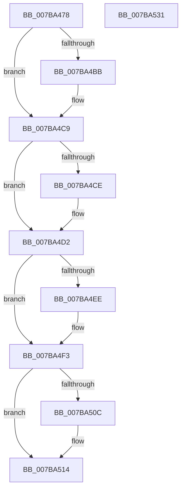

# EtwpFlushCoverage

- RVA: `0x007BA478`–`0x007BA532` (길이 `186` bytes)
- VA: `0x00000001407BA478`
- 실행 섹션: `PAGE`
- PDB 이름 있음: `예`; PDB Function 태그: `아니요`
- unwind 정보 RVA: `0x00060BC4`
- 디코드: `45`개 명령, `186/186` bytes 표시
- 미해석 바이트: `0` (있으면 어셈블리에 `.byte`로 보존)

> 이 문서는 커널 이미지의 기계어와 PDB 기호를 분석해 생성했습니다. 4번과 5번은 함수 원형과 자료형을 바이너리 사용 방식에서 추정한 C 해석이며 원본 소스 복구 결과는 아닙니다.

## 1. Dependencies

- 직접 호출 지점: **6**; 고유 호출 대상: **6**
- 직접 호출자로 확인된 함수: **1**
- RIP 상대 이미지 참조: **5**

### Outgoing calls
- `0x007BA4AB` → [KeAbPreAcquire](../../text/21/KeAbPreAcquire_function_00210230.md) (function, `0x00210230`)
- `0x007BA4C4` → [ExfAcquirePushLockExclusiveEx](../../text/20/ExfAcquirePushLockExclusiveEx_function_0020FC90.md) (function, `0x0020FC90`)
- `0x007BA4EE` → [EtwpCoverageFlushPending](../AB/EtwpCoverageFlushPending_function_00AB6700.md) (function, `0x00AB6700`)
- `0x007BA50F` → [ExfTryToWakePushLock](../../text/26/ExfTryToWakePushLock_function_00265DD0.md) (function, `0x00265DD0`)
- `0x007BA517` → [KeAbPostRelease](../../text/2E/KeAbPostRelease_function_002E1600.md) (function, `0x002E1600`)
- `0x007BA51C` → [KeLeaveCriticalRegion](../../text/25/KeLeaveCriticalRegion_function_0025D8B0.md) (function, `0x0025D8B0`)

### Direct callers
- [EtwShutdown](EtwShutdown_function_007B50B0.md) at `0x007B511C`

### Static image references
- `0x007BA490` → RVA `0x00EFF1B8` (`.data`; read)
- `0x007BA4DB` → RVA `0x00E684E8` (`.data`; read)
- `0x007BA4E2` → RVA `0x00E684E0` (`.data`; write)
- `0x007BA4F3` → RVA `0x00E684E0` (`.data`; read/write)
- `0x007BA4FB` → RVA `0x00EFF1B8` (`.data`; read/write)

## 2. Other-region calls and transfers

- 다른 실행 섹션으로 향하는 call: **5**
  - `0x007BA4AB` → [KeAbPreAcquire](../../text/21/KeAbPreAcquire_function_00210230.md) (`PAGE` → `.text`)
  - `0x007BA4C4` → [ExfAcquirePushLockExclusiveEx](../../text/20/ExfAcquirePushLockExclusiveEx_function_0020FC90.md) (`PAGE` → `.text`)
  - `0x007BA50F` → [ExfTryToWakePushLock](../../text/26/ExfTryToWakePushLock_function_00265DD0.md) (`PAGE` → `.text`)
  - `0x007BA517` → [KeAbPostRelease](../../text/2E/KeAbPostRelease_function_002E1600.md) (`PAGE` → `.text`)
  - `0x007BA51C` → [KeLeaveCriticalRegion](../../text/25/KeLeaveCriticalRegion_function_0025D8B0.md) (`PAGE` → `.text`)
- 별도 외부 분기/꼬리 이동을 확인하지 못했습니다.

## 3. Assembly (complete function range)

```asm
007BA478  48 89 5C 24 08                  mov qword ptr [rsp + 8], rbx
007BA47D  48 89 74 24 10                  mov qword ptr [rsp + 0x10], rsi
007BA482  57                              push rdi
007BA483  48 83 EC 20                     sub rsp, 0x20
007BA487  65 48 8B 04 25 88 01 00 00      mov rax, qword ptr gs:[0x188]
007BA490  48 8D 35 21 4D 74 00            lea rsi, [rip + 0x744d21]
007BA497  48 83 CB FF                     or rbx, 0xffffffffffffffff
007BA49B  45 33 C0                        xor r8d, r8d
007BA49E  33 D2                           xor edx, edx
007BA4A0  48 8B CE                        mov rcx, rsi
007BA4A3  66 01 98 E4 01 00 00            add word ptr [rax + 0x1e4], bx
007BA4AA  90                              nop
007BA4AB  E8 80 5D A5 FF                  call 0x140210230
007BA4B0  F0 48 0F BA 2E 00               lock bts qword ptr [rsi], 0
007BA4B6  48 8B F8                        mov rdi, rax
007BA4B9  73 0E                           jae 0x1407ba4c9
007BA4BB  4C 8B C6                        mov r8, rsi
007BA4BE  48 8B D0                        mov rdx, rax
007BA4C1  48 8B CE                        mov rcx, rsi
007BA4C4  E8 C7 57 A5 FF                  call 0x14020fc90
007BA4C9  48 85 FF                        test rdi, rdi
007BA4CC  74 04                           je 0x1407ba4d2
007BA4CE  C6 47 0A 01                     mov byte ptr [rdi + 0xa], 1
007BA4D2  65 48 8B 04 25 88 01 00 00      mov rax, qword ptr gs:[0x188]
007BA4DB  48 8B 0D 06 E0 6A 00            mov rcx, qword ptr [rip + 0x6ae006]
007BA4E2  48 89 05 F7 DF 6A 00            mov qword ptr [rip + 0x6adff7], rax
007BA4E9  48 85 C9                        test rcx, rcx
007BA4EC  74 05                           je 0x1407ba4f3
007BA4EE  E8 0D C2 2F 00                  call 0x140ab6700
007BA4F3  48 83 25 E5 DF 6A 00 00         and qword ptr [rip + 0x6adfe5], 0
007BA4FB  F0 48 0F C1 1D B4 4C 74 00      lock xadd qword ptr [rip + 0x744cb4], rbx
007BA504  80 E3 06                        and bl, 6
007BA507  80 FB 02                        cmp bl, 2
007BA50A  75 08                           jne 0x1407ba514
007BA50C  48 8B CE                        mov rcx, rsi
007BA50F  E8 BC B8 AA FF                  call 0x140265dd0
007BA514  48 8B CE                        mov rcx, rsi
007BA517  E8 E4 70 B2 FF                  call 0x1402e1600
007BA51C  E8 8F 33 AA FF                  call 0x14025d8b0
007BA521  48 8B 5C 24 30                  mov rbx, qword ptr [rsp + 0x30]
007BA526  48 8B 74 24 38                  mov rsi, qword ptr [rsp + 0x38]
007BA52B  48 83 C4 20                     add rsp, 0x20
007BA52F  5F                              pop rdi
007BA530  C3                              ret
007BA531  CC                              int3
```

## 4. C-style interpretation (structured pseudocode)

```c
__int64 __fastcall EtwpFlushCoverage(__int64 a1, int a2, int a3)
{
    __int64 result;
    __int64 v_rbx;
    __int64 v_rsp;
    unsigned __int64 v_stack_p10;
    unsigned __int64 v_stack_p8;

    v_stack_p8 = v_rbx;
    v_stack_p10 = v_rsi;
    v_rsp = (v_rsp) - (32);
    v_rbx = (v_rbx) | (-1);
    a3 = 0;
    a2 = 0;
    result = KeAbPreAcquire(v_rip + 7621921, a2, a3, a4);
    if (!(condition_is_above_or_equal)) {
        a3 = v_rip + 7621921;
        a2 = result;
        a1 = v_rip + 7621921;
        result = ExfAcquirePushLockExclusiveEx(a1, a2, a3, a4);
    }
    if (result != 0) {
        *(unsigned __int8 *)(result + 10) = 1;
    }
    *(unsigned __int64 *)(v_rip + 7004151) = *(unsigned __int64 *)(gs_base + (0 + 392));
    result = *(unsigned __int64 *)(gs_base + (0 + 392));
    if (*(unsigned __int64 *)(v_rip + 7004166) != 0) {
        result = EtwpCoverageFlushPending(*(unsigned __int64 *)(v_rip + 7004166), a2, a3, a4);
    }
    v_rbx = (unsigned __int8)((v_rbx) & (6));
    if (((unsigned __int8)(v_rbx)) == 2) {
        a1 = v_rip + 7621921;
        result = ExfTryToWakePushLock(a1, a2, a3, a4);
    }
    result = KeAbPostRelease(v_rip + 7621921, a2, a3, a4);
    result = KeLeaveCriticalRegion(v_rip + 7621921, a2, a3, a4);
    v_rsp = (v_rsp) + (32);
    return result;
}
```

## 5. (Beta) C Style

```c
int64_t EtwpFlushCoverage(int64_t Arg1, int32_t Arg2, int32_t Arg3)
{
    int64_t result;
    int64_t local_rbx;
    int64_t local_rsp;
    uint64_t v_stack_p10;
    uint64_t v_stack_p8;

    v_stack_p8 = local_rbx;
    v_stack_p10 = local_rsi;
    local_rsp = (local_rsp) - (32);
    local_rbx = (local_rbx) | (-1);
    Arg3 = 0;
    Arg2 = 0;
    result = KeAbPreAcquire(v_rip + 7621921, Arg2, Arg3, a4);
    if (!(condition_is_above_or_equal)) {
        Arg3 = v_rip + 7621921;
        Arg2 = result;
        Arg1 = v_rip + 7621921;
        result = ExfAcquirePushLockExclusiveEx(Arg1, Arg2, Arg3, a4);
    }
    if (result != 0) {
        *(uint8_t *)(result + 0xA) = 1;
    }
    *(uint64_t *)(v_rip + 0x6ADFF7) = *(uint64_t *)(gs_base + (0 + 0x188));
    result = *(uint64_t *)(gs_base + (0 + 0x188));
    if (*(uint64_t *)(v_rip + 0x6AE006) != 0) {
        result = EtwpCoverageFlushPending(*(uint64_t *)(v_rip + 0x6AE006), Arg2, Arg3, a4);
    }
    local_rbx = (uint8_t)((local_rbx) & (6));
    if (((uint8_t)(local_rbx)) == 2) {
        Arg1 = v_rip + 7621921;
        result = ExfTryToWakePushLock(Arg1, Arg2, Arg3, a4);
    }
    result = KeAbPostRelease(v_rip + 7621921, Arg2, Arg3, a4);
    result = KeLeaveCriticalRegion(v_rip + 7621921, Arg2, Arg3, a4);
    local_rsp = (local_rsp) + (32);
    return result;
}
```

## 6. Execution-region graph

[열기: 2D/3D 그래프와 함수 탐색 컨트롤 패널](../../../control-panel.html?section=page&rva=0x007BA478&view=graph)

- 2D 그래프는 위에서 아래로 흐르고, 3D 그래프는 빈 공간을 드래그해 회전합니다. Shift+드래그는 이동, 휠은 확대·축소, 함수 노드 선택은 대상 보고서 이동입니다.

### Static fallback


