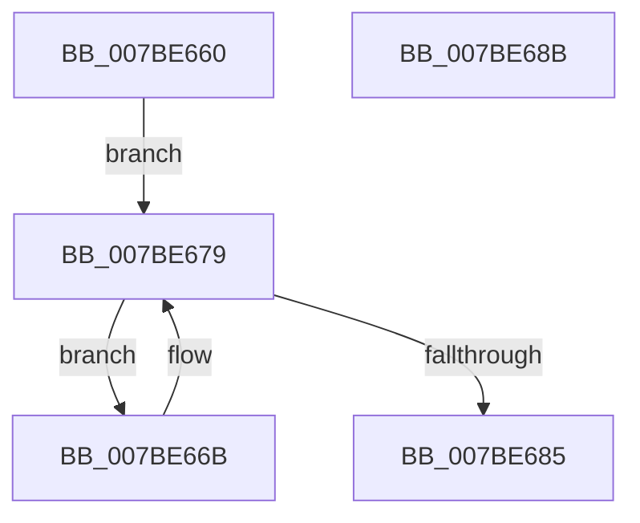

# EtwpFreeKeyNameList

- RVA: `0x007BE660`–`0x007BE68C` (길이 `44` bytes)
- VA: `0x00000001407BE660`
- 실행 섹션: `PAGE`
- PDB 이름 있음: `예`; PDB Function 태그: `아니요`
- unwind 정보 RVA: `0x0005CF00`
- 디코드: `16`개 명령, `44/44` bytes 표시
- 미해석 바이트: `0` (있으면 어셈블리에 `.byte`로 보존)

> 이 문서는 커널 이미지의 기계어와 PDB 기호를 분석해 생성했습니다. 4번과 5번은 함수 원형과 자료형을 바이너리 사용 방식에서 추정한 C 해석이며 원본 소스 복구 결과는 아닙니다.

## 1. Dependencies

- 직접 호출 지점: **2**; 고유 호출 대상: **2**
- 직접 호출자로 확인된 함수: **2**
- RIP 상대 이미지 참조: **0**

### Outgoing calls
- `0x007BE671` → [RtlDeleteElementGenericTableAvl](../../text/3E/RtlDeleteElementGenericTableAvl_function_003EE750.md) (function, `0x003EE750`)
- `0x007BE67B` → [RtlEnumerateGenericTableAvl](../../text/3E/RtlEnumerateGenericTableAvl_function_003E5AB0.md) (function, `0x003E5AB0`)

### Direct callers
- [EtwpEnableKeyProviders](EtwpEnableKeyProviders_function_007BE28C.md) at `0x007BE36B`
- [EtwpInitializeAutoLoggers](EtwpInitializeAutoLoggers_function_007BE694.md) at `0x007BE936`

### Static image references
- 디코드된 RIP-relative 메모리 참조가 없습니다.

## 2. Other-region calls and transfers

- 다른 실행 섹션으로 향하는 call: **2**
  - `0x007BE671` → [RtlDeleteElementGenericTableAvl](../../text/3E/RtlDeleteElementGenericTableAvl_function_003EE750.md) (`PAGE` → `.text`)
  - `0x007BE67B` → [RtlEnumerateGenericTableAvl](../../text/3E/RtlEnumerateGenericTableAvl_function_003E5AB0.md) (`PAGE` → `.text`)
- 별도 외부 분기/꼬리 이동을 확인하지 못했습니다.

## 3. Assembly (complete function range)

```asm
007BE660  40 53                           push rbx
007BE662  48 83 EC 20                     sub rsp, 0x20
007BE666  48 8B D9                        mov rbx, rcx
007BE669  EB 0E                           jmp 0x1407be679
007BE66B  48 8B D0                        mov rdx, rax
007BE66E  48 8B CB                        mov rcx, rbx
007BE671  E8 DA 00 C3 FF                  call 0x1403ee750
007BE676  48 8B CB                        mov rcx, rbx
007BE679  B2 01                           mov dl, 1
007BE67B  E8 30 74 C2 FF                  call 0x1403e5ab0
007BE680  48 85 C0                        test rax, rax
007BE683  75 E6                           jne 0x1407be66b
007BE685  48 83 C4 20                     add rsp, 0x20
007BE689  5B                              pop rbx
007BE68A  C3                              ret
007BE68B  CC                              int3
```

## 4. C-style interpretation (structured pseudocode)

```c
__int64 __fastcall EtwpFreeKeyNameList(__int64 a1)
{
    __int64 result;
    __int64 v_rsp;

    v_rsp = (v_rsp) - (32);
    goto loc_007BE679;
loc_007BE66B:
    result = RtlDeleteElementGenericTableAvl(a1, result, a3, a4);
loc_007BE679:
    result = RtlEnumerateGenericTableAvl(a1, 1, a3, a4);
    if (result != 0) goto loc_007BE66B;
    v_rsp = (v_rsp) + (32);
    return result;
}
```

## 5. (Beta) C Style

```c
int64_t EtwpFreeKeyNameList(int64_t Arg1)
{
    int64_t result;
    int64_t local_rsp;

    local_rsp = (local_rsp) - (32);
    goto loc_007BE679;
loc_007BE66B:
    result = RtlDeleteElementGenericTableAvl(Arg1, result, a3, a4);
loc_007BE679:
    result = RtlEnumerateGenericTableAvl(Arg1, 1, a3, a4);
    if (result != 0) goto loc_007BE66B;
    local_rsp = (local_rsp) + (32);
    return result;
}
```

## 6. Execution-region graph

[열기: 2D/3D 그래프와 함수 탐색 컨트롤 패널](../../../control-panel.html?section=page&rva=0x007BE660&view=graph)

- 2D 그래프는 위에서 아래로 흐르고, 3D 그래프는 빈 공간을 드래그해 회전합니다. Shift+드래그는 이동, 휠은 확대·축소, 함수 노드 선택은 대상 보고서 이동입니다.

### Static fallback


