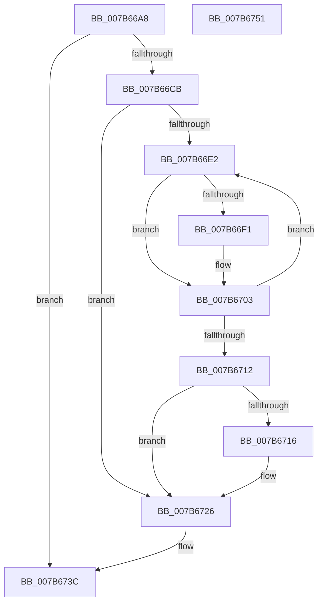

# EtwpFreePfnArray

- RVA: `0x007B66A8`–`0x007B6752` (길이 `170` bytes)
- VA: `0x00000001407B66A8`
- 실행 섹션: `PAGE`
- PDB 이름 있음: `예`; PDB Function 태그: `아니요`
- unwind 정보 RVA: `0x0005C954`
- 디코드: `47`개 명령, `170/170` bytes 표시
- 미해석 바이트: `0` (있으면 어셈블리에 `.byte`로 보존)

> 이 문서는 커널 이미지의 기계어와 PDB 기호를 분석해 생성했습니다. 4번과 5번은 함수 원형과 자료형을 바이너리 사용 방식에서 추정한 C 해석이며 원본 소스 복구 결과는 아닙니다.

## 1. Dependencies

- 직접 호출 지점: **5**; 고유 호출 대상: **3**
- 직접 호출자로 확인된 함수: **2**
- RIP 상대 이미지 참조: **0**

### Outgoing calls
- `0x007B66F7` → [EtwpMdlInit](EtwpMdlInit_function_007B7680.md) (function, `0x007B7680`)
- `0x007B66FC` → [MmFreePagesFromMdl](../../text/3F/MmFreePagesFromMdl_function_003F82E0.md) (function, `0x003F82E0`)
- `0x007B671C` → [EtwpMdlInit](EtwpMdlInit_function_007B7680.md) (function, `0x007B7680`)
- `0x007B6721` → [MmFreePagesFromMdl](../../text/3F/MmFreePagesFromMdl_function_003F82E0.md) (function, `0x003F82E0`)
- `0x007B672F` → [ExFreePoolWithTag](../../poolcode/B8/ExFreePoolWithTag_function_00B82870.md) (function, `0x00B82870`)

### Direct callers
- [EtwpAllocateTraceBufferPool](../A7/EtwpAllocateTraceBufferPool_function_00A74750.md) at `0x00A74882`
- [EtwpAllocatePhysicalMemoryForTraceBuffers](../A7/EtwpAllocatePhysicalMemoryForTraceBuffers_function_00A74920.md) at `0x00A749C3`

### Static image references
- 디코드된 RIP-relative 메모리 참조가 없습니다.

## 2. Other-region calls and transfers

- 다른 실행 섹션으로 향하는 call: **3**
  - `0x007B66FC` → [MmFreePagesFromMdl](../../text/3F/MmFreePagesFromMdl_function_003F82E0.md) (`PAGE` → `.text`)
  - `0x007B6721` → [MmFreePagesFromMdl](../../text/3F/MmFreePagesFromMdl_function_003F82E0.md) (`PAGE` → `.text`)
  - `0x007B672F` → [ExFreePoolWithTag](../../poolcode/B8/ExFreePoolWithTag_function_00B82870.md) (`PAGE` → `POOLCODE`)
- 별도 외부 분기/꼬리 이동을 확인하지 못했습니다.

## 3. Assembly (complete function range)

```asm
007B66A8  48 89 5C 24 08                  mov qword ptr [rsp + 8], rbx
007B66AD  48 89 6C 24 10                  mov qword ptr [rsp + 0x10], rbp
007B66B2  48 89 74 24 18                  mov qword ptr [rsp + 0x18], rsi
007B66B7  57                              push rdi
007B66B8  48 83 EC 20                     sub rsp, 0x20
007B66BC  48 8B 81 50 06 00 00            mov rax, qword ptr [rcx + 0x650]
007B66C3  48 8B D9                        mov rbx, rcx
007B66C6  48 85 C0                        test rax, rax
007B66C9  74 71                           je 0x1407b673c
007B66CB  8B 69 04                        mov ebp, dword ptr [rcx + 4]
007B66CE  33 D2                           xor edx, edx
007B66D0  48 8B B9 48 06 00 00            mov rdi, qword ptr [rcx + 0x648]
007B66D7  C1 ED 0C                        shr ebp, 0xc
007B66DA  8D 72 01                        lea esi, [rdx + 1]
007B66DD  48 39 30                        cmp qword ptr [rax], rsi
007B66E0  72 44                           jb 0x1407b6726
007B66E2  48 8B 04 F0                     mov rax, qword ptr [rax + rsi*8]
007B66E6  48 89 44 D7 30                  mov qword ptr [rdi + rdx*8 + 0x30], rax
007B66EB  FF C2                           inc edx
007B66ED  3B D5                           cmp edx, ebp
007B66EF  72 12                           jb 0x1407b6703
007B66F1  45 33 C0                        xor r8d, r8d
007B66F4  48 8B CF                        mov rcx, rdi
007B66F7  E8 84 0F 00 00                  call 0x1407b7680
007B66FC  E8 DF 1B C4 FF                  call 0x1403f82e0
007B6701  33 D2                           xor edx, edx
007B6703  48 8B 83 50 06 00 00            mov rax, qword ptr [rbx + 0x650]
007B670A  48 FF C6                        inc rsi
007B670D  48 3B 30                        cmp rsi, qword ptr [rax]
007B6710  76 D0                           jbe 0x1407b66e2
007B6712  85 D2                           test edx, edx
007B6714  74 10                           je 0x1407b6726
007B6716  45 33 C0                        xor r8d, r8d
007B6719  48 8B CF                        mov rcx, rdi
007B671C  E8 5F 0F 00 00                  call 0x1407b7680
007B6721  E8 BA 1B C4 FF                  call 0x1403f82e0
007B6726  48 8B 8B 50 06 00 00            mov rcx, qword ptr [rbx + 0x650]
007B672D  33 D2                           xor edx, edx
007B672F  E8 3C C1 3C 00                  call 0x140b82870
007B6734  48 83 A3 50 06 00 00 00         and qword ptr [rbx + 0x650], 0
007B673C  48 8B 5C 24 30                  mov rbx, qword ptr [rsp + 0x30]
007B6741  48 8B 6C 24 38                  mov rbp, qword ptr [rsp + 0x38]
007B6746  48 8B 74 24 40                  mov rsi, qword ptr [rsp + 0x40]
007B674B  48 83 C4 20                     add rsp, 0x20
007B674F  5F                              pop rdi
007B6750  C3                              ret
007B6751  CC                              int3
```

## 4. C-style interpretation (structured pseudocode)

```c
__int64 __fastcall EtwpFreePfnArray(__int64 a1, int a2, int a3)
{
    __int64 result;
    __int64 v_rbp;
    __int64 v_rsi;
    __int64 v_rsp;
    unsigned __int64 v_stack_p10;
    unsigned __int64 v_stack_p18;
    unsigned __int64 v_stack_p8;

    v_stack_p8 = v_rbx;
    v_stack_p10 = v_rbp;
    v_stack_p18 = v_rsi;
    v_rsp = (v_rsp) - (32);
    if (*(unsigned __int64 *)(a1 + 1616) == 0) goto loc_007B673C;
    a2 = 0;
    v_rbp = (unsigned int)(((unsigned int)(*(unsigned int *)(a1 + 4))) >> (12));
    if ((*(unsigned __int64 *)(*(unsigned __int64 *)(a1 + 1616))) < (a2 + 1)) goto loc_007B6726;
loc_007B66E2:
    *(unsigned __int64 *)(*(unsigned __int64 *)(a1 + 1608) + a2 * 8 + 48) = *(unsigned __int64 *)(*(unsigned __int64 *)(a1 + 1616) + a2 + 1 * 8);
    a2 = (unsigned int)((a2) + 1);
    result = *(unsigned __int64 *)(*(unsigned __int64 *)(a1 + 1616) + a2 + 1 * 8);
    if (a2 >= ((unsigned int)(v_rbp))) {
        a3 = 0;
        a1 = *(unsigned __int64 *)(a1 + 1608);
        result = EtwpMdlInit(a1, a2, a3, a4);
        result = MmFreePagesFromMdl(a1, a2, a3, a4);
        a2 = 0;
    }
    v_rsi = (a2 + 1) + 1;
    if (v_rsi <= (*(unsigned __int64 *)(*(unsigned __int64 *)(a1 + 1616)))) goto loc_007B66E2;
    result = *(unsigned __int64 *)(a1 + 1616);
    if (0 != 0) {
        a3 = 0;
        a1 = *(unsigned __int64 *)(a1 + 1608);
        result = EtwpMdlInit(a1, a2, a3, a4);
        result = MmFreePagesFromMdl(a1, a2, a3, a4);
    }
    a2 = 0;
    result = ExFreePoolWithTag(*(unsigned __int64 *)(a1 + 1616), a2, a3, a4);
loc_007B673C:
    v_rsp = (v_rsp) + (32);
    return result;
}
```

## 5. (Beta) C Style

```c
int64_t EtwpFreePfnArray(void *Arg1, int32_t Arg2, int32_t Arg3)
{
    uint8_t *arg1 = (uint8_t *)Arg1;

    int64_t result;
    int64_t local_rbp;
    int64_t local_rsi;
    int64_t local_rsp;
    uint64_t v_stack_p10;
    uint64_t v_stack_p18;
    uint64_t v_stack_p8;

    v_stack_p8 = local_rbx;
    v_stack_p10 = local_rbp;
    v_stack_p18 = local_rsi;
    local_rsp = (local_rsp) - (32);
    if (*(uint64_t *)(arg1 + 0x650) == 0) goto loc_007B673C;
    Arg2 = 0;
    local_rbp = (uint32_t)(((uint32_t)(*(uint32_t *)(arg1 + 0x4))) >> (12));
    if ((*(uint64_t *)(*(uint64_t *)(arg1 + 0x650))) < (Arg2 + 1)) goto loc_007B6726;
loc_007B66E2:
    *(uint64_t *)(*(uint64_t *)(arg1 + 0x648) + Arg2 * 8 + 0x30) = *(uint64_t *)(*(uint64_t *)(arg1 + 0x650) + Arg2 + 0x1 * 8);
    Arg2 = (uint32_t)((Arg2) + 1);
    result = *(uint64_t *)(*(uint64_t *)(arg1 + 0x650) + Arg2 + 0x1 * 8);
    if (Arg2 >= ((uint32_t)(local_rbp))) {
        Arg3 = 0;
        Arg1 = *(uint64_t *)(arg1 + 0x648);
        result = EtwpMdlInit(Arg1, Arg2, Arg3, a4);
        result = MmFreePagesFromMdl(Arg1, Arg2, Arg3, a4);
        Arg2 = 0;
    }
    local_rsi = (Arg2 + 1) + 1;
    if (local_rsi <= (*(uint64_t *)(*(uint64_t *)(arg1 + 0x650)))) goto loc_007B66E2;
    result = *(uint64_t *)(arg1 + 0x650);
    if (0 != 0) {
        Arg3 = 0;
        Arg1 = *(uint64_t *)(arg1 + 0x648);
        result = EtwpMdlInit(Arg1, Arg2, Arg3, a4);
        result = MmFreePagesFromMdl(Arg1, Arg2, Arg3, a4);
    }
    Arg2 = 0;
    result = ExFreePoolWithTag(*(uint64_t *)(arg1 + 0x650), Arg2, Arg3, a4);
loc_007B673C:
    local_rsp = (local_rsp) + (32);
    return result;
}
```

### 관측된 메모리 오프셋

구조체 형식이 확인되지 않은 접근은 인자 기준의 오프셋으로만 기록했습니다.

| 기준 인자 | 오프셋 표현 | 폭 (bit) | 접근 |
|---|---:|---:|---|
| `Arg1` | `+ 0x4` | `32` | `R` |
| `Arg1` | `+ 0x648` | `64` | `R` |
| `Arg1` | `+ 0x650` | `64` | `R` |
| `Arg1` | `+ 0x650` | `64` | `R/W` |

## 6. Execution-region graph

[열기: 2D/3D 그래프와 함수 탐색 컨트롤 패널](../../../control-panel.html?section=page&rva=0x007B66A8&view=graph)

- 2D 그래프는 위에서 아래로 흐르고, 3D 그래프는 빈 공간을 드래그해 회전합니다. Shift+드래그는 이동, 휠은 확대·축소, 함수 노드 선택은 대상 보고서 이동입니다.

### Static fallback


