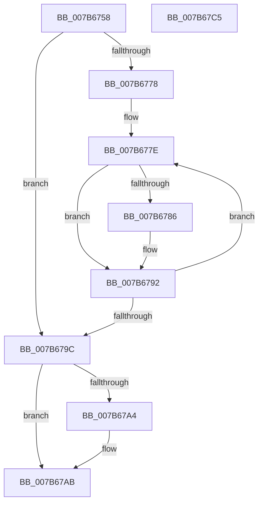

# EtwpFreePmcData

- RVA: `0x007B6758`–`0x007B67C6` (길이 `110` bytes)
- VA: `0x00000001407B6758`
- 실행 섹션: `PAGE`
- PDB 이름 있음: `예`; PDB Function 태그: `아니요`
- unwind 정보 RVA: `0x00060BC4`
- 디코드: `32`개 명령, `110/110` bytes 표시
- 미해석 바이트: `0` (있으면 어셈블리에 `.byte`로 보존)

> 이 문서는 커널 이미지의 기계어와 PDB 기호를 분석해 생성했습니다. 4번과 5번은 함수 원형과 자료형을 바이너리 사용 방식에서 추정한 C 해석이며 원본 소스 복구 결과는 아닙니다.

## 1. Dependencies

- 직접 호출 지점: **3**; 고유 호출 대상: **2**
- 직접 호출자로 확인된 함수: **1**
- RIP 상대 이미지 참조: **2**

### Outgoing calls
- `0x007B678D` → [guard_dispatch_icall](../../text/6B/guard_dispatch_icall_function_006BAAD0.md) (function, `0x006BAAD0`)
- `0x007B67A6` → [ExFreePoolWithTag](../../poolcode/B8/ExFreePoolWithTag_function_00B82870.md) (function, `0x00B82870`)
- `0x007B67B0` → [ExFreePoolWithTag](../../poolcode/B8/ExFreePoolWithTag_function_00B82870.md) (function, `0x00B82870`)

### Direct callers
- [EtwpFreeLoggerContext](../9C/EtwpFreeLoggerContext_function_009C1688.md) at `0x009C19FC`

### Static image references
- `0x007B6767` → RVA `0x00FC6A80` (`ALMOSTRO`; read)
- `0x007B6786` → RVA `0x00E00A40` (`.data`; read)

## 2. Other-region calls and transfers

- 다른 실행 섹션으로 향하는 call: **3**
  - `0x007B678D` → [guard_dispatch_icall](../../text/6B/guard_dispatch_icall_function_006BAAD0.md) (`PAGE` → `.text`)
  - `0x007B67A6` → [ExFreePoolWithTag](../../poolcode/B8/ExFreePoolWithTag_function_00B82870.md) (`PAGE` → `POOLCODE`)
  - `0x007B67B0` → [ExFreePoolWithTag](../../poolcode/B8/ExFreePoolWithTag_function_00B82870.md) (`PAGE` → `POOLCODE`)
- 별도 외부 분기/꼬리 이동을 확인하지 못했습니다.

## 3. Assembly (complete function range)

```asm
007B6758  48 89 5C 24 08                  mov qword ptr [rsp + 8], rbx
007B675D  48 89 74 24 10                  mov qword ptr [rsp + 0x10], rsi
007B6762  57                              push rdi
007B6763  48 83 EC 20                     sub rsp, 0x20
007B6767  8B 05 13 03 81 00               mov eax, dword ptr [rip + 0x810313]
007B676D  48 8B 99 28 04 00 00            mov rbx, qword ptr [rcx + 0x428]
007B6774  85 C0                           test eax, eax
007B6776  74 24                           je 0x1407b679c
007B6778  48 8D 7B 18                     lea rdi, [rbx + 0x18]
007B677C  8B F0                           mov esi, eax
007B677E  48 8B 0F                        mov rcx, qword ptr [rdi]
007B6781  48 85 C9                        test rcx, rcx
007B6784  74 0C                           je 0x1407b6792
007B6786  48 8B 05 B3 A2 64 00            mov rax, qword ptr [rip + 0x64a2b3]
007B678D  E8 3E 43 F0 FF                  call 0x1406baad0
007B6792  48 83 C7 08                     add rdi, 8
007B6796  48 83 EE 01                     sub rsi, 1
007B679A  75 E2                           jne 0x1407b677e
007B679C  48 8B 0B                        mov rcx, qword ptr [rbx]
007B679F  48 85 C9                        test rcx, rcx
007B67A2  74 07                           je 0x1407b67ab
007B67A4  33 D2                           xor edx, edx
007B67A6  E8 C5 C0 3C 00                  call 0x140b82870
007B67AB  33 D2                           xor edx, edx
007B67AD  48 8B CB                        mov rcx, rbx
007B67B0  E8 BB C0 3C 00                  call 0x140b82870
007B67B5  48 8B 5C 24 30                  mov rbx, qword ptr [rsp + 0x30]
007B67BA  48 8B 74 24 38                  mov rsi, qword ptr [rsp + 0x38]
007B67BF  48 83 C4 20                     add rsp, 0x20
007B67C3  5F                              pop rdi
007B67C4  C3                              ret
007B67C5  CC                              int3
```

## 4. C-style interpretation (structured pseudocode)

```c
__int64 __fastcall EtwpFreePmcData(__int64 a1, int a2)
{
    __int64 result;
    __int64 v_rdi;
    __int64 v_rsi;
    __int64 v_rsp;
    unsigned __int64 v_stack_p10;
    unsigned __int64 v_stack_p8;

    v_stack_p8 = v_rbx;
    v_stack_p10 = v_rsi;
    v_rsp = (v_rsp) - (32);
    if ((unsigned int)((unsigned int)(*(unsigned int *)(v_rip + 8454931))) == 0) goto loc_007B679C;
loc_007B677E:
    result = (unsigned int)(*(unsigned int *)(v_rip + 8454931));
    if (*(unsigned __int64 *)(*(unsigned __int64 *)(a1 + 1064) + 24) != 0) {
        result = *(unsigned __int64 *)(v_rip + 6595251);
        result = guard_dispatch_icall(*(unsigned __int64 *)(*(unsigned __int64 *)(a1 + 1064) + 24), a2, a3, a4);
    }
    v_rdi = (*(unsigned __int64 *)(a1 + 1064) + 24) + (8);
    v_rsi = ((unsigned int)((unsigned int)((unsigned int)(*(unsigned int *)(v_rip + 8454931))))) - (1);
    if (condition_is_not_equal) goto loc_007B677E;
loc_007B679C:
    if (*(unsigned __int64 *)(*(unsigned __int64 *)(a1 + 1064)) != 0) {
        a2 = 0;
        result = ExFreePoolWithTag(*(unsigned __int64 *)(*(unsigned __int64 *)(a1 + 1064)), a2, a3, a4);
    }
    a2 = 0;
    result = ExFreePoolWithTag(*(unsigned __int64 *)(a1 + 1064), a2, a3, a4);
    v_rsp = (v_rsp) + (32);
    return result;
}
```

## 5. (Beta) C Style

```c
int64_t EtwpFreePmcData(void *Arg1, int32_t Arg2)
{
    uint8_t *arg1 = (uint8_t *)Arg1;

    int64_t result;
    int64_t local_rdi;
    int64_t local_rsi;
    int64_t local_rsp;
    uint64_t v_stack_p10;
    uint64_t v_stack_p8;

    v_stack_p8 = local_rbx;
    v_stack_p10 = local_rsi;
    local_rsp = (local_rsp) - (32);
    if ((uint32_t)((uint32_t)(*(uint32_t *)(v_rip + 0x810313))) == 0) goto loc_007B679C;
loc_007B677E:
    result = (uint32_t)(*(uint32_t *)(v_rip + 0x810313));
    if (*(uint64_t *)(*(uint64_t *)(arg1 + 0x428) + 0x18) != 0) {
        result = *(uint64_t *)(v_rip + 0x64A2B3);
        result = guard_dispatch_icall(*(uint64_t *)(*(uint64_t *)(arg1 + 0x428) + 0x18), Arg2, a3, a4);
    }
    local_rdi = (*(uint64_t *)(arg1 + 0x428) + 24) + (8);
    local_rsi = ((uint32_t)((uint32_t)((uint32_t)(*(uint32_t *)(v_rip + 0x810313))))) - (1);
    if (condition_is_not_equal) goto loc_007B677E;
loc_007B679C:
    if (*(uint64_t *)(*(uint64_t *)(arg1 + 0x428)) != 0) {
        Arg2 = 0;
        result = ExFreePoolWithTag(*(uint64_t *)(*(uint64_t *)(arg1 + 0x428)), Arg2, a3, a4);
    }
    Arg2 = 0;
    result = ExFreePoolWithTag(*(uint64_t *)(arg1 + 0x428), Arg2, a3, a4);
    local_rsp = (local_rsp) + (32);
    return result;
}
```

### 관측된 메모리 오프셋

구조체 형식이 확인되지 않은 접근은 인자 기준의 오프셋으로만 기록했습니다.

| 기준 인자 | 오프셋 표현 | 폭 (bit) | 접근 |
|---|---:|---:|---|
| `Arg1` | `+ 0x428` | `64` | `R` |

## 6. Execution-region graph

[열기: 2D/3D 그래프와 함수 탐색 컨트롤 패널](../../../control-panel.html?section=page&rva=0x007B6758&view=graph)

- 2D 그래프는 위에서 아래로 흐르고, 3D 그래프는 빈 공간을 드래그해 회전합니다. Shift+드래그는 이동, 휠은 확대·축소, 함수 노드 선택은 대상 보고서 이동입니다.

### Static fallback


