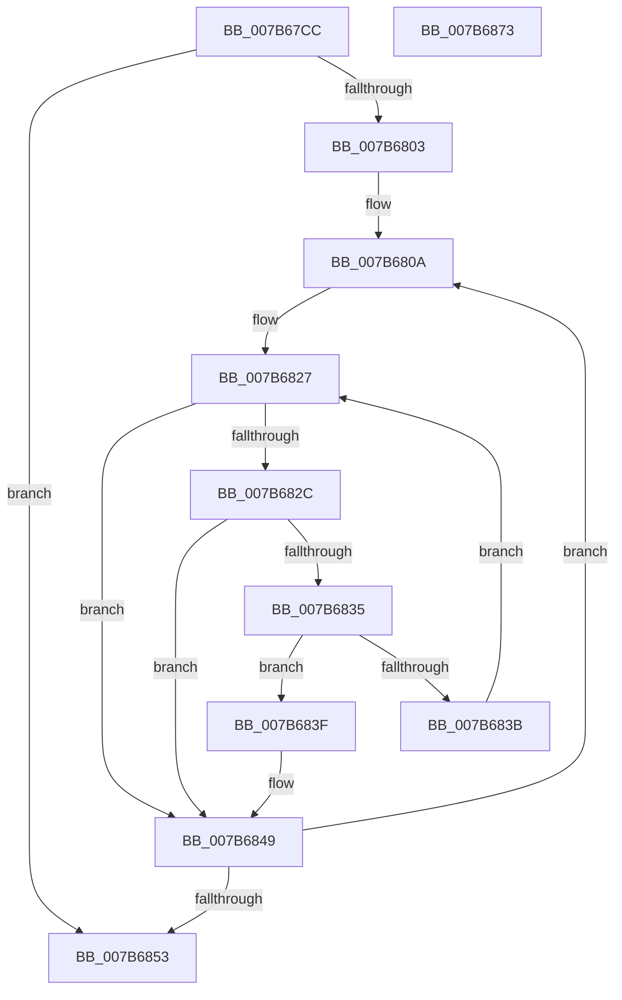

# EtwpGetMicroarchitecturalPmcAffinity

- RVA: `0x007B67CC`–`0x007B6874` (길이 `168` bytes)
- VA: `0x00000001407B67CC`
- 실행 섹션: `PAGE`
- PDB 이름 있음: `예`; PDB Function 태그: `아니요`
- unwind 정보 RVA: `0x000D3424`
- 디코드: `53`개 명령, `168/168` bytes 표시
- 미해석 바이트: `0` (있으면 어셈블리에 `.byte`로 보존)

> 이 문서는 커널 이미지의 기계어와 PDB 기호를 분석해 생성했습니다. 4번과 5번은 함수 원형과 자료형을 바이너리 사용 방식에서 추정한 C 해석이며 원본 소스 복구 결과는 아닙니다.

## 1. Dependencies

- 직접 호출 지점: **3**; 고유 호출 대상: **3**
- 직접 호출자로 확인된 함수: **2**
- RIP 상대 이미지 참조: **2**

### Outgoing calls
- `0x007B67F6` → [KeQueryActiveProcessorAffinity2](../../text/46/KeQueryActiveProcessorAffinity2_function_00469CC0.md) (function, `0x00469CC0`)
- `0x007B6844` → [KeRemoveProcessorAffinityEx](../../text/30/KeRemoveProcessorAffinityEx_function_00304E10.md) (function, `0x00304E10`)
- `0x007B685B` → [_security_check_cookie](../../text/6A/_security_check_cookie_function_006AC640.md) (function, `0x006AC640`)

### Direct callers
- [EtwpLoadMicroarchitecturalProfileGroup](EtwpLoadMicroarchitecturalProfileGroup_function_007B6F74.md) at `0x007B7123`
- [sub_00B3C988](../B3/Unknown_function_00B3C988.md) at `0x00B3D015`
- [sub_00B3C988](../B3/Unknown_function_00B3C988.md) at `0x00B3D21B`

### Static image references
- `0x007B67DE` → RVA `0x00E0A740` (`.data`; read)
- `0x007B6803` → RVA `0x00FC8C40` (`ALMOSTRO`; read)

## 2. Other-region calls and transfers

- 다른 실행 섹션으로 향하는 call: **3**
  - `0x007B67F6` → [KeQueryActiveProcessorAffinity2](../../text/46/KeQueryActiveProcessorAffinity2_function_00469CC0.md) (`PAGE` → `.text`)
  - `0x007B6844` → [KeRemoveProcessorAffinityEx](../../text/30/KeRemoveProcessorAffinityEx_function_00304E10.md) (`PAGE` → `.text`)
  - `0x007B685B` → [_security_check_cookie](../../text/6A/_security_check_cookie_function_006AC640.md) (`PAGE` → `.text`)
- 별도 외부 분기/꼬리 이동을 확인하지 못했습니다.

## 3. Assembly (complete function range)

```asm
007B67CC  48 89 5C 24 08                  mov qword ptr [rsp + 8], rbx
007B67D1  48 89 6C 24 18                  mov qword ptr [rsp + 0x18], rbp
007B67D6  56                              push rsi
007B67D7  57                              push rdi
007B67D8  41 56                           push r14
007B67DA  48 83 EC 40                     sub rsp, 0x40
007B67DE  48 8B 05 5B 3F 65 00            mov rax, qword ptr [rip + 0x653f5b]
007B67E5  48 33 C4                        xor rax, rsp
007B67E8  48 89 44 24 30                  mov qword ptr [rsp + 0x30], rax
007B67ED  4C 8B F1                        mov r14, rcx
007B67F0  48 8B EA                        mov rbp, rdx
007B67F3  48 8B CA                        mov rcx, rdx
007B67F6  E8 C5 34 CB FF                  call 0x140469cc0
007B67FB  33 DB                           xor ebx, ebx
007B67FD  8B F0                           mov esi, eax
007B67FF  85 C0                           test eax, eax
007B6801  74 50                           je 0x1407b6853
007B6803  48 8D 3D 36 24 81 00            lea rdi, [rip + 0x812436]
007B680A  48 8B 17                        mov rdx, qword ptr [rdi]
007B680D  0F BE 4A 40                     movsx ecx, byte ptr [rdx + 0x40]
007B6811  0F B6 42 42                     movzx eax, byte ptr [rdx + 0x42]
007B6815  89 4C 24 20                     mov dword ptr [rsp + 0x20], ecx
007B6819  0F B6 4A 43                     movzx ecx, byte ptr [rdx + 0x43]
007B681D  89 44 24 28                     mov dword ptr [rsp + 0x28], eax
007B6821  33 C0                           xor eax, eax
007B6823  89 4C 24 24                     mov dword ptr [rsp + 0x24], ecx
007B6827  83 F8 03                        cmp eax, 3
007B682A  73 1D                           jae 0x1407b6849
007B682C  41 8B 14 86                     mov edx, dword ptr [r14 + rax*4]
007B6830  83 FA FF                        cmp edx, -1
007B6833  74 14                           je 0x1407b6849
007B6835  3B 54 84 20                     cmp edx, dword ptr [rsp + rax*4 + 0x20]
007B6839  75 04                           jne 0x1407b683f
007B683B  FF C0                           inc eax
007B683D  EB E8                           jmp 0x1407b6827
007B683F  8B D3                           mov edx, ebx
007B6841  48 8B CD                        mov rcx, rbp
007B6844  E8 C7 E5 B4 FF                  call 0x140304e10
007B6849  FF C3                           inc ebx
007B684B  48 83 C7 08                     add rdi, 8
007B684F  3B DE                           cmp ebx, esi
007B6851  72 B7                           jb 0x1407b680a
007B6853  48 8B 4C 24 30                  mov rcx, qword ptr [rsp + 0x30]
007B6858  48 33 CC                        xor rcx, rsp
007B685B  E8 E0 5D EF FF                  call 0x1406ac640
007B6860  48 8B 5C 24 60                  mov rbx, qword ptr [rsp + 0x60]
007B6865  48 8B 6C 24 70                  mov rbp, qword ptr [rsp + 0x70]
007B686A  48 83 C4 40                     add rsp, 0x40
007B686E  41 5E                           pop r14
007B6870  5F                              pop rdi
007B6871  5E                              pop rsi
007B6872  C3                              ret
007B6873  CC                              int3
```

## 4. C-style interpretation (structured pseudocode)

```c
__int64 __fastcall EtwpGetMicroarchitecturalPmcAffinity(__int64 a1, __int64 a2)
{
    __int64 result;
    __int64 v_rbx;
    __int64 v_rdi;
    __int64 v_rsp;
    unsigned __int64 v_stack_m28;
    unsigned int v_stack_m30;
    unsigned int v_stack_m34;
    unsigned int v_stack_m38;
    unsigned __int64 v_stack_p18;
    unsigned __int64 v_stack_p8;

    v_stack_p8 = v_rbx;
    v_stack_p18 = v_rbp;
    v_rsp = (v_rsp) - (64);
    result = (*(unsigned __int64 *)(v_rip + 6635355)) ^ (v_rsp);
    v_stack_m28 = result;
    result = KeQueryActiveProcessorAffinity2(a2, a2, a3, a4);
    v_rbx = 0;
    if ((unsigned int)(result) == 0) goto loc_007B6853;
loc_007B680A:
    v_stack_m38 = (unsigned int)((__int8)(*(unsigned __int8 *)(*(unsigned __int64 *)(v_rip + 8463414) + 64)));
    v_stack_m30 = (unsigned int)(*(unsigned __int8 *)(*(unsigned __int64 *)(v_rip + 8463414) + 66));
    result = 0;
    v_stack_m34 = (unsigned int)(*(unsigned __int8 *)(*(unsigned __int64 *)(v_rip + 8463414) + 67));
loc_007B6827:
    if (0 >= 3) goto loc_007B6849;
    if (((unsigned int)((unsigned int)(*(unsigned int *)(a1 + result * 4)))) == -1) goto loc_007B6849;
    if (((unsigned int)((unsigned int)(*(unsigned int *)(a1 + result * 4)))) != (*(unsigned int *)(v_rsp + result * 4 + 32))) goto loc_007B683F;
    result = (unsigned int)((result) + 1);
    goto loc_007B6827;
loc_007B683F:
    result = KeRemoveProcessorAffinityEx(a2, 0, a3, a4);
loc_007B6849:
    v_rbx = (unsigned int)((v_rbx) + 1);
    v_rdi = (v_rip + 8463414) + (8);
    if (((unsigned int)(v_rbx)) < ((unsigned int)((unsigned int)((unsigned int)(result))))) goto loc_007B680A;
loc_007B6853:
    a1 = (v_stack_m28) ^ (v_rsp);
    result = _security_check_cookie(a1, 0, a3, a4);
    v_rsp = (v_rsp) + (64);
    return result;
}
```

## 5. (Beta) C Style

```c
int64_t EtwpGetMicroarchitecturalPmcAffinity(void *Arg1, int64_t Arg2)
{
    uint8_t *arg1 = (uint8_t *)Arg1;

    int64_t result;
    int64_t local_rbx;
    int64_t local_rdi;
    int64_t local_rsp;
    uint64_t v_stack_m28;
    uint32_t v_stack_m30;
    uint32_t v_stack_m34;
    uint32_t v_stack_m38;
    uint64_t v_stack_p18;
    uint64_t v_stack_p8;

    v_stack_p8 = local_rbx;
    v_stack_p18 = local_rbp;
    local_rsp = (local_rsp) - (64);
    result = (*(uint64_t *)(v_rip + 0x653F5B)) ^ (local_rsp);
    v_stack_m28 = result;
    result = KeQueryActiveProcessorAffinity2(Arg2, Arg2, a3, a4);
    local_rbx = 0;
    if ((uint32_t)(result) == 0) goto loc_007B6853;
loc_007B680A:
    v_stack_m38 = (uint32_t)((int8_t)(*(uint8_t *)(*(uint64_t *)(v_rip + 0x812436) + 0x40)));
    v_stack_m30 = (uint32_t)(*(uint8_t *)(*(uint64_t *)(v_rip + 0x812436) + 0x42));
    result = 0;
    v_stack_m34 = (uint32_t)(*(uint8_t *)(*(uint64_t *)(v_rip + 0x812436) + 0x43));
loc_007B6827:
    if (0 >= 3) goto loc_007B6849;
    if (((uint32_t)((uint32_t)(*(uint32_t *)(arg1 + result * 4)))) == -1) goto loc_007B6849;
    if (((uint32_t)((uint32_t)(*(uint32_t *)(arg1 + result * 4)))) != (*(uint32_t *)(local_rsp + result * 4 + 0x20))) goto loc_007B683F;
    result = (uint32_t)((result) + 1);
    goto loc_007B6827;
loc_007B683F:
    result = KeRemoveProcessorAffinityEx(Arg2, 0, a3, a4);
loc_007B6849:
    local_rbx = (uint32_t)((local_rbx) + 1);
    local_rdi = (v_rip + 8463414) + (8);
    if (((uint32_t)(local_rbx)) < ((uint32_t)((uint32_t)((uint32_t)(result))))) goto loc_007B680A;
loc_007B6853:
    Arg1 = (v_stack_m28) ^ (local_rsp);
    result = _security_check_cookie(Arg1, 0, a3, a4);
    local_rsp = (local_rsp) + (64);
    return result;
}
```

### 관측된 메모리 오프셋

구조체 형식이 확인되지 않은 접근은 인자 기준의 오프셋으로만 기록했습니다.

| 기준 인자 | 오프셋 표현 | 폭 (bit) | 접근 |
|---|---:|---:|---|
| `Arg1` | `+ 0x0 + rax*4` | `32` | `R` |

## 6. Execution-region graph

[열기: 2D/3D 그래프와 함수 탐색 컨트롤 패널](../../../control-panel.html?section=page&rva=0x007B67CC&view=graph)

- 2D 그래프는 위에서 아래로 흐르고, 3D 그래프는 빈 공간을 드래그해 회전합니다. Shift+드래그는 이동, 휠은 확대·축소, 함수 노드 선택은 대상 보고서 이동입니다.

### Static fallback


