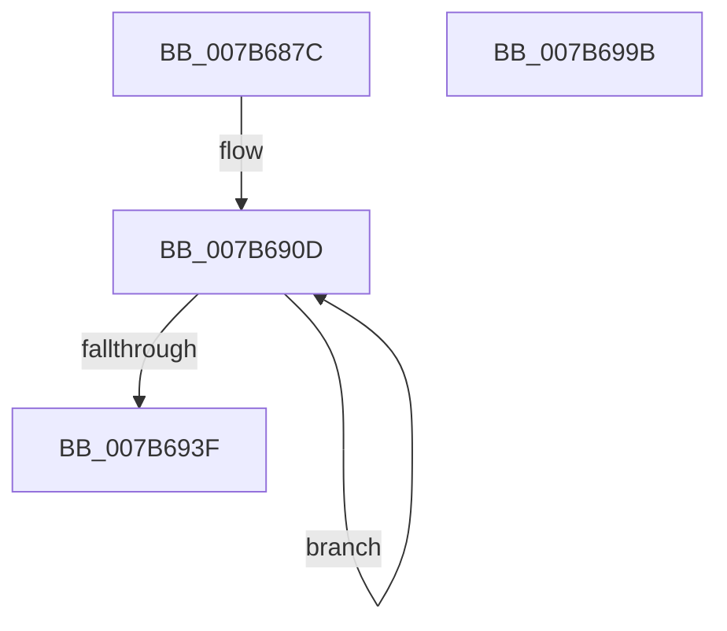

# EtwpGetPmcCpuHierarchyRegistry

- RVA: `0x007B687C`–`0x007B699C` (길이 `288` bytes)
- VA: `0x00000001407B687C`
- 실행 섹션: `PAGE`
- PDB 이름 있음: `예`; PDB Function 태그: `아니요`
- unwind 정보 RVA: `0x000D33E0`
- 디코드: `73`개 명령, `288/288` bytes 표시
- 미해석 바이트: `0` (있으면 어셈블리에 `.byte`로 보존)

> 이 문서는 커널 이미지의 기계어와 PDB 기호를 분석해 생성했습니다. 4번과 5번은 함수 원형과 자료형을 바이너리 사용 방식에서 추정한 C 해석이며 원본 소스 복구 결과는 아닙니다.

## 1. Dependencies

- 직접 호출 지점: **3**; 고유 호출 대상: **3**
- 직접 호출자로 확인된 함수: **2**
- RIP 상대 이미지 참조: **6**

### Outgoing calls
- `0x007B68DC` → [memset](../../text/6C/memset_function_006C6C40.md) (function, `0x006C6C40`)
- `0x007B6979` → [RtlpQueryRegistryValues](../8C/RtlpQueryRegistryValues_function_008C9050.md) (function, `0x008C9050`)
- `0x007B6988` → [_security_check_cookie](../../text/6A/_security_check_cookie_function_006AC640.md) (function, `0x006AC640`)

### Direct callers
- [EtwpFindMatchingPmcRegistryGroup](EtwpFindMatchingPmcRegistryGroup_function_007B644C.md) at `0x007B65F5`
- [EtwpLoadMicroarchitecturalProfileGroup](EtwpLoadMicroarchitecturalProfileGroup_function_007B6F74.md) at `0x007B7040`

### Static image references
- `0x007B6892` → RVA `0x00E0A740` (`.data`; read)
- `0x007B68A3` → RVA `0x00B074D0` (` ?? ::NNGAKEGL::`string'`; read)
- `0x007B68B5` → RVA `0x00B074C0` (` ?? ::NNGAKEGL::`string'`; read)
- `0x007B68C8` → RVA `0x00B073D0` (` ?? ::NNGAKEGL::`string'`; read)
- `0x007B6906` → RVA `0x007BEA40` (`EtwpQueryRegistryCallback`; read)
- `0x007B694E` → RVA `0x00B07320` (` ?? ::NNGAKEGL::`string'`; read)

## 2. Other-region calls and transfers

- 다른 실행 섹션으로 향하는 call: **2**
  - `0x007B68DC` → [memset](../../text/6C/memset_function_006C6C40.md) (`PAGE` → `.text`)
  - `0x007B6988` → [_security_check_cookie](../../text/6A/_security_check_cookie_function_006AC640.md) (`PAGE` → `.text`)
- 별도 외부 분기/꼬리 이동을 확인하지 못했습니다.

## 3. Assembly (complete function range)

```asm
007B687C  40 55                           push rbp
007B687E  53                              push rbx
007B687F  56                              push rsi
007B6880  57                              push rdi
007B6881  41 56                           push r14
007B6883  48 8D AC 24 30 FF FF FF         lea rbp, [rsp - 0xd0]
007B688B  48 81 EC D0 01 00 00            sub rsp, 0x1d0
007B6892  48 8B 05 A7 3E 65 00            mov rax, qword ptr [rip + 0x653ea7]
007B6899  48 33 C4                        xor rax, rsp
007B689C  48 89 85 C0 00 00 00            mov qword ptr [rbp + 0xc0], rax
007B68A3  48 8D 05 26 0C 35 00            lea rax, [rip + 0x350c26]
007B68AA  49 8B D8                        mov rbx, r8
007B68AD  48 89 44 24 30                  mov qword ptr [rsp + 0x30], rax
007B68B2  48 8B FA                        mov rdi, rdx
007B68B5  48 8D 05 04 0C 35 00            lea rax, [rip + 0x350c04]
007B68BC  48 8B F1                        mov rsi, rcx
007B68BF  48 89 44 24 38                  mov qword ptr [rsp + 0x38], rax
007B68C4  48 8D 4D A0                     lea rcx, [rbp - 0x60]
007B68C8  48 8D 05 01 0B 35 00            lea rax, [rip + 0x350b01]
007B68CF  33 D2                           xor edx, edx
007B68D1  41 B8 18 01 00 00               mov r8d, 0x118
007B68D7  48 89 44 24 40                  mov qword ptr [rsp + 0x40], rax
007B68DC  E8 5F 03 F1 FF                  call 0x1406c6c40
007B68E1  48 83 C8 FF                     or rax, 0xffffffffffffffff
007B68E5  48 8D 54 24 58                  lea rdx, [rsp + 0x58]
007B68EA  4C 8D 44 24 30                  lea r8, [rsp + 0x30]
007B68EF  48 89 03                        mov qword ptr [rbx], rax
007B68F2  48 8D 4D B8                     lea rcx, [rbp - 0x48]
007B68F6  89 43 08                        mov dword ptr [rbx + 8], eax
007B68F9  4C 8D 4C 24 50                  lea r9, [rsp + 0x50]
007B68FE  44 8D 50 04                     lea r10d, [rax + 4]
007B6902  44 8D 58 05                     lea r11d, [rax + 5]
007B6906  4C 8D 35 33 81 00 00            lea r14, [rip + 0x8133]
007B690D  49 8B 00                        mov rax, qword ptr [r8]
007B6910  4D 8D 40 08                     lea r8, [r8 + 8]
007B6914  4C 89 09                        mov qword ptr [rcx], r9
007B6917  49 83 C1 10                     add r9, 0x10
007B691B  48 89 1A                        mov qword ptr [rdx], rbx
007B691E  49 03 DB                        add rbx, r11
007B6921  4C 89 71 E8                     mov qword ptr [rcx - 0x18], r14
007B6925  48 89 41 F8                     mov qword ptr [rcx - 8], rax
007B6929  44 89 59 08                     mov dword ptr [rcx + 8], r11d
007B692D  48 8D 49 38                     lea rcx, [rcx + 0x38]
007B6931  44 89 5A F8                     mov dword ptr [rdx - 8], r11d
007B6935  48 8D 52 10                     lea rdx, [rdx + 0x10]
007B6939  49 83 EA 01                     sub r10, 1
007B693D  75 CE                           jne 0x1407b690d
007B693F  83 0F FF                        or dword ptr [rdi], 0xffffffff
007B6942  48 8D 45 80                     lea rax, [rbp - 0x80]
007B6946  48 89 45 60                     mov qword ptr [rbp + 0x60], rax
007B694A  4C 8D 45 A0                     lea r8, [rbp - 0x60]
007B694E  48 8D 05 CB 09 35 00            lea rax, [rip + 0x3509cb]
007B6955  4C 89 75 48                     mov qword ptr [rbp + 0x48], r14
007B6959  45 33 C9                        xor r9d, r9d
007B695C  48 89 45 58                     mov qword ptr [rbp + 0x58], rax
007B6960  48 8B D6                        mov rdx, rsi
007B6963  44 89 5D 68                     mov dword ptr [rbp + 0x68], r11d
007B6967  B9 00 00 00 40                  mov ecx, 0x40000000
007B696C  44 89 5D 80                     mov dword ptr [rbp - 0x80], r11d
007B6970  48 89 7D 88                     mov qword ptr [rbp - 0x78], rdi
007B6974  C6 44 24 28 01                  mov byte ptr [rsp + 0x28], 1
007B6979  E8 D2 26 11 00                  call 0x1408c9050
007B697E  48 8B 8D C0 00 00 00            mov rcx, qword ptr [rbp + 0xc0]
007B6985  48 33 CC                        xor rcx, rsp
007B6988  E8 B3 5C EF FF                  call 0x1406ac640
007B698D  48 81 C4 D0 01 00 00            add rsp, 0x1d0
007B6994  41 5E                           pop r14
007B6996  5F                              pop rdi
007B6997  5E                              pop rsi
007B6998  5B                              pop rbx
007B6999  5D                              pop rbp
007B699A  C3                              ret
007B699B  CC                              int3
```

## 4. C-style interpretation (structured pseudocode)

```c
__int64 __fastcall EtwpGetPmcCpuHierarchyRegistry(__int64 a1, __int64 a2, __int64 a3)
{
    __int64 result;
    __int64 v_r10;
    __int64 v_rbx;
    __int64 v_rsp;
    unsigned __int64 v_stack_m140;
    unsigned __int64 v_stack_m158;
    unsigned __int64 v_stack_m170;
    unsigned __int64 v_stack_m178;
    unsigned __int64 v_stack_m1A0;
    unsigned __int64 v_stack_m1A8;
    unsigned __int64 v_stack_m1B8;
    unsigned __int64 v_stack_m1C0;
    unsigned __int64 v_stack_m1C8;
    unsigned __int8 v_stack_m1D0;
    unsigned __int64 v_stack_m38;
    unsigned int v_stack_m90;
    unsigned __int64 v_stack_m98;
    unsigned __int64 v_stack_mA0;
    unsigned __int64 v_stack_mB0;
    unsigned __int64 v_stack_mF8;

    v_rsp = (v_rsp) - (464);
    result = (*(unsigned __int64 *)(v_rip + 6635175)) ^ (v_rsp);
    v_stack_m38 = result;
    v_stack_m1C8 = v_rip + 3476518;
    v_stack_m1C0 = v_rip + 3476484;
    a2 = 0;
    v_stack_m1B8 = v_rip + 3476225;
    result = memset(v_stack_m158, a2, 280, a4);
    result = (result) | (-1);
    *(unsigned __int64 *)(a3) = result;
    *(unsigned int *)(a3 + 8) = (unsigned int)(result);
loc_007B690D:
    *(unsigned __int64 *)(v_stack_m140) = v_stack_m1A8;
    a4 = (v_stack_m1A8) + (16);
    *(unsigned __int64 *)(v_stack_m1A0) = a3;
    v_rbx = (a3) + (result + 5);
    *(unsigned __int64 *)(v_stack_m140 - 24) = v_rip + 33075;
    *(unsigned __int64 *)(v_stack_m140 - 8) = *(unsigned __int64 *)(v_stack_m1C8);
    *(unsigned int *)(v_stack_m140 + 8) = (unsigned int)(result + 5);
    *(unsigned int *)(v_stack_m1A0 - 8) = (unsigned int)(result + 5);
    v_r10 = (result + 4) - (1);
    if (condition_is_not_equal) goto loc_007B690D;
    v_stack_m98 = v_stack_m178;
    v_stack_mB0 = v_rip + 33075;
    a4 = 0;
    v_stack_mA0 = v_rip + 3475915;
    v_stack_m90 = (unsigned int)(result + 5);
    v_stack_m178 = (unsigned int)(result + 5);
    v_stack_m170 = 0;
    v_stack_m1D0 = 1;
    result = RtlpQueryRegistryValues((unsigned int)(0x40000000ULL), a1, v_stack_m158, a4);
    a1 = (v_stack_m38) ^ (v_rsp);
    result = _security_check_cookie(a1, a1, v_stack_m158, a4);
    v_rsp = (v_rsp) + (464);
    return result;
}
```

## 5. (Beta) C Style

```c
int64_t EtwpGetPmcCpuHierarchyRegistry(int64_t Arg1, void *Arg2, void *Arg3)
{
    uint8_t *arg2 = (uint8_t *)Arg2;
    uint8_t *arg3 = (uint8_t *)Arg3;

    int64_t result;
    int64_t local_r10;
    int64_t local_rbx;
    int64_t local_rsp;
    uint64_t v_stack_m140;
    uint64_t v_stack_m158;
    uint64_t v_stack_m170;
    uint64_t v_stack_m178;
    uint64_t v_stack_m1A0;
    uint64_t v_stack_m1A8;
    uint64_t v_stack_m1B8;
    uint64_t v_stack_m1C0;
    uint64_t v_stack_m1C8;
    uint8_t v_stack_m1D0;
    uint64_t v_stack_m38;
    uint32_t v_stack_m90;
    uint64_t v_stack_m98;
    uint64_t v_stack_mA0;
    uint64_t v_stack_mB0;
    uint64_t v_stack_mF8;

    local_rsp = (local_rsp) - (464);
    result = (*(uint64_t *)(v_rip + 0x653EA7)) ^ (local_rsp);
    v_stack_m38 = result;
    v_stack_m1C8 = v_rip + 3476518;
    v_stack_m1C0 = v_rip + 3476484;
    Arg2 = 0;
    v_stack_m1B8 = v_rip + 3476225;
    result = memset(v_stack_m158, Arg2, 280, a4);
    result = (result) | (-1);
    *(uint64_t *)(arg3) = result;
    *(uint32_t *)(arg3 + 0x8) = (uint32_t)(result);
loc_007B690D:
    *(uint64_t *)(v_stack_m140) = v_stack_m1A8;
    a4 = (v_stack_m1A8) + (16);
    *(void **)(v_stack_m1A0) = Arg3;
    local_rbx = (Arg3) + (result + 5);
    *(uint64_t *)(v_stack_m140 - 0x18) = v_rip + 33075;
    *(uint64_t *)(v_stack_m140 - 0x8) = *(uint64_t *)(v_stack_m1C8);
    *(uint32_t *)(v_stack_m140 + 0x8) = (uint32_t)(result + 5);
    *(uint32_t *)(v_stack_m1A0 - 0x8) = (uint32_t)(result + 5);
    local_r10 = (result + 4) - (1);
    if (condition_is_not_equal) goto loc_007B690D;
    v_stack_m98 = v_stack_m178;
    v_stack_mB0 = v_rip + 33075;
    a4 = 0;
    v_stack_mA0 = v_rip + 3475915;
    v_stack_m90 = (uint32_t)(result + 5);
    v_stack_m178 = (uint32_t)(result + 5);
    v_stack_m170 = 0;
    v_stack_m1D0 = 1;
    result = RtlpQueryRegistryValues((uint32_t)(0x40000000ULL), Arg1, v_stack_m158, a4);
    Arg1 = (v_stack_m38) ^ (local_rsp);
    result = _security_check_cookie(Arg1, Arg1, v_stack_m158, a4);
    local_rsp = (local_rsp) + (464);
    return result;
}
```

### 관측된 메모리 오프셋

구조체 형식이 확인되지 않은 접근은 인자 기준의 오프셋으로만 기록했습니다.

| 기준 인자 | 오프셋 표현 | 폭 (bit) | 접근 |
|---|---:|---:|---|
| `Arg2` | `+ 0x0` | `32` | `R/W` |
| `Arg3` | `+ 0x0` | `64` | `W` |
| `Arg3` | `+ 0x8` | `32` | `W` |

## 6. Execution-region graph

[열기: 2D/3D 그래프와 함수 탐색 컨트롤 패널](../../../control-panel.html?section=page&rva=0x007B687C&view=graph)

- 2D 그래프는 위에서 아래로 흐르고, 3D 그래프는 빈 공간을 드래그해 회전합니다. Shift+드래그는 이동, 휠은 확대·축소, 함수 노드 선택은 대상 보고서 이동입니다.

### Static fallback


