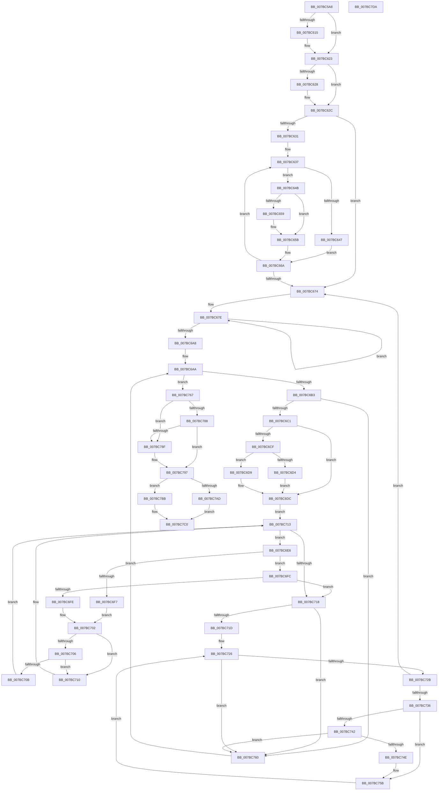

# EtwpGetPrivateSessionTraceHandle

- RVA: `0x007BC5A8`–`0x007BC7DB` (길이 `563` bytes)
- VA: `0x00000001407BC5A8`
- 실행 섹션: `PAGE`
- PDB 이름 있음: `예`; PDB Function 태그: `아니요`
- unwind 정보 RVA: `0x000BBDE4`
- 디코드: `161`개 명령, `563/563` bytes 표시
- 미해석 바이트: `0` (있으면 어셈블리에 `.byte`로 보존)

> 이 문서는 커널 이미지의 기계어와 PDB 기호를 분석해 생성했습니다. 4번과 5번은 함수 원형과 자료형을 바이너리 사용 방식에서 추정한 C 해석이며 원본 소스 복구 결과는 아닙니다.

## 1. Dependencies

- 직접 호출 지점: **11**; 고유 호출 대상: **11**
- 직접 호출자로 확인된 함수: **1**
- RIP 상대 이미지 참조: **0**

### Outgoing calls
- `0x007BC5C7` → [PsGetCurrentServerSiloGlobals](../../text/2F/PsGetCurrentServerSiloGlobals_function_002FE1F0.md) (function, `0x002FE1F0`)
- `0x007BC605` → [KeAbPreAcquire](../../text/21/KeAbPreAcquire_function_00210230.md) (function, `0x00210230`)
- `0x007BC61E` → [ExfAcquirePushLockExclusiveEx](../../text/20/ExfAcquirePushLockExclusiveEx_function_0020FC90.md) (function, `0x0020FC90`)
- `0x007BC63E` → [PsLookupProcessByProcessId](../8A/PsLookupProcessByProcessId_function_008A2AA0.md) (function, `0x008A2AA0`)
- `0x007BC650` → [EtwpCheckCurrentUserProcessAccess](../9E/EtwpCheckCurrentUserProcessAccess_function_009EB530.md) (function, `0x009EB530`)
- `0x007BC665` → [ObfDereferenceObjectWithTag](../../text/2F/ObfDereferenceObjectWithTag_function_002F78E0.md) (function, `0x002F78E0`)
- `0x007BC686` → [RtlRandomEx](../../text/41/RtlRandomEx_function_0041AFE0.md) (function, `0x0041AFE0`)
- `0x007BC6EE` → [PidNodeCompare](PidNodeCompare_function_007BCF10.md) (function, `0x007BCF10`)
- `0x007BC792` → [ExfReleasePushLock](../../text/26/ExfReleasePushLock_function_002638D0.md) (function, `0x002638D0`)
- `0x007BC79A` → [KeAbPostRelease](../../text/2E/KeAbPostRelease_function_002E1600.md) (function, `0x002E1600`)
- `0x007BC79F` → [KeLeaveCriticalRegion](../../text/25/KeLeaveCriticalRegion_function_0025D8B0.md) (function, `0x0025D8B0`)

### Direct callers
- [NtTraceControl](../A9/NtTraceControl_function_00A9ED40.md) at `0x00A9F768`

### Static image references
- 디코드된 RIP-relative 메모리 참조가 없습니다.

## 2. Other-region calls and transfers

- 다른 실행 섹션으로 향하는 call: **8**
  - `0x007BC5C7` → [PsGetCurrentServerSiloGlobals](../../text/2F/PsGetCurrentServerSiloGlobals_function_002FE1F0.md) (`PAGE` → `.text`)
  - `0x007BC605` → [KeAbPreAcquire](../../text/21/KeAbPreAcquire_function_00210230.md) (`PAGE` → `.text`)
  - `0x007BC61E` → [ExfAcquirePushLockExclusiveEx](../../text/20/ExfAcquirePushLockExclusiveEx_function_0020FC90.md) (`PAGE` → `.text`)
  - `0x007BC665` → [ObfDereferenceObjectWithTag](../../text/2F/ObfDereferenceObjectWithTag_function_002F78E0.md) (`PAGE` → `.text`)
  - `0x007BC686` → [RtlRandomEx](../../text/41/RtlRandomEx_function_0041AFE0.md) (`PAGE` → `.text`)
  - `0x007BC792` → [ExfReleasePushLock](../../text/26/ExfReleasePushLock_function_002638D0.md) (`PAGE` → `.text`)
  - `0x007BC79A` → [KeAbPostRelease](../../text/2E/KeAbPostRelease_function_002E1600.md) (`PAGE` → `.text`)
  - `0x007BC79F` → [KeLeaveCriticalRegion](../../text/25/KeLeaveCriticalRegion_function_0025D8B0.md) (`PAGE` → `.text`)
- 별도 외부 분기/꼬리 이동을 확인하지 못했습니다.

## 3. Assembly (complete function range)

```asm
007BC5A8  48 89 5C 24 08                  mov qword ptr [rsp + 8], rbx
007BC5AD  4C 89 44 24 18                  mov qword ptr [rsp + 0x18], r8
007BC5B2  55                              push rbp
007BC5B3  56                              push rsi
007BC5B4  57                              push rdi
007BC5B5  41 54                           push r12
007BC5B7  41 55                           push r13
007BC5B9  41 56                           push r14
007BC5BB  41 57                           push r15
007BC5BD  48 83 EC 40                     sub rsp, 0x40
007BC5C1  44 8B EA                        mov r13d, edx
007BC5C4  4C 8B E1                        mov r12, rcx
007BC5C7  E8 24 1C B4 FF                  call 0x1402fe1f0
007BC5CC  33 DB                           xor ebx, ebx
007BC5CE  45 33 C0                        xor r8d, r8d
007BC5D1  33 D2                           xor edx, edx
007BC5D3  48 89 5C 24 30                  mov qword ptr [rsp + 0x30], rbx
007BC5D8  88 9C 24 98 00 00 00            mov byte ptr [rsp + 0x98], bl
007BC5DF  4C 8B B8 40 03 00 00            mov r15, qword ptr [rax + 0x340]
007BC5E6  65 48 8B 04 25 88 01 00 00      mov rax, qword ptr gs:[0x188]
007BC5EF  49 81 C7 00 11 00 00            add r15, 0x1100
007BC5F6  66 FF 88 E4 01 00 00            dec word ptr [rax + 0x1e4]
007BC5FD  49 8D 77 10                     lea rsi, [r15 + 0x10]
007BC601  48 8B CE                        mov rcx, rsi
007BC604  90                              nop
007BC605  E8 26 3C A5 FF                  call 0x140210230
007BC60A  F0 48 0F BA 2E 00               lock bts qword ptr [rsi], 0
007BC610  48 8B F8                        mov rdi, rax
007BC613  73 0E                           jae 0x1407bc623
007BC615  4C 8B C6                        mov r8, rsi
007BC618  48 8B D0                        mov rdx, rax
007BC61B  48 8B CE                        mov rcx, rsi
007BC61E  E8 6D 36 A5 FF                  call 0x14020fc90
007BC623  48 85 FF                        test rdi, rdi
007BC626  74 04                           je 0x1407bc62c
007BC628  C6 47 0A 01                     mov byte ptr [rdi + 0xa], 1
007BC62C  45 85 ED                        test r13d, r13d
007BC62F  74 43                           je 0x1407bc674
007BC631  49 8B FC                        mov rdi, r12
007BC634  49 8B F5                        mov rsi, r13
007BC637  8B 0F                           mov ecx, dword ptr [rdi]
007BC639  48 8D 54 24 30                  lea rdx, [rsp + 0x30]
007BC63E  E8 5D 64 0E 00                  call 0x1408a2aa0
007BC643  85 C0                           test eax, eax
007BC645  74 04                           je 0x1407bc64b
007BC647  89 1F                           mov dword ptr [rdi], ebx
007BC649  EB 1F                           jmp 0x1407bc66a
007BC64B  48 8B 4C 24 30                  mov rcx, qword ptr [rsp + 0x30]
007BC650  E8 DB EE 22 00                  call 0x1409eb530
007BC655  85 C0                           test eax, eax
007BC657  74 02                           je 0x1407bc65b
007BC659  89 1F                           mov dword ptr [rdi], ebx
007BC65B  48 8B 4C 24 30                  mov rcx, qword ptr [rsp + 0x30]
007BC660  BA 44 66 6C 74                  mov edx, 0x746c6644
007BC665  E8 76 B2 B3 FF                  call 0x1402f78e0
007BC66A  48 83 C7 08                     add rdi, 8
007BC66E  48 83 EE 01                     sub rsi, 1
007BC672  75 C3                           jne 0x1407bc637
007BC674  48 B8 20 03 00 00 80 F7 FF FF   movabs rax, 0xfffff78000000320
007BC67E  48 8B 00                        mov rax, qword ptr [rax]
007BC681  48 8D 4C 24 28                  lea rcx, [rsp + 0x28]
007BC686  E8 55 E9 C5 FF                  call 0x14041afe0
007BC68B  44 8B F0                        mov r14d, eax
007BC68E  B8 FF 7F 00 00                  mov eax, 0x7fff
007BC693  66 44 23 F0                     and r14w, ax
007BC697  48 B8 20 03 00 00 80 F7 FF FF   movabs rax, 0xfffff78000000320
007BC6A1  66 41 83 FE 40                  cmp r14w, 0x40
007BC6A6  72 D6                           jb 0x1407bc67e
007BC6A8  8B EB                           mov ebp, ebx
007BC6AA  41 3B ED                        cmp ebp, r13d
007BC6AD  0F 83 B4 00 00 00               jae 0x1407bc767
007BC6B3  8B CD                           mov ecx, ebp
007BC6B5  41 8B 04 CC                     mov eax, dword ptr [r12 + rcx*8]
007BC6B9  85 C0                           test eax, eax
007BC6BB  0F 84 9F 00 00 00               je 0x1407bc760
007BC6C1  41 F6 47 08 01                  test byte ptr [r15 + 8], 1
007BC6C6  49 8B 3F                        mov rdi, qword ptr [r15]
007BC6C9  89 44 24 20                     mov dword ptr [rsp + 0x20], eax
007BC6CD  74 0D                           je 0x1407bc6dc
007BC6CF  48 85 FF                        test rdi, rdi
007BC6D2  74 05                           je 0x1407bc6d9
007BC6D4  49 33 FF                        xor rdi, r15
007BC6D7  EB 03                           jmp 0x1407bc6dc
007BC6D9  48 8B FB                        mov rdi, rbx
007BC6DC  41 0F B6 77 08                  movzx esi, byte ptr [r15 + 8]
007BC6E1  83 E6 01                        and esi, 1
007BC6E4  EB 2D                           jmp 0x1407bc713
007BC6E6  48 8B D7                        mov rdx, rdi
007BC6E9  48 8D 4C 24 20                  lea rcx, [rsp + 0x20]
007BC6EE  E8 1D 08 00 00                  call 0x1407bcf10
007BC6F3  85 C0                           test eax, eax
007BC6F5  79 05                           jns 0x1407bc6fc
007BC6F7  48 8B 07                        mov rax, qword ptr [rdi]
007BC6FA  EB 06                           jmp 0x1407bc702
007BC6FC  7E 1A                           jle 0x1407bc718
007BC6FE  48 8B 47 08                     mov rax, qword ptr [rdi + 8]
007BC702  85 F6                           test esi, esi
007BC704  74 0A                           je 0x1407bc710
007BC706  48 85 C0                        test rax, rax
007BC709  74 05                           je 0x1407bc710
007BC70B  48 33 F8                        xor rdi, rax
007BC70E  EB 03                           jmp 0x1407bc713
007BC710  48 8B F8                        mov rdi, rax
007BC713  48 85 FF                        test rdi, rdi
007BC716  75 CE                           jne 0x1407bc6e6
007BC718  48 85 FF                        test rdi, rdi
007BC71B  74 43                           je 0x1407bc760
007BC71D  48 83 C7 20                     add rdi, 0x20
007BC721  8B D5                           mov edx, ebp
007BC723  48 8B 0F                        mov rcx, qword ptr [rdi]
007BC726  48 3B CF                        cmp rcx, rdi
007BC729  74 35                           je 0x1407bc760
007BC72B  66 44 39 71 12                  cmp word ptr [rcx + 0x12], r14w
007BC730  0F 84 3E FF FF FF               je 0x1407bc674
007BC736  41 0F B7 44 D4 04               movzx eax, word ptr [r12 + rdx*8 + 4]
007BC73C  66 39 41 10                     cmp word ptr [rcx + 0x10], ax
007BC740  75 19                           jne 0x1407bc75b
007BC742  41 0F B7 44 D4 06               movzx eax, word ptr [r12 + rdx*8 + 6]
007BC748  66 39 41 14                     cmp word ptr [rcx + 0x14], ax
007BC74C  75 12                           jne 0x1407bc760
007BC74E  66 44 89 71 12                  mov word ptr [rcx + 0x12], r14w
007BC753  C6 84 24 98 00 00 00 01         mov byte ptr [rsp + 0x98], 1
007BC75B  48 8B 09                        mov rcx, qword ptr [rcx]
007BC75E  EB C6                           jmp 0x1407bc726
007BC760  FF C5                           inc ebp
007BC762  E9 43 FF FF FF                  jmp 0x1407bc6aa
007BC767  49 8D 7F 10                     lea rdi, [r15 + 0x10]
007BC76B  0F 0D 0F                        prefetchw byte ptr [rdi]
007BC76E  48 8B 07                        mov rax, qword ptr [rdi]
007BC771  48 8B C8                        mov rcx, rax
007BC774  48 83 E1 F0                     and rcx, 0xfffffffffffffff0
007BC778  48 83 F9 10                     cmp rcx, 0x10
007BC77C  48 8D 50 F0                     lea rdx, [rax - 0x10]
007BC780  48 0F 46 D3                     cmovbe rdx, rbx
007BC784  A8 02                           test al, 2
007BC786  75 07                           jne 0x1407bc78f
007BC788  F0 48 0F B1 17                  lock cmpxchg qword ptr [rdi], rdx
007BC78D  74 08                           je 0x1407bc797
007BC78F  48 8B CF                        mov rcx, rdi
007BC792  E8 39 71 AA FF                  call 0x1402638d0
007BC797  48 8B CF                        mov rcx, rdi
007BC79A  E8 61 4E B2 FF                  call 0x1402e1600
007BC79F  E8 0C 11 AA FF                  call 0x14025d8b0
007BC7A4  38 9C 24 98 00 00 00            cmp byte ptr [rsp + 0x98], bl
007BC7AB  74 0E                           je 0x1407bc7bb
007BC7AD  48 8B 84 24 90 00 00 00         mov rax, qword ptr [rsp + 0x90]
007BC7B5  66 44 89 30                     mov word ptr [rax], r14w
007BC7B9  EB 05                           jmp 0x1407bc7c0
007BC7BB  BB 25 02 00 C0                  mov ebx, 0xc0000225
007BC7C0  8B C3                           mov eax, ebx
007BC7C2  48 8B 9C 24 80 00 00 00         mov rbx, qword ptr [rsp + 0x80]
007BC7CA  48 83 C4 40                     add rsp, 0x40
007BC7CE  41 5F                           pop r15
007BC7D0  41 5E                           pop r14
007BC7D2  41 5D                           pop r13
007BC7D4  41 5C                           pop r12
007BC7D6  5F                              pop rdi
007BC7D7  5E                              pop rsi
007BC7D8  5D                              pop rbp
007BC7D9  C3                              ret
007BC7DA  CC                              int3
```

## 4. C-style interpretation (structured pseudocode)

```c
__int64 __fastcall EtwpGetPrivateSessionTraceHandle(__int64 a1, int a2, __int64 a3)
{
    __int64 result;
    __int64 v_r14;
    __int64 v_r15;
    __int64 v_rbp;
    __int64 v_rbx;
    __int64 v_rdi;
    __int64 v_rsi;
    __int64 v_rsp;
    unsigned __int64 v_stack_m48;
    unsigned __int64 v_stack_m50;
    unsigned int v_stack_m58;
    unsigned __int64 v_stack_p18;
    unsigned __int8 v_stack_p20;
    unsigned __int64 v_stack_p8;

    v_stack_p8 = v_rbx;
    v_stack_p18 = a3;
    v_rsp = (v_rsp) - (64);
    result = PsGetCurrentServerSiloGlobals(a1, a2, a3, a4);
    v_rbx = 0;
    a3 = 0;
    a2 = 0;
    v_stack_m48 = 0;
    v_stack_p20 = 0;
    v_r15 = (*(unsigned __int64 *)(result + 832)) + (0x1100ULL);
    result = KeAbPreAcquire(v_r15 + 16, a2, a3, a4);
    if (!(condition_is_above_or_equal)) {
        a3 = v_r15 + 16;
        a2 = result;
        a1 = v_r15 + 16;
        result = ExfAcquirePushLockExclusiveEx(a1, a2, a3, a4);
    }
    if (result != 0) {
        *(unsigned __int8 *)(result + 10) = 1;
    }
    if ((unsigned int)((unsigned int)(a2)) == 0) goto loc_007BC674;
loc_007BC637:
    result = PsLookupProcessByProcessId((unsigned int)(*(unsigned int *)(a1)), v_stack_m48, a3, a4);
    if ((unsigned int)(result) == 0) goto loc_007BC64B;
    *(unsigned int *)(a1) = 0;
    goto loc_007BC66A;
loc_007BC64B:
    result = EtwpCheckCurrentUserProcessAccess(v_stack_m48, v_stack_m48, a3, a4);
    if ((unsigned int)(result) != 0) {
        *(unsigned int *)(a1) = 0;
    }
    result = ObfDereferenceObjectWithTag(v_stack_m48, (unsigned int)(0x746C6644ULL), a3, a4);
loc_007BC66A:
    v_rdi = (a1) + (8);
    v_rsi = ((unsigned int)(a2)) - (1);
    if (condition_is_not_equal) goto loc_007BC637;
loc_007BC674:
loc_007BC67E:
    result = RtlRandomEx(v_stack_m50, (unsigned int)(0x746C6644ULL), a3, a4);
    v_r14 = (unsigned __int16)(((unsigned int)((unsigned int)(result))) & ((unsigned __int16)((unsigned int)(0x7FFFULL))));
    if (((unsigned __int16)(v_r14)) < 64) goto loc_007BC67E;
loc_007BC6AA:
    if (0 >= ((unsigned int)((unsigned int)(a2)))) goto loc_007BC767;
    if ((unsigned int)((unsigned int)(*(unsigned int *)(a1 + 0 * 8))) == 0) goto loc_007BC760;
    v_stack_m58 = (unsigned int)((unsigned int)(*(unsigned int *)(a1 + 0 * 8)));
    if (((*(unsigned __int8 *)(v_r15 + 8)) & (1)) == 0) goto loc_007BC6DC;
    if (*(unsigned __int64 *)(v_r15) == 0) goto loc_007BC6D9;
    v_rdi = (*(unsigned __int64 *)(v_r15)) ^ (v_r15);
    goto loc_007BC6DC;
loc_007BC6D9:
loc_007BC6DC:
    v_rsi = (unsigned int)((*(unsigned __int8 *)(v_r15 + 8)) & (1));
    goto loc_007BC713;
loc_007BC6E6:
    result = PidNodeCompare(v_stack_m58, 0, a3, a4);
    if (!sign_flag) goto loc_007BC6FC;
    goto loc_007BC702;
loc_007BC6FC:
    if (condition_is_less_or_equal) goto loc_007BC718;
loc_007BC702:
    if ((unsigned int)(v_rsi) == 0) goto loc_007BC710;
    if (*(unsigned __int64 *)(0 + 8) == 0) goto loc_007BC710;
    v_rdi = (0) ^ (*(unsigned __int64 *)(0 + 8));
    goto loc_007BC713;
loc_007BC710:
loc_007BC713:
    if (*(unsigned __int64 *)(0 + 8) != 0) goto loc_007BC6E6;
loc_007BC718:
    if (*(unsigned __int64 *)(0 + 8) == 0) goto loc_007BC760;
    v_rdi = (*(unsigned __int64 *)(0 + 8)) + (32);
loc_007BC726:
    if ((*(unsigned __int64 *)(v_rdi)) == v_rdi) goto loc_007BC760;
    if ((*(unsigned __int16 *)(*(unsigned __int64 *)(v_rdi) + 18)) == ((unsigned __int16)(v_r14))) goto loc_007BC674;
    if ((*(unsigned __int16 *)(*(unsigned __int64 *)(v_rdi) + 16)) != ((unsigned __int16)(*(unsigned __int16 *)(a1 + 0 * 8 + 4)))) goto loc_007BC75B;
    if ((*(unsigned __int16 *)(*(unsigned __int64 *)(v_rdi) + 20)) != ((unsigned __int16)(*(unsigned __int16 *)(a1 + 0 * 8 + 6)))) goto loc_007BC760;
    *(unsigned __int16 *)(*(unsigned __int64 *)(v_rdi) + 18) = (unsigned __int16)(v_r14);
    v_stack_p20 = 1;
loc_007BC75B:
    goto loc_007BC726;
loc_007BC760:
    v_rbp = (unsigned int)((0) + 1);
    goto loc_007BC6AA;
loc_007BC767:
    a1 = (*(unsigned __int64 *)(v_r15 + 16)) & (-16);
    a2 = *(unsigned __int64 *)(v_r15 + 16) - 16;
    if (a1 <= 16) { a2 = 0; }
    if ((((unsigned __int8)(*(unsigned __int64 *)(v_r15 + 16))) & (2)) != 0) goto loc_007BC78F;
    result = *(unsigned __int64 *)(v_r15 + 16);
    if ((((unsigned __int8)(*(unsigned __int64 *)(v_r15 + 16))) & (2)) != 0) {
        a1 = v_r15 + 16;
        result = ExfReleasePushLock(a1, a2, a3, a4);
    }
    result = KeAbPostRelease(v_r15 + 16, a2, a3, a4);
    result = KeLeaveCriticalRegion(v_r15 + 16, a2, a3, a4);
    if (v_stack_p20 == 0) goto loc_007BC7BB;
    *(unsigned __int16 *)(v_stack_p18) = (unsigned __int16)(v_r14);
    goto loc_007BC7C0;
loc_007BC7BB:
loc_007BC7C0:
    v_rsp = (v_rsp) + (64);
    return (unsigned int)((unsigned int)((unsigned int)(0xC0000225ULL)));
}
```

## 5. (Beta) C Style

```c
int64_t EtwpGetPrivateSessionTraceHandle(void *Arg1, int32_t Arg2, int64_t Arg3)
{
    uint8_t *arg1 = (uint8_t *)Arg1;

    int64_t result;
    int64_t local_r14;
    int64_t local_r15;
    int64_t local_rbp;
    int64_t local_rbx;
    int64_t local_rdi;
    int64_t local_rsi;
    int64_t local_rsp;
    uint64_t v_stack_m48;
    uint64_t v_stack_m50;
    uint32_t v_stack_m58;
    uint64_t v_stack_p18;
    uint8_t v_stack_p20;
    uint64_t v_stack_p8;

    v_stack_p8 = local_rbx;
    v_stack_p18 = Arg3;
    local_rsp = (local_rsp) - (64);
    result = PsGetCurrentServerSiloGlobals(Arg1, Arg2, Arg3, a4);
    local_rbx = 0;
    Arg3 = 0;
    Arg2 = 0;
    v_stack_m48 = 0;
    v_stack_p20 = 0;
    local_r15 = (*(uint64_t *)(result + 0x340)) + (0x1100ULL);
    result = KeAbPreAcquire(local_r15 + 16, Arg2, Arg3, a4);
    if (!(condition_is_above_or_equal)) {
        Arg3 = local_r15 + 16;
        Arg2 = result;
        Arg1 = local_r15 + 16;
        result = ExfAcquirePushLockExclusiveEx(Arg1, Arg2, Arg3, a4);
    }
    if (result != 0) {
        *(uint8_t *)(result + 0xA) = 1;
    }
    if ((uint32_t)((uint32_t)(Arg2)) == 0) goto loc_007BC674;
loc_007BC637:
    result = PsLookupProcessByProcessId((uint32_t)(*(uint32_t *)(arg1)), v_stack_m48, Arg3, a4);
    if ((uint32_t)(result) == 0) goto loc_007BC64B;
    *(uint32_t *)(arg1) = 0;
    goto loc_007BC66A;
loc_007BC64B:
    result = EtwpCheckCurrentUserProcessAccess(v_stack_m48, v_stack_m48, Arg3, a4);
    if ((uint32_t)(result) != 0) {
        *(uint32_t *)(arg1) = 0;
    }
    result = ObfDereferenceObjectWithTag(v_stack_m48, (uint32_t)(0x746C6644ULL), Arg3, a4);
loc_007BC66A:
    local_rdi = (Arg1) + (8);
    local_rsi = ((uint32_t)(Arg2)) - (1);
    if (condition_is_not_equal) goto loc_007BC637;
loc_007BC674:
loc_007BC67E:
    result = RtlRandomEx(v_stack_m50, (uint32_t)(0x746C6644ULL), Arg3, a4);
    local_r14 = (uint16_t)(((uint32_t)((uint32_t)(result))) & ((uint16_t)((uint32_t)(0x7FFFULL))));
    if (((uint16_t)(local_r14)) < 64) goto loc_007BC67E;
loc_007BC6AA:
    if (0 >= ((uint32_t)((uint32_t)(Arg2)))) goto loc_007BC767;
    if ((uint32_t)((uint32_t)(*(uint32_t *)(arg1 + 0x0 * 8))) == 0) goto loc_007BC760;
    v_stack_m58 = (uint32_t)((uint32_t)(*(uint32_t *)(arg1 + 0x0 * 8)));
    if (((*(uint8_t *)(local_r15 + 0x8)) & (1)) == 0) goto loc_007BC6DC;
    if (*(uint64_t *)(local_r15) == 0) goto loc_007BC6D9;
    local_rdi = (*(uint64_t *)(local_r15)) ^ (local_r15);
    goto loc_007BC6DC;
loc_007BC6D9:
loc_007BC6DC:
    local_rsi = (uint32_t)((*(uint8_t *)(local_r15 + 0x8)) & (1));
    goto loc_007BC713;
loc_007BC6E6:
    result = PidNodeCompare(v_stack_m58, 0, Arg3, a4);
    if (!sign_flag) goto loc_007BC6FC;
    goto loc_007BC702;
loc_007BC6FC:
    if (condition_is_less_or_equal) goto loc_007BC718;
loc_007BC702:
    if ((uint32_t)(local_rsi) == 0) goto loc_007BC710;
    if (*(uint64_t *)(0 + 0x8) == 0) goto loc_007BC710;
    local_rdi = (0) ^ (*(uint64_t *)(0 + 0x8));
    goto loc_007BC713;
loc_007BC710:
loc_007BC713:
    if (*(uint64_t *)(0 + 0x8) != 0) goto loc_007BC6E6;
loc_007BC718:
    if (*(uint64_t *)(0 + 0x8) == 0) goto loc_007BC760;
    local_rdi = (*(uint64_t *)(0 + 0x8)) + (32);
loc_007BC726:
    if ((*(uint64_t *)(local_rdi)) == local_rdi) goto loc_007BC760;
    if ((*(uint16_t *)(*(uint64_t *)(local_rdi) + 0x12)) == ((uint16_t)(local_r14))) goto loc_007BC674;
    if ((*(uint16_t *)(*(uint64_t *)(local_rdi) + 0x10)) != ((uint16_t)(*(uint16_t *)(arg1 + 0x0 * 8 + 0x4)))) goto loc_007BC75B;
    if ((*(uint16_t *)(*(uint64_t *)(local_rdi) + 0x14)) != ((uint16_t)(*(uint16_t *)(arg1 + 0x0 * 8 + 0x6)))) goto loc_007BC760;
    *(uint16_t *)(*(uint64_t *)(local_rdi) + 0x12) = (uint16_t)(local_r14);
    v_stack_p20 = 1;
loc_007BC75B:
    goto loc_007BC726;
loc_007BC760:
    local_rbp = (uint32_t)((0) + 1);
    goto loc_007BC6AA;
loc_007BC767:
    Arg1 = (*(uint64_t *)(local_r15 + 0x10)) & (-16);
    Arg2 = *(uint64_t *)(local_r15 + 0x10) - 16;
    if (Arg1 <= 16) { Arg2 = 0; }
    if ((((uint8_t)(*(uint64_t *)(local_r15 + 0x10))) & (2)) != 0) goto loc_007BC78F;
    result = *(uint64_t *)(local_r15 + 0x10);
    if ((((uint8_t)(*(uint64_t *)(local_r15 + 0x10))) & (2)) != 0) {
        Arg1 = local_r15 + 16;
        result = ExfReleasePushLock(Arg1, Arg2, Arg3, a4);
    }
    result = KeAbPostRelease(local_r15 + 16, Arg2, Arg3, a4);
    result = KeLeaveCriticalRegion(local_r15 + 16, Arg2, Arg3, a4);
    if (v_stack_p20 == 0) goto loc_007BC7BB;
    *(uint16_t *)(v_stack_p18) = (uint16_t)(local_r14);
    goto loc_007BC7C0;
loc_007BC7BB:
loc_007BC7C0:
    local_rsp = (local_rsp) + (64);
    return (uint32_t)((uint32_t)((uint32_t)(0xC0000225ULL)));
}
```

### 관측된 메모리 오프셋

구조체 형식이 확인되지 않은 접근은 인자 기준의 오프셋으로만 기록했습니다.

| 기준 인자 | 오프셋 표현 | 폭 (bit) | 접근 |
|---|---:|---:|---|
| `Arg1` | `+ 0x0` | `32` | `R` |
| `Arg1` | `+ 0x0` | `32` | `W` |
| `Arg1` | `+ 0x0 + rcx*8` | `32` | `R` |
| `Arg1` | `+ 0x4 + rdx*8` | `16` | `R` |
| `Arg1` | `+ 0x6 + rdx*8` | `16` | `R` |

## 6. Execution-region graph

[열기: 2D/3D 그래프와 함수 탐색 컨트롤 패널](../../../control-panel.html?section=page&rva=0x007BC5A8&view=graph)

- 2D 그래프는 위에서 아래로 흐르고, 3D 그래프는 빈 공간을 드래그해 회전합니다. Shift+드래그는 이동, 휠은 확대·축소, 함수 노드 선택은 대상 보고서 이동입니다.

### Static fallback


