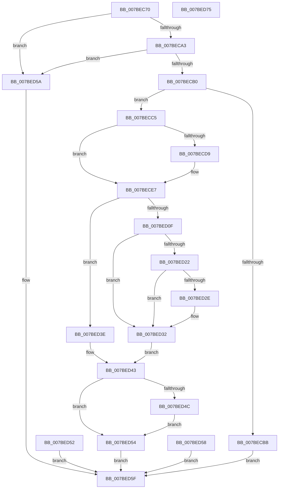

# EtwpGetSoftRestartInformation

- RVA: `0x007BEC70`–`0x007BED76` (길이 `262` bytes)
- VA: `0x00000001407BEC70`
- 실행 섹션: `PAGE`
- PDB 이름 있음: `예`; PDB Function 태그: `아니요`
- unwind 정보 RVA: `0x000D3D68`
- 디코드: `69`개 명령, `262/262` bytes 표시
- 미해석 바이트: `0` (있으면 어셈블리에 `.byte`로 보존)

> 이 문서는 커널 이미지의 기계어와 PDB 기호를 분석해 생성했습니다. 4번과 5번은 함수 원형과 자료형을 바이너리 사용 방식에서 추정한 C 해석이며 원본 소스 복구 결과는 아닙니다.

## 1. Dependencies

- 직접 호출 지점: **5**; 고유 호출 대상: **5**
- 직접 호출자로 확인된 함수: **1**
- RIP 상대 이미지 참조: **2**

### Outgoing calls
- `0x007BECA3` → [PsIsCurrentThreadInServerSilo](../../text/43/PsIsCurrentThreadInServerSilo_function_004362E0.md) (function, `0x004362E0`)
- `0x007BED02` → [EtwpAcquireLoggerContextByLoggerId](../93/EtwpAcquireLoggerContextByLoggerId_function_00932920.md) (function, `0x00932920`)
- `0x007BED17` → [EtwpCheckLoggerControlAccess](../8C/EtwpCheckLoggerControlAccess_function_008C0AE0.md) (function, `0x008C0AE0`)
- `0x007BED37` → [EtwpReleaseLoggerContext](../A0/EtwpReleaseLoggerContext_function_00A04160.md) (function, `0x00A04160`)
- `0x007BED43` → [KeLeaveCriticalRegion](../../text/25/KeLeaveCriticalRegion_function_0025D8B0.md) (function, `0x0025D8B0`)

### Direct callers
- [EtwQueryPerformanceTraceInformation](../AF/EtwQueryPerformanceTraceInformation_function_00AF28A4.md) at `0x00AF2F49`

### Static image references
- `0x007BEC90` → RVA `0x00FD9F38` (`PAGEDATA`; read)
- `0x007BECD9` → RVA `0x00FC6AA8` (`ALMOSTRO`; read)

## 2. Other-region calls and transfers

- 다른 실행 섹션으로 향하는 call: **2**
  - `0x007BECA3` → [PsIsCurrentThreadInServerSilo](../../text/43/PsIsCurrentThreadInServerSilo_function_004362E0.md) (`PAGE` → `.text`)
  - `0x007BED43` → [KeLeaveCriticalRegion](../../text/25/KeLeaveCriticalRegion_function_0025D8B0.md) (`PAGE` → `.text`)
- 별도 외부 분기/꼬리 이동을 확인하지 못했습니다.

## 3. Assembly (complete function range)

```asm
007BEC70  48 89 5C 24 08                  mov qword ptr [rsp + 8], rbx
007BEC75  48 89 74 24 10                  mov qword ptr [rsp + 0x10], rsi
007BEC7A  48 89 7C 24 18                  mov qword ptr [rsp + 0x18], rdi
007BEC7F  41 56                           push r14
007BEC81  48 83 EC 20                     sub rsp, 0x20
007BEC85  49 8B D8                        mov rbx, r8
007BEC88  8B FA                           mov edi, edx
007BEC8A  48 8B F1                        mov rsi, rcx
007BEC8D  45 32 F6                        xor r14b, r14b
007BEC90  48 83 3D A0 B2 81 00 00         cmp qword ptr [rip + 0x81b2a0], 0
007BEC98  0F 95 C0                        setne al
007BEC9B  84 C0                           test al, al
007BEC9D  0F 84 B7 00 00 00               je 0x1407bed5a
007BECA3  E8 38 76 C7 FF                  call 0x1404362e0
007BECA8  84 C0                           test al, al
007BECAA  0F 85 AA 00 00 00               jne 0x1407bed5a
007BECB0  C7 03 18 00 00 00               mov dword ptr [rbx], 0x18
007BECB6  83 FF 18                        cmp edi, 0x18
007BECB9  73 0A                           jae 0x1407becc5
007BECBB  B8 04 00 00 C0                  mov eax, 0xc0000004
007BECC0  E9 9A 00 00 00                  jmp 0x1407bed5f
007BECC5  48 8B 46 08                     mov rax, qword ptr [rsi + 8]
007BECC9  48 89 44 24 48                  mov qword ptr [rsp + 0x48], rax
007BECCE  0F B7 D0                        movzx edx, ax
007BECD1  81 FA FF FF 00 00               cmp edx, 0xffff
007BECD7  75 0E                           jne 0x1407bece7
007BECD9  48 8B 05 C8 7D 80 00            mov rax, qword ptr [rip + 0x807dc8]
007BECE0  0F B6 90 98 11 00 00            movzx edx, byte ptr [rax + 0x1198]
007BECE7  65 48 8B 04 25 88 01 00 00      mov rax, qword ptr gs:[0x188]
007BECF0  66 FF 88 E4 01 00 00            dec word ptr [rax + 0x1e4]
007BECF7  90                              nop
007BECF8  41 B0 01                        mov r8b, 1
007BECFB  48 8B 0D A6 7D 80 00            mov rcx, qword ptr [rip + 0x807da6]
007BED02  E8 19 3C 17 00                  call 0x140932920
007BED07  48 8B F8                        mov rdi, rax
007BED0A  48 85 C0                        test rax, rax
007BED0D  74 2F                           je 0x1407bed3e
007BED0F  48 8B D0                        mov rdx, rax
007BED12  B9 01 00 00 00                  mov ecx, 1
007BED17  E8 C4 1D 10 00                  call 0x1408c0ae0
007BED1C  8B D8                           mov ebx, eax
007BED1E  85 C0                           test eax, eax
007BED20  78 10                           js 0x1407bed32
007BED22  48 8B 87 48 05 00 00            mov rax, qword ptr [rdi + 0x548]
007BED29  48 85 C0                        test rax, rax
007BED2C  74 04                           je 0x1407bed32
007BED2E  44 8A 70 20                     mov r14b, byte ptr [rax + 0x20]
007BED32  B2 01                           mov dl, 1
007BED34  48 8B CF                        mov rcx, rdi
007BED37  E8 24 54 24 00                  call 0x140a04160
007BED3C  EB 05                           jmp 0x1407bed43
007BED3E  BB 96 02 00 C0                  mov ebx, 0xc0000296
007BED43  E8 68 EB A9 FF                  call 0x14025d8b0
007BED48  85 DB                           test ebx, ebx
007BED4A  78 08                           js 0x1407bed54
007BED4C  44 88 76 10                     mov byte ptr [rsi + 0x10], r14b
007BED50  EB 02                           jmp 0x1407bed54
007BED52  EB 0B                           jmp 0x1407bed5f
007BED54  8B C3                           mov eax, ebx
007BED56  EB 07                           jmp 0x1407bed5f
007BED58  EB 05                           jmp 0x1407bed5f
007BED5A  B8 BB 00 00 C0                  mov eax, 0xc00000bb
007BED5F  48 8B 5C 24 30                  mov rbx, qword ptr [rsp + 0x30]
007BED64  48 8B 74 24 38                  mov rsi, qword ptr [rsp + 0x38]
007BED69  48 8B 7C 24 40                  mov rdi, qword ptr [rsp + 0x40]
007BED6E  48 83 C4 20                     add rsp, 0x20
007BED72  41 5E                           pop r14
007BED74  C3                              ret
007BED75  CC                              int3
```

## 4. C-style interpretation (structured pseudocode)

```c
__int64 __fastcall EtwpGetSoftRestartInformation(__int64 a1, int a2, __int64 a3)
{
    __int64 result;
    __int64 v_r14;
    __int64 v_rsp;
    unsigned __int64 v_stack_p10;
    unsigned __int64 v_stack_p18;
    unsigned __int64 v_stack_p20;
    unsigned __int64 v_stack_p8;

    v_stack_p8 = v_rbx;
    v_stack_p10 = v_rsi;
    v_stack_p18 = v_rdi;
    v_rsp = (v_rsp) - (32);
    v_r14 = 0;
    result = ((*(unsigned __int64 *)(v_rip + 8499872)) != 0) ? 1 : 0;
    if ((unsigned __int8)(result) == 0) goto loc_007BED5A;
    result = PsIsCurrentThreadInServerSilo(a1, a2, a3, a4);
    if ((unsigned __int8)(result) != 0) goto loc_007BED5A;
    *(unsigned int *)(a3) = 24;
    if (((unsigned int)((unsigned int)(a2))) >= 24) goto loc_007BECC5;
    goto loc_007BED5F;
loc_007BECC5:
    v_stack_p20 = *(unsigned __int64 *)(a1 + 8);
    result = *(unsigned __int64 *)(a1 + 8);
    if (((unsigned int)((unsigned __int16)(*(unsigned __int64 *)(a1 + 8)))) == 0xFFFFULL) {
        result = *(unsigned __int64 *)(v_rip + 8420808);
        a2 = *(unsigned __int8 *)(result + 4504);
    }
    result = EtwpAcquireLoggerContextByLoggerId(*(unsigned __int64 *)(v_rip + 8420774), a2, 1, a4);
    if (result == 0) goto loc_007BED3E;
    result = EtwpCheckLoggerControlAccess(1, result, 1, a4);
    if (sign_flag) goto loc_007BED32;
    if (*(unsigned __int64 *)(result + 1352) != 0) {
        v_r14 = *(unsigned __int8 *)(*(unsigned __int64 *)(result + 1352) + 32);
    }
    result = EtwpReleaseLoggerContext(result, 1, 1, a4);
    goto loc_007BED43;
loc_007BED3E:
loc_007BED43:
    result = KeLeaveCriticalRegion(result, 1, 1, a4);
    if (sign_flag) goto loc_007BED54;
    *(unsigned __int8 *)(a1 + 16) = (unsigned __int8)(v_r14);
    goto loc_007BED54;
loc_007BED54:
    goto loc_007BED5F;
loc_007BED5A:
loc_007BED5F:
    v_rsp = (v_rsp) + (32);
    return (unsigned int)(0xC00000BBULL);
}
```

## 5. (Beta) C Style

```c
int64_t EtwpGetSoftRestartInformation(void *Arg1, int32_t Arg2, void *Arg3)
{
    uint8_t *arg1 = (uint8_t *)Arg1;
    uint8_t *arg3 = (uint8_t *)Arg3;

    int64_t result;
    int64_t local_r14;
    int64_t local_rsp;
    uint64_t v_stack_p10;
    uint64_t v_stack_p18;
    uint64_t v_stack_p20;
    uint64_t v_stack_p8;

    v_stack_p8 = local_rbx;
    v_stack_p10 = local_rsi;
    v_stack_p18 = local_rdi;
    local_rsp = (local_rsp) - (32);
    local_r14 = 0;
    result = ((*(uint64_t *)(v_rip + 0x81B2A0)) != 0) ? 1 : 0;
    if ((uint8_t)(result) == 0) goto loc_007BED5A;
    result = PsIsCurrentThreadInServerSilo(Arg1, Arg2, Arg3, a4);
    if ((uint8_t)(result) != 0) goto loc_007BED5A;
    *(uint32_t *)(arg3) = 24;
    if (((uint32_t)((uint32_t)(Arg2))) >= 24) goto loc_007BECC5;
    goto loc_007BED5F;
loc_007BECC5:
    v_stack_p20 = *(uint64_t *)(arg1 + 0x8);
    result = *(uint64_t *)(arg1 + 0x8);
    if (((uint32_t)((uint16_t)(*(uint64_t *)(arg1 + 0x8)))) == 0xFFFFULL) {
        result = *(uint64_t *)(v_rip + 0x807DC8);
        Arg2 = *(uint8_t *)(result + 0x1198);
    }
    result = EtwpAcquireLoggerContextByLoggerId(*(uint64_t *)(v_rip + 0x807DA6), Arg2, 1, a4);
    if (result == 0) goto loc_007BED3E;
    result = EtwpCheckLoggerControlAccess(1, result, 1, a4);
    if (sign_flag) goto loc_007BED32;
    if (*(uint64_t *)(result + 0x548) != 0) {
        local_r14 = *(uint8_t *)(*(uint64_t *)(result + 0x548) + 0x20);
    }
    result = EtwpReleaseLoggerContext(result, 1, 1, a4);
    goto loc_007BED43;
loc_007BED3E:
loc_007BED43:
    result = KeLeaveCriticalRegion(result, 1, 1, a4);
    if (sign_flag) goto loc_007BED54;
    *(uint8_t *)(arg1 + 0x10) = (uint8_t)(local_r14);
    goto loc_007BED54;
loc_007BED54:
    goto loc_007BED5F;
loc_007BED5A:
loc_007BED5F:
    local_rsp = (local_rsp) + (32);
    return (uint32_t)(0xC00000BBULL);
}
```

### 관측된 메모리 오프셋

구조체 형식이 확인되지 않은 접근은 인자 기준의 오프셋으로만 기록했습니다.

| 기준 인자 | 오프셋 표현 | 폭 (bit) | 접근 |
|---|---:|---:|---|
| `Arg1` | `+ 0x8` | `64` | `R` |
| `Arg1` | `+ 0x10` | `8` | `W` |
| `Arg3` | `+ 0x0` | `32` | `W` |

## 6. Execution-region graph

[열기: 2D/3D 그래프와 함수 탐색 컨트롤 패널](../../../control-panel.html?section=page&rva=0x007BEC70&view=graph)

- 2D 그래프는 위에서 아래로 흐르고, 3D 그래프는 빈 공간을 드래그해 회전합니다. Shift+드래그는 이동, 휠은 확대·축소, 함수 노드 선택은 대상 보고서 이동입니다.

### Static fallback


