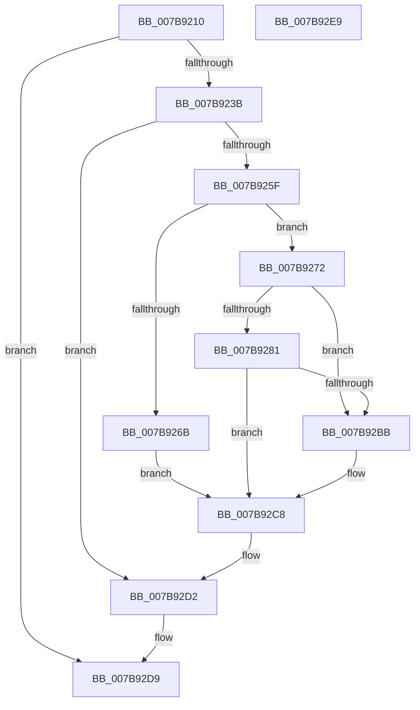

# EtwpIncrementTraceFile

- RVA: `0x007B9210`–`0x007B92EA` (길이 `218` bytes)
- VA: `0x00000001407B9210`
- 실행 섹션: `PAGE`
- PDB 이름 있음: `예`; PDB Function 태그: `아니요`
- unwind 정보 RVA: `0x00060BC4`
- 디코드: `58`개 명령, `218/218` bytes 표시
- 미해석 바이트: `0` (있으면 어셈블리에 `.byte`로 보존)

> 이 문서는 커널 이미지의 기계어와 PDB 기호를 분석해 생성했습니다. 4번과 5번은 함수 원형과 자료형을 바이너리 사용 방식에서 추정한 C 해석이며 원본 소스 복구 결과는 아닙니다.

## 1. Dependencies

- 직접 호출 지점: **8**; 고유 호출 대상: **7**
- 직접 호출자로 확인된 함수: **1**
- RIP 상대 이미지 참조: **0**

### Outgoing calls
- `0x007B922E` → [EtwpValidateLoggerInfo](../8B/EtwpValidateLoggerInfo_function_008BF9B0.md) (function, `0x008BF9B0`)
- `0x007B9254` → [EtwpAcquireLoggerContext](../93/EtwpAcquireLoggerContext_function_009326AC.md) (function, `0x009326AC`)
- `0x007B9289` → [EtwpSynchronizeWithLogger](../A6/EtwpSynchronizeWithLogger_function_00A66250.md) (function, `0x00A66250`)
- `0x007B92A3` → [EtwpGenerateFileName](../A9/EtwpGenerateFileName_function_00A962C8.md) (function, `0x00A962C8`)
- `0x007B92B0` → [EtwpSynchronizeWithLogger](../A6/EtwpSynchronizeWithLogger_function_00A66250.md) (function, `0x00A66250`)
- `0x007B92C1` → [EtwpGetLoggerInfoFromContext](../8B/EtwpGetLoggerInfoFromContext_function_008BEF90.md) (function, `0x008BEF90`)
- `0x007B92CD` → [EtwpReleaseLoggerContext](../A0/EtwpReleaseLoggerContext_function_00A04160.md) (function, `0x00A04160`)
- `0x007B92D2` → [KeLeaveCriticalRegion](../../text/25/KeLeaveCriticalRegion_function_0025D8B0.md) (function, `0x0025D8B0`)

### Direct callers
- [NtTraceControl](../A9/NtTraceControl_function_00A9ED40.md) at `0x00A9F082`

### Static image references
- 디코드된 RIP-relative 메모리 참조가 없습니다.

## 2. Other-region calls and transfers

- 다른 실행 섹션으로 향하는 call: **1**
  - `0x007B92D2` → [KeLeaveCriticalRegion](../../text/25/KeLeaveCriticalRegion_function_0025D8B0.md) (`PAGE` → `.text`)
- 별도 외부 분기/꼬리 이동을 확인하지 못했습니다.

## 3. Assembly (complete function range)

```asm
007B9210  48 89 5C 24 08                  mov qword ptr [rsp + 8], rbx
007B9215  48 89 74 24 10                  mov qword ptr [rsp + 0x10], rsi
007B921A  57                              push rdi
007B921B  48 83 EC 20                     sub rsp, 0x20
007B921F  48 83 64 24 40 00               and qword ptr [rsp + 0x40], 0
007B9225  4C 8B C9                        mov r9, rcx
007B9228  48 8B CA                        mov rcx, rdx
007B922B  48 8B F2                        mov rsi, rdx
007B922E  E8 7D 67 10 00                  call 0x1408bf9b0
007B9233  85 C0                           test eax, eax
007B9235  0F 88 9E 00 00 00               js 0x1407b92d9
007B923B  65 48 8B 04 25 88 01 00 00      mov rax, qword ptr gs:[0x188]
007B9244  4C 8D 44 24 40                  lea r8, [rsp + 0x40]
007B9249  49 8B C9                        mov rcx, r9
007B924C  66 FF 88 E4 01 00 00            dec word ptr [rax + 0x1e4]
007B9253  90                              nop
007B9254  E8 53 94 17 00                  call 0x1409326ac
007B9259  8B F8                           mov edi, eax
007B925B  85 C0                           test eax, eax
007B925D  78 73                           js 0x1407b92d2
007B925F  48 8B 5C 24 40                  mov rbx, qword ptr [rsp + 0x40]
007B9264  8B 43 0C                        mov eax, dword ptr [rbx + 0xc]
007B9267  A8 08                           test al, 8
007B9269  75 07                           jne 0x1407b9272
007B926B  BF 0D 00 00 C0                  mov edi, 0xc000000d
007B9270  EB 56                           jmp 0x1407b92c8
007B9272  8B 83 38 03 00 00               mov eax, dword ptr [rbx + 0x338]
007B9278  48 8B 5C 24 40                  mov rbx, qword ptr [rsp + 0x40]
007B927D  A8 01                           test al, 1
007B927F  75 3A                           jne 0x1407b92bb
007B9281  BA 04 00 00 00                  mov edx, 4
007B9286  48 8B CB                        mov rcx, rbx
007B9289  E8 C2 CF 2A 00                  call 0x140a66250
007B928E  4C 8D 83 B8 00 00 00            lea r8, [rbx + 0xb8]
007B9295  48 8D 93 28 01 00 00            lea rdx, [rbx + 0x128]
007B929C  48 8D 8B A8 00 00 00            lea rcx, [rbx + 0xa8]
007B92A3  E8 20 D0 2D 00                  call 0x140a962c8
007B92A8  BA 01 00 00 00                  mov edx, 1
007B92AD  48 8B CB                        mov rcx, rbx
007B92B0  E8 9B CF 2A 00                  call 0x140a66250
007B92B5  8B F8                           mov edi, eax
007B92B7  85 C0                           test eax, eax
007B92B9  78 0D                           js 0x1407b92c8
007B92BB  48 8B D3                        mov rdx, rbx
007B92BE  48 8B CE                        mov rcx, rsi
007B92C1  E8 CA 5C 10 00                  call 0x1408bef90
007B92C6  8B F8                           mov edi, eax
007B92C8  B2 01                           mov dl, 1
007B92CA  48 8B CB                        mov rcx, rbx
007B92CD  E8 8E AE 24 00                  call 0x140a04160
007B92D2  E8 D9 45 AA FF                  call 0x14025d8b0
007B92D7  8B C7                           mov eax, edi
007B92D9  48 8B 5C 24 30                  mov rbx, qword ptr [rsp + 0x30]
007B92DE  48 8B 74 24 38                  mov rsi, qword ptr [rsp + 0x38]
007B92E3  48 83 C4 20                     add rsp, 0x20
007B92E7  5F                              pop rdi
007B92E8  C3                              ret
007B92E9  CC                              int3
```

## 4. C-style interpretation (structured pseudocode)

```c
__int64 __fastcall EtwpIncrementTraceFile(__int64 a1, __int64 a2)
{
    __int64 result;
    __int64 v_rdi;
    __int64 v_rsp;
    unsigned __int64 v_stack_p10;
    unsigned __int64 v_stack_p18;
    unsigned __int64 v_stack_p8;

    v_stack_p8 = v_rbx;
    v_stack_p10 = v_rsi;
    v_rsp = (v_rsp) - (32);
    result = EtwpValidateLoggerInfo(a2, a2, a3, a1);
    if (sign_flag) goto loc_007B92D9;
    result = EtwpAcquireLoggerContext(a1, a2, v_stack_p18, a1);
    if (sign_flag) goto loc_007B92D2;
    if ((((unsigned __int8)((unsigned int)(*(unsigned int *)(v_stack_p18 + 12)))) & (8)) != 0) goto loc_007B9272;
    goto loc_007B92C8;
loc_007B9272:
    if ((((unsigned __int8)((unsigned int)(*(unsigned int *)(v_stack_p18 + 824)))) & (1)) != 0) goto loc_007B92BB;
    result = EtwpSynchronizeWithLogger(v_stack_p18, 4, v_stack_p18, a1);
    result = EtwpGenerateFileName(v_stack_p18 + 168, v_stack_p18 + 296, v_stack_p18 + 184, a1);
    result = EtwpSynchronizeWithLogger(v_stack_p18, 1, v_stack_p18 + 184, a1);
    v_rdi = (unsigned int)((unsigned int)(result));
    if (!(sign_flag)) {
        a2 = v_stack_p18;
        a1 = a2;
        result = EtwpGetLoggerInfoFromContext(a1, a2, v_stack_p18 + 184, a1);
        v_rdi = (unsigned int)(result);
    }
    result = EtwpReleaseLoggerContext(v_stack_p18, 1, v_stack_p18 + 184, a1);
loc_007B92D2:
    result = KeLeaveCriticalRegion(v_stack_p18, 1, v_stack_p18 + 184, a1);
loc_007B92D9:
    v_rsp = (v_rsp) + (32);
    return (unsigned int)((unsigned int)(v_rdi));
}
```

## 5. (Beta) C Style

```c
int64_t EtwpIncrementTraceFile(int64_t Arg1, int64_t Arg2)
{
    int64_t result;
    int64_t local_rdi;
    int64_t local_rsp;
    uint64_t v_stack_p10;
    uint64_t v_stack_p18;
    uint64_t v_stack_p8;

    v_stack_p8 = local_rbx;
    v_stack_p10 = local_rsi;
    local_rsp = (local_rsp) - (32);
    result = EtwpValidateLoggerInfo(Arg2, Arg2, a3, Arg1);
    if (sign_flag) goto loc_007B92D9;
    result = EtwpAcquireLoggerContext(Arg1, Arg2, v_stack_p18, Arg1);
    if (sign_flag) goto loc_007B92D2;
    if ((((uint8_t)((uint32_t)(*(uint32_t *)(v_stack_p18 + 0xC)))) & (8)) != 0) goto loc_007B9272;
    goto loc_007B92C8;
loc_007B9272:
    if ((((uint8_t)((uint32_t)(*(uint32_t *)(v_stack_p18 + 0x338)))) & (1)) != 0) goto loc_007B92BB;
    result = EtwpSynchronizeWithLogger(v_stack_p18, 4, v_stack_p18, Arg1);
    result = EtwpGenerateFileName(v_stack_p18 + 168, v_stack_p18 + 296, v_stack_p18 + 184, Arg1);
    result = EtwpSynchronizeWithLogger(v_stack_p18, 1, v_stack_p18 + 184, Arg1);
    local_rdi = (uint32_t)((uint32_t)(result));
    if (!(sign_flag)) {
        Arg2 = v_stack_p18;
        Arg1 = Arg2;
        result = EtwpGetLoggerInfoFromContext(Arg1, Arg2, v_stack_p18 + 184, Arg1);
        local_rdi = (uint32_t)(result);
    }
    result = EtwpReleaseLoggerContext(v_stack_p18, 1, v_stack_p18 + 184, Arg1);
loc_007B92D2:
    result = KeLeaveCriticalRegion(v_stack_p18, 1, v_stack_p18 + 184, Arg1);
loc_007B92D9:
    local_rsp = (local_rsp) + (32);
    return (uint32_t)((uint32_t)(local_rdi));
}
```

## 6. Execution-region graph

[열기: 2D/3D 그래프와 함수 탐색 컨트롤 패널](../../../control-panel.html?section=page&rva=0x007B9210&view=graph)

- 2D 그래프는 위에서 아래로 흐르고, 3D 그래프는 빈 공간을 드래그해 회전합니다. Shift+드래그는 이동, 휠은 확대·축소, 함수 노드 선택은 대상 보고서 이동입니다.

### Static fallback


