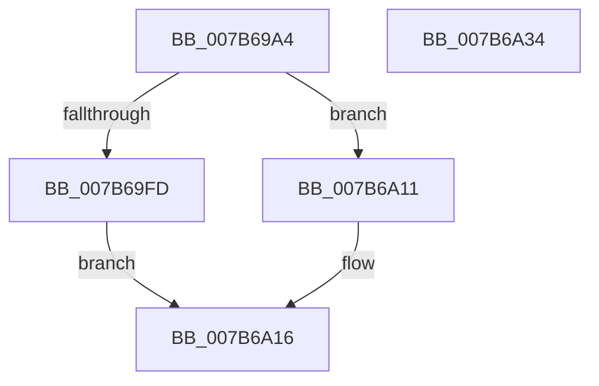

# EtwpInitializeActivityIdSeed

- RVA: `0x007B69A4`–`0x007B6A35` (길이 `145` bytes)
- VA: `0x00000001407B69A4`
- 실행 섹션: `PAGE`
- PDB 이름 있음: `예`; PDB Function 태그: `아니요`
- unwind 정보 RVA: `0x000C6EF8`
- 디코드: `37`개 명령, `145/145` bytes 표시
- 미해석 바이트: `0` (있으면 어셈블리에 `.byte`로 보존)

> 이 문서는 커널 이미지의 기계어와 PDB 기호를 분석해 생성했습니다. 4번과 5번은 함수 원형과 자료형을 바이너리 사용 방식에서 추정한 C 해석이며 원본 소스 복구 결과는 아닙니다.

## 1. Dependencies

- 직접 호출 지점: **2**; 고유 호출 대상: **2**
- 직접 호출자로 확인된 함수: **2**
- RIP 상대 이미지 참조: **1**

### Outgoing calls
- `0x007B69F4` → [HeadlessDispatch](../../text/65/HeadlessDispatch_function_00655C40.md) (function, `0x00655C40`)
- `0x007B6A29` → [_security_check_cookie](../../text/6A/_security_check_cookie_function_006AC640.md) (function, `0x006AC640`)

### Direct callers
- [KiStartDynamicProcessor](../74/KiStartDynamicProcessor_function_007456C8.md) at `0x0074594D`
- [EtwInitializeProcessorActivityId](EtwInitializeProcessorActivityId_function_007B508C.md) at `0x007B509A`

### Static image references
- `0x007B69AC` → RVA `0x00E0A740` (`.data`; read)

## 2. Other-region calls and transfers

- 다른 실행 섹션으로 향하는 call: **2**
  - `0x007B69F4` → [HeadlessDispatch](../../text/65/HeadlessDispatch_function_00655C40.md) (`PAGE` → `.text`)
  - `0x007B6A29` → [_security_check_cookie](../../text/6A/_security_check_cookie_function_006AC640.md) (`PAGE` → `.text`)
- 별도 외부 분기/꼬리 이동을 확인하지 못했습니다.

## 3. Assembly (complete function range)

```asm
007B69A4  4C 8B DC                        mov r11, rsp
007B69A7  53                              push rbx
007B69A8  48 83 EC 50                     sub rsp, 0x50
007B69AC  48 8B 05 8D 3D 65 00            mov rax, qword ptr [rip + 0x653d8d]
007B69B3  48 33 C4                        xor rax, rsp
007B69B6  48 89 44 24 48                  mov qword ptr [rsp + 0x48], rax
007B69BB  66 89 51 06                     mov word ptr [rcx + 6], dx
007B69BF  4D 8D 4B E0                     lea r9, [r11 - 0x20]
007B69C3  0F 57 C0                        xorps xmm0, xmm0
007B69C6  33 D2                           xor edx, edx
007B69C8  0F 11 44 24 38                  movups xmmword ptr [rsp + 0x38], xmm0
007B69CD  48 A1 14 00 00 00 80 F7 FF FF   movabs rax, qword ptr [0xfffff78000000014]
007B69D7  48 8B D9                        mov rbx, rcx
007B69DA  48 89 41 08                     mov qword ptr [rcx + 8], rax
007B69DE  45 33 C0                        xor r8d, r8d
007B69E1  49 8D 43 D8                     lea rax, [r11 - 0x28]
007B69E5  49 C7 43 D8 10 00 00 00         mov qword ptr [r11 - 0x28], 0x10
007B69ED  8D 4A 15                        lea ecx, [rdx + 0x15]
007B69F0  49 89 43 C8                     mov qword ptr [r11 - 0x38], rax
007B69F4  E8 47 F2 E9 FF                  call 0x140655c40
007B69F9  85 C0                           test eax, eax
007B69FB  74 14                           je 0x1407b6a11
007B69FD  48 B8 14 00 00 00 80 F7 FF FF   movabs rax, 0xfffff78000000014
007B6A07  48 8B 00                        mov rax, qword ptr [rax]
007B6A0A  48 89 44 24 38                  mov qword ptr [rsp + 0x38], rax
007B6A0F  EB 05                           jmp 0x1407b6a16
007B6A11  48 8B 44 24 38                  mov rax, qword ptr [rsp + 0x38]
007B6A16  89 03                           mov dword ptr [rbx], eax
007B6A18  0F B7 44 24 3C                  movzx eax, word ptr [rsp + 0x3c]
007B6A1D  66 89 43 04                     mov word ptr [rbx + 4], ax
007B6A21  48 8B 4C 24 48                  mov rcx, qword ptr [rsp + 0x48]
007B6A26  48 33 CC                        xor rcx, rsp
007B6A29  E8 12 5C EF FF                  call 0x1406ac640
007B6A2E  48 83 C4 50                     add rsp, 0x50
007B6A32  5B                              pop rbx
007B6A33  C3                              ret
007B6A34  CC                              int3
```

## 4. C-style interpretation (structured pseudocode)

```c
__int64 __fastcall EtwpInitializeActivityIdSeed(__int64 a1, int a2, int a3)
{
    __int64 result;
    __int64 v_rsp;
    unsigned __int64 v_stack_m10;
    unsigned __int16 v_stack_m1C;
    unsigned __int64 v_stack_m20;

    v_rsp = (v_rsp) - (80);
    result = (*(unsigned __int64 *)(v_rip + 6634893)) ^ (v_rsp);
    v_stack_m10 = result;
    *(unsigned __int16 *)(a1 + 6) = (unsigned __int16)(a2);
    a2 = 0;
    v_stack_m20 = v_xmm0;
    *(unsigned __int64 *)(a1 + 8) = result;
    a3 = 0;
    *(unsigned __int64 *)(v_rsp - 40) = 16;
    *(unsigned __int64 *)(v_rsp - 56) = v_rsp - 40;
    result = HeadlessDispatch(a2 + 21, a2, a3, v_rsp - 32);
    if ((unsigned int)(result) == 0) goto loc_007B6A11;
    v_stack_m20 = *(unsigned __int64 *)(result);
    goto loc_007B6A16;
loc_007B6A11:
loc_007B6A16:
    *(unsigned int *)(a1) = (unsigned int)(v_stack_m20);
    *(unsigned __int16 *)(a1 + 4) = (unsigned __int16)(v_stack_m1C);
    a1 = (v_stack_m10) ^ (v_rsp);
    result = _security_check_cookie(a1, a2, a3, v_rsp - 32);
    v_rsp = (v_rsp) + (80);
    return result;
}
```

## 5. (Beta) C Style

```c
int64_t EtwpInitializeActivityIdSeed(void *Arg1, int32_t Arg2, int32_t Arg3)
{
    uint8_t *arg1 = (uint8_t *)Arg1;

    int64_t result;
    int64_t local_rsp;
    uint64_t v_stack_m10;
    uint16_t v_stack_m1C;
    uint64_t v_stack_m20;

    local_rsp = (local_rsp) - (80);
    result = (*(uint64_t *)(v_rip + 0x653D8D)) ^ (local_rsp);
    v_stack_m10 = result;
    *(uint16_t *)(arg1 + 0x6) = (uint16_t)(Arg2);
    Arg2 = 0;
    v_stack_m20 = v_xmm0;
    *(uint64_t *)(arg1 + 0x8) = result;
    Arg3 = 0;
    *(uint64_t *)(local_rsp - 0x28) = 16;
    *(uint64_t *)(local_rsp - 0x38) = local_rsp - 40;
    result = HeadlessDispatch(Arg2 + 21, Arg2, Arg3, local_rsp - 32);
    if ((uint32_t)(result) == 0) goto loc_007B6A11;
    v_stack_m20 = *(uint64_t *)(result);
    goto loc_007B6A16;
loc_007B6A11:
loc_007B6A16:
    *(uint32_t *)(arg1) = (uint32_t)(v_stack_m20);
    *(uint16_t *)(arg1 + 0x4) = (uint16_t)(v_stack_m1C);
    Arg1 = (v_stack_m10) ^ (local_rsp);
    result = _security_check_cookie(Arg1, Arg2, Arg3, local_rsp - 32);
    local_rsp = (local_rsp) + (80);
    return result;
}
```

### 관측된 메모리 오프셋

구조체 형식이 확인되지 않은 접근은 인자 기준의 오프셋으로만 기록했습니다.

| 기준 인자 | 오프셋 표현 | 폭 (bit) | 접근 |
|---|---:|---:|---|
| `Arg1` | `+ 0x0` | `32` | `W` |
| `Arg1` | `+ 0x4` | `16` | `W` |
| `Arg1` | `+ 0x6` | `16` | `W` |
| `Arg1` | `+ 0x8` | `64` | `W` |

## 6. Execution-region graph

[열기: 2D/3D 그래프와 함수 탐색 컨트롤 패널](../../../control-panel.html?section=page&rva=0x007B69A4&view=graph)

- 2D 그래프는 위에서 아래로 흐르고, 3D 그래프는 빈 공간을 드래그해 회전합니다. Shift+드래그는 이동, 휠은 확대·축소, 함수 노드 선택은 대상 보고서 이동입니다.

### Static fallback


