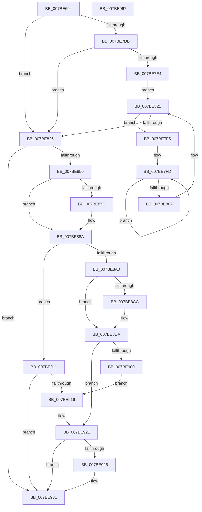

# EtwpInitializeAutoLoggers

- RVA: `0x007BE694`–`0x007BE968` (길이 `724` bytes)
- VA: `0x00000001407BE694`
- 실행 섹션: `PAGE`
- PDB 이름 있음: `예`; PDB Function 태그: `아니요`
- unwind 정보 RVA: `0x000D3C98`
- 디코드: `181`개 명령, `724/724` bytes 표시
- 미해석 바이트: `0` (있으면 어셈블리에 `.byte`로 보존)

> 이 문서는 커널 이미지의 기계어와 PDB 기호를 분석해 생성했습니다. 4번과 5번은 함수 원형과 자료형을 바이너리 사용 방식에서 추정한 C 해석이며 원본 소스 복구 결과는 아닙니다.

## 1. Dependencies

- 직접 호출 지점: **17**; 고유 호출 대상: **11**
- 직접 호출자로 확인된 함수: **1**
- RIP 상대 이미지 참조: **10**

### Outgoing calls
- `0x007BE7AB` → [memset](../../text/6C/memset_function_006C6C40.md) (function, `0x006C6C40`)
- `0x007BE7D1` → [RtlInitializeGenericTableAvl](../../text/46/RtlInitializeGenericTableAvl_function_00466100.md) (function, `0x00466100`)
- `0x007BE7EB` → [EtwpEnableBootLoggerRegistryProviders](../../init/C4/EtwpEnableBootLoggerRegistryProviders_function_00C4EF8C.md) (function, `0x00C4EF8C`)
- `0x007BE819` → [RtlInsertElementGenericTableAvl](../../text/3E/RtlInsertElementGenericTableAvl_function_003EE510.md) (function, `0x003EE510`)
- `0x007BE83F` → [ExAllocatePool2](../../poolcode/B8/ExAllocatePool2_function_00B820F0.md) (function, `0x00B820F0`)
- `0x007BE873` → [RtlGetPersistedStateLocation](../8C/RtlGetPersistedStateLocation_function_008C8DE0.md) (function, `0x008C8DE0`)
- `0x007BE882` → [ExFreePoolWithTag](../../poolcode/B8/ExFreePoolWithTag_function_00B82870.md) (function, `0x00B82870`)
- `0x007BE893` → [ExAllocatePool2](../../poolcode/B8/ExAllocatePool2_function_00B820F0.md) (function, `0x00B820F0`)
- `0x007BE8C3` → [RtlGetPersistedStateLocation](../8C/RtlGetPersistedStateLocation_function_008C8DE0.md) (function, `0x008C8DE0`)
- `0x007BE8D2` → [ExFreePoolWithTag](../../poolcode/B8/ExFreePoolWithTag_function_00B82870.md) (function, `0x00B82870`)
- `0x007BE8E5` → [EtwStartAutoLogger](EtwStartAutoLogger_function_007BD2F8.md) (function, `0x007BD2F8`)
- `0x007BE8F6` → [EtwpEnumerateAutologgerPath](EtwpEnumerateAutologgerPath_function_007BE398.md) (function, `0x007BE398`)
- `0x007BE90A` → [EtwpEnumerateAutologgerPath](EtwpEnumerateAutologgerPath_function_007BE398.md) (function, `0x007BE398`)
- `0x007BE91C` → [ExFreePoolWithTag](../../poolcode/B8/ExFreePoolWithTag_function_00B82870.md) (function, `0x00B82870`)
- `0x007BE92C` → [ExFreePoolWithTag](../../poolcode/B8/ExFreePoolWithTag_function_00B82870.md) (function, `0x00B82870`)
- `0x007BE936` → [EtwpFreeKeyNameList](EtwpFreeKeyNameList_function_007BE660.md) (function, `0x007BE660`)
- `0x007BE945` → [_security_check_cookie](../../text/6A/_security_check_cookie_function_006AC640.md) (function, `0x006AC640`)

### Direct callers
- [EtwpInitializeSiloState](EtwpInitializeSiloState_function_007B6A3C.md) at `0x007B6BE0`

### Static image references
- `0x007BE6B6` → RVA `0x00E0A740` (`.data`; read)
- `0x007BE6CD` → RVA `0x00000000` (`image boundary/outside`; read)
- `0x007BE775` → RVA `0x00B078D0` (` ?? ::NNGAKEGL::`string'`; read)
- `0x007BE78A` → RVA `0x00B078E8` (`PAGE`; read)
- `0x007BE79E` → RVA `0x00B078E0` (`PAGE`; read)
- `0x007BE7B2` → RVA `0x00652940` (`EtwpFreeKeyNameEntry`; read)
- `0x007BE7B9` → RVA `0x006527B0` (`EtwpAllocateKeyNameEntry`; read)
- `0x007BE7C5` → RVA `0x004B55C0` (`EtwpAvlCompareKeyNames`; read)
- `0x007BE85D` → RVA `0x00B07B50` (` ?? ::NNGAKEGL::`string'`; read)
- `0x007BE8AD` → RVA `0x00B07B20` (` ?? ::NNGAKEGL::`string'`; read)

## 2. Other-region calls and transfers

- 다른 실행 섹션으로 향하는 call: **11**
  - `0x007BE7AB` → [memset](../../text/6C/memset_function_006C6C40.md) (`PAGE` → `.text`)
  - `0x007BE7D1` → [RtlInitializeGenericTableAvl](../../text/46/RtlInitializeGenericTableAvl_function_00466100.md) (`PAGE` → `.text`)
  - `0x007BE7EB` → [EtwpEnableBootLoggerRegistryProviders](../../init/C4/EtwpEnableBootLoggerRegistryProviders_function_00C4EF8C.md) (`PAGE` → `INIT`)
  - `0x007BE819` → [RtlInsertElementGenericTableAvl](../../text/3E/RtlInsertElementGenericTableAvl_function_003EE510.md) (`PAGE` → `.text`)
  - `0x007BE83F` → [ExAllocatePool2](../../poolcode/B8/ExAllocatePool2_function_00B820F0.md) (`PAGE` → `POOLCODE`)
  - `0x007BE882` → [ExFreePoolWithTag](../../poolcode/B8/ExFreePoolWithTag_function_00B82870.md) (`PAGE` → `POOLCODE`)
  - `0x007BE893` → [ExAllocatePool2](../../poolcode/B8/ExAllocatePool2_function_00B820F0.md) (`PAGE` → `POOLCODE`)
  - `0x007BE8D2` → [ExFreePoolWithTag](../../poolcode/B8/ExFreePoolWithTag_function_00B82870.md) (`PAGE` → `POOLCODE`)
  - `0x007BE91C` → [ExFreePoolWithTag](../../poolcode/B8/ExFreePoolWithTag_function_00B82870.md) (`PAGE` → `POOLCODE`)
  - `0x007BE92C` → [ExFreePoolWithTag](../../poolcode/B8/ExFreePoolWithTag_function_00B82870.md) (`PAGE` → `POOLCODE`)
  - `0x007BE945` → [_security_check_cookie](../../text/6A/_security_check_cookie_function_006AC640.md) (`PAGE` → `.text`)
- 별도 외부 분기/꼬리 이동을 확인하지 못했습니다.

## 3. Assembly (complete function range)

```asm
007BE694  48 8B C4                        mov rax, rsp
007BE697  48 89 58 10                     mov qword ptr [rax + 0x10], rbx
007BE69B  48 89 70 18                     mov qword ptr [rax + 0x18], rsi
007BE69F  48 89 78 20                     mov qword ptr [rax + 0x20], rdi
007BE6A3  55                              push rbp
007BE6A4  41 56                           push r14
007BE6A6  41 57                           push r15
007BE6A8  48 8D A8 D8 FE FF FF            lea rbp, [rax - 0x128]
007BE6AF  48 81 EC 10 02 00 00            sub rsp, 0x210
007BE6B6  48 8B 05 83 C0 64 00            mov rax, qword ptr [rip + 0x64c083]
007BE6BD  48 33 C4                        xor rax, rsp
007BE6C0  48 89 85 00 01 00 00            mov qword ptr [rbp + 0x100], rax
007BE6C7  41 B8 80 00 00 00               mov r8d, 0x80
007BE6CD  48 8D 15 2C 19 84 FF            lea rdx, [rip - 0x7be6d4]
007BE6D4  48 8D 82 40 78 B0 00            lea rax, [rdx + 0xb07840]
007BE6DB  48 8B F9                        mov rdi, rcx
007BE6DE  0F 10 00                        movups xmm0, xmmword ptr [rax]
007BE6E1  48 8D 4D E0                     lea rcx, [rbp - 0x20]
007BE6E5  0F 10 48 10                     movups xmm1, xmmword ptr [rax + 0x10]
007BE6E9  0F 11 01                        movups xmmword ptr [rcx], xmm0
007BE6EC  0F 10 40 20                     movups xmm0, xmmword ptr [rax + 0x20]
007BE6F0  0F 11 49 10                     movups xmmword ptr [rcx + 0x10], xmm1
007BE6F4  0F 10 48 30                     movups xmm1, xmmword ptr [rax + 0x30]
007BE6F8  0F 11 41 20                     movups xmmword ptr [rcx + 0x20], xmm0
007BE6FC  0F 10 40 40                     movups xmm0, xmmword ptr [rax + 0x40]
007BE700  0F 11 49 30                     movups xmmword ptr [rcx + 0x30], xmm1
007BE704  0F 10 48 50                     movups xmm1, xmmword ptr [rax + 0x50]
007BE708  0F 11 41 40                     movups xmmword ptr [rcx + 0x40], xmm0
007BE70C  0F 10 40 60                     movups xmm0, xmmword ptr [rax + 0x60]
007BE710  0F 11 49 50                     movups xmmword ptr [rcx + 0x50], xmm1
007BE714  0F 11 41 60                     movups xmmword ptr [rcx + 0x60], xmm0
007BE718  0F 10 40 70                     movups xmm0, xmmword ptr [rax + 0x70]
007BE71C  42 8B 04 00                     mov eax, dword ptr [rax + r8]
007BE720  42 0F 11 44 01 F0               movups xmmword ptr [rcx + r8 - 0x10], xmm0
007BE726  42 89 04 01                     mov dword ptr [rcx + r8], eax
007BE72A  48 8D 82 F0 78 B0 00            lea rax, [rdx + 0xb078f0]
007BE731  0F 10 00                        movups xmm0, xmmword ptr [rax]
007BE734  48 8D 4D 70                     lea rcx, [rbp + 0x70]
007BE738  33 D2                           xor edx, edx
007BE73A  0F 10 48 10                     movups xmm1, xmmword ptr [rax + 0x10]
007BE73E  0F 11 01                        movups xmmword ptr [rcx], xmm0
007BE741  0F 10 40 20                     movups xmm0, xmmword ptr [rax + 0x20]
007BE745  0F 11 49 10                     movups xmmword ptr [rcx + 0x10], xmm1
007BE749  0F 10 48 30                     movups xmm1, xmmword ptr [rax + 0x30]
007BE74D  0F 11 41 20                     movups xmmword ptr [rcx + 0x20], xmm0
007BE751  0F 10 40 40                     movups xmm0, xmmword ptr [rax + 0x40]
007BE755  0F 11 49 30                     movups xmmword ptr [rcx + 0x30], xmm1
007BE759  0F 10 48 50                     movups xmm1, xmmword ptr [rax + 0x50]
007BE75D  0F 11 41 40                     movups xmmword ptr [rcx + 0x40], xmm0
007BE761  0F 10 40 60                     movups xmm0, xmmword ptr [rax + 0x60]
007BE765  0F 11 49 50                     movups xmmword ptr [rcx + 0x50], xmm1
007BE769  0F 10 48 70                     movups xmm1, xmmword ptr [rax + 0x70]
007BE76D  4A 8B 04 00                     mov rax, qword ptr [rax + r8]
007BE771  0F 11 41 60                     movups xmmword ptr [rcx + 0x60], xmm0
007BE775  0F 10 05 54 91 34 00            movups xmm0, xmmword ptr [rip + 0x349154]
007BE77C  42 0F 11 4C 01 F0               movups xmmword ptr [rcx + r8 - 0x10], xmm1
007BE782  4A 89 04 01                     mov qword ptr [rcx + r8], rax
007BE786  44 8D 42 68                     lea r8d, [rdx + 0x68]
007BE78A  0F B7 05 57 91 34 00            movzx eax, word ptr [rip + 0x349157]
007BE791  48 8D 4C 24 50                  lea rcx, [rsp + 0x50]
007BE796  0F 11 45 C0                     movups xmmword ptr [rbp - 0x40], xmm0
007BE79A  66 89 45 D8                     mov word ptr [rbp - 0x28], ax
007BE79E  F2 0F 10 05 3A 91 34 00         movsd xmm0, qword ptr [rip + 0x34913a]
007BE7A6  F2 0F 11 45 D0                  movsd qword ptr [rbp - 0x30], xmm0
007BE7AB  E8 90 84 F0 FF                  call 0x1406c6c40
007BE7B0  33 F6                           xor esi, esi
007BE7B2  4C 8D 0D 87 41 E9 FF            lea r9, [rip - 0x16be79]
007BE7B9  4C 8D 05 F0 3F E9 FF            lea r8, [rip - 0x16c010]
007BE7C0  48 89 74 24 20                  mov qword ptr [rsp + 0x20], rsi
007BE7C5  48 8D 15 F4 6D CF FF            lea rdx, [rip - 0x30920c]
007BE7CC  48 8D 4C 24 50                  lea rcx, [rsp + 0x50]
007BE7D1  E8 2A 79 CA FF                  call 0x140466100
007BE7D6  48 85 FF                        test rdi, rdi
007BE7D9  74 4B                           je 0x1407be826
007BE7DB  48 8D 5F 08                     lea rbx, [rdi + 8]
007BE7DF  48 39 1B                        cmp qword ptr [rbx], rbx
007BE7E2  74 42                           je 0x1407be826
007BE7E4  48 8B D7                        mov rdx, rdi
007BE7E7  48 8D 4D E0                     lea rcx, [rbp - 0x20]
007BE7EB  E8 9C 07 49 00                  call 0x140c4ef8c
007BE7F0  48 8B 3B                        mov rdi, qword ptr [rbx]
007BE7F3  EB 2C                           jmp 0x1407be821
007BE7F5  48 8B 57 10                     mov rdx, qword ptr [rdi + 0x10]
007BE7F9  49 83 C8 FF                     or r8, 0xffffffffffffffff
007BE7FD  49 FF C0                        inc r8
007BE800  66 42 39 34 42                  cmp word ptr [rdx + r8*2], si
007BE805  75 F6                           jne 0x1407be7fd
007BE807  46 8D 04 45 02 00 00 00         lea r8d, [r8*2 + 2]
007BE80F  4C 8D 4C 24 40                  lea r9, [rsp + 0x40]
007BE814  48 8D 4C 24 50                  lea rcx, [rsp + 0x50]
007BE819  E8 F2 FC C2 FF                  call 0x1403ee510
007BE81E  48 8B 3F                        mov rdi, qword ptr [rdi]
007BE821  48 3B FB                        cmp rdi, rbx
007BE824  75 CF                           jne 0x1407be7f5
007BE826  41 BE 45 74 77 74               mov r14d, 0x74777445
007BE82C  41 BF 08 02 00 00               mov r15d, 0x208
007BE832  BB 00 01 00 00                  mov ebx, 0x100
007BE837  45 8B C6                        mov r8d, r14d
007BE83A  41 8B D7                        mov edx, r15d
007BE83D  8B CB                           mov ecx, ebx
007BE83F  E8 AC 38 3C 00                  call 0x140b820f0
007BE844  48 8B F8                        mov rdi, rax
007BE847  48 85 C0                        test rax, rax
007BE84A  0F 84 E1 00 00 00               je 0x1407be931
007BE850  48 8D 44 24 44                  lea rax, [rsp + 0x44]
007BE855  45 33 C9                        xor r9d, r9d
007BE858  48 89 44 24 30                  mov qword ptr [rsp + 0x30], rax
007BE85D  48 8D 0D EC 92 34 00            lea rcx, [rip + 0x3492ec]
007BE864  44 89 7C 24 28                  mov dword ptr [rsp + 0x28], r15d
007BE869  45 33 C0                        xor r8d, r8d
007BE86C  33 D2                           xor edx, edx
007BE86E  48 89 7C 24 20                  mov qword ptr [rsp + 0x20], rdi
007BE873  E8 68 A5 10 00                  call 0x1408c8de0
007BE878  85 C0                           test eax, eax
007BE87A  74 0E                           je 0x1407be88a
007BE87C  41 8B D6                        mov edx, r14d
007BE87F  48 8B CF                        mov rcx, rdi
007BE882  E8 E9 3F 3C 00                  call 0x140b82870
007BE887  48 8B FE                        mov rdi, rsi
007BE88A  45 8B C6                        mov r8d, r14d
007BE88D  49 8B D7                        mov rdx, r15
007BE890  48 8B CB                        mov rcx, rbx
007BE893  E8 58 38 3C 00                  call 0x140b820f0
007BE898  48 8B D8                        mov rbx, rax
007BE89B  48 85 C0                        test rax, rax
007BE89E  74 71                           je 0x1407be911
007BE8A0  48 8D 44 24 44                  lea rax, [rsp + 0x44]
007BE8A5  45 33 C9                        xor r9d, r9d
007BE8A8  48 89 44 24 30                  mov qword ptr [rsp + 0x30], rax
007BE8AD  48 8D 0D 6C 92 34 00            lea rcx, [rip + 0x34926c]
007BE8B4  44 89 7C 24 28                  mov dword ptr [rsp + 0x28], r15d
007BE8B9  45 33 C0                        xor r8d, r8d
007BE8BC  33 D2                           xor edx, edx
007BE8BE  48 89 5C 24 20                  mov qword ptr [rsp + 0x20], rbx
007BE8C3  E8 18 A5 10 00                  call 0x1408c8de0
007BE8C8  85 C0                           test eax, eax
007BE8CA  74 0E                           je 0x1407be8da
007BE8CC  41 8B D6                        mov edx, r14d
007BE8CF  48 8B CB                        mov rcx, rbx
007BE8D2  E8 99 3F 3C 00                  call 0x140b82870
007BE8D7  48 8B DE                        mov rbx, rsi
007BE8DA  4C 8B C3                        mov r8, rbx
007BE8DD  48 8D 55 70                     lea rdx, [rbp + 0x70]
007BE8E1  48 8D 4D C0                     lea rcx, [rbp - 0x40]
007BE8E5  E8 0E EA FF FF                  call 0x1407bd2f8
007BE8EA  4C 8D 44 24 50                  lea r8, [rsp + 0x50]
007BE8EF  48 8B D7                        mov rdx, rdi
007BE8F2  48 8D 4D E0                     lea rcx, [rbp - 0x20]
007BE8F6  E8 9D FA FF FF                  call 0x1407be398
007BE8FB  48 85 FF                        test rdi, rdi
007BE8FE  74 21                           je 0x1407be921
007BE900  4C 8D 44 24 50                  lea r8, [rsp + 0x50]
007BE905  33 D2                           xor edx, edx
007BE907  48 8B CF                        mov rcx, rdi
007BE90A  E8 89 FA FF FF                  call 0x1407be398
007BE90F  EB 05                           jmp 0x1407be916
007BE911  48 85 FF                        test rdi, rdi
007BE914  74 1B                           je 0x1407be931
007BE916  41 8B D6                        mov edx, r14d
007BE919  48 8B CF                        mov rcx, rdi
007BE91C  E8 4F 3F 3C 00                  call 0x140b82870
007BE921  48 85 DB                        test rbx, rbx
007BE924  74 0B                           je 0x1407be931
007BE926  41 8B D6                        mov edx, r14d
007BE929  48 8B CB                        mov rcx, rbx
007BE92C  E8 3F 3F 3C 00                  call 0x140b82870
007BE931  48 8D 4C 24 50                  lea rcx, [rsp + 0x50]
007BE936  E8 25 FD FF FF                  call 0x1407be660
007BE93B  48 8B 8D 00 01 00 00            mov rcx, qword ptr [rbp + 0x100]
007BE942  48 33 CC                        xor rcx, rsp
007BE945  E8 F6 DC EE FF                  call 0x1406ac640
007BE94A  4C 8D 9C 24 10 02 00 00         lea r11, [rsp + 0x210]
007BE952  49 8B 5B 28                     mov rbx, qword ptr [r11 + 0x28]
007BE956  49 8B 73 30                     mov rsi, qword ptr [r11 + 0x30]
007BE95A  49 8B 7B 38                     mov rdi, qword ptr [r11 + 0x38]
007BE95E  49 8B E3                        mov rsp, r11
007BE961  41 5F                           pop r15
007BE963  41 5E                           pop r14
007BE965  5D                              pop rbp
007BE966  C3                              ret
007BE967  CC                              int3
```

## 4. C-style interpretation (structured pseudocode)

```c
__int64 __fastcall EtwpInitializeAutoLoggers(__int64 a1)
{
    __int64 result;
    __int64 v_rbx;
    __int64 v_rdi;
    __int64 v_rsi;
    __int64 v_rsp;
    unsigned __int64 v_stack_m18;
    unsigned __int64 v_stack_m1D8;
    unsigned __int64 v_stack_m1E4;
    unsigned __int64 v_stack_m1E8;
    unsigned __int64 v_stack_m1F8;
    unsigned int v_stack_m200;
    unsigned __int64 v_stack_m208;

    *(unsigned __int64 *)(v_rsp + 16) = v_rbx;
    *(unsigned __int64 *)(v_rsp + 24) = v_rsi;
    *(unsigned __int64 *)(v_rsp + 32) = v_rdi;
    v_rsp = (v_rsp) - (528);
    result = (*(unsigned __int64 *)(v_rip + 6602883)) ^ (v_rsp);
    *(unsigned __int64 *)(v_rsp - 296 + 256) = result;
    *(unsigned __int64 *)(v_rsp - 296 - 32) = v_xmm0;
    *(unsigned __int64 *)(v_rsp - 296 - 32 + 16) = v_xmm1;
    *(unsigned __int64 *)(v_rsp - 296 - 32 + 32) = v_xmm0;
    *(unsigned __int64 *)(v_rsp - 296 - 32 + 48) = v_xmm1;
    *(unsigned __int64 *)(v_rsp - 296 - 32 + 64) = v_xmm0;
    *(unsigned __int64 *)(v_rsp - 296 - 32 + 80) = v_xmm1;
    *(unsigned __int64 *)(v_rsp - 296 - 32 + 96) = v_xmm0;
    *(unsigned __int64 *)(v_rsp - 296 - 32 + 128 * 1 - 16) = v_xmm0;
    *(unsigned int *)(v_rsp - 296 - 32 + 128 * 1) = (unsigned int)((unsigned int)(*(unsigned int *)(v_rip - 8120020 + 11565120 + 128 * 1)));
    a2 = 0;
    *(unsigned __int64 *)(v_rsp - 296 + 112) = v_xmm0;
    *(unsigned __int64 *)(v_rsp - 296 + 112 + 16) = v_xmm1;
    *(unsigned __int64 *)(v_rsp - 296 + 112 + 32) = v_xmm0;
    *(unsigned __int64 *)(v_rsp - 296 + 112 + 48) = v_xmm1;
    *(unsigned __int64 *)(v_rsp - 296 + 112 + 64) = v_xmm0;
    *(unsigned __int64 *)(v_rsp - 296 + 112 + 80) = v_xmm1;
    *(unsigned __int64 *)(v_rsp - 296 + 112 + 96) = v_xmm0;
    *(unsigned __int64 *)(v_rsp - 296 + 112 + 128 * 1 - 16) = v_xmm1;
    *(unsigned __int64 *)(v_rsp - 296 + 112 + 128 * 1) = *(unsigned __int64 *)(v_rip - 8120020 + 11565296 + 128 * 1);
    *(unsigned __int64 *)(v_rsp - 296 - 64) = v_xmm0;
    *(unsigned __int16 *)(v_rsp - 296 - 40) = (unsigned __int16)(*(unsigned __int16 *)(v_rip + 3445079));
    *(unsigned __int64 *)(v_rsp - 296 - 48) = v_xmm0;
    result = memset(v_stack_m1D8, a2, a2 + 104, a4);
    v_rsi = 0;
    v_stack_m208 = 0;
    result = RtlInitializeGenericTableAvl(v_stack_m1D8, v_rip - 3183116, v_rip - 1490960, v_rip - 1490553);
    if (a1 == 0) goto loc_007BE826;
    if ((*(unsigned __int64 *)(a1 + 8)) == (a1 + 8)) goto loc_007BE826;
    result = EtwpEnableBootLoggerRegistryProviders(v_rsp - 296 - 32, a1, v_rip - 1490960, v_rip - 1490553);
    goto loc_007BE821;
loc_007BE7F5:
    a3 = (v_rip - 1490960) | (-1);
loc_007BE7FD:
    a3 = (a3) + 1;
    if ((*(unsigned __int16 *)(*(unsigned __int64 *)(*(unsigned __int64 *)(a1 + 8) + 16) + a3 * 2)) != 0) goto loc_007BE7FD;
    result = RtlInsertElementGenericTableAvl(v_stack_m1D8, *(unsigned __int64 *)(*(unsigned __int64 *)(a1 + 8) + 16), a3 * 2 + 2, v_stack_m1E8);
loc_007BE821:
    if ((*(unsigned __int64 *)(*(unsigned __int64 *)(a1 + 8))) != (a1 + 8)) goto loc_007BE7F5;
loc_007BE826:
    result = ExAllocatePool2(256, 520, (unsigned int)((unsigned int)((unsigned int)(0x74777445ULL))), v_stack_m1E8);
    if (result == 0) goto loc_007BE931;
    a4 = 0;
    v_stack_m1F8 = v_stack_m1E4;
    v_stack_m200 = 520;
    a3 = 0;
    a2 = 0;
    v_stack_m208 = result;
    result = RtlGetPersistedStateLocation(v_rip + 3445484, a2, a3, a4);
    v_rdi = result;
    if ((unsigned int)(result) != 0) {
        a2 = (unsigned int)((unsigned int)(0x74777445ULL));
        a1 = result;
        result = ExFreePoolWithTag(a1, a2, a3, a4);
        v_rdi = 0;
    }
    result = ExAllocatePool2(256, 520, (unsigned int)((unsigned int)((unsigned int)(0x74777445ULL))), a4);
    if (result == 0) goto loc_007BE911;
    a4 = 0;
    v_stack_m1F8 = v_stack_m1E4;
    v_stack_m200 = 520;
    a3 = 0;
    a2 = 0;
    v_stack_m208 = result;
    result = RtlGetPersistedStateLocation(v_rip + 3445356, a2, a3, a4);
    v_rbx = result;
    if ((unsigned int)(result) != 0) {
        a2 = (unsigned int)((unsigned int)(0x74777445ULL));
        a1 = result;
        result = ExFreePoolWithTag(a1, a2, a3, a4);
        v_rbx = 0;
    }
    result = EtwStartAutoLogger(v_rsp - 296 - 64, v_rsp - 296 + 112, v_rbx, a4);
    result = EtwpEnumerateAutologgerPath(v_rsp - 296 - 32, v_rdi, v_stack_m1D8, a4);
    if (v_rdi == 0) goto loc_007BE921;
    a2 = 0;
    result = EtwpEnumerateAutologgerPath(v_rdi, a2, v_stack_m1D8, a4);
    goto loc_007BE916;
loc_007BE911:
    if (v_rdi == 0) goto loc_007BE931;
loc_007BE916:
    result = ExFreePoolWithTag(v_rdi, (unsigned int)((unsigned int)((unsigned int)(0x74777445ULL))), v_stack_m1D8, a4);
loc_007BE921:
    if (v_rbx != 0) {
        a2 = (unsigned int)((unsigned int)(0x74777445ULL));
        a1 = v_rbx;
        result = ExFreePoolWithTag(a1, a2, v_stack_m1D8, a4);
    }
    result = EtwpFreeKeyNameList(v_stack_m1D8, a2, v_stack_m1D8, a4);
    a1 = (*(unsigned __int64 *)(v_rsp - 296 + 256)) ^ (v_rsp);
    result = _security_check_cookie(a1, a2, v_stack_m1D8, a4);
    return result;
}
```

## 5. (Beta) C Style

```c
int64_t EtwpInitializeAutoLoggers(int64_t Arg1)
{
    int64_t result;
    int64_t local_rbx;
    int64_t local_rdi;
    int64_t local_rsi;
    int64_t local_rsp;
    uint64_t v_stack_m18;
    uint64_t v_stack_m1D8;
    uint64_t v_stack_m1E4;
    uint64_t v_stack_m1E8;
    uint64_t v_stack_m1F8;
    uint32_t v_stack_m200;
    uint64_t v_stack_m208;

    *(uint64_t *)(local_rsp + 0x10) = local_rbx;
    *(uint64_t *)(local_rsp + 0x18) = local_rsi;
    *(uint64_t *)(local_rsp + 0x20) = local_rdi;
    local_rsp = (local_rsp) - (528);
    result = (*(uint64_t *)(v_rip + 0x64C083)) ^ (local_rsp);
    *(uint64_t *)(local_rsp - 0x128 + 0x100) = result;
    *(uint64_t *)(local_rsp - 0x128 - 0x20) = v_xmm0;
    *(uint64_t *)(local_rsp - 0x128 - 0x20 + 0x10) = v_xmm1;
    *(uint64_t *)(local_rsp - 0x128 - 0x20 + 0x20) = v_xmm0;
    *(uint64_t *)(local_rsp - 0x128 - 0x20 + 0x30) = v_xmm1;
    *(uint64_t *)(local_rsp - 0x128 - 0x20 + 0x40) = v_xmm0;
    *(uint64_t *)(local_rsp - 0x128 - 0x20 + 0x50) = v_xmm1;
    *(uint64_t *)(local_rsp - 0x128 - 0x20 + 0x60) = v_xmm0;
    *(uint64_t *)(local_rsp - 0x128 - 0x20 + 0x80 * 1 - 0x10) = v_xmm0;
    *(uint32_t *)(local_rsp - 0x128 - 0x20 + 0x80 * 1) = (uint32_t)((uint32_t)(*(uint32_t *)(v_rip - 0x7BE6D4 + 0xB07840 + 0x80 * 1)));
    a2 = 0;
    *(uint64_t *)(local_rsp - 0x128 + 0x70) = v_xmm0;
    *(uint64_t *)(local_rsp - 0x128 + 0x70 + 0x10) = v_xmm1;
    *(uint64_t *)(local_rsp - 0x128 + 0x70 + 0x20) = v_xmm0;
    *(uint64_t *)(local_rsp - 0x128 + 0x70 + 0x30) = v_xmm1;
    *(uint64_t *)(local_rsp - 0x128 + 0x70 + 0x40) = v_xmm0;
    *(uint64_t *)(local_rsp - 0x128 + 0x70 + 0x50) = v_xmm1;
    *(uint64_t *)(local_rsp - 0x128 + 0x70 + 0x60) = v_xmm0;
    *(uint64_t *)(local_rsp - 0x128 + 0x70 + 0x80 * 1 - 0x10) = v_xmm1;
    *(uint64_t *)(local_rsp - 0x128 + 0x70 + 0x80 * 1) = *(uint64_t *)(v_rip - 0x7BE6D4 + 0xB078F0 + 0x80 * 1);
    *(uint64_t *)(local_rsp - 0x128 - 0x40) = v_xmm0;
    *(uint16_t *)(local_rsp - 0x128 - 0x28) = (uint16_t)(*(uint16_t *)(v_rip + 0x349157));
    *(uint64_t *)(local_rsp - 0x128 - 0x30) = v_xmm0;
    result = memset(v_stack_m1D8, a2, a2 + 104, a4);
    local_rsi = 0;
    v_stack_m208 = 0;
    result = RtlInitializeGenericTableAvl(v_stack_m1D8, v_rip - 3183116, v_rip - 1490960, v_rip - 1490553);
    if (Arg1 == 0) goto loc_007BE826;
    if ((*(uint64_t *)(Arg1 + 0x8)) == (Arg1 + 8)) goto loc_007BE826;
    result = EtwpEnableBootLoggerRegistryProviders(local_rsp - 296 - 32, Arg1, v_rip - 1490960, v_rip - 1490553);
    goto loc_007BE821;
loc_007BE7F5:
    a3 = (v_rip - 1490960) | (-1);
loc_007BE7FD:
    a3 = (a3) + 1;
    if ((*(uint16_t *)(*(uint64_t *)(*(uint64_t *)(Arg1 + 0x8) + 0x10) + a3 * 2)) != 0) goto loc_007BE7FD;
    result = RtlInsertElementGenericTableAvl(v_stack_m1D8, *(uint64_t *)(*(uint64_t *)(Arg1 + 0x8) + 0x10), a3 * 2 + 2, v_stack_m1E8);
loc_007BE821:
    if ((*(uint64_t *)(*(uint64_t *)(Arg1 + 0x8))) != (Arg1 + 8)) goto loc_007BE7F5;
loc_007BE826:
    result = ExAllocatePool2(256, 520, (uint32_t)((uint32_t)((uint32_t)(0x74777445ULL))), v_stack_m1E8);
    if (result == 0) goto loc_007BE931;
    a4 = 0;
    v_stack_m1F8 = v_stack_m1E4;
    v_stack_m200 = 520;
    a3 = 0;
    a2 = 0;
    v_stack_m208 = result;
    result = RtlGetPersistedStateLocation(v_rip + 3445484, a2, a3, a4);
    local_rdi = result;
    if ((uint32_t)(result) != 0) {
        a2 = (uint32_t)((uint32_t)(0x74777445ULL));
        Arg1 = result;
        result = ExFreePoolWithTag(Arg1, a2, a3, a4);
        local_rdi = 0;
    }
    result = ExAllocatePool2(256, 520, (uint32_t)((uint32_t)((uint32_t)(0x74777445ULL))), a4);
    if (result == 0) goto loc_007BE911;
    a4 = 0;
    v_stack_m1F8 = v_stack_m1E4;
    v_stack_m200 = 520;
    a3 = 0;
    a2 = 0;
    v_stack_m208 = result;
    result = RtlGetPersistedStateLocation(v_rip + 3445356, a2, a3, a4);
    local_rbx = result;
    if ((uint32_t)(result) != 0) {
        a2 = (uint32_t)((uint32_t)(0x74777445ULL));
        Arg1 = result;
        result = ExFreePoolWithTag(Arg1, a2, a3, a4);
        local_rbx = 0;
    }
    result = EtwStartAutoLogger(local_rsp - 296 - 64, local_rsp - 296 + 112, local_rbx, a4);
    result = EtwpEnumerateAutologgerPath(local_rsp - 296 - 32, local_rdi, v_stack_m1D8, a4);
    if (local_rdi == 0) goto loc_007BE921;
    a2 = 0;
    result = EtwpEnumerateAutologgerPath(local_rdi, a2, v_stack_m1D8, a4);
    goto loc_007BE916;
loc_007BE911:
    if (local_rdi == 0) goto loc_007BE931;
loc_007BE916:
    result = ExFreePoolWithTag(local_rdi, (uint32_t)((uint32_t)((uint32_t)(0x74777445ULL))), v_stack_m1D8, a4);
loc_007BE921:
    if (local_rbx != 0) {
        a2 = (uint32_t)((uint32_t)(0x74777445ULL));
        Arg1 = local_rbx;
        result = ExFreePoolWithTag(Arg1, a2, v_stack_m1D8, a4);
    }
    result = EtwpFreeKeyNameList(v_stack_m1D8, a2, v_stack_m1D8, a4);
    Arg1 = (*(uint64_t *)(local_rsp - 0x128 + 0x100)) ^ (local_rsp);
    result = _security_check_cookie(Arg1, a2, v_stack_m1D8, a4);
    return result;
}
```

## 6. Execution-region graph

[열기: 2D/3D 그래프와 함수 탐색 컨트롤 패널](../../../control-panel.html?section=page&rva=0x007BE694&view=graph)

- 2D 그래프는 위에서 아래로 흐르고, 3D 그래프는 빈 공간을 드래그해 회전합니다. Shift+드래그는 이동, 휠은 확대·축소, 함수 노드 선택은 대상 보고서 이동입니다.

### Static fallback


