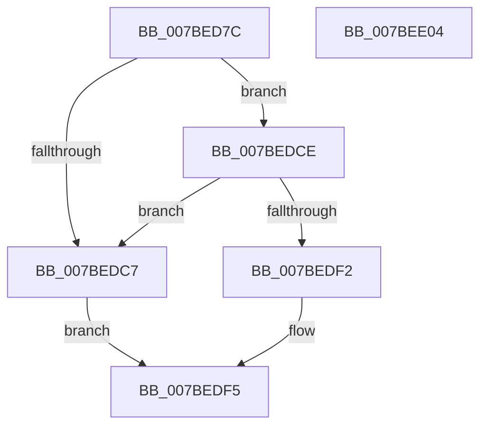

# EtwpInitializeCompressedWriter

- RVA: `0x007BED7C`–`0x007BEE05` (길이 `137` bytes)
- VA: `0x00000001407BED7C`
- 실행 섹션: `PAGE`
- PDB 이름 있음: `예`; PDB Function 태그: `아니요`
- unwind 정보 RVA: `0x000C8960`
- 디코드: `44`개 명령, `137/137` bytes 표시
- 미해석 바이트: `0` (있으면 어셈블리에 `.byte`로 보존)

> 이 문서는 커널 이미지의 기계어와 PDB 기호를 분석해 생성했습니다. 4번과 5번은 함수 원형과 자료형을 바이너리 사용 방식에서 추정한 C 해석이며 원본 소스 복구 결과는 아닙니다.

## 1. Dependencies

- 직접 호출 지점: **3**; 고유 호출 대상: **2**
- 직접 호출자로 확인된 함수: **1**
- RIP 상대 이미지 참조: **0**

### Outgoing calls
- `0x007BEDA5` → [RtlGetCompressionWorkSpaceSize](../../text/3B/RtlGetCompressionWorkSpaceSize_function_003B2560.md) (function, `0x003B2560`)
- `0x007BEDB9` → [ExAllocatePool2](../../poolcode/B8/ExAllocatePool2_function_00B820F0.md) (function, `0x00B820F0`)
- `0x007BEDE4` → [ExAllocatePool2](../../poolcode/B8/ExAllocatePool2_function_00B820F0.md) (function, `0x00B820F0`)

### Direct callers
- [EtwpSavePersistedLogger](EtwpSavePersistedLogger_function_007BF374.md) at `0x007BF5A0`

### Static image references
- 디코드된 RIP-relative 메모리 참조가 없습니다.

## 2. Other-region calls and transfers

- 다른 실행 섹션으로 향하는 call: **3**
  - `0x007BEDA5` → [RtlGetCompressionWorkSpaceSize](../../text/3B/RtlGetCompressionWorkSpaceSize_function_003B2560.md) (`PAGE` → `.text`)
  - `0x007BEDB9` → [ExAllocatePool2](../../poolcode/B8/ExAllocatePool2_function_00B820F0.md) (`PAGE` → `POOLCODE`)
  - `0x007BEDE4` → [ExAllocatePool2](../../poolcode/B8/ExAllocatePool2_function_00B820F0.md) (`PAGE` → `POOLCODE`)
- 별도 외부 분기/꼬리 이동을 확인하지 못했습니다.

## 3. Assembly (complete function range)

```asm
007BED7C  48 8B C4                        mov rax, rsp
007BED7F  48 89 58 10                     mov qword ptr [rax + 0x10], rbx
007BED83  55                              push rbp
007BED84  56                              push rsi
007BED85  57                              push rdi
007BED86  48 83 EC 20                     sub rsp, 0x20
007BED8A  33 DB                           xor ebx, ebx
007BED8C  49 8B E8                        mov rbp, r8
007BED8F  8B F2                           mov esi, edx
007BED91  89 58 20                        mov dword ptr [rax + 0x20], ebx
007BED94  48 8B F9                        mov rdi, rcx
007BED97  89 58 08                        mov dword ptr [rax + 8], ebx
007BED9A  4C 8D 40 20                     lea r8, [rax + 0x20]
007BED9E  8D 4B 03                        lea ecx, [rbx + 3]
007BEDA1  48 8D 50 08                     lea rdx, [rax + 8]
007BEDA5  E8 B6 37 BF FF                  call 0x1403b2560
007BEDAA  8B 54 24 40                     mov edx, dword ptr [rsp + 0x40]
007BEDAE  B9 00 01 00 00                  mov ecx, 0x100
007BEDB3  41 B8 45 74 77 5A               mov r8d, 0x5a777445
007BEDB9  E8 32 33 3C 00                  call 0x140b820f0
007BEDBE  48 89 47 20                     mov qword ptr [rdi + 0x20], rax
007BEDC2  48 85 C0                        test rax, rax
007BEDC5  75 07                           jne 0x1407bedce
007BEDC7  BB 17 00 00 C0                  mov ebx, 0xc0000017
007BEDCC  EB 27                           jmp 0x1407bedf5
007BEDCE  8D 04 36                        lea eax, [rsi + rsi]
007BEDD1  89 77 10                        mov dword ptr [rdi + 0x10], esi
007BEDD4  8B D0                           mov edx, eax
007BEDD6  B9 00 01 00 00                  mov ecx, 0x100
007BEDDB  41 B8 45 74 77 5A               mov r8d, 0x5a777445
007BEDE1  89 47 30                        mov dword ptr [rdi + 0x30], eax
007BEDE4  E8 07 33 3C 00                  call 0x140b820f0
007BEDE9  48 89 47 28                     mov qword ptr [rdi + 0x28], rax
007BEDED  48 85 C0                        test rax, rax
007BEDF0  74 D5                           je 0x1407bedc7
007BEDF2  48 89 2F                        mov qword ptr [rdi], rbp
007BEDF5  8B C3                           mov eax, ebx
007BEDF7  48 8B 5C 24 48                  mov rbx, qword ptr [rsp + 0x48]
007BEDFC  48 83 C4 20                     add rsp, 0x20
007BEE00  5F                              pop rdi
007BEE01  5E                              pop rsi
007BEE02  5D                              pop rbp
007BEE03  C3                              ret
007BEE04  CC                              int3
```

## 4. C-style interpretation (structured pseudocode)

```c
__int64 __fastcall EtwpInitializeCompressedWriter(__int64 a1, int a2, __int64 a3)
{
    __int64 result;
    __int64 v_rbx;
    __int64 v_rsp;
    unsigned __int64 v_stack_p10;
    unsigned int v_stack_p8;

    *(unsigned __int64 *)(v_rsp + 16) = v_rbx;
    v_rsp = (v_rsp) - (32);
    v_rbx = 0;
    *(unsigned int *)(v_rsp + 32) = 0;
    *(unsigned int *)(v_rsp + 8) = 0;
    result = RtlGetCompressionWorkSpaceSize(v_rbx + 3, v_rsp + 8, v_rsp + 32, a4);
    result = ExAllocatePool2(256, (unsigned int)(v_stack_p8), (unsigned int)(0x5A777445ULL), a4);
    *(unsigned __int64 *)(a1 + 32) = result;
    if (result != 0) goto loc_007BEDCE;
loc_007BEDC7:
    goto loc_007BEDF5;
loc_007BEDCE:
    *(unsigned int *)(a1 + 16) = (unsigned int)((unsigned int)(a2));
    *(unsigned int *)(a1 + 48) = (unsigned int)((unsigned int)(a2) + (unsigned int)(a2) * 1);
    result = ExAllocatePool2(256, (unsigned int)((unsigned int)((unsigned int)(a2) + (unsigned int)(a2) * 1)), (unsigned int)(0x5A777445ULL), a4);
    *(unsigned __int64 *)(a1 + 40) = result;
    if (result == 0) goto loc_007BEDC7;
    *(unsigned __int64 *)(a1) = a3;
loc_007BEDF5:
    v_rsp = (v_rsp) + (32);
    return (unsigned int)((unsigned int)((unsigned int)(0xC0000017ULL)));
}
```

## 5. (Beta) C Style

```c
int64_t EtwpInitializeCompressedWriter(void *Arg1, void *Arg2, int64_t Arg3)
{
    uint8_t *arg1 = (uint8_t *)Arg1;
    uint8_t *arg2 = (uint8_t *)Arg2;

    int64_t result;
    int64_t local_rbx;
    int64_t local_rsp;
    uint64_t v_stack_p10;
    uint32_t v_stack_p8;

    *(uint64_t *)(local_rsp + 0x10) = local_rbx;
    local_rsp = (local_rsp) - (32);
    local_rbx = 0;
    *(uint32_t *)(local_rsp + 0x20) = 0;
    *(uint32_t *)(local_rsp + 0x8) = 0;
    result = RtlGetCompressionWorkSpaceSize(local_rbx + 3, local_rsp + 8, local_rsp + 32, a4);
    result = ExAllocatePool2(256, (uint32_t)(v_stack_p8), (uint32_t)(0x5A777445ULL), a4);
    *(uint64_t *)(arg1 + 0x20) = result;
    if (result != 0) goto loc_007BEDCE;
loc_007BEDC7:
    goto loc_007BEDF5;
loc_007BEDCE:
    *(uint32_t *)(arg1 + 0x10) = (uint32_t)((uint32_t)(Arg2));
    *(uint32_t *)(arg1 + 0x30) = (uint32_t)((uint32_t)(Arg2) + (uint32_t)(Arg2) * 1);
    result = ExAllocatePool2(256, (uint32_t)((uint32_t)((uint32_t)(Arg2) + (uint32_t)(Arg2) * 1)), (uint32_t)(0x5A777445ULL), a4);
    *(uint64_t *)(arg1 + 0x28) = result;
    if (result == 0) goto loc_007BEDC7;
    *(uint64_t *)(arg1) = Arg3;
loc_007BEDF5:
    local_rsp = (local_rsp) + (32);
    return (uint32_t)((uint32_t)((uint32_t)(0xC0000017ULL)));
}
```

### 관측된 메모리 오프셋

구조체 형식이 확인되지 않은 접근은 인자 기준의 오프셋으로만 기록했습니다.

| 기준 인자 | 오프셋 표현 | 폭 (bit) | 접근 |
|---|---:|---:|---|
| `Arg1` | `+ 0x0` | `64` | `W` |
| `Arg1` | `+ 0x10` | `32` | `W` |
| `Arg1` | `+ 0x20` | `64` | `W` |
| `Arg1` | `+ 0x28` | `64` | `W` |
| `Arg1` | `+ 0x30` | `32` | `W` |
| `Arg2` | `+ 0x0 + rsi*1` | `32` | `R` |

## 6. Execution-region graph

[열기: 2D/3D 그래프와 함수 탐색 컨트롤 패널](../../../control-panel.html?section=page&rva=0x007BED7C&view=graph)

- 2D 그래프는 위에서 아래로 흐르고, 3D 그래프는 빈 공간을 드래그해 회전합니다. Shift+드래그는 이동, 휠은 확대·축소, 함수 노드 선택은 대상 보고서 이동입니다.

### Static fallback


