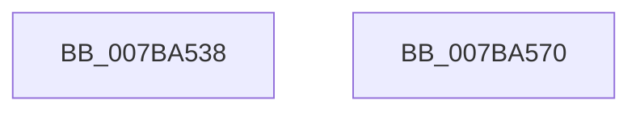

# EtwpInitializeCoverage

- RVA: `0x007BA538`–`0x007BA571` (길이 `57` bytes)
- VA: `0x00000001407BA538`
- 실행 섹션: `PAGE`
- PDB 이름 있음: `예`; PDB Function 태그: `아니요`
- unwind 정보 RVA: `0x0005C788`
- 디코드: `11`개 명령, `57/57` bytes 표시
- 미해석 바이트: `0` (있으면 어셈블리에 `.byte`로 보존)

> 이 문서는 커널 이미지의 기계어와 PDB 기호를 분석해 생성했습니다. 4번과 5번은 함수 원형과 자료형을 바이너리 사용 방식에서 추정한 C 해석이며 원본 소스 복구 결과는 아닙니다.

## 1. Dependencies

- 직접 호출 지점: **1**; 고유 호출 대상: **1**
- 직접 호출자로 확인된 함수: **1**
- RIP 상대 이미지 참조: **4**

### Outgoing calls
- `0x007BA566` → [TraceLoggingRegisterEx_EtwRegister_EtwSetInformation](../92/TraceLoggingRegisterEx_EtwRegister_EtwSetInformation_function_009208A0.md) (function, `0x009208A0`)

### Direct callers
- [EtwpInitialize](../../init/C4/EtwpInitialize_function_00C4DBCC.md) at `0x00C4DED7`

### Static image references
- `0x007BA53C` → RVA `0x00FC5008` (`ALMOSTRO`; read)
- `0x007BA543` → RVA `0x00A9C6F0` (`EtwpCoverageProvEnableCallback`; read)
- `0x007BA54D` → RVA `0x00E091D8` (`.data`; read)
- `0x007BA55E` → RVA `0x00EFF1B8` (`.data`; read/write)

## 2. Other-region calls and transfers

- 다른 실행 섹션으로 향하는 call: **0**
- 별도 외부 분기/꼬리 이동을 확인하지 못했습니다.

## 3. Assembly (complete function range)

```asm
007BA538  48 83 EC 28                     sub rsp, 0x28
007BA53C  48 8B 05 C5 AA 80 00            mov rax, qword ptr [rip + 0x80aac5]
007BA543  48 8D 15 A6 21 2E 00            lea rdx, [rip + 0x2e21a6]
007BA54A  45 33 C0                        xor r8d, r8d
007BA54D  48 8D 0D 84 EC 64 00            lea rcx, [rip + 0x64ec84]
007BA554  C7 80 7C 03 00 00 01 00 00 00   mov dword ptr [rax + 0x37c], 1
007BA55E  48 83 25 52 4C 74 00 00         and qword ptr [rip + 0x744c52], 0
007BA566  E8 35 63 16 00                  call 0x1409208a0
007BA56B  48 83 C4 28                     add rsp, 0x28
007BA56F  C3                              ret
007BA570  CC                              int3
```

## 4. C-style interpretation (structured pseudocode)

```c
__int64 __fastcall EtwpInitializeCoverage(__int64 a1, __int64 a2, int a3)
{
    __int64 result;
    __int64 v_rsp;

    v_rsp = (v_rsp) - (40);
    a3 = 0;
    *(unsigned int *)(*(unsigned __int64 *)(v_rip + 8432325) + 892) = 1;
    result = TraceLoggingRegisterEx_EtwRegister_EtwSetInformation(v_rip + 6614148, v_rip + 3023270, a3, a4);
    v_rsp = (v_rsp) + (40);
    return result;
}
```

## 5. (Beta) C Style

```c
int64_t EtwpInitializeCoverage(int64_t Arg1, int64_t Arg2, int32_t Arg3)
{
    int64_t result;
    int64_t local_rsp;

    local_rsp = (local_rsp) - (40);
    Arg3 = 0;
    *(uint32_t *)(*(uint64_t *)(v_rip + 0x80AAC5) + 0x37C) = 1;
    result = TraceLoggingRegisterEx_EtwRegister_EtwSetInformation(v_rip + 6614148, v_rip + 3023270, Arg3, a4);
    local_rsp = (local_rsp) + (40);
    return result;
}
```

## 6. Execution-region graph

[열기: 2D/3D 그래프와 함수 탐색 컨트롤 패널](../../../control-panel.html?section=page&rva=0x007BA538&view=graph)

- 2D 그래프는 위에서 아래로 흐르고, 3D 그래프는 빈 공간을 드래그해 회전합니다. Shift+드래그는 이동, 휠은 확대·축소, 함수 노드 선택은 대상 보고서 이동입니다.

### Static fallback


