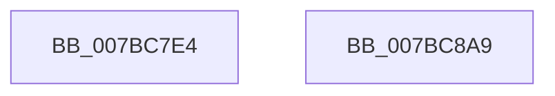

# EtwpInitializePrivateSessionDemuxObject

- RVA: `0x007BC7E4`–`0x007BC8AA` (길이 `198` bytes)
- VA: `0x00000001407BC7E4`
- 실행 섹션: `PAGE`
- PDB 이름 있음: `예`; PDB Function 태그: `아니요`
- unwind 정보 RVA: `0x0006FCAC`
- 디코드: `43`개 명령, `198/198` bytes 표시
- 미해석 바이트: `0` (있으면 어셈블리에 `.byte`로 보존)

> 이 문서는 커널 이미지의 기계어와 PDB 기호를 분석해 생성했습니다. 4번과 5번은 함수 원형과 자료형을 바이너리 사용 방식에서 추정한 C 해석이며 원본 소스 복구 결과는 아닙니다.

## 1. Dependencies

- 직접 호출 지점: **4**; 고유 호출 대상: **4**
- 직접 호출자로 확인된 함수: **1**
- RIP 상대 이미지 참조: **6**

### Outgoing calls
- `0x007BC819` → [memset](../../text/6C/memset_function_006C6C40.md) (function, `0x006C6C40`)
- `0x007BC868` → [RtlInitUnicodeString](../../text/42/RtlInitUnicodeString_function_0042A780.md) (function, `0x0042A780`)
- `0x007BC887` → [ObCreateObjectTypeEx](../AB/ObCreateObjectTypeEx_function_00AB46D0.md) (function, `0x00AB46D0`)
- `0x007BC893` → [_security_check_cookie](../../text/6A/_security_check_cookie_function_006AC640.md) (function, `0x006AC640`)

### Direct callers
- [EtwpInitialize](../../init/C4/EtwpInitialize_function_00C4DBCC.md) at `0x00C4DD7E`

### Static image references
- `0x007BC7F6` → RVA `0x00E0A740` (`.data`; read)
- `0x007BC81E` → RVA `0x00011360` (`.rdata`; read)
- `0x007BC829` → RVA `0x00A49730` (`EtwpOpenRealTimeConnectionObject`; read)
- `0x007BC834` → RVA `0x00B07810` (` ?? ::NNGAKEGL::`string'`; read)
- `0x007BC83B` → RVA `0x007BC480` (`EtwpDeleteSessionDemuxObject`; read)
- `0x007BC86D` → RVA `0x00FC7010` (`ALMOSTRO`; read)

## 2. Other-region calls and transfers

- 다른 실행 섹션으로 향하는 call: **3**
  - `0x007BC819` → [memset](../../text/6C/memset_function_006C6C40.md) (`PAGE` → `.text`)
  - `0x007BC868` → [RtlInitUnicodeString](../../text/42/RtlInitUnicodeString_function_0042A780.md) (`PAGE` → `.text`)
  - `0x007BC893` → [_security_check_cookie](../../text/6A/_security_check_cookie_function_006AC640.md) (`PAGE` → `.text`)
- 별도 외부 분기/꼬리 이동을 확인하지 못했습니다.

## 3. Assembly (complete function range)

```asm
007BC7E4  48 89 5C 24 08                  mov qword ptr [rsp + 8], rbx
007BC7E9  55                              push rbp
007BC7EA  48 8D 6C 24 A9                  lea rbp, [rsp - 0x57]
007BC7EF  48 81 EC D0 00 00 00            sub rsp, 0xd0
007BC7F6  48 8B 05 43 DF 64 00            mov rax, qword ptr [rip + 0x64df43]
007BC7FD  48 33 C4                        xor rax, rsp
007BC800  48 89 45 47                     mov qword ptr [rbp + 0x47], rax
007BC804  0F 57 C0                        xorps xmm0, xmm0
007BC807  48 8D 4D C7                     lea rcx, [rbp - 0x39]
007BC80B  BB 78 00 00 00                  mov ebx, 0x78
007BC810  33 D2                           xor edx, edx
007BC812  44 8B C3                        mov r8d, ebx
007BC815  0F 11 45 B7                     movups xmmword ptr [rbp - 0x49], xmm0
007BC819  E8 22 A4 F0 FF                  call 0x1406c6c40
007BC81E  0F 10 05 3B 4B 85 FF            movups xmm0, xmmword ptr [rip - 0x7ab4c5]
007BC825  80 4D C9 14                     or byte ptr [rbp - 0x37], 0x14
007BC829  48 8D 05 00 CF 28 00            lea rax, [rip + 0x28cf00]
007BC830  48 89 45 FF                     mov qword ptr [rbp - 1], rax
007BC834  48 8D 15 D5 AF 34 00            lea rdx, [rip + 0x34afd5]
007BC83B  48 8D 05 3E FC FF FF            lea rax, [rip - 0x3c2]
007BC842  66 89 5D C7                     mov word ptr [rbp - 0x39], bx
007BC846  48 8D 4D B7                     lea rcx, [rbp - 0x49]
007BC84A  48 89 45 0F                     mov qword ptr [rbp + 0xf], rax
007BC84E  C7 45 CF 00 01 00 00            mov dword ptr [rbp - 0x31], 0x100
007BC855  F3 0F 7F 45 D3                  movdqu xmmword ptr [rbp - 0x2d], xmm0
007BC85A  C7 45 EB 01 00 00 00            mov dword ptr [rbp - 0x15], 1
007BC861  C7 45 EF 20 00 00 00            mov dword ptr [rbp - 0x11], 0x20
007BC868  E8 13 DF C6 FF                  call 0x14042a780
007BC86D  48 8D 05 9C A7 80 00            lea rax, [rip + 0x80a79c]
007BC874  45 33 C9                        xor r9d, r9d
007BC877  45 33 C0                        xor r8d, r8d
007BC87A  48 89 44 24 20                  mov qword ptr [rsp + 0x20], rax
007BC87F  48 8D 55 C7                     lea rdx, [rbp - 0x39]
007BC883  48 8D 4D B7                     lea rcx, [rbp - 0x49]
007BC887  E8 44 7E 2F 00                  call 0x140ab46d0
007BC88C  48 8B 4D 47                     mov rcx, qword ptr [rbp + 0x47]
007BC890  48 33 CC                        xor rcx, rsp
007BC893  E8 A8 FD EE FF                  call 0x1406ac640
007BC898  48 8B 9C 24 E0 00 00 00         mov rbx, qword ptr [rsp + 0xe0]
007BC8A0  48 81 C4 D0 00 00 00            add rsp, 0xd0
007BC8A7  5D                              pop rbp
007BC8A8  C3                              ret
007BC8A9  CC                              int3
```

## 4. C-style interpretation (structured pseudocode)

```c
__int64 __fastcall EtwpInitializePrivateSessionDemuxObject(__int64 a1, int a2, __int64 a3, int a4)
{
    __int64 result;
    __int64 v_rsp;
    unsigned __int64 v_stack_m18;
    unsigned __int64 v_stack_m50;
    unsigned __int64 v_stack_m5F;
    unsigned __int64 v_stack_m60;
    unsigned int v_stack_m70;
    unsigned int v_stack_m74;
    unsigned __int64 v_stack_m8C;
    unsigned int v_stack_m90;
    unsigned __int8 v_stack_m96;
    unsigned __int64 v_stack_m98;
    unsigned __int64 v_stack_mA8;
    unsigned __int64 v_stack_mB8;
    unsigned __int64 v_stack_p8;

    v_stack_p8 = v_rbx;
    v_rsp = (v_rsp) - (208);
    result = (*(unsigned __int64 *)(v_rip + 6610755)) ^ (v_rsp);
    v_stack_m18 = result;
    a2 = 0;
    v_stack_mA8 = v_xmm0;
    result = memset(v_stack_m98, a2, 120, a4);
    v_stack_m60 = v_rip + 2674432;
    v_stack_m98 = 120;
    v_stack_m50 = v_rip - 962;
    v_stack_m90 = 256;
    v_stack_m8C = v_xmm0;
    v_stack_m74 = 1;
    v_stack_m70 = 32;
    result = RtlInitUnicodeString(v_stack_mA8, v_rip + 3452885, 120, a4);
    a4 = 0;
    a3 = 0;
    v_stack_mB8 = v_rip + 8431516;
    result = ObCreateObjectTypeEx(v_stack_mA8, v_stack_m98, a3, a4);
    a1 = (v_stack_m18) ^ (v_rsp);
    result = _security_check_cookie(a1, v_stack_m98, a3, a4);
    v_rsp = (v_rsp) + (208);
    return result;
}
```

## 5. (Beta) C Style

```c
int64_t EtwpInitializePrivateSessionDemuxObject(int64_t Arg1, int32_t Arg2, int64_t Arg3, int32_t Arg4)
{
    int64_t result;
    int64_t local_rsp;
    uint64_t v_stack_m18;
    uint64_t v_stack_m50;
    uint64_t v_stack_m5F;
    uint64_t v_stack_m60;
    uint32_t v_stack_m70;
    uint32_t v_stack_m74;
    uint64_t v_stack_m8C;
    uint32_t v_stack_m90;
    uint8_t v_stack_m96;
    uint64_t v_stack_m98;
    uint64_t v_stack_mA8;
    uint64_t v_stack_mB8;
    uint64_t v_stack_p8;

    v_stack_p8 = local_rbx;
    local_rsp = (local_rsp) - (208);
    result = (*(uint64_t *)(v_rip + 0x64DF43)) ^ (local_rsp);
    v_stack_m18 = result;
    Arg2 = 0;
    v_stack_mA8 = v_xmm0;
    result = memset(v_stack_m98, Arg2, 120, Arg4);
    v_stack_m60 = v_rip + 2674432;
    v_stack_m98 = 120;
    v_stack_m50 = v_rip - 962;
    v_stack_m90 = 256;
    v_stack_m8C = v_xmm0;
    v_stack_m74 = 1;
    v_stack_m70 = 32;
    result = RtlInitUnicodeString(v_stack_mA8, v_rip + 3452885, 120, Arg4);
    Arg4 = 0;
    Arg3 = 0;
    v_stack_mB8 = v_rip + 8431516;
    result = ObCreateObjectTypeEx(v_stack_mA8, v_stack_m98, Arg3, Arg4);
    Arg1 = (v_stack_m18) ^ (local_rsp);
    result = _security_check_cookie(Arg1, v_stack_m98, Arg3, Arg4);
    local_rsp = (local_rsp) + (208);
    return result;
}
```

## 6. Execution-region graph

[열기: 2D/3D 그래프와 함수 탐색 컨트롤 패널](../../../control-panel.html?section=page&rva=0x007BC7E4&view=graph)

- 2D 그래프는 위에서 아래로 흐르고, 3D 그래프는 빈 공간을 드래그해 회전합니다. Shift+드래그는 이동, 휠은 확대·축소, 함수 노드 선택은 대상 보고서 이동입니다.

### Static fallback


