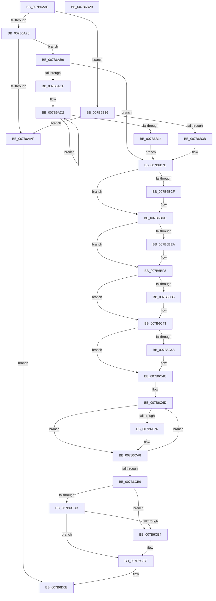

# EtwpInitializeSiloState

- RVA: `0x007B6A3C`–`0x007B6D2A` (길이 `750` bytes)
- VA: `0x00000001407B6A3C`
- 실행 섹션: `PAGE`
- PDB 이름 있음: `예`; PDB Function 태그: `아니요`
- unwind 정보 RVA: `0x00084C9C`
- 디코드: `174`개 명령, `750/750` bytes 표시
- 미해석 바이트: `0` (있으면 어셈블리에 `.byte`로 보존)

> 이 문서는 커널 이미지의 기계어와 PDB 기호를 분석해 생성했습니다. 4번과 5번은 함수 원형과 자료형을 바이너리 사용 방식에서 추정한 C 해석이며 원본 소스 복구 결과는 아닙니다.

## 1. Dependencies

- 직접 호출 지점: **18**; 고유 호출 대상: **16**
- 직접 호출자로 확인된 함수: **2**
- RIP 상대 이미지 참조: **5**

### Outgoing calls
- `0x007B6A5A` → [PsGetServerSiloGlobals](../../text/22/PsGetServerSiloGlobals_function_002250A0.md) (function, `0x002250A0`)
- `0x007B6A66` → [PsIsHostSilo](../../text/44/PsIsHostSilo_function_00443B30.md) (function, `0x00443B30`)
- `0x007B6A7D` → [KeQueryMaximumProcessorCountEx](../../text/26/KeQueryMaximumProcessorCountEx_function_00264D60.md) (function, `0x00264D60`)
- `0x007B6A9E` → [ExAllocatePool2](../../poolcode/B8/ExAllocatePool2_function_00B820F0.md) (function, `0x00B820F0`)
- `0x007B6B26` → [ExAllocatePool2](../../poolcode/B8/ExAllocatePool2_function_00B820F0.md) (function, `0x00B820F0`)
- `0x007B6B79` → [ExSubscribeWnfStateChange](../9D/ExSubscribeWnfStateChange_function_009D4BC0.md) (function, `0x009D4BC0`)
- `0x007B6B81` → [PsAttachSiloToCurrentThread](../../text/44/PsAttachSiloToCurrentThread_function_004428C0.md) (function, `0x004428C0`)
- `0x007B6B8C` → [EtwpQuerySiloRegistrySettings](../../text/64/EtwpQuerySiloRegistrySettings_function_0064EF78.md) (function, `0x0064EF78`)
- `0x007B6BC5` → [EtwpQueryPartitionRegistryInformation](../../text/64/EtwpQueryPartitionRegistryInformation_function_0064ECCC.md) (function, `0x0064ECCC`)
- `0x007B6BD1` → [KeQueryPerformanceCounter](../../text/37/KeQueryPerformanceCounter_function_0037E7E0.md) (function, `0x0037E7E0`)
- `0x007B6BE0` → [EtwpInitializeAutoLoggers](EtwpInitializeAutoLoggers_function_007BE694.md) (function, `0x007BE694`)
- `0x007B6BEC` → [KeQueryPerformanceCounter](../../text/37/KeQueryPerformanceCounter_function_0037E7E0.md) (function, `0x0037E7E0`)
- `0x007B6BFB` → [PsDetachSiloFromCurrentThread](../../text/44/PsDetachSiloFromCurrentThread_function_00449AC0.md) (function, `0x00449AC0`)
- `0x007B6C25` → [KeAbPreAcquire](../../text/21/KeAbPreAcquire_function_00210230.md) (function, `0x00210230`)
- `0x007B6C3E` → [ExfAcquirePushLockExclusiveEx](../../text/20/ExfAcquirePushLockExclusiveEx_function_0020FC90.md) (function, `0x0020FC90`)
- `0x007B6CE7` → [ExfReleasePushLock](../../text/26/ExfReleasePushLock_function_002638D0.md) (function, `0x002638D0`)
- `0x007B6CEF` → [KeAbPostRelease](../../text/2E/KeAbPostRelease_function_002E1600.md) (function, `0x002E1600`)
- `0x007B6CF4` → [KeLeaveCriticalRegion](../../text/25/KeLeaveCriticalRegion_function_0025D8B0.md) (function, `0x0025D8B0`)

### Direct callers
- [PspInitializeServerSiloDeferred](../77/PspInitializeServerSiloDeferred_function_0077FEE0.md) at `0x0078009F`
- [EtwpInitialize](../../init/C4/EtwpInitialize_function_00C4DBCC.md) at `0x00C4DE7E`

### Static image references
- `0x007B6B3F` → RVA `0x0064F340` (`EtwpUnsubscribeContainerStateWnf`; read)
- `0x007B6B4A` → RVA `0x00020B00` (`.rdata`; read)
- `0x007B6B63` → RVA `0x0064E790` (`EtwpContainerStateWnfCallback`; read)
- `0x007B6BD6` → RVA `0x010087D8` (`INITDATA`; write)
- `0x007B6BF1` → RVA `0x010087E0` (`INITDATA`; write)

## 2. Other-region calls and transfers

- 다른 실행 섹션으로 향하는 call: **16**
  - `0x007B6A5A` → [PsGetServerSiloGlobals](../../text/22/PsGetServerSiloGlobals_function_002250A0.md) (`PAGE` → `.text`)
  - `0x007B6A66` → [PsIsHostSilo](../../text/44/PsIsHostSilo_function_00443B30.md) (`PAGE` → `.text`)
  - `0x007B6A7D` → [KeQueryMaximumProcessorCountEx](../../text/26/KeQueryMaximumProcessorCountEx_function_00264D60.md) (`PAGE` → `.text`)
  - `0x007B6A9E` → [ExAllocatePool2](../../poolcode/B8/ExAllocatePool2_function_00B820F0.md) (`PAGE` → `POOLCODE`)
  - `0x007B6B26` → [ExAllocatePool2](../../poolcode/B8/ExAllocatePool2_function_00B820F0.md) (`PAGE` → `POOLCODE`)
  - `0x007B6B81` → [PsAttachSiloToCurrentThread](../../text/44/PsAttachSiloToCurrentThread_function_004428C0.md) (`PAGE` → `.text`)
  - `0x007B6B8C` → [EtwpQuerySiloRegistrySettings](../../text/64/EtwpQuerySiloRegistrySettings_function_0064EF78.md) (`PAGE` → `.text`)
  - `0x007B6BC5` → [EtwpQueryPartitionRegistryInformation](../../text/64/EtwpQueryPartitionRegistryInformation_function_0064ECCC.md) (`PAGE` → `.text`)
  - `0x007B6BD1` → [KeQueryPerformanceCounter](../../text/37/KeQueryPerformanceCounter_function_0037E7E0.md) (`PAGE` → `.text`)
  - `0x007B6BEC` → [KeQueryPerformanceCounter](../../text/37/KeQueryPerformanceCounter_function_0037E7E0.md) (`PAGE` → `.text`)
  - `0x007B6BFB` → [PsDetachSiloFromCurrentThread](../../text/44/PsDetachSiloFromCurrentThread_function_00449AC0.md) (`PAGE` → `.text`)
  - `0x007B6C25` → [KeAbPreAcquire](../../text/21/KeAbPreAcquire_function_00210230.md) (`PAGE` → `.text`)
  - `0x007B6C3E` → [ExfAcquirePushLockExclusiveEx](../../text/20/ExfAcquirePushLockExclusiveEx_function_0020FC90.md) (`PAGE` → `.text`)
  - `0x007B6CE7` → [ExfReleasePushLock](../../text/26/ExfReleasePushLock_function_002638D0.md) (`PAGE` → `.text`)
  - `0x007B6CEF` → [KeAbPostRelease](../../text/2E/KeAbPostRelease_function_002E1600.md) (`PAGE` → `.text`)
  - `0x007B6CF4` → [KeLeaveCriticalRegion](../../text/25/KeLeaveCriticalRegion_function_0025D8B0.md) (`PAGE` → `.text`)
- 별도 외부 분기/꼬리 이동을 확인하지 못했습니다.

## 3. Assembly (complete function range)

```asm
007B6A3C  48 89 5C 24 08                  mov qword ptr [rsp + 8], rbx
007B6A41  48 89 6C 24 10                  mov qword ptr [rsp + 0x10], rbp
007B6A46  48 89 74 24 18                  mov qword ptr [rsp + 0x18], rsi
007B6A4B  57                              push rdi
007B6A4C  41 56                           push r14
007B6A4E  41 57                           push r15
007B6A50  48 83 EC 30                     sub rsp, 0x30
007B6A54  4C 8B FA                        mov r15, rdx
007B6A57  48 8B E9                        mov rbp, rcx
007B6A5A  E8 41 E6 A6 FF                  call 0x1402250a0
007B6A5F  48 8B B8 40 03 00 00            mov rdi, qword ptr [rax + 0x340]
007B6A66  E8 C5 D0 C8 FF                  call 0x140443b30
007B6A6B  33 DB                           xor ebx, ebx
007B6A6D  40 8A F0                        mov sil, al
007B6A70  84 C0                           test al, al
007B6A72  0F 85 9E 00 00 00               jne 0x1407b6b16
007B6A78  B9 FF FF 00 00                  mov ecx, 0xffff
007B6A7D  E8 DE E2 AA FF                  call 0x140264d60
007B6A82  8B 4F 10                        mov ecx, dword ptr [rdi + 0x10]
007B6A85  41 B8 45 74 77 61               mov r8d, 0x61777445
007B6A8B  44 8B F0                        mov r14d, eax
007B6A8E  8D 14 49                        lea edx, [rcx + rcx*2]
007B6A91  8D 14 D5 40 00 00 00            lea edx, [rdx*8 + 0x40]
007B6A98  0F AF D0                        imul edx, eax
007B6A9B  8D 4B 48                        lea ecx, [rbx + 0x48]
007B6A9E  E8 4D B6 3C 00                  call 0x140b820f0
007B6AA3  48 89 87 40 11 00 00            mov qword ptr [rdi + 0x1140], rax
007B6AAA  48 85 C0                        test rax, rax
007B6AAD  75 0A                           jne 0x1407b6ab9
007B6AAF  BB 17 00 00 C0                  mov ebx, 0xc0000017
007B6AB4  E9 55 02 00 00                  jmp 0x1407b6d0e
007B6AB9  49 8B CE                        mov rcx, r14
007B6ABC  4D 8B CE                        mov r9, r14
007B6ABF  48 C1 E1 06                     shl rcx, 6
007B6AC3  48 03 C8                        add rcx, rax
007B6AC6  45 85 F6                        test r14d, r14d
007B6AC9  0F 84 AF 00 00 00               je 0x1407b6b7e
007B6ACF  4C 8B C3                        mov r8, rbx
007B6AD2  48 8B 87 40 11 00 00            mov rax, qword ptr [rdi + 0x1140]
007B6AD9  49 89 0C 00                     mov qword ptr [r8 + rax], rcx
007B6ADD  4D 8D 40 40                     lea r8, [r8 + 0x40]
007B6AE1  8B 47 10                        mov eax, dword ptr [rdi + 0x10]
007B6AE4  48 8D 0C C1                     lea rcx, [rcx + rax*8]
007B6AE8  48 8B 87 40 11 00 00            mov rax, qword ptr [rdi + 0x1140]
007B6AEF  49 89 4C 00 C8                  mov qword ptr [r8 + rax - 0x38], rcx
007B6AF4  8B 47 10                        mov eax, dword ptr [rdi + 0x10]
007B6AF7  48 8D 14 C1                     lea rdx, [rcx + rax*8]
007B6AFB  48 8B 87 40 11 00 00            mov rax, qword ptr [rdi + 0x1140]
007B6B02  49 89 54 00 D0                  mov qword ptr [r8 + rax - 0x30], rdx
007B6B07  8B 47 10                        mov eax, dword ptr [rdi + 0x10]
007B6B0A  48 8D 0C C2                     lea rcx, [rdx + rax*8]
007B6B0E  49 83 E9 01                     sub r9, 1
007B6B12  75 BE                           jne 0x1407b6ad2
007B6B14  EB 68                           jmp 0x1407b6b7e
007B6B16  BA 20 00 00 00                  mov edx, 0x20
007B6B1B  B9 00 01 00 00                  mov ecx, 0x100
007B6B20  41 B8 45 74 77 57               mov r8d, 0x57777445
007B6B26  E8 C5 B5 3C 00                  call 0x140b820f0
007B6B2B  48 89 87 58 11 00 00            mov qword ptr [rdi + 0x1158], rax
007B6B32  48 85 C0                        test rax, rax
007B6B35  0F 84 74 FF FF FF               je 0x1407b6aaf
007B6B3B  48 89 58 18                     mov qword ptr [rax + 0x18], rbx
007B6B3F  48 8D 0D FA 87 E9 FF            lea rcx, [rip - 0x167806]
007B6B46  48 89 48 10                     mov qword ptr [rax + 0x10], rcx
007B6B4A  48 8D 15 AF 9F 86 FF            lea rdx, [rip - 0x796051]
007B6B51  48 89 18                        mov qword ptr [rax], rbx
007B6B54  48 8D 8F 48 11 00 00            lea rcx, [rdi + 0x1148]
007B6B5B  45 33 C9                        xor r9d, r9d
007B6B5E  48 89 5C 24 28                  mov qword ptr [rsp + 0x28], rbx
007B6B63  48 8D 05 26 7C E9 FF            lea rax, [rip - 0x1683da]
007B6B6A  89 9F 50 11 00 00               mov dword ptr [rdi + 0x1150], ebx
007B6B70  48 89 44 24 20                  mov qword ptr [rsp + 0x20], rax
007B6B75  45 8D 41 01                     lea r8d, [r9 + 1]
007B6B79  E8 42 E0 21 00                  call 0x1409d4bc0
007B6B7E  48 8B CD                        mov rcx, rbp
007B6B81  E8 3A BD C8 FF                  call 0x1404428c0
007B6B86  48 8B CF                        mov rcx, rdi
007B6B89  48 8B E8                        mov rbp, rax
007B6B8C  E8 E7 83 E9 FF                  call 0x14064ef78
007B6B91  4C 8D 97 70 11 00 00            lea r10, [rdi + 0x1170]
007B6B98  4C 8D 9F 80 11 00 00            lea r11, [rdi + 0x1180]
007B6B9F  4C 89 54 24 28                  mov qword ptr [rsp + 0x28], r10
007B6BA4  4C 8D 8F 94 11 00 00            lea r9, [rdi + 0x1194]
007B6BAB  4C 89 5C 24 20                  mov qword ptr [rsp + 0x20], r11
007B6BB0  4C 8D 87 90 11 00 00            lea r8, [rdi + 0x1190]
007B6BB7  48 8D 97 88 11 00 00            lea rdx, [rdi + 0x1188]
007B6BBE  48 8D 8F 60 11 00 00            lea rcx, [rdi + 0x1160]
007B6BC5  E8 02 81 E9 FF                  call 0x14064eccc
007B6BCA  40 84 F6                        test sil, sil
007B6BCD  74 0E                           je 0x1407b6bdd
007B6BCF  33 C9                           xor ecx, ecx
007B6BD1  E8 0A 7C BC FF                  call 0x14037e7e0
007B6BD6  48 89 05 FB 1B 85 00            mov qword ptr [rip + 0x851bfb], rax
007B6BDD  49 8B CF                        mov rcx, r15
007B6BE0  E8 AF 7A 00 00                  call 0x1407be694
007B6BE5  40 84 F6                        test sil, sil
007B6BE8  74 0E                           je 0x1407b6bf8
007B6BEA  33 C9                           xor ecx, ecx
007B6BEC  E8 EF 7B BC FF                  call 0x14037e7e0
007B6BF1  48 89 05 E8 1B 85 00            mov qword ptr [rip + 0x851be8], rax
007B6BF8  48 8B CD                        mov rcx, rbp
007B6BFB  E8 C0 2E C9 FF                  call 0x140449ac0
007B6C00  65 48 8B 04 25 88 01 00 00      mov rax, qword ptr gs:[0x188]
007B6C09  48 8D B7 B0 02 00 00            lea rsi, [rdi + 0x2b0]
007B6C10  49 83 CE FF                     or r14, 0xffffffffffffffff
007B6C14  45 33 C0                        xor r8d, r8d
007B6C17  33 D2                           xor edx, edx
007B6C19  48 8B CE                        mov rcx, rsi
007B6C1C  66 44 01 B0 E4 01 00 00         add word ptr [rax + 0x1e4], r14w
007B6C24  90                              nop
007B6C25  E8 06 96 A5 FF                  call 0x140210230
007B6C2A  F0 48 0F BA 2E 00               lock bts qword ptr [rsi], 0
007B6C30  48 8B E8                        mov rbp, rax
007B6C33  73 0E                           jae 0x1407b6c43
007B6C35  4C 8B C6                        mov r8, rsi
007B6C38  48 8B D0                        mov rdx, rax
007B6C3B  48 8B CE                        mov rcx, rsi
007B6C3E  E8 4D 90 A5 FF                  call 0x14020fc90
007B6C43  48 85 ED                        test rbp, rbp
007B6C46  74 04                           je 0x1407b6c4c
007B6C48  C6 45 0A 01                     mov byte ptr [rbp + 0xa], 1
007B6C4C  65 48 8B 04 25 88 01 00 00      mov rax, qword ptr gs:[0x188]
007B6C55  4C 8D 8F D0 10 00 00            lea r9, [rdi + 0x10d0]
007B6C5C  48 89 87 B8 02 00 00            mov qword ptr [rdi + 0x2b8], rax
007B6C63  48 8D 97 9C 00 00 00            lea rdx, [rdi + 0x9c]
007B6C6A  44 8B C3                        mov r8d, ebx
007B6C6D  41 0F B7 01                     movzx eax, word ptr [r9]
007B6C71  66 85 C0                        test ax, ax
007B6C74  74 32                           je 0x1407b6ca8
007B6C76  66 89 42 02                     mov word ptr [rdx + 2], ax
007B6C7A  C7 42 FC 01 00 00 00            mov dword ptr [rdx - 4], 1
007B6C81  C6 02 FF                        mov byte ptr [rdx], 0xff
007B6C84  4C 89 72 0C                     mov qword ptr [rdx + 0xc], r14
007B6C88  48 89 5A 14                     mov qword ptr [rdx + 0x14], rbx
007B6C8C  C7 42 04 40 00 00 00            mov dword ptr [rdx + 4], 0x40
007B6C93  0F B7 8F F0 10 00 00            movzx ecx, word ptr [rdi + 0x10f0]
007B6C9A  41 0F B6 C0                     movzx eax, r8b
007B6C9E  0F AB C1                        bts ecx, eax
007B6CA1  66 89 8F F0 10 00 00            mov word ptr [rdi + 0x10f0], cx
007B6CA8  41 FF C0                        inc r8d
007B6CAB  49 83 C1 02                     add r9, 2
007B6CAF  48 83 C2 20                     add rdx, 0x20
007B6CB3  41 83 F8 10                     cmp r8d, 0x10
007B6CB7  72 B4                           jb 0x1407b6c6d
007B6CB9  48 89 9F B8 02 00 00            mov qword ptr [rdi + 0x2b8], rbx
007B6CC0  0F 0D 0E                        prefetchw byte ptr [rsi]
007B6CC3  48 8B 06                        mov rax, qword ptr [rsi]
007B6CC6  48 8B C8                        mov rcx, rax
007B6CC9  48 83 E1 F0                     and rcx, 0xfffffffffffffff0
007B6CCD  48 83 F9 10                     cmp rcx, 0x10
007B6CD1  48 8D 50 F0                     lea rdx, [rax - 0x10]
007B6CD5  48 0F 46 D3                     cmovbe rdx, rbx
007B6CD9  A8 02                           test al, 2
007B6CDB  75 07                           jne 0x1407b6ce4
007B6CDD  F0 48 0F B1 16                  lock cmpxchg qword ptr [rsi], rdx
007B6CE2  74 08                           je 0x1407b6cec
007B6CE4  48 8B CE                        mov rcx, rsi
007B6CE7  E8 E4 CB AA FF                  call 0x1402638d0
007B6CEC  48 8B CE                        mov rcx, rsi
007B6CEF  E8 0C A9 B2 FF                  call 0x1402e1600
007B6CF4  E8 B7 6B AA FF                  call 0x14025d8b0
007B6CF9  48 89 9F 10 11 00 00            mov qword ptr [rdi + 0x1110], rbx
007B6D00  48 89 9F 00 11 00 00            mov qword ptr [rdi + 0x1100], rbx
007B6D07  48 89 9F 08 11 00 00            mov qword ptr [rdi + 0x1108], rbx
007B6D0E  48 8B 6C 24 58                  mov rbp, qword ptr [rsp + 0x58]
007B6D13  8B C3                           mov eax, ebx
007B6D15  48 8B 5C 24 50                  mov rbx, qword ptr [rsp + 0x50]
007B6D1A  48 8B 74 24 60                  mov rsi, qword ptr [rsp + 0x60]
007B6D1F  48 83 C4 30                     add rsp, 0x30
007B6D23  41 5F                           pop r15
007B6D25  41 5E                           pop r14
007B6D27  5F                              pop rdi
007B6D28  C3                              ret
007B6D29  CC                              int3
```

## 4. C-style interpretation (structured pseudocode)

```c
__int64 __fastcall EtwpInitializeSiloState(__int64 a1, __int64 a2)
{
    __int64 result;
    __int64 v_r14;
    __int64 v_rbx;
    __int64 v_rsp;
    unsigned __int64 v_stack_m20;
    unsigned __int64 v_stack_m28;
    unsigned __int64 v_stack_p10;
    unsigned __int64 v_stack_p18;
    unsigned __int64 v_stack_p8;

    v_stack_p8 = v_rbx;
    v_stack_p10 = v_rbp;
    v_stack_p18 = v_rsi;
    v_rsp = (v_rsp) - (48);
    result = PsGetServerSiloGlobals(a1, a2, a3, a4);
    result = PsIsHostSilo(a1, a2, a3, a4);
    v_rbx = 0;
    if ((unsigned __int8)(result) != 0) goto loc_007B6B16;
    result = KeQueryMaximumProcessorCountEx((unsigned int)(0xFFFFULL), a2, a3, a4);
    a2 = (unsigned int)(((unsigned int)(*(unsigned int *)(*(unsigned __int64 *)(result + 832) + 16)) + (unsigned int)(*(unsigned int *)(*(unsigned __int64 *)(result + 832) + 16)) * 2 * 8 + 64) * ((unsigned int)(result)));
    result = ExAllocatePool2(v_rbx + 72, a2, (unsigned int)(0x61777445ULL), a4);
    *(unsigned __int64 *)(*(unsigned __int64 *)(result + 832) + 4416) = result;
    if (result != 0) goto loc_007B6AB9;
loc_007B6AAF:
    goto loc_007B6D0E;
loc_007B6AB9:
    a1 = ((unsigned int)((unsigned int)(result))) << (6);
    a1 = (a1) + (result);
    if ((unsigned int)((unsigned int)((unsigned int)(result))) == 0) goto loc_007B6B7E;
loc_007B6AD2:
    *(unsigned __int64 *)((unsigned int)(0xC0000017ULL) + *(unsigned __int64 *)(*(unsigned __int64 *)(result + 832) + 4416) * 1) = a1;
    *(unsigned __int64 *)((unsigned int)(0xC0000017ULL) + 64 + *(unsigned __int64 *)(*(unsigned __int64 *)(result + 832) + 4416) * 1 - 56) = a1 + (unsigned int)(*(unsigned int *)(*(unsigned __int64 *)(result + 832) + 16)) * 8;
    *(unsigned __int64 *)((unsigned int)(0xC0000017ULL) + 64 + *(unsigned __int64 *)(*(unsigned __int64 *)(result + 832) + 4416) * 1 - 48) = a1 + (unsigned int)(*(unsigned int *)(*(unsigned __int64 *)(result + 832) + 16)) * 8 + (unsigned int)(*(unsigned int *)(*(unsigned __int64 *)(result + 832) + 16)) * 8;
    a4 = ((unsigned int)((unsigned int)(result))) - (1);
    if (condition_is_not_equal) goto loc_007B6AD2;
    goto loc_007B6B7E;
loc_007B6B16:
    result = ExAllocatePool2(256, 32, (unsigned int)(0x57777445ULL), a4);
    *(unsigned __int64 *)(*(unsigned __int64 *)(result + 832) + 4440) = result;
    if (result == 0) goto loc_007B6AAF;
    *(unsigned __int64 *)(result + 24) = (unsigned int)(0xC0000017ULL);
    *(unsigned __int64 *)(result + 16) = v_rip - 1472518;
    *(unsigned __int64 *)(result) = (unsigned int)(0xC0000017ULL);
    a4 = 0;
    v_stack_m20 = (unsigned int)(0xC0000017ULL);
    *(unsigned int *)(*(unsigned __int64 *)(result + 832) + 4432) = (unsigned int)((unsigned int)(0xC0000017ULL));
    v_stack_m28 = v_rip - 1475546;
    result = ExSubscribeWnfStateChange(*(unsigned __int64 *)(result + 832) + 4424, v_rip - 7954513, a4 + 1, a4);
loc_007B6B7E:
    result = PsAttachSiloToCurrentThread(a1, v_rip - 7954513, a4 + 1, a4);
    result = EtwpQuerySiloRegistrySettings(*(unsigned __int64 *)(result + 832), v_rip - 7954513, a4 + 1, a4);
    v_stack_m20 = *(unsigned __int64 *)(result + 832) + 4464;
    v_stack_m28 = *(unsigned __int64 *)(result + 832) + 4480;
    result = EtwpQueryPartitionRegistryInformation(*(unsigned __int64 *)(result + 832) + 4448, *(unsigned __int64 *)(result + 832) + 4488, *(unsigned __int64 *)(result + 832) + 4496, *(unsigned __int64 *)(result + 832) + 4500);
    if ((unsigned __int8)((unsigned __int8)(result)) != 0) {
        a1 = 0;
        result = KeQueryPerformanceCounter(a1, *(unsigned __int64 *)(result + 832) + 4488, *(unsigned __int64 *)(result + 832) + 4496, *(unsigned __int64 *)(result + 832) + 4500);
        *(unsigned __int64 *)(v_rip + 8723451) = result;
    }
    result = EtwpInitializeAutoLoggers(a2, *(unsigned __int64 *)(result + 832) + 4488, *(unsigned __int64 *)(result + 832) + 4496, *(unsigned __int64 *)(result + 832) + 4500);
    if ((unsigned __int8)((unsigned __int8)(result)) != 0) {
        a1 = 0;
        result = KeQueryPerformanceCounter(a1, *(unsigned __int64 *)(result + 832) + 4488, *(unsigned __int64 *)(result + 832) + 4496, *(unsigned __int64 *)(result + 832) + 4500);
        *(unsigned __int64 *)(v_rip + 8723432) = result;
    }
    result = PsDetachSiloFromCurrentThread(result, *(unsigned __int64 *)(result + 832) + 4488, *(unsigned __int64 *)(result + 832) + 4496, *(unsigned __int64 *)(result + 832) + 4500);
    v_r14 = ((unsigned int)((unsigned int)(result))) | (-1);
    a3 = 0;
    a2 = 0;
    result = KeAbPreAcquire(*(unsigned __int64 *)(result + 832) + 688, a2, a3, *(unsigned __int64 *)(result + 832) + 4500);
    if (!(condition_is_above_or_equal)) {
        a3 = *(unsigned __int64 *)(result + 832) + 688;
        a2 = result;
        a1 = *(unsigned __int64 *)(result + 832) + 688;
        result = ExfAcquirePushLockExclusiveEx(a1, a2, a3, *(unsigned __int64 *)(result + 832) + 4500);
    }
    if (result != 0) {
        *(unsigned __int8 *)(result + 10) = 1;
    }
    *(unsigned __int64 *)(*(unsigned __int64 *)(result + 832) + 696) = *(unsigned __int64 *)(gs_base + (0 + 392));
loc_007B6C6D:
    result = *(unsigned __int16 *)(*(unsigned __int64 *)(result + 832) + 4304);
    if ((unsigned __int16)(*(unsigned __int16 *)(*(unsigned __int64 *)(result + 832) + 4304)) != 0) {
        *(unsigned __int16 *)(*(unsigned __int64 *)(result + 832) + 156 + 2) = (unsigned __int16)(*(unsigned __int16 *)(*(unsigned __int64 *)(result + 832) + 4304));
        *(unsigned int *)(*(unsigned __int64 *)(result + 832) + 156 - 4) = 1;
        *(unsigned __int8 *)(*(unsigned __int64 *)(result + 832) + 156) = 255;
        *(unsigned __int64 *)(*(unsigned __int64 *)(result + 832) + 156 + 12) = v_r14;
        *(unsigned __int64 *)(*(unsigned __int64 *)(result + 832) + 156 + 20) = (unsigned int)(0xC0000017ULL);
        *(unsigned int *)(*(unsigned __int64 *)(result + 832) + 156 + 4) = 64;
        a1 = *(unsigned __int16 *)(*(unsigned __int64 *)(result + 832) + 4336);
        result = (unsigned __int8)((unsigned int)((unsigned int)((unsigned int)(0xC0000017ULL))));
        *(unsigned __int16 *)(*(unsigned __int64 *)(result + 832) + 4336) = (unsigned __int16)(a1);
    }
    a3 = (unsigned int)(((unsigned int)((unsigned int)((unsigned int)(0xC0000017ULL)))) + 1);
    a4 = (*(unsigned __int64 *)(result + 832) + 4304) + (2);
    a2 = (*(unsigned __int64 *)(result + 832) + 156) + (32);
    if (((unsigned int)(a3)) < 16) goto loc_007B6C6D;
    *(unsigned __int64 *)(*(unsigned __int64 *)(result + 832) + 696) = (unsigned int)(0xC0000017ULL);
    a1 = (*(unsigned __int64 *)(*(unsigned __int64 *)(result + 832) + 688)) & (-16);
    a2 = *(unsigned __int64 *)(*(unsigned __int64 *)(result + 832) + 688) - 16;
    if (a1 <= 16) { a2 = (unsigned int)(0xC0000017ULL); }
    if ((((unsigned __int8)(*(unsigned __int64 *)(*(unsigned __int64 *)(result + 832) + 688))) & (2)) != 0) goto loc_007B6CE4;
    result = *(unsigned __int64 *)(*(unsigned __int64 *)(result + 832) + 688);
    if ((((unsigned __int8)(*(unsigned __int64 *)(*(unsigned __int64 *)(result + 832) + 688))) & (2)) != 0) {
        a1 = *(unsigned __int64 *)(result + 832) + 688;
        result = ExfReleasePushLock(a1, a2, a3, a4);
    }
    result = KeAbPostRelease(*(unsigned __int64 *)(result + 832) + 688, a2, a3, a4);
    result = KeLeaveCriticalRegion(*(unsigned __int64 *)(result + 832) + 688, a2, a3, a4);
    *(unsigned __int64 *)(*(unsigned __int64 *)(result + 832) + 4368) = (unsigned int)(0xC0000017ULL);
    *(unsigned __int64 *)(*(unsigned __int64 *)(result + 832) + 4352) = (unsigned int)(0xC0000017ULL);
    *(unsigned __int64 *)(*(unsigned __int64 *)(result + 832) + 4360) = (unsigned int)(0xC0000017ULL);
loc_007B6D0E:
    v_rsp = (v_rsp) + (48);
    return (unsigned int)((unsigned int)((unsigned int)(0xC0000017ULL)));
}
```

## 5. (Beta) C Style

```c
int64_t EtwpInitializeSiloState(int64_t Arg1, int64_t Arg2)
{
    int64_t result;
    int64_t local_r14;
    int64_t local_rbx;
    int64_t local_rsp;
    uint64_t v_stack_m20;
    uint64_t v_stack_m28;
    uint64_t v_stack_p10;
    uint64_t v_stack_p18;
    uint64_t v_stack_p8;

    v_stack_p8 = local_rbx;
    v_stack_p10 = local_rbp;
    v_stack_p18 = local_rsi;
    local_rsp = (local_rsp) - (48);
    result = PsGetServerSiloGlobals(Arg1, Arg2, a3, a4);
    result = PsIsHostSilo(Arg1, Arg2, a3, a4);
    local_rbx = 0;
    if ((uint8_t)(result) != 0) goto loc_007B6B16;
    result = KeQueryMaximumProcessorCountEx((uint32_t)(0xFFFFULL), Arg2, a3, a4);
    Arg2 = (uint32_t)(((uint32_t)(*(uint32_t *)(*(uint64_t *)(result + 0x340) + 0x10)) + (uint32_t)(*(uint32_t *)(*(uint64_t *)(result + 0x340) + 0x10)) * 2 * 8 + 64) * ((uint32_t)(result)));
    result = ExAllocatePool2(local_rbx + 72, Arg2, (uint32_t)(0x61777445ULL), a4);
    *(uint64_t *)(*(uint64_t *)(result + 0x340) + 0x1140) = result;
    if (result != 0) goto loc_007B6AB9;
loc_007B6AAF:
    goto loc_007B6D0E;
loc_007B6AB9:
    Arg1 = ((uint32_t)((uint32_t)(result))) << (6);
    Arg1 = (Arg1) + (result);
    if ((uint32_t)((uint32_t)((uint32_t)(result))) == 0) goto loc_007B6B7E;
loc_007B6AD2:
    *(uint64_t *)((uint32_t)(0xC0000017ULL) + *(uint64_t *)(*(uint64_t *)(result + 0x340) + 0x1140) * 1) = Arg1;
    *(uint64_t *)((uint32_t)(0xC0000017ULL) + 0x40 + *(uint64_t *)(*(uint64_t *)(result + 0x340) + 0x1140) * 1 - 0x38) = Arg1 + (uint32_t)(*(uint32_t *)(*(uint64_t *)(result + 0x340) + 0x10)) * 8;
    *(uint64_t *)((uint32_t)(0xC0000017ULL) + 0x40 + *(uint64_t *)(*(uint64_t *)(result + 0x340) + 0x1140) * 1 - 0x30) = Arg1 + (uint32_t)(*(uint32_t *)(*(uint64_t *)(result + 0x340) + 0x10)) * 8 + (uint32_t)(*(uint32_t *)(*(uint64_t *)(result + 0x340) + 0x10)) * 8;
    a4 = ((uint32_t)((uint32_t)(result))) - (1);
    if (condition_is_not_equal) goto loc_007B6AD2;
    goto loc_007B6B7E;
loc_007B6B16:
    result = ExAllocatePool2(256, 32, (uint32_t)(0x57777445ULL), a4);
    *(uint64_t *)(*(uint64_t *)(result + 0x340) + 0x1158) = result;
    if (result == 0) goto loc_007B6AAF;
    *(uint64_t *)(result + 0x18) = (uint32_t)(0xC0000017ULL);
    *(uint64_t *)(result + 0x10) = v_rip - 1472518;
    *(uint64_t *)(result) = (uint32_t)(0xC0000017ULL);
    a4 = 0;
    v_stack_m20 = (uint32_t)(0xC0000017ULL);
    *(uint32_t *)(*(uint64_t *)(result + 0x340) + 0x1150) = (uint32_t)((uint32_t)(0xC0000017ULL));
    v_stack_m28 = v_rip - 1475546;
    result = ExSubscribeWnfStateChange(*(uint64_t *)(result + 0x340) + 4424, v_rip - 7954513, a4 + 1, a4);
loc_007B6B7E:
    result = PsAttachSiloToCurrentThread(Arg1, v_rip - 7954513, a4 + 1, a4);
    result = EtwpQuerySiloRegistrySettings(*(uint64_t *)(result + 0x340), v_rip - 7954513, a4 + 1, a4);
    v_stack_m20 = *(uint64_t *)(result + 0x340) + 4464;
    v_stack_m28 = *(uint64_t *)(result + 0x340) + 4480;
    result = EtwpQueryPartitionRegistryInformation(*(uint64_t *)(result + 0x340) + 4448, *(uint64_t *)(result + 0x340) + 4488, *(uint64_t *)(result + 0x340) + 4496, *(uint64_t *)(result + 0x340) + 4500);
    if ((uint8_t)((uint8_t)(result)) != 0) {
        Arg1 = 0;
        result = KeQueryPerformanceCounter(Arg1, *(uint64_t *)(result + 0x340) + 4488, *(uint64_t *)(result + 0x340) + 4496, *(uint64_t *)(result + 0x340) + 4500);
        *(uint64_t *)(v_rip + 0x851BFB) = result;
    }
    result = EtwpInitializeAutoLoggers(Arg2, *(uint64_t *)(result + 0x340) + 4488, *(uint64_t *)(result + 0x340) + 4496, *(uint64_t *)(result + 0x340) + 4500);
    if ((uint8_t)((uint8_t)(result)) != 0) {
        Arg1 = 0;
        result = KeQueryPerformanceCounter(Arg1, *(uint64_t *)(result + 0x340) + 4488, *(uint64_t *)(result + 0x340) + 4496, *(uint64_t *)(result + 0x340) + 4500);
        *(uint64_t *)(v_rip + 0x851BE8) = result;
    }
    result = PsDetachSiloFromCurrentThread(result, *(uint64_t *)(result + 0x340) + 4488, *(uint64_t *)(result + 0x340) + 4496, *(uint64_t *)(result + 0x340) + 4500);
    local_r14 = ((uint32_t)((uint32_t)(result))) | (-1);
    a3 = 0;
    Arg2 = 0;
    result = KeAbPreAcquire(*(uint64_t *)(result + 0x340) + 688, Arg2, a3, *(uint64_t *)(result + 0x340) + 4500);
    if (!(condition_is_above_or_equal)) {
        a3 = *(uint64_t *)(result + 0x340) + 688;
        Arg2 = result;
        Arg1 = *(uint64_t *)(result + 0x340) + 688;
        result = ExfAcquirePushLockExclusiveEx(Arg1, Arg2, a3, *(uint64_t *)(result + 0x340) + 4500);
    }
    if (result != 0) {
        *(uint8_t *)(result + 0xA) = 1;
    }
    *(uint64_t *)(*(uint64_t *)(result + 0x340) + 0x2B8) = *(uint64_t *)(gs_base + (0 + 0x188));
loc_007B6C6D:
    result = *(uint16_t *)(*(uint64_t *)(result + 0x340) + 0x10D0);
    if ((uint16_t)(*(uint16_t *)(*(uint64_t *)(result + 0x340) + 0x10D0)) != 0) {
        *(uint16_t *)(*(uint64_t *)(result + 0x340) + 0x9C + 0x2) = (uint16_t)(*(uint16_t *)(*(uint64_t *)(result + 0x340) + 0x10D0));
        *(uint32_t *)(*(uint64_t *)(result + 0x340) + 0x9C - 0x4) = 1;
        *(uint8_t *)(*(uint64_t *)(result + 0x340) + 0x9C) = 255;
        *(uint64_t *)(*(uint64_t *)(result + 0x340) + 0x9C + 0xC) = local_r14;
        *(uint64_t *)(*(uint64_t *)(result + 0x340) + 0x9C + 0x14) = (uint32_t)(0xC0000017ULL);
        *(uint32_t *)(*(uint64_t *)(result + 0x340) + 0x9C + 0x4) = 64;
        Arg1 = *(uint16_t *)(*(uint64_t *)(result + 0x340) + 0x10F0);
        result = (uint8_t)((uint32_t)((uint32_t)((uint32_t)(0xC0000017ULL))));
        *(uint16_t *)(*(uint64_t *)(result + 0x340) + 0x10F0) = (uint16_t)(Arg1);
    }
    a3 = (uint32_t)(((uint32_t)((uint32_t)((uint32_t)(0xC0000017ULL)))) + 1);
    a4 = (*(uint64_t *)(result + 0x340) + 4304) + (2);
    Arg2 = (*(uint64_t *)(result + 0x340) + 156) + (32);
    if (((uint32_t)(a3)) < 16) goto loc_007B6C6D;
    *(uint64_t *)(*(uint64_t *)(result + 0x340) + 0x2B8) = (uint32_t)(0xC0000017ULL);
    Arg1 = (*(uint64_t *)(*(uint64_t *)(result + 0x340) + 0x2B0)) & (-16);
    Arg2 = *(uint64_t *)(*(uint64_t *)(result + 0x340) + 0x2B0) - 16;
    if (Arg1 <= 16) { Arg2 = (uint32_t)(0xC0000017ULL); }
    if ((((uint8_t)(*(uint64_t *)(*(uint64_t *)(result + 0x340) + 0x2B0))) & (2)) != 0) goto loc_007B6CE4;
    result = *(uint64_t *)(*(uint64_t *)(result + 0x340) + 0x2B0);
    if ((((uint8_t)(*(uint64_t *)(*(uint64_t *)(result + 0x340) + 0x2B0))) & (2)) != 0) {
        Arg1 = *(uint64_t *)(result + 0x340) + 688;
        result = ExfReleasePushLock(Arg1, Arg2, a3, a4);
    }
    result = KeAbPostRelease(*(uint64_t *)(result + 0x340) + 688, Arg2, a3, a4);
    result = KeLeaveCriticalRegion(*(uint64_t *)(result + 0x340) + 688, Arg2, a3, a4);
    *(uint64_t *)(*(uint64_t *)(result + 0x340) + 0x1110) = (uint32_t)(0xC0000017ULL);
    *(uint64_t *)(*(uint64_t *)(result + 0x340) + 0x1100) = (uint32_t)(0xC0000017ULL);
    *(uint64_t *)(*(uint64_t *)(result + 0x340) + 0x1108) = (uint32_t)(0xC0000017ULL);
loc_007B6D0E:
    local_rsp = (local_rsp) + (48);
    return (uint32_t)((uint32_t)((uint32_t)(0xC0000017ULL)));
}
```

## 6. Execution-region graph

[열기: 2D/3D 그래프와 함수 탐색 컨트롤 패널](../../../control-panel.html?section=page&rva=0x007B6A3C&view=graph)

- 2D 그래프는 위에서 아래로 흐르고, 3D 그래프는 빈 공간을 드래그해 회전합니다. Shift+드래그는 이동, 휠은 확대·축소, 함수 노드 선택은 대상 보고서 이동입니다.

### Static fallback


