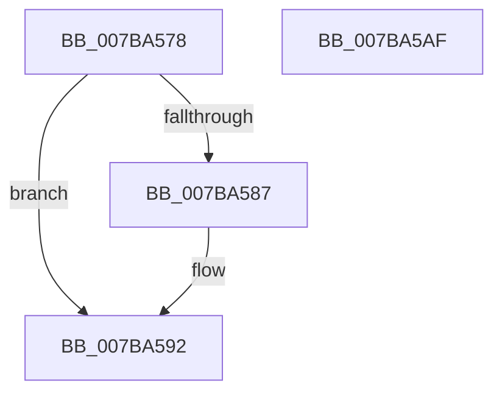

# EtwpInitializeStackLookasideList

- RVA: `0x007BA578`–`0x007BA5B0` (길이 `56` bytes)
- VA: `0x00000001407BA578`
- 실행 섹션: `PAGE`
- PDB 이름 있음: `예`; PDB Function 태그: `아니요`
- unwind 정보 RVA: `0x0005C788`
- 디코드: `14`개 명령, `56/56` bytes 표시
- 미해석 바이트: `0` (있으면 어셈블리에 `.byte`로 보존)

> 이 문서는 커널 이미지의 기계어와 PDB 기호를 분석해 생성했습니다. 4번과 5번은 함수 원형과 자료형을 바이너리 사용 방식에서 추정한 C 해석이며 원본 소스 복구 결과는 아닙니다.

## 1. Dependencies

- 직접 호출 지점: **1**; 고유 호출 대상: **1**
- 직접 호출자로 확인된 함수: **1**
- RIP 상대 이미지 참조: **4**

### Outgoing calls
- `0x007BA58C` → [RtlRaiseStatus](../../text/2F/RtlRaiseStatus_function_002F6A50.md) (function, `0x002F6A50`)

### Direct callers
- [EtwpInitialize](../../init/C4/EtwpInitialize_function_00C4DBCC.md) at `0x00C4DC3D`

### Static image references
- `0x007BA57C` → RVA `0x00E28F80` (`.data`; read)
- `0x007BA592` → RVA `0x00E28F90` (`.data`; read/write)
- `0x007BA59C` → RVA `0x00E28F94` (`.data`; read/write)
- `0x007BA5A3` → RVA `0x00E28F80` (`.data`; write)

## 2. Other-region calls and transfers

- 다른 실행 섹션으로 향하는 call: **1**
  - `0x007BA58C` → [RtlRaiseStatus](../../text/2F/RtlRaiseStatus_function_002F6A50.md) (`PAGE` → `.text`)
- 별도 외부 분기/꼬리 이동을 확인하지 못했습니다.

## 3. Assembly (complete function range)

```asm
007BA578  48 83 EC 28                     sub rsp, 0x28
007BA57C  48 8D 05 FD E9 66 00            lea rax, [rip + 0x66e9fd]
007BA583  A8 0F                           test al, 0xf
007BA585  74 0B                           je 0x1407ba592
007BA587  B9 02 00 00 80                  mov ecx, 0x80000002
007BA58C  E8 BF C4 B3 FF                  call 0x1402f6a50
007BA591  CC                              int3
007BA592  83 25 F7 E9 66 00 00            and dword ptr [rip + 0x66e9f7], 0
007BA599  0F 57 C0                        xorps xmm0, xmm0
007BA59C  83 25 F1 E9 66 00 00            and dword ptr [rip + 0x66e9f1], 0
007BA5A3  0F 29 05 D6 E9 66 00            movaps xmmword ptr [rip + 0x66e9d6], xmm0
007BA5AA  48 83 C4 28                     add rsp, 0x28
007BA5AE  C3                              ret
007BA5AF  CC                              int3
```

## 4. C-style interpretation (structured pseudocode)

```c
__int64 __fastcall EtwpInitializeStackLookasideList(void)
{
    __int64 result;
    __int64 v_rsp;

    v_rsp = (v_rsp) - (40);
    result = v_rip + 6744573;
    if ((((unsigned __int8)(v_rip + 6744573)) & (15)) != 0) {
        a1 = 0x80000002ULL;
        result = RtlRaiseStatus(a1, a2, a3, a4);
    }
    *(unsigned __int64 *)(v_rip + 6744534) = v_xmm0;
    v_rsp = (v_rsp) + (40);
    return result;
}
```

## 5. (Beta) C Style

```c
void EtwpInitializeStackLookasideList(void)
{
    int64_t result;
    int64_t local_rsp;

    local_rsp = (local_rsp) - (40);
    result = v_rip + 6744573;
    if ((((uint8_t)(v_rip + 6744573)) & (15)) != 0) {
        a1 = 0x80000002ULL;
        result = RtlRaiseStatus(a1, a2, a3, a4);
    }
    *(uint64_t *)(v_rip + 0x66E9D6) = v_xmm0;
    local_rsp = (local_rsp) + (40);
    return result;
}
```

## 6. Execution-region graph

[열기: 2D/3D 그래프와 함수 탐색 컨트롤 패널](../../../control-panel.html?section=page&rva=0x007BA578&view=graph)

- 2D 그래프는 위에서 아래로 흐르고, 3D 그래프는 빈 공간을 드래그해 회전합니다. Shift+드래그는 이동, 휠은 확대·축소, 함수 노드 선택은 대상 보고서 이동입니다.

### Static fallback


