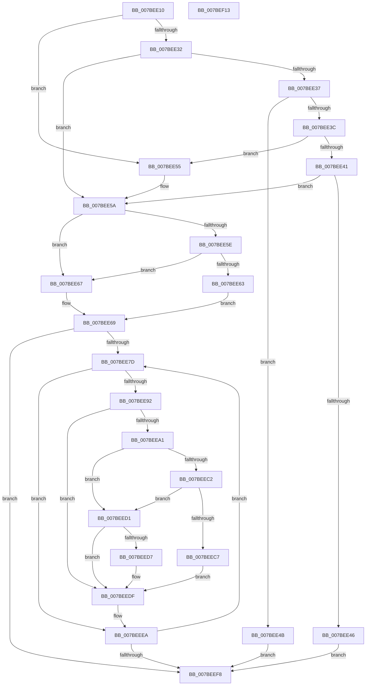

# EtwpKsrCallback

- RVA: `0x007BEE10`–`0x007BEF14` (길이 `260` bytes)
- VA: `0x00000001407BEE10`
- 실행 섹션: `PAGE`
- PDB 이름 있음: `예`; PDB Function 태그: `아니요`
- unwind 정보 RVA: `0x0005D7BC`
- 디코드: `79`개 명령, `260/260` bytes 표시
- 미해석 바이트: `0` (있으면 어셈블리에 `.byte`로 보존)

> 이 문서는 커널 이미지의 기계어와 PDB 기호를 분석해 생성했습니다. 4번과 5번은 함수 원형과 자료형을 바이너리 사용 방식에서 추정한 C 해석이며 원본 소스 복구 결과는 아닙니다.

## 1. Dependencies

- 직접 호출 지점: **7**; 고유 호출 대상: **6**
- 직접 호출자로 확인된 함수: **0**
- RIP 상대 이미지 참조: **2**

### Outgoing calls
- `0x007BEE4B` → [EtwpSavePersistedLoggers](EtwpSavePersistedLoggers_function_007BF910.md) (function, `0x007BF910`)
- `0x007BEE55` → [EtwpSavePersistedLoggers](EtwpSavePersistedLoggers_function_007BF910.md) (function, `0x007BF910`)
- `0x007BEE85` → [EtwpAcquireLoggerContextByLoggerId](../93/EtwpAcquireLoggerContextByLoggerId_function_00932920.md) (function, `0x00932920`)
- `0x007BEEB9` → [KeWaitForSingleObject](../../text/20/KeWaitForSingleObject_function_0020E6B0.md) (function, `0x0020E6B0`)
- `0x007BEECA` → [EtwpCancelMemoryPreservation](EtwpCancelMemoryPreservation_function_007BEC0C.md) (function, `0x007BEC0C`)
- `0x007BEEDA` → [EtwpPreserveLogger](EtwpPreserveLogger_function_007BEF4C.md) (function, `0x007BEF4C`)
- `0x007BEEE5` → [EtwpReleaseLoggerContext](../A0/EtwpReleaseLoggerContext_function_00A04160.md) (function, `0x00A04160`)

### Direct callers
- 이 함수 시작 RVA로 연결되는 직접 call은 확인되지 않았습니다. 간접 호출은 완전히 역산할 수 없습니다.

### Static image references
- `0x007BEE69` → RVA `0x00FD9A72` (`PAGEDATA`; write)
- `0x007BEE71` → RVA `0x00FC6AA8` (`ALMOSTRO`; read)

## 2. Other-region calls and transfers

- 다른 실행 섹션으로 향하는 call: **1**
  - `0x007BEEB9` → [KeWaitForSingleObject](../../text/20/KeWaitForSingleObject_function_0020E6B0.md) (`PAGE` → `.text`)
- 별도 외부 분기/꼬리 이동을 확인하지 못했습니다.

## 3. Assembly (complete function range)

```asm
007BEE10  48 8B C4                        mov rax, rsp
007BEE13  48 89 58 08                     mov qword ptr [rax + 8], rbx
007BEE17  48 89 68 10                     mov qword ptr [rax + 0x10], rbp
007BEE1B  48 89 70 18                     mov qword ptr [rax + 0x18], rsi
007BEE1F  48 89 78 20                     mov qword ptr [rax + 0x20], rdi
007BEE23  41 56                           push r14
007BEE25  48 83 EC 30                     sub rsp, 0x30
007BEE29  48 8B FA                        mov rdi, rdx
007BEE2C  8B C2                           mov eax, edx
007BEE2E  85 D2                           test edx, edx
007BEE30  74 23                           je 0x1407bee55
007BEE32  83 E8 01                        sub eax, 1
007BEE35  74 23                           je 0x1407bee5a
007BEE37  83 E8 01                        sub eax, 1
007BEE3A  74 0F                           je 0x1407bee4b
007BEE3C  83 E8 01                        sub eax, 1
007BEE3F  74 14                           je 0x1407bee55
007BEE41  83 F8 01                        cmp eax, 1
007BEE44  74 14                           je 0x1407bee5a
007BEE46  E9 AD 00 00 00                  jmp 0x1407beef8
007BEE4B  E8 C0 0A 00 00                  call 0x1407bf910
007BEE50  E9 A3 00 00 00                  jmp 0x1407beef8
007BEE55  E8 B6 0A 00 00                  call 0x1407bf910
007BEE5A  85 FF                           test edi, edi
007BEE5C  74 09                           je 0x1407bee67
007BEE5E  83 FF 03                        cmp edi, 3
007BEE61  74 04                           je 0x1407bee67
007BEE63  32 C0                           xor al, al
007BEE65  EB 02                           jmp 0x1407bee69
007BEE67  B0 01                           mov al, 1
007BEE69  88 05 03 AC 81 00               mov byte ptr [rip + 0x81ac03], al
007BEE6F  33 F6                           xor esi, esi
007BEE71  48 8B 05 30 7C 80 00            mov rax, qword ptr [rip + 0x807c30]
007BEE78  39 70 10                        cmp dword ptr [rax + 0x10], esi
007BEE7B  76 7B                           jbe 0x1407beef8
007BEE7D  45 33 C0                        xor r8d, r8d
007BEE80  8B D6                           mov edx, esi
007BEE82  48 8B C8                        mov rcx, rax
007BEE85  E8 96 3A 17 00                  call 0x140932920
007BEE8A  48 8B D8                        mov rbx, rax
007BEE8D  48 85 C0                        test rax, rax
007BEE90  74 58                           je 0x1407beeea
007BEE92  48 8B A8 48 05 00 00            mov rbp, qword ptr [rax + 0x548]
007BEE99  45 32 F6                        xor r14b, r14b
007BEE9C  48 85 ED                        test rbp, rbp
007BEE9F  74 3E                           je 0x1407beedf
007BEEA1  48 83 64 24 20 00               and qword ptr [rsp + 0x20], 0
007BEEA7  48 8D 88 78 02 00 00            lea rcx, [rax + 0x278]
007BEEAE  45 33 C9                        xor r9d, r9d
007BEEB1  45 33 C0                        xor r8d, r8d
007BEEB4  33 D2                           xor edx, edx
007BEEB6  41 B6 01                        mov r14b, 1
007BEEB9  E8 F2 F7 A4 FF                  call 0x14020e6b0
007BEEBE  85 FF                           test edi, edi
007BEEC0  74 0F                           je 0x1407beed1
007BEEC2  83 FF 03                        cmp edi, 3
007BEEC5  74 0A                           je 0x1407beed1
007BEEC7  48 8B CB                        mov rcx, rbx
007BEECA  E8 3D FD FF FF                  call 0x1407bec0c
007BEECF  EB 0E                           jmp 0x1407beedf
007BEED1  80 7D 20 00                     cmp byte ptr [rbp + 0x20], 0
007BEED5  74 08                           je 0x1407beedf
007BEED7  48 8B CB                        mov rcx, rbx
007BEEDA  E8 6D 00 00 00                  call 0x1407bef4c
007BEEDF  41 8A D6                        mov dl, r14b
007BEEE2  48 8B CB                        mov rcx, rbx
007BEEE5  E8 76 52 24 00                  call 0x140a04160
007BEEEA  48 8B 05 B7 7B 80 00            mov rax, qword ptr [rip + 0x807bb7]
007BEEF1  FF C6                           inc esi
007BEEF3  3B 70 10                        cmp esi, dword ptr [rax + 0x10]
007BEEF6  72 85                           jb 0x1407bee7d
007BEEF8  48 8B 5C 24 40                  mov rbx, qword ptr [rsp + 0x40]
007BEEFD  48 8B 6C 24 48                  mov rbp, qword ptr [rsp + 0x48]
007BEF02  48 8B 74 24 50                  mov rsi, qword ptr [rsp + 0x50]
007BEF07  48 8B 7C 24 58                  mov rdi, qword ptr [rsp + 0x58]
007BEF0C  48 83 C4 30                     add rsp, 0x30
007BEF10  41 5E                           pop r14
007BEF12  C3                              ret
007BEF13  CC                              int3
```

## 4. C-style interpretation (structured pseudocode)

```c
__int64 __fastcall EtwpKsrCallback(__int64 a1, __int64 a2, int a3, int a4)
{
    __int64 result;
    __int64 v_r14;
    __int64 v_rsi;
    __int64 v_rsp;
    unsigned __int64 v_stack_m18;
    unsigned __int64 v_stack_p10;
    unsigned __int64 v_stack_p18;
    unsigned __int64 v_stack_p20;
    unsigned __int64 v_stack_p8;

    *(unsigned __int64 *)(v_rsp + 8) = v_rbx;
    *(unsigned __int64 *)(v_rsp + 16) = v_rbp;
    *(unsigned __int64 *)(v_rsp + 24) = v_rsi;
    *(unsigned __int64 *)(v_rsp + 32) = v_rdi;
    v_rsp = (v_rsp) - (48);
    if ((unsigned int)(a2) == 0) goto loc_007BEE55;
    result = (unsigned int)(((unsigned int)((unsigned int)(a2))) - (1));
    if (condition_is_equal) goto loc_007BEE5A;
    result = (unsigned int)((result) - (1));
    if (condition_is_equal) goto loc_007BEE4B;
    result = (unsigned int)((result) - (1));
    if (condition_is_equal) goto loc_007BEE55;
    if (((unsigned int)(result)) == 1) goto loc_007BEE5A;
    goto loc_007BEEF8;
loc_007BEE4B:
    result = EtwpSavePersistedLoggers(a1, a2, a3, a4);
    goto loc_007BEEF8;
loc_007BEE55:
    result = EtwpSavePersistedLoggers(a1, a2, a3, a4);
loc_007BEE5A:
    if ((unsigned int)(a2) == 0) goto loc_007BEE67;
    if (((unsigned int)(a2)) == 3) goto loc_007BEE67;
    result = 0;
    goto loc_007BEE69;
loc_007BEE67:
loc_007BEE69:
    *(unsigned __int8 *)(v_rip + 8498179) = 1;
    v_rsi = 0;
    if ((*(unsigned int *)(*(unsigned __int64 *)(v_rip + 8420400) + 16)) <= 0) goto loc_007BEEF8;
loc_007BEE7D:
    a3 = 0;
    result = EtwpAcquireLoggerContextByLoggerId(*(unsigned __int64 *)(v_rip + 8420400), 0, a3, a4);
    if (result == 0) goto loc_007BEEEA;
    v_r14 = 0;
    if (*(unsigned __int64 *)(result + 1352) == 0) goto loc_007BEEDF;
    a4 = 0;
    a3 = 0;
    a2 = 0;
    result = KeWaitForSingleObject(result + 632, a2, a3, a4);
    if (0 == 0) goto loc_007BEED1;
    if (0 == 3) goto loc_007BEED1;
    result = EtwpCancelMemoryPreservation(result, a2, a3, a4);
    goto loc_007BEEDF;
loc_007BEED1:
    if ((*(unsigned __int8 *)(*(unsigned __int64 *)(result + 1352) + 32)) != 0) {
        a1 = result;
        result = EtwpPreserveLogger(a1, a2, a3, a4);
    }
    result = EtwpReleaseLoggerContext(result, 1, a3, a4);
loc_007BEEEA:
    v_rsi = (unsigned int)((v_rsi) + 1);
    if (((unsigned int)(v_rsi)) < (*(unsigned int *)(*(unsigned __int64 *)(v_rip + 8420279) + 16))) goto loc_007BEE7D;
loc_007BEEF8:
    v_rsp = (v_rsp) + (48);
    return *(unsigned __int64 *)(v_rip + 8420279);
}
```

## 5. (Beta) C Style

```c
int64_t EtwpKsrCallback(int64_t Arg1, int64_t Arg2, int32_t Arg3, int32_t Arg4)
{
    int64_t result;
    int64_t local_r14;
    int64_t local_rsi;
    int64_t local_rsp;
    uint64_t v_stack_m18;
    uint64_t v_stack_p10;
    uint64_t v_stack_p18;
    uint64_t v_stack_p20;
    uint64_t v_stack_p8;

    *(uint64_t *)(local_rsp + 0x8) = local_rbx;
    *(uint64_t *)(local_rsp + 0x10) = local_rbp;
    *(uint64_t *)(local_rsp + 0x18) = local_rsi;
    *(uint64_t *)(local_rsp + 0x20) = local_rdi;
    local_rsp = (local_rsp) - (48);
    if ((uint32_t)(Arg2) == 0) goto loc_007BEE55;
    result = (uint32_t)(((uint32_t)((uint32_t)(Arg2))) - (1));
    if (condition_is_equal) goto loc_007BEE5A;
    result = (uint32_t)((result) - (1));
    if (condition_is_equal) goto loc_007BEE4B;
    result = (uint32_t)((result) - (1));
    if (condition_is_equal) goto loc_007BEE55;
    if (((uint32_t)(result)) == 1) goto loc_007BEE5A;
    goto loc_007BEEF8;
loc_007BEE4B:
    result = EtwpSavePersistedLoggers(Arg1, Arg2, Arg3, Arg4);
    goto loc_007BEEF8;
loc_007BEE55:
    result = EtwpSavePersistedLoggers(Arg1, Arg2, Arg3, Arg4);
loc_007BEE5A:
    if ((uint32_t)(Arg2) == 0) goto loc_007BEE67;
    if (((uint32_t)(Arg2)) == 3) goto loc_007BEE67;
    result = 0;
    goto loc_007BEE69;
loc_007BEE67:
loc_007BEE69:
    *(uint8_t *)(v_rip + 0x81AC03) = 1;
    local_rsi = 0;
    if ((*(uint32_t *)(*(uint64_t *)(v_rip + 0x807C30) + 0x10)) <= 0) goto loc_007BEEF8;
loc_007BEE7D:
    Arg3 = 0;
    result = EtwpAcquireLoggerContextByLoggerId(*(uint64_t *)(v_rip + 0x807C30), 0, Arg3, Arg4);
    if (result == 0) goto loc_007BEEEA;
    local_r14 = 0;
    if (*(uint64_t *)(result + 0x548) == 0) goto loc_007BEEDF;
    Arg4 = 0;
    Arg3 = 0;
    Arg2 = 0;
    result = KeWaitForSingleObject(result + 632, Arg2, Arg3, Arg4);
    if (0 == 0) goto loc_007BEED1;
    if (0 == 3) goto loc_007BEED1;
    result = EtwpCancelMemoryPreservation(result, Arg2, Arg3, Arg4);
    goto loc_007BEEDF;
loc_007BEED1:
    if ((*(uint8_t *)(*(uint64_t *)(result + 0x548) + 0x20)) != 0) {
        Arg1 = result;
        result = EtwpPreserveLogger(Arg1, Arg2, Arg3, Arg4);
    }
    result = EtwpReleaseLoggerContext(result, 1, Arg3, Arg4);
loc_007BEEEA:
    local_rsi = (uint32_t)((local_rsi) + 1);
    if (((uint32_t)(local_rsi)) < (*(uint32_t *)(*(uint64_t *)(v_rip + 0x807BB7) + 0x10))) goto loc_007BEE7D;
loc_007BEEF8:
    local_rsp = (local_rsp) + (48);
    return *(uint64_t *)(v_rip + 0x807BB7);
}
```

## 6. Execution-region graph

[열기: 2D/3D 그래프와 함수 탐색 컨트롤 패널](../../../control-panel.html?section=page&rva=0x007BEE10&view=graph)

- 2D 그래프는 위에서 아래로 흐르고, 3D 그래프는 빈 공간을 드래그해 회전합니다. Shift+드래그는 이동, 휠은 확대·축소, 함수 노드 선택은 대상 보고서 이동입니다.

### Static fallback


