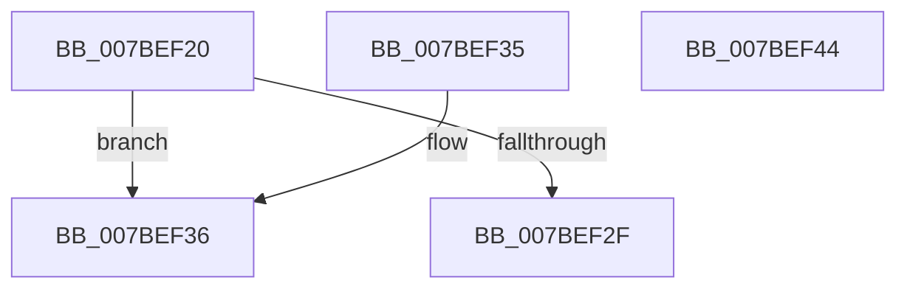

# EtwpKsrMemoryEnumCallback

- RVA: `0x007BEF20`–`0x007BEF45` (길이 `37` bytes)
- VA: `0x00000001407BEF20`
- 실행 섹션: `PAGE`
- PDB 이름 있음: `예`; PDB Function 태그: `아니요`
- unwind 정보 RVA: `0x000DB714`
- 디코드: `13`개 명령, `37/37` bytes 표시
- 미해석 바이트: `0` (있으면 어셈블리에 `.byte`로 보존)

> 이 문서는 커널 이미지의 기계어와 PDB 기호를 분석해 생성했습니다. 4번과 5번은 함수 원형과 자료형을 바이너리 사용 방식에서 추정한 C 해석이며 원본 소스 복구 결과는 아닙니다.

## 1. Dependencies

- 직접 호출 지점: **0**; 고유 호출 대상: **0**
- 직접 호출자로 확인된 함수: **0**
- RIP 상대 이미지 참조: **1**

### Outgoing calls
- 직접 디코드된 call 명령이 없습니다.

### Direct callers
- 이 함수 시작 RVA로 연결되는 직접 call은 확인되지 않았습니다. 간접 호출은 완전히 역산할 수 없습니다.

### Static image references
- `0x007BEF20` → RVA `0x00FC6AA8` (`ALMOSTRO`; read)

## 2. Other-region calls and transfers

- 다른 실행 섹션으로 향하는 call: **0**
- 별도 외부 분기/꼬리 이동을 확인하지 못했습니다.

## 3. Assembly (complete function range)

```asm
007BEF20  48 8B 05 81 7B 80 00            mov rax, qword ptr [rip + 0x807b81]
007BEF27  41 8B 08                        mov ecx, dword ptr [r8]
007BEF2A  3B 48 10                        cmp ecx, dword ptr [rax + 0x10]
007BEF2D  72 07                           jb 0x1407bef36
007BEF2F  B8 23 00 00 C0                  mov eax, 0xc0000023
007BEF34  C3                              ret
007BEF35  CC                              int3
007BEF36  49 8B 40 08                     mov rax, qword ptr [r8 + 8]
007BEF3A  48 89 14 C8                     mov qword ptr [rax + rcx*8], rdx
007BEF3E  33 C0                           xor eax, eax
007BEF40  41 FF 00                        inc dword ptr [r8]
007BEF43  C3                              ret
007BEF44  CC                              int3
```

## 4. C-style interpretation (structured pseudocode)

```c
__int64 __fastcall EtwpKsrMemoryEnumCallback(__int64 a1, __int64 a2, __int64 a3)
{
    __int64 result;

    if (((unsigned int)((unsigned int)(*(unsigned int *)(a3)))) < (*(unsigned int *)(*(unsigned __int64 *)(v_rip + 8420225) + 16))) goto loc_007BEF36;
    return (unsigned int)(0xC0000023ULL);
loc_007BEF36:
    *(unsigned __int64 *)(*(unsigned __int64 *)(a3 + 8) + (unsigned int)(*(unsigned int *)(a3)) * 8) = a2;
    result = 0;
    return result;
}
```

## 5. (Beta) C Style

```c
int64_t EtwpKsrMemoryEnumCallback(int64_t Arg1, int64_t Arg2, void *Arg3)
{
    uint8_t *arg3 = (uint8_t *)Arg3;

    int64_t result;

    if (((uint32_t)((uint32_t)(*(uint32_t *)(arg3)))) < (*(uint32_t *)(*(uint64_t *)(v_rip + 0x807B81) + 0x10))) goto loc_007BEF36;
    return (uint32_t)(0xC0000023ULL);
loc_007BEF36:
    *(uint64_t *)(*(uint64_t *)(arg3 + 0x8) + (uint32_t)(*(uint32_t *)(arg3)) * 8) = Arg2;
    result = 0;
    return result;
}
```

### 관측된 메모리 오프셋

구조체 형식이 확인되지 않은 접근은 인자 기준의 오프셋으로만 기록했습니다.

| 기준 인자 | 오프셋 표현 | 폭 (bit) | 접근 |
|---|---:|---:|---|
| `Arg3` | `+ 0x0` | `32` | `R` |
| `Arg3` | `+ 0x0` | `32` | `R/W` |
| `Arg3` | `+ 0x8` | `64` | `R` |

## 6. Execution-region graph

[열기: 2D/3D 그래프와 함수 탐색 컨트롤 패널](../../../control-panel.html?section=page&rva=0x007BEF20&view=graph)

- 2D 그래프는 위에서 아래로 흐르고, 3D 그래프는 빈 공간을 드래그해 회전합니다. Shift+드래그는 이동, 휠은 확대·축소, 함수 노드 선택은 대상 보고서 이동입니다.

### Static fallback


