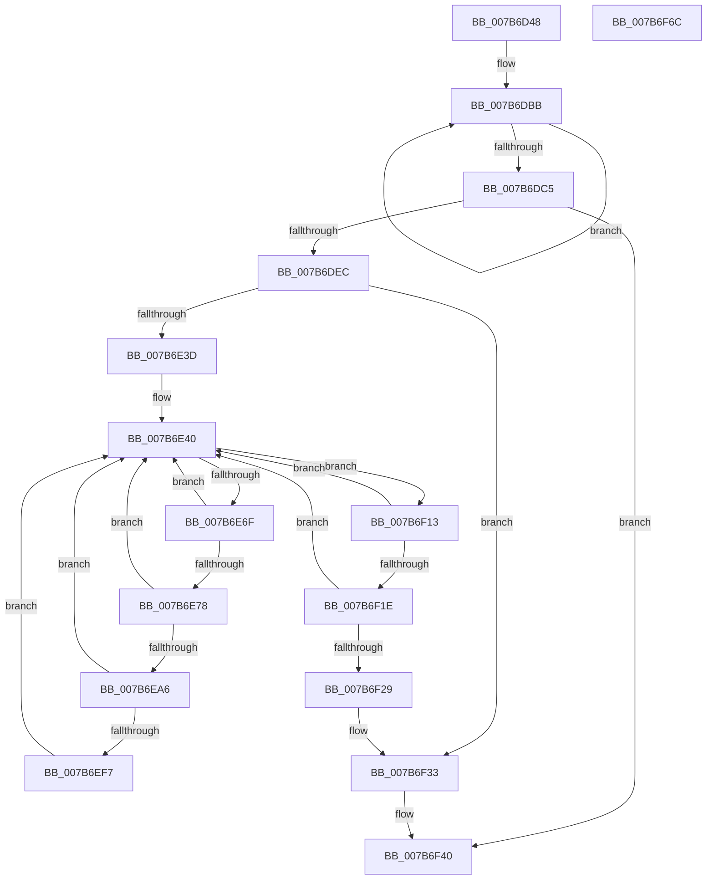

# EtwpLoadMicroarchitecturalPmcs

- RVA: `0x007B6D48`–`0x007B6F6D` (길이 `549` bytes)
- VA: `0x00000001407B6D48`
- 실행 섹션: `PAGE`
- PDB 이름 있음: `예`; PDB Function 태그: `아니요`
- unwind 정보 RVA: `0x000D346C`
- 디코드: `124`개 명령, `549/549` bytes 표시
- 미해석 바이트: `0` (있으면 어셈블리에 `.byte`로 보존)

> 이 문서는 커널 이미지의 기계어와 PDB 기호를 분석해 생성했습니다. 4번과 5번은 함수 원형과 자료형을 바이너리 사용 방식에서 추정한 C 해석이며 원본 소스 복구 결과는 아닙니다.

## 1. Dependencies

- 직접 호출 지점: **13**; 고유 호출 대상: **10**
- 직접 호출자로 확인된 함수: **1**
- RIP 상대 이미지 참조: **3**

### Outgoing calls
- `0x007B6D94` → [memset](../../text/6C/memset_function_006C6C40.md) (function, `0x006C6C40`)
- `0x007B6DDB` → [ExAllocatePool2](../../poolcode/B8/ExAllocatePool2_function_00B820F0.md) (function, `0x00B820F0`)
- `0x007B6DF4` → [RtlInitUnicodeString](../../text/42/RtlInitUnicodeString_function_0042A780.md) (function, `0x0042A780`)
- `0x007B6E30` → [ZwOpenKey](../../text/6A/ZwOpenKey_function_006AD310.md) (function, `0x006AD310`)
- `0x007B6E62` → [ZwEnumerateKey](../../text/6A/ZwEnumerateKey_function_006AD710.md) (function, `0x006AD710`)
- `0x007B6E9D` → [RtlStringCbPrintfW](../../text/40/RtlStringCbPrintfW_function_0040FB40.md) (function, `0x0040FB40`)
- `0x007B6EAE` → [RtlInitUnicodeString](../../text/42/RtlInitUnicodeString_function_0042A780.md) (function, `0x0042A780`)
- `0x007B6EEA` → [ZwOpenKey](../../text/6A/ZwOpenKey_function_006AD310.md) (function, `0x006AD310`)
- `0x007B6EFF` → [EtwpLoadMicroarchitecturalProfileGroup](EtwpLoadMicroarchitecturalProfileGroup_function_007B6F74.md) (function, `0x007B6F74`)
- `0x007B6F09` → [ZwClose](../../text/6A/ZwClose_function_006AD2B0.md) (function, `0x006AD2B0`)
- `0x007B6F2E` → [ZwClose](../../text/6A/ZwClose_function_006AD2B0.md) (function, `0x006AD2B0`)
- `0x007B6F3B` → [ExFreePoolWithTag](../../poolcode/B8/ExFreePoolWithTag_function_00B82870.md) (function, `0x00B82870`)
- `0x007B6F4A` → [_security_check_cookie](../../text/6A/_security_check_cookie_function_006AC640.md) (function, `0x006AC640`)

### Direct callers
- [EtwpInitialize](../../init/C4/EtwpInitialize_function_00C4DBCC.md) at `0x00C4DE39`

### Static image references
- `0x007B6D6A` → RVA `0x00E0A740` (`.data`; read)
- `0x007B6DAB` → RVA `0x00B07430` (` ?? ::NNGAKEGL::`string'`; read)
- `0x007B6E7B` → RVA `0x00B07420` (` ?? ::NNGAKEGL::`string'`; read)

## 2. Other-region calls and transfers

- 다른 실행 섹션으로 향하는 call: **12**
  - `0x007B6D94` → [memset](../../text/6C/memset_function_006C6C40.md) (`PAGE` → `.text`)
  - `0x007B6DDB` → [ExAllocatePool2](../../poolcode/B8/ExAllocatePool2_function_00B820F0.md) (`PAGE` → `POOLCODE`)
  - `0x007B6DF4` → [RtlInitUnicodeString](../../text/42/RtlInitUnicodeString_function_0042A780.md) (`PAGE` → `.text`)
  - `0x007B6E30` → [ZwOpenKey](../../text/6A/ZwOpenKey_function_006AD310.md) (`PAGE` → `.text`)
  - `0x007B6E62` → [ZwEnumerateKey](../../text/6A/ZwEnumerateKey_function_006AD710.md) (`PAGE` → `.text`)
  - `0x007B6E9D` → [RtlStringCbPrintfW](../../text/40/RtlStringCbPrintfW_function_0040FB40.md) (`PAGE` → `.text`)
  - `0x007B6EAE` → [RtlInitUnicodeString](../../text/42/RtlInitUnicodeString_function_0042A780.md) (`PAGE` → `.text`)
  - `0x007B6EEA` → [ZwOpenKey](../../text/6A/ZwOpenKey_function_006AD310.md) (`PAGE` → `.text`)
  - `0x007B6F09` → [ZwClose](../../text/6A/ZwClose_function_006AD2B0.md) (`PAGE` → `.text`)
  - `0x007B6F2E` → [ZwClose](../../text/6A/ZwClose_function_006AD2B0.md) (`PAGE` → `.text`)
  - `0x007B6F3B` → [ExFreePoolWithTag](../../poolcode/B8/ExFreePoolWithTag_function_00B82870.md) (`PAGE` → `POOLCODE`)
  - `0x007B6F4A` → [_security_check_cookie](../../text/6A/_security_check_cookie_function_006AC640.md) (`PAGE` → `.text`)
- 별도 외부 분기/꼬리 이동을 확인하지 못했습니다.

## 3. Assembly (complete function range)

```asm
007B6D48  48 8B C4                        mov rax, rsp
007B6D4B  48 89 58 08                     mov qword ptr [rax + 8], rbx
007B6D4F  48 89 70 10                     mov qword ptr [rax + 0x10], rsi
007B6D53  48 89 78 18                     mov qword ptr [rax + 0x18], rdi
007B6D57  55                              push rbp
007B6D58  41 56                           push r14
007B6D5A  41 57                           push r15
007B6D5C  48 8D A8 28 FE FF FF            lea rbp, [rax - 0x1d8]
007B6D63  48 81 EC C0 02 00 00            sub rsp, 0x2c0
007B6D6A  48 8B 05 CF 39 65 00            mov rax, qword ptr [rip + 0x6539cf]
007B6D71  48 33 C4                        xor rax, rsp
007B6D74  48 89 85 B0 01 00 00            mov qword ptr [rbp + 0x1b0], rax
007B6D7B  45 33 F6                        xor r14d, r14d
007B6D7E  48 8D 4D 90                     lea rcx, [rbp - 0x70]
007B6D82  33 D2                           xor edx, edx
007B6D84  4C 89 74 24 38                  mov qword ptr [rsp + 0x38], r14
007B6D89  41 B8 18 02 00 00               mov r8d, 0x218
007B6D8F  4C 89 74 24 40                  mov qword ptr [rsp + 0x40], r14
007B6D94  E8 A7 FE F0 FF                  call 0x1406c6c40
007B6D99  0F 57 C0                        xorps xmm0, xmm0
007B6D9C  44 89 74 24 5C                  mov dword ptr [rsp + 0x5c], r14d
007B6DA1  0F 11 44 24 48                  movups xmmword ptr [rsp + 0x48], xmm0
007B6DA6  44 89 74 24 74                  mov dword ptr [rsp + 0x74], r14d
007B6DAB  4C 8D 3D 7E 06 35 00            lea r15, [rip + 0x35067e]
007B6DB2  44 89 74 24 30                  mov dword ptr [rsp + 0x30], r14d
007B6DB7  48 83 C8 FF                     or rax, 0xffffffffffffffff
007B6DBB  48 FF C0                        inc rax
007B6DBE  66 45 39 34 47                  cmp word ptr [r15 + rax*2], r14w
007B6DC3  75 F6                           jne 0x1407b6dbb
007B6DC5  8D 04 45 02 02 00 00            lea eax, [rax*2 + 0x202]
007B6DCC  41 B8 45 74 77 50               mov r8d, 0x50777445
007B6DD2  8B D0                           mov edx, eax
007B6DD4  B9 00 01 00 00                  mov ecx, 0x100
007B6DD9  8B F0                           mov esi, eax
007B6DDB  E8 10 B3 3C 00                  call 0x140b820f0
007B6DE0  48 8B D8                        mov rbx, rax
007B6DE3  48 85 C0                        test rax, rax
007B6DE6  0F 84 54 01 00 00               je 0x1407b6f40
007B6DEC  49 8B D7                        mov rdx, r15
007B6DEF  48 8D 4C 24 48                  lea rcx, [rsp + 0x48]
007B6DF4  E8 87 39 C7 FF                  call 0x14042a780
007B6DF9  48 8D 44 24 48                  lea rax, [rsp + 0x48]
007B6DFE  C7 44 24 58 30 00 00 00         mov dword ptr [rsp + 0x58], 0x30
007B6E06  0F 57 C0                        xorps xmm0, xmm0
007B6E09  48 89 44 24 68                  mov qword ptr [rsp + 0x68], rax
007B6E0E  4C 8D 44 24 58                  lea r8, [rsp + 0x58]
007B6E13  4C 89 74 24 60                  mov qword ptr [rsp + 0x60], r14
007B6E18  BA 19 00 02 00                  mov edx, 0x20019
007B6E1D  C7 44 24 70 40 02 00 00         mov dword ptr [rsp + 0x70], 0x240
007B6E25  48 8D 4C 24 40                  lea rcx, [rsp + 0x40]
007B6E2A  F3 0F 7F 44 24 78               movdqu xmmword ptr [rsp + 0x78], xmm0
007B6E30  E8 DB 64 EF FF                  call 0x1406ad310
007B6E35  85 C0                           test eax, eax
007B6E37  0F 88 F6 00 00 00               js 0x1407b6f33
007B6E3D  83 CF FF                        or edi, 0xffffffff
007B6E40  48 8B 4C 24 40                  mov rcx, qword ptr [rsp + 0x40]
007B6E45  48 8D 44 24 30                  lea rax, [rsp + 0x30]
007B6E4A  48 89 44 24 28                  mov qword ptr [rsp + 0x28], rax
007B6E4F  4C 8D 4D 90                     lea r9, [rbp - 0x70]
007B6E53  FF C7                           inc edi
007B6E55  C7 44 24 20 16 02 00 00         mov dword ptr [rsp + 0x20], 0x216
007B6E5D  8B D7                           mov edx, edi
007B6E5F  45 33 C0                        xor r8d, r8d
007B6E62  E8 A9 68 EF FF                  call 0x1406ad710
007B6E67  85 C0                           test eax, eax
007B6E69  0F 88 A4 00 00 00               js 0x1407b6f13
007B6E6F  81 7D 9C FE 01 00 00            cmp dword ptr [rbp - 0x64], 0x1fe
007B6E76  73 C8                           jae 0x1407b6e40
007B6E78  8B 45 9C                        mov eax, dword ptr [rbp - 0x64]
007B6E7B  4C 8D 05 9E 05 35 00            lea r8, [rip + 0x35059e]
007B6E82  48 D1 E8                        shr rax, 1
007B6E85  4D 8B CF                        mov r9, r15
007B6E88  48 8B D6                        mov rdx, rsi
007B6E8B  48 8B CB                        mov rcx, rbx
007B6E8E  66 44 89 74 45 A0               mov word ptr [rbp + rax*2 - 0x60], r14w
007B6E94  48 8D 45 A0                     lea rax, [rbp - 0x60]
007B6E98  48 89 44 24 20                  mov qword ptr [rsp + 0x20], rax
007B6E9D  E8 9E 8C C5 FF                  call 0x14040fb40
007B6EA2  85 C0                           test eax, eax
007B6EA4  78 9A                           js 0x1407b6e40
007B6EA6  48 8B D3                        mov rdx, rbx
007B6EA9  48 8D 4C 24 48                  lea rcx, [rsp + 0x48]
007B6EAE  E8 CD 38 C7 FF                  call 0x14042a780
007B6EB3  48 8D 44 24 48                  lea rax, [rsp + 0x48]
007B6EB8  C7 44 24 58 30 00 00 00         mov dword ptr [rsp + 0x58], 0x30
007B6EC0  0F 57 C0                        xorps xmm0, xmm0
007B6EC3  48 89 44 24 68                  mov qword ptr [rsp + 0x68], rax
007B6EC8  4C 8D 44 24 58                  lea r8, [rsp + 0x58]
007B6ECD  4C 89 74 24 60                  mov qword ptr [rsp + 0x60], r14
007B6ED2  BA 19 00 02 00                  mov edx, 0x20019
007B6ED7  C7 44 24 70 40 02 00 00         mov dword ptr [rsp + 0x70], 0x240
007B6EDF  48 8D 4C 24 38                  lea rcx, [rsp + 0x38]
007B6EE4  F3 0F 7F 44 24 78               movdqu xmmword ptr [rsp + 0x78], xmm0
007B6EEA  E8 21 64 EF FF                  call 0x1406ad310
007B6EEF  85 C0                           test eax, eax
007B6EF1  0F 88 49 FF FF FF               js 0x1407b6e40
007B6EF7  48 8B 4C 24 38                  mov rcx, qword ptr [rsp + 0x38]
007B6EFC  48 8B D3                        mov rdx, rbx
007B6EFF  E8 70 00 00 00                  call 0x1407b6f74
007B6F04  48 8B 4C 24 38                  mov rcx, qword ptr [rsp + 0x38]
007B6F09  E8 A2 63 EF FF                  call 0x1406ad2b0
007B6F0E  E9 2D FF FF FF                  jmp 0x1407b6e40
007B6F13  3D 23 00 00 C0                  cmp eax, 0xc0000023
007B6F18  0F 84 22 FF FF FF               je 0x1407b6e40
007B6F1E  3D 05 00 00 80                  cmp eax, 0x80000005
007B6F23  0F 84 17 FF FF FF               je 0x1407b6e40
007B6F29  48 8B 4C 24 40                  mov rcx, qword ptr [rsp + 0x40]
007B6F2E  E8 7D 63 EF FF                  call 0x1406ad2b0
007B6F33  BA 45 74 77 50                  mov edx, 0x50777445
007B6F38  48 8B CB                        mov rcx, rbx
007B6F3B  E8 30 B9 3C 00                  call 0x140b82870
007B6F40  48 8B 8D B0 01 00 00            mov rcx, qword ptr [rbp + 0x1b0]
007B6F47  48 33 CC                        xor rcx, rsp
007B6F4A  E8 F1 56 EF FF                  call 0x1406ac640
007B6F4F  4C 8D 9C 24 C0 02 00 00         lea r11, [rsp + 0x2c0]
007B6F57  49 8B 5B 20                     mov rbx, qword ptr [r11 + 0x20]
007B6F5B  49 8B 73 28                     mov rsi, qword ptr [r11 + 0x28]
007B6F5F  49 8B 7B 30                     mov rdi, qword ptr [r11 + 0x30]
007B6F63  49 8B E3                        mov rsp, r11
007B6F66  41 5F                           pop r15
007B6F68  41 5E                           pop r14
007B6F6A  5D                              pop rbp
007B6F6B  C3                              ret
007B6F6C  CC                              int3
```

## 4. C-style interpretation (structured pseudocode)

```c
__int64 __fastcall EtwpLoadMicroarchitecturalPmcs(__int64 a1, int a2)
{
    __int64 result;
    __int64 v_r14;
    __int64 v_rdi;
    __int64 v_rsp;
    unsigned __int64 v_stack_m18;
    unsigned __int64 v_stack_m260;
    unsigned int v_stack_m264;
    unsigned int v_stack_m268;
    unsigned __int64 v_stack_m270;
    unsigned __int64 v_stack_m278;
    unsigned int v_stack_m27C;
    unsigned int v_stack_m280;
    unsigned __int64 v_stack_m290;
    unsigned __int64 v_stack_m298;
    unsigned __int64 v_stack_m2A0;
    unsigned int v_stack_m2A8;
    unsigned __int64 v_stack_m2B0;
    unsigned int v_stack_m2B8;

    *(unsigned __int64 *)(v_rsp + 8) = v_rbx;
    *(unsigned __int64 *)(v_rsp + 16) = v_rsi;
    *(unsigned __int64 *)(v_rsp + 24) = v_rdi;
    v_rsp = (v_rsp) - (704);
    result = (*(unsigned __int64 *)(v_rip + 6633935)) ^ (v_rsp);
    *(unsigned __int64 *)(v_rsp - 472 + 432) = result;
    v_r14 = 0;
    a2 = 0;
    v_stack_m2A0 = 0;
    v_stack_m298 = 0;
    result = memset(v_rsp - 472 - 112, a2, 536, a4);
    v_stack_m27C = 0;
    v_stack_m290 = v_xmm0;
    v_stack_m264 = 0;
    v_stack_m2A8 = 0;
    result = (result) | (-1);
loc_007B6DBB:
    result = (result) + 1;
    if ((*(unsigned __int16 *)(v_rip + 3475070 + result * 2)) != 0) goto loc_007B6DBB;
    result = ExAllocatePool2(256, (unsigned int)((unsigned int)(result * 2 + 514)), (unsigned int)(0x50777445ULL), a4);
    if (result == 0) goto loc_007B6F40;
    result = RtlInitUnicodeString(v_stack_m290, v_rip + 3475070, (unsigned int)(0x50777445ULL), a4);
    v_stack_m280 = 48;
    v_stack_m270 = v_stack_m290;
    v_stack_m278 = 0;
    v_stack_m268 = 576;
    v_stack_m260 = v_xmm0;
    result = ZwOpenKey(v_stack_m298, (unsigned int)(0x20019ULL), v_stack_m280, a4);
    if (sign_flag) goto loc_007B6F33;
    v_rdi = (unsigned int)((v_rdi) | (0xFFFFFFFFULL));
loc_007B6E40:
    v_stack_m2B0 = v_stack_m2A8;
    v_rdi = (unsigned int)((v_rdi) + 1);
    v_stack_m2B8 = 534;
    a3 = 0;
    result = ZwEnumerateKey(v_stack_m298, (unsigned int)((unsigned int)(v_rdi)), a3, v_rsp - 472 - 112);
    if (sign_flag) goto loc_007B6F13;
    if ((*(unsigned int *)(v_rsp - 472 - 100)) >= 510) goto loc_007B6E40;
    result = ((unsigned int)(*(unsigned int *)(v_rsp - 472 - 100))) >> (1);
    *(unsigned __int16 *)(v_rsp - 472 + result * 2 - 96) = 0;
    v_stack_m2B8 = v_rsp - 472 - 96;
    result = RtlStringCbPrintfW(result, (unsigned int)((unsigned int)(result * 2 + 514)), v_rip + 3474846, v_rip + 3475070);
    if (sign_flag) goto loc_007B6E40;
    result = RtlInitUnicodeString(v_stack_m290, result, v_rip + 3474846, v_rip + 3475070);
    v_stack_m280 = 48;
    v_stack_m270 = v_stack_m290;
    v_stack_m278 = 0;
    v_stack_m268 = 576;
    v_stack_m260 = v_xmm0;
    result = ZwOpenKey(v_stack_m2A0, (unsigned int)(0x20019ULL), v_stack_m280, v_rip + 3475070);
    if (sign_flag) goto loc_007B6E40;
    result = EtwpLoadMicroarchitecturalProfileGroup(v_stack_m2A0, result, v_stack_m280, v_rip + 3475070);
    result = ZwClose(v_stack_m2A0, result, v_stack_m280, v_rip + 3475070);
    goto loc_007B6E40;
loc_007B6F13:
    if (((unsigned int)(result)) == 0xC0000023ULL) goto loc_007B6E40;
    if (((unsigned int)(result)) == 0x80000005ULL) goto loc_007B6E40;
    result = ZwClose(v_stack_m298, result, v_stack_m280, v_rip + 3475070);
loc_007B6F33:
    result = ExFreePoolWithTag(result, (unsigned int)(0x50777445ULL), v_stack_m280, v_rip + 3475070);
loc_007B6F40:
    a1 = (*(unsigned __int64 *)(v_rsp - 472 + 432)) ^ (v_rsp);
    result = _security_check_cookie(a1, (unsigned int)(0x50777445ULL), v_stack_m280, v_rip + 3475070);
    return result;
}
```

## 5. (Beta) C Style

```c
int64_t EtwpLoadMicroarchitecturalPmcs(int64_t Arg1, int32_t Arg2)
{
    int64_t result;
    int64_t local_r14;
    int64_t local_rdi;
    int64_t local_rsp;
    uint64_t v_stack_m18;
    uint64_t v_stack_m260;
    uint32_t v_stack_m264;
    uint32_t v_stack_m268;
    uint64_t v_stack_m270;
    uint64_t v_stack_m278;
    uint32_t v_stack_m27C;
    uint32_t v_stack_m280;
    uint64_t v_stack_m290;
    uint64_t v_stack_m298;
    uint64_t v_stack_m2A0;
    uint32_t v_stack_m2A8;
    uint64_t v_stack_m2B0;
    uint32_t v_stack_m2B8;

    *(uint64_t *)(local_rsp + 0x8) = local_rbx;
    *(uint64_t *)(local_rsp + 0x10) = local_rsi;
    *(uint64_t *)(local_rsp + 0x18) = local_rdi;
    local_rsp = (local_rsp) - (704);
    result = (*(uint64_t *)(v_rip + 0x6539CF)) ^ (local_rsp);
    *(uint64_t *)(local_rsp - 0x1D8 + 0x1B0) = result;
    local_r14 = 0;
    Arg2 = 0;
    v_stack_m2A0 = 0;
    v_stack_m298 = 0;
    result = memset(local_rsp - 472 - 112, Arg2, 536, a4);
    v_stack_m27C = 0;
    v_stack_m290 = v_xmm0;
    v_stack_m264 = 0;
    v_stack_m2A8 = 0;
    result = (result) | (-1);
loc_007B6DBB:
    result = (result) + 1;
    if ((*(uint16_t *)(v_rip + 0x35067E + result * 2)) != 0) goto loc_007B6DBB;
    result = ExAllocatePool2(256, (uint32_t)((uint32_t)(result * 2 + 514)), (uint32_t)(0x50777445ULL), a4);
    if (result == 0) goto loc_007B6F40;
    result = RtlInitUnicodeString(v_stack_m290, v_rip + 3475070, (uint32_t)(0x50777445ULL), a4);
    v_stack_m280 = 48;
    v_stack_m270 = v_stack_m290;
    v_stack_m278 = 0;
    v_stack_m268 = 576;
    v_stack_m260 = v_xmm0;
    result = ZwOpenKey(v_stack_m298, (uint32_t)(0x20019ULL), v_stack_m280, a4);
    if (sign_flag) goto loc_007B6F33;
    local_rdi = (uint32_t)((local_rdi) | (0xFFFFFFFFULL));
loc_007B6E40:
    v_stack_m2B0 = v_stack_m2A8;
    local_rdi = (uint32_t)((local_rdi) + 1);
    v_stack_m2B8 = 534;
    a3 = 0;
    result = ZwEnumerateKey(v_stack_m298, (uint32_t)((uint32_t)(local_rdi)), a3, local_rsp - 472 - 112);
    if (sign_flag) goto loc_007B6F13;
    if ((*(uint32_t *)(local_rsp - 0x1D8 - 0x64)) >= 510) goto loc_007B6E40;
    result = ((uint32_t)(*(uint32_t *)(local_rsp - 0x1D8 - 0x64))) >> (1);
    *(uint16_t *)(local_rsp - 0x1D8 + result * 2 - 0x60) = 0;
    v_stack_m2B8 = local_rsp - 472 - 96;
    result = RtlStringCbPrintfW(result, (uint32_t)((uint32_t)(result * 2 + 514)), v_rip + 3474846, v_rip + 3475070);
    if (sign_flag) goto loc_007B6E40;
    result = RtlInitUnicodeString(v_stack_m290, result, v_rip + 3474846, v_rip + 3475070);
    v_stack_m280 = 48;
    v_stack_m270 = v_stack_m290;
    v_stack_m278 = 0;
    v_stack_m268 = 576;
    v_stack_m260 = v_xmm0;
    result = ZwOpenKey(v_stack_m2A0, (uint32_t)(0x20019ULL), v_stack_m280, v_rip + 3475070);
    if (sign_flag) goto loc_007B6E40;
    result = EtwpLoadMicroarchitecturalProfileGroup(v_stack_m2A0, result, v_stack_m280, v_rip + 3475070);
    result = ZwClose(v_stack_m2A0, result, v_stack_m280, v_rip + 3475070);
    goto loc_007B6E40;
loc_007B6F13:
    if (((uint32_t)(result)) == 0xC0000023ULL) goto loc_007B6E40;
    if (((uint32_t)(result)) == 0x80000005ULL) goto loc_007B6E40;
    result = ZwClose(v_stack_m298, result, v_stack_m280, v_rip + 3475070);
loc_007B6F33:
    result = ExFreePoolWithTag(result, (uint32_t)(0x50777445ULL), v_stack_m280, v_rip + 3475070);
loc_007B6F40:
    Arg1 = (*(uint64_t *)(local_rsp - 0x1D8 + 0x1B0)) ^ (local_rsp);
    result = _security_check_cookie(Arg1, (uint32_t)(0x50777445ULL), v_stack_m280, v_rip + 3475070);
    return result;
}
```

## 6. Execution-region graph

[열기: 2D/3D 그래프와 함수 탐색 컨트롤 패널](../../../control-panel.html?section=page&rva=0x007B6D48&view=graph)

- 2D 그래프는 위에서 아래로 흐르고, 3D 그래프는 빈 공간을 드래그해 회전합니다. Shift+드래그는 이동, 휠은 확대·축소, 함수 노드 선택은 대상 보고서 이동입니다.

### Static fallback


