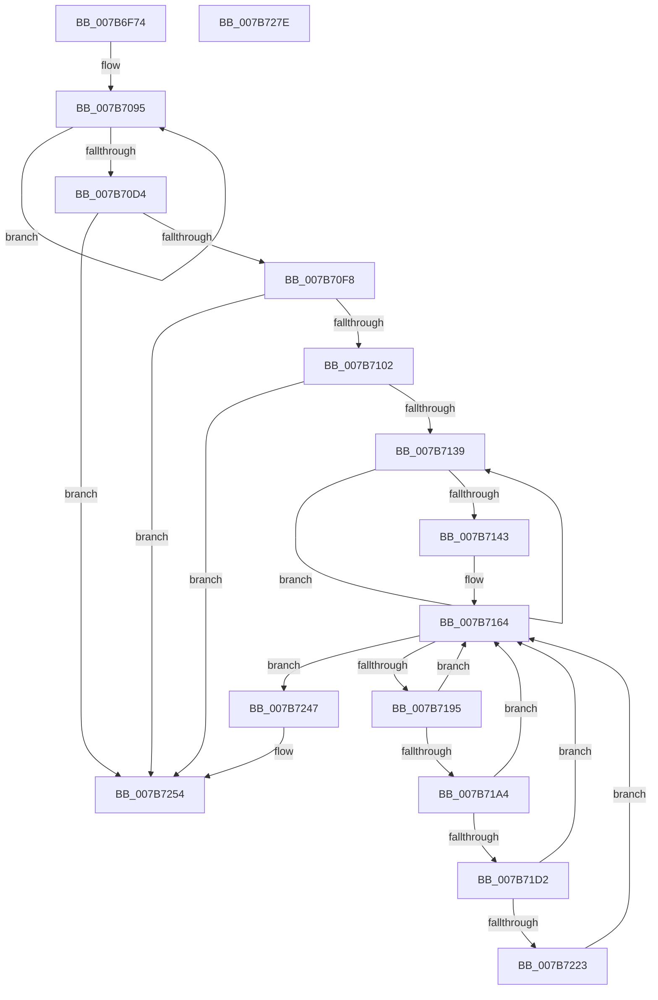

# EtwpLoadMicroarchitecturalProfileGroup

- RVA: `0x007B6F74`–`0x007B727F` (길이 `779` bytes)
- VA: `0x00000001407B6F74`
- 실행 섹션: `PAGE`
- PDB 이름 있음: `예`; PDB Function 태그: `아니요`
- unwind 정보 RVA: `0x000D3444`
- 디코드: `174`개 명령, `779/779` bytes 표시
- 미해석 바이트: `0` (있으면 어셈블리에 `.byte`로 보존)

> 이 문서는 커널 이미지의 기계어와 PDB 기호를 분석해 생성했습니다. 4번과 5번은 함수 원형과 자료형을 바이너리 사용 방식에서 추정한 C 해석이며 원본 소스 복구 결과는 아닙니다.

## 1. Dependencies

- 직접 호출 지점: **18**; 고유 호출 대상: **15**
- 직접 호출자로 확인된 함수: **1**
- RIP 상대 이미지 참조: **6**

### Outgoing calls
- `0x007B6FC1` → [memset](../../text/6C/memset_function_006C6C40.md) (function, `0x006C6C40`)
- `0x007B701B` → [memset](../../text/6C/memset_function_006C6C40.md) (function, `0x006C6C40`)
- `0x007B702A` → [KiGetCpuVendor](../../pagelk/B7/KiGetCpuVendor_function_00B7D5B4.md) (function, `0x00B7D5B4`)
- `0x007B7040` → [EtwpGetPmcCpuHierarchyRegistry](EtwpGetPmcCpuHierarchyRegistry_function_007B687C.md) (function, `0x007B687C`)
- `0x007B7052` → [memset](../../text/6C/memset_function_006C6C40.md) (function, `0x006C6C40`)
- `0x007B70EB` → [RtlpQueryRegistryValues](../8C/RtlpQueryRegistryValues_function_008C9050.md) (function, `0x008C9050`)
- `0x007B7113` → [memset](../../text/6C/memset_function_006C6C40.md) (function, `0x006C6C40`)
- `0x007B7123` → [EtwpGetMicroarchitecturalPmcAffinity](EtwpGetMicroarchitecturalPmcAffinity_function_007B67CC.md) (function, `0x007B67CC`)
- `0x007B712C` → [KeIsEmptyAffinityEx](../../text/2D/KeIsEmptyAffinityEx_function_002D1580.md) (function, `0x002D1580`)
- `0x007B7159` → [ExAllocatePool2](../../poolcode/B8/ExAllocatePool2_function_00B820F0.md) (function, `0x00B820F0`)
- `0x007B7188` → [ZwEnumerateKey](../../text/6A/ZwEnumerateKey_function_006AD710.md) (function, `0x006AD710`)
- `0x007B71C9` → [RtlStringCbPrintfW](../../text/40/RtlStringCbPrintfW_function_0040FB40.md) (function, `0x0040FB40`)
- `0x007B71DA` → [RtlInitUnicodeString](../../text/42/RtlInitUnicodeString_function_0042A780.md) (function, `0x0042A780`)
- `0x007B7216` → [ZwOpenKey](../../text/6A/ZwOpenKey_function_006AD310.md) (function, `0x006AD310`)
- `0x007B7233` → [EtwpLoadMicroarchitecturalProfileSource](EtwpLoadMicroarchitecturalProfileSource_function_007B7288.md) (function, `0x007B7288`)
- `0x007B723D` → [ZwClose](../../text/6A/ZwClose_function_006AD2B0.md) (function, `0x006AD2B0`)
- `0x007B724F` → [ExFreePoolWithTag](../../poolcode/B8/ExFreePoolWithTag_function_00B82870.md) (function, `0x00B82870`)
- `0x007B725E` → [_security_check_cookie](../../text/6A/_security_check_cookie_function_006AC640.md) (function, `0x006AC640`)

### Direct callers
- [EtwpLoadMicroarchitecturalPmcs](EtwpLoadMicroarchitecturalPmcs_function_007B6D48.md) at `0x007B6EFF`

### Static image references
- `0x007B6F93` → RVA `0x00E0A740` (`.data`; read)
- `0x007B6FDD` → RVA `0x00B074D0` (` ?? ::NNGAKEGL::`string'`; read)
- `0x007B6FF0` → RVA `0x00B074C0` (` ?? ::NNGAKEGL::`string'`; read)
- `0x007B6FFE` → RVA `0x00B073D0` (` ?? ::NNGAKEGL::`string'`; read)
- `0x007B7095` → RVA `0x007BEA40` (`EtwpQueryRegistryCallback`; read)
- `0x007B71AD` → RVA `0x00B07420` (` ?? ::NNGAKEGL::`string'`; read)

## 2. Other-region calls and transfers

- 다른 실행 섹션으로 향하는 call: **14**
  - `0x007B6FC1` → [memset](../../text/6C/memset_function_006C6C40.md) (`PAGE` → `.text`)
  - `0x007B701B` → [memset](../../text/6C/memset_function_006C6C40.md) (`PAGE` → `.text`)
  - `0x007B702A` → [KiGetCpuVendor](../../pagelk/B7/KiGetCpuVendor_function_00B7D5B4.md) (`PAGE` → `PAGELK`)
  - `0x007B7052` → [memset](../../text/6C/memset_function_006C6C40.md) (`PAGE` → `.text`)
  - `0x007B7113` → [memset](../../text/6C/memset_function_006C6C40.md) (`PAGE` → `.text`)
  - `0x007B712C` → [KeIsEmptyAffinityEx](../../text/2D/KeIsEmptyAffinityEx_function_002D1580.md) (`PAGE` → `.text`)
  - `0x007B7159` → [ExAllocatePool2](../../poolcode/B8/ExAllocatePool2_function_00B820F0.md) (`PAGE` → `POOLCODE`)
  - `0x007B7188` → [ZwEnumerateKey](../../text/6A/ZwEnumerateKey_function_006AD710.md) (`PAGE` → `.text`)
  - `0x007B71C9` → [RtlStringCbPrintfW](../../text/40/RtlStringCbPrintfW_function_0040FB40.md) (`PAGE` → `.text`)
  - `0x007B71DA` → [RtlInitUnicodeString](../../text/42/RtlInitUnicodeString_function_0042A780.md) (`PAGE` → `.text`)
  - `0x007B7216` → [ZwOpenKey](../../text/6A/ZwOpenKey_function_006AD310.md) (`PAGE` → `.text`)
  - `0x007B723D` → [ZwClose](../../text/6A/ZwClose_function_006AD2B0.md) (`PAGE` → `.text`)
  - `0x007B724F` → [ExFreePoolWithTag](../../poolcode/B8/ExFreePoolWithTag_function_00B82870.md) (`PAGE` → `POOLCODE`)
  - `0x007B725E` → [_security_check_cookie](../../text/6A/_security_check_cookie_function_006AC640.md) (`PAGE` → `.text`)
- 별도 외부 분기/꼬리 이동을 확인하지 못했습니다.

## 3. Assembly (complete function range)

```asm
007B6F74  48 89 5C 24 18                  mov qword ptr [rsp + 0x18], rbx
007B6F79  55                              push rbp
007B6F7A  56                              push rsi
007B6F7B  57                              push rdi
007B6F7C  41 54                           push r12
007B6F7E  41 55                           push r13
007B6F80  41 56                           push r14
007B6F82  41 57                           push r15
007B6F84  48 8D AC 24 F0 FB FF FF         lea rbp, [rsp - 0x410]
007B6F8C  48 81 EC 10 05 00 00            sub rsp, 0x510
007B6F93  48 8B 05 A6 37 65 00            mov rax, qword ptr [rip + 0x6537a6]
007B6F9A  48 33 C4                        xor rax, rsp
007B6F9D  48 89 85 00 04 00 00            mov qword ptr [rbp + 0x400], rax
007B6FA4  4C 8B FA                        mov r15, rdx
007B6FA7  4C 8B F1                        mov r14, rcx
007B6FAA  45 33 E4                        xor r12d, r12d
007B6FAD  48 8D 8D 90 00 00 00            lea rcx, [rbp + 0x90]
007B6FB4  33 D2                           xor edx, edx
007B6FB6  44 89 64 24 30                  mov dword ptr [rsp + 0x30], r12d
007B6FBB  41 B8 18 02 00 00               mov r8d, 0x218
007B6FC1  E8 7A FC F0 FF                  call 0x1406c6c40
007B6FC6  33 C0                           xor eax, eax
007B6FC8  48 8D 4D 88                     lea rcx, [rbp - 0x78]
007B6FCC  48 89 44 24 60                  mov qword ptr [rsp + 0x60], rax
007B6FD1  0F 57 C0                        xorps xmm0, xmm0
007B6FD4  89 44 24 68                     mov dword ptr [rsp + 0x68], eax
007B6FD8  BE 00 01 00 00                  mov esi, 0x100
007B6FDD  48 8D 05 EC 04 35 00            lea rax, [rip + 0x3504ec]
007B6FE4  44 8B C6                        mov r8d, esi
007B6FE7  48 89 85 C0 02 00 00            mov qword ptr [rbp + 0x2c0], rax
007B6FEE  33 D2                           xor edx, edx
007B6FF0  48 8D 05 C9 04 35 00            lea rax, [rip + 0x3504c9]
007B6FF7  48 89 85 C8 02 00 00            mov qword ptr [rbp + 0x2c8], rax
007B6FFE  48 8D 05 CB 03 35 00            lea rax, [rip + 0x3503cb]
007B7005  48 89 85 D0 02 00 00            mov qword ptr [rbp + 0x2d0], rax
007B700C  0F 11 44 24 40                  movups xmmword ptr [rsp + 0x40], xmm0
007B7011  0F 11 44 24 50                  movups xmmword ptr [rsp + 0x50], xmm0
007B7016  0F 11 44 24 70                  movups xmmword ptr [rsp + 0x70], xmm0
007B701B  E8 20 FC F0 FF                  call 0x1406c6c40
007B7020  4C 89 64 24 38                  mov qword ptr [rsp + 0x38], r12
007B7025  44 89 64 24 34                  mov dword ptr [rsp + 0x34], r12d
007B702A  E8 85 65 3C 00                  call 0x140b7d5b4
007B702F  4C 8D 85 B0 02 00 00            lea r8, [rbp + 0x2b0]
007B7036  49 8B CE                        mov rcx, r14
007B7039  48 8D 54 24 30                  lea rdx, [rsp + 0x30]
007B703E  8B F8                           mov edi, eax
007B7040  E8 37 F8 FF FF                  call 0x1407b687c
007B7045  33 D2                           xor edx, edx
007B7047  44 8D 46 E0                     lea r8d, [rsi - 0x20]
007B704B  48 8D 8D 20 03 00 00            lea rcx, [rbp + 0x320]
007B7052  E8 E9 FB F0 FF                  call 0x1406c6c40
007B7057  48 83 CB FF                     or rbx, 0xffffffffffffffff
007B705B  48 8D 95 E8 02 00 00            lea rdx, [rbp + 0x2e8]
007B7062  48 89 9D B0 02 00 00            mov qword ptr [rbp + 0x2b0], rbx
007B7069  4C 8D 85 C0 02 00 00            lea r8, [rbp + 0x2c0]
007B7070  89 9D B8 02 00 00               mov dword ptr [rbp + 0x2b8], ebx
007B7076  48 8D 8D 38 03 00 00            lea rcx, [rbp + 0x338]
007B707D  4C 8D 8D B0 02 00 00            lea r9, [rbp + 0x2b0]
007B7084  4C 8D 95 E0 02 00 00            lea r10, [rbp + 0x2e0]
007B708B  45 8D 5C 24 03                  lea r11d, [r12 + 3]
007B7090  45 8D 6C 24 01                  lea r13d, [r12 + 1]
007B7095  48 8D 05 A4 79 00 00            lea rax, [rip + 0x79a4]
007B709C  4C 89 11                        mov qword ptr [rcx], r10
007B709F  48 89 41 E8                     mov qword ptr [rcx - 0x18], rax
007B70A3  49 83 C2 10                     add r10, 0x10
007B70A7  49 8B 00                        mov rax, qword ptr [r8]
007B70AA  4D 8D 40 08                     lea r8, [r8 + 8]
007B70AE  4C 89 0A                        mov qword ptr [rdx], r9
007B70B1  49 83 C1 04                     add r9, 4
007B70B5  48 89 41 F8                     mov qword ptr [rcx - 8], rax
007B70B9  C7 41 08 04 00 00 00            mov dword ptr [rcx + 8], 4
007B70C0  48 8D 49 38                     lea rcx, [rcx + 0x38]
007B70C4  C7 42 F8 04 00 00 00            mov dword ptr [rdx - 8], 4
007B70CB  48 8D 52 10                     lea rdx, [rdx + 0x10]
007B70CF  4D 2B DD                        sub r11, r13
007B70D2  75 C1                           jne 0x1407b7095
007B70D4  45 33 C9                        xor r9d, r9d
007B70D7  44 88 6C 24 28                  mov byte ptr [rsp + 0x28], r13b
007B70DC  4C 8D 85 20 03 00 00            lea r8, [rbp + 0x320]
007B70E3  49 8B D6                        mov rdx, r14
007B70E6  B9 00 00 00 40                  mov ecx, 0x40000000
007B70EB  E8 60 1F 11 00                  call 0x1408c9050
007B70F0  85 C0                           test eax, eax
007B70F2  0F 88 5C 01 00 00               js 0x1407b7254
007B70F8  39 7C 24 30                     cmp dword ptr [rsp + 0x30], edi
007B70FC  0F 85 52 01 00 00               jne 0x1407b7254
007B7102  4C 8B C6                        mov r8, rsi
007B7105  48 C7 45 80 01 00 20 00         mov qword ptr [rbp - 0x80], 0x200001
007B710D  33 D2                           xor edx, edx
007B710F  48 8D 4D 88                     lea rcx, [rbp - 0x78]
007B7113  E8 28 FB F0 FF                  call 0x1406c6c40
007B7118  48 8D 55 80                     lea rdx, [rbp - 0x80]
007B711C  48 8D 8D B0 02 00 00            lea rcx, [rbp + 0x2b0]
007B7123  E8 A4 F6 FF FF                  call 0x1407b67cc
007B7128  48 8D 4D 80                     lea rcx, [rbp - 0x80]
007B712C  E8 4F A4 B1 FF                  call 0x1402d1580
007B7131  85 C0                           test eax, eax
007B7133  0F 85 1B 01 00 00               jne 0x1407b7254
007B7139  48 FF C3                        inc rbx
007B713C  66 45 39 24 5F                  cmp word ptr [r15 + rbx*2], r12w
007B7141  75 F6                           jne 0x1407b7139
007B7143  8D 04 5D 00 02 00 00            lea eax, [rbx*2 + 0x200]
007B714A  41 B8 45 74 77 50               mov r8d, 0x50777445
007B7150  8B D0                           mov edx, eax
007B7152  B9 00 01 00 00                  mov ecx, 0x100
007B7157  8B F0                           mov esi, eax
007B7159  E8 92 AF 3C 00                  call 0x140b820f0
007B715E  48 8B D8                        mov rbx, rax
007B7161  83 CF FF                        or edi, 0xffffffff
007B7164  48 8D 44 24 34                  lea rax, [rsp + 0x34]
007B7169  41 03 FD                        add edi, r13d
007B716C  48 89 44 24 28                  mov qword ptr [rsp + 0x28], rax
007B7171  4C 8D 8D 90 00 00 00            lea r9, [rbp + 0x90]
007B7178  8B D7                           mov edx, edi
007B717A  C7 44 24 20 16 02 00 00         mov dword ptr [rsp + 0x20], 0x216
007B7182  45 33 C0                        xor r8d, r8d
007B7185  49 8B CE                        mov rcx, r14
007B7188  E8 83 65 EF FF                  call 0x1406ad710
007B718D  85 C0                           test eax, eax
007B718F  0F 88 B2 00 00 00               js 0x1407b7247
007B7195  8B 85 9C 00 00 00               mov eax, dword ptr [rbp + 0x9c]
007B719B  D1 E8                           shr eax, 1
007B719D  3D FE 00 00 00                  cmp eax, 0xfe
007B71A2  77 C0                           ja 0x1407b7164
007B71A4  66 44 89 A4 45 A0 00 00 00      mov word ptr [rbp + rax*2 + 0xa0], r12w
007B71AD  4C 8D 05 6C 02 35 00            lea r8, [rip + 0x35026c]
007B71B4  48 8D 85 A0 00 00 00            lea rax, [rbp + 0xa0]
007B71BB  4D 8B CF                        mov r9, r15
007B71BE  48 8B D6                        mov rdx, rsi
007B71C1  48 89 44 24 20                  mov qword ptr [rsp + 0x20], rax
007B71C6  48 8B CB                        mov rcx, rbx
007B71C9  E8 72 89 C5 FF                  call 0x14040fb40
007B71CE  85 C0                           test eax, eax
007B71D0  78 92                           js 0x1407b7164
007B71D2  48 8B D3                        mov rdx, rbx
007B71D5  48 8D 4C 24 70                  lea rcx, [rsp + 0x70]
007B71DA  E8 A1 35 C7 FF                  call 0x14042a780
007B71DF  48 8D 44 24 70                  lea rax, [rsp + 0x70]
007B71E4  C7 44 24 40 30 00 00 00         mov dword ptr [rsp + 0x40], 0x30
007B71EC  0F 57 C0                        xorps xmm0, xmm0
007B71EF  48 89 44 24 50                  mov qword ptr [rsp + 0x50], rax
007B71F4  4C 8D 44 24 40                  lea r8, [rsp + 0x40]
007B71F9  4C 89 64 24 48                  mov qword ptr [rsp + 0x48], r12
007B71FE  BA 19 00 02 00                  mov edx, 0x20019
007B7203  C7 44 24 58 40 02 00 00         mov dword ptr [rsp + 0x58], 0x240
007B720B  48 8D 4C 24 38                  lea rcx, [rsp + 0x38]
007B7210  F3 0F 7F 44 24 60               movdqu xmmword ptr [rsp + 0x60], xmm0
007B7216  E8 F5 60 EF FF                  call 0x1406ad310
007B721B  85 C0                           test eax, eax
007B721D  0F 88 41 FF FF FF               js 0x1407b7164
007B7223  48 8B 4C 24 38                  mov rcx, qword ptr [rsp + 0x38]
007B7228  4C 8D 85 A0 00 00 00            lea r8, [rbp + 0xa0]
007B722F  48 8D 55 80                     lea rdx, [rbp - 0x80]
007B7233  E8 50 00 00 00                  call 0x1407b7288
007B7238  48 8B 4C 24 38                  mov rcx, qword ptr [rsp + 0x38]
007B723D  E8 6E 60 EF FF                  call 0x1406ad2b0
007B7242  E9 1D FF FF FF                  jmp 0x1407b7164
007B7247  BA 45 74 77 50                  mov edx, 0x50777445
007B724C  48 8B CB                        mov rcx, rbx
007B724F  E8 1C B6 3C 00                  call 0x140b82870
007B7254  48 8B 8D 00 04 00 00            mov rcx, qword ptr [rbp + 0x400]
007B725B  48 33 CC                        xor rcx, rsp
007B725E  E8 DD 53 EF FF                  call 0x1406ac640
007B7263  48 8B 9C 24 60 05 00 00         mov rbx, qword ptr [rsp + 0x560]
007B726B  48 81 C4 10 05 00 00            add rsp, 0x510
007B7272  41 5F                           pop r15
007B7274  41 5E                           pop r14
007B7276  41 5D                           pop r13
007B7278  41 5C                           pop r12
007B727A  5F                              pop rdi
007B727B  5E                              pop rsi
007B727C  5D                              pop rbp
007B727D  C3                              ret
007B727E  CC                              int3
```

## 4. C-style interpretation (structured pseudocode)

```c
__int64 __fastcall EtwpLoadMicroarchitecturalProfileGroup(__int64 a1, __int64 a2)
{
    __int64 result;
    __int64 v_r10;
    __int64 v_r11;
    __int64 v_r12;
    __int64 v_rbx;
    __int64 v_rdi;
    __int64 v_rsp;
    unsigned __int64 v_stack_m110;
    unsigned __int64 v_stack_m128;
    unsigned __int64 v_stack_m160;
    unsigned __int64 v_stack_m168;
    unsigned __int64 v_stack_m178;
    unsigned __int64 v_stack_m180;
    unsigned __int64 v_stack_m188;
    unsigned int v_stack_m190;
    unsigned __int64 v_stack_m198;
    unsigned __int64 v_stack_m3A8;
    unsigned int v_stack_m3AC;
    unsigned __int64 v_stack_m3B8;
    unsigned __int64 v_stack_m448;
    unsigned __int64 v_stack_m48;
    unsigned __int64 v_stack_m4C0;
    unsigned __int64 v_stack_m4C8;
    unsigned __int64 v_stack_m4D8;
    unsigned int v_stack_m4E0;
    unsigned __int64 v_stack_m4E8;
    unsigned int v_stack_m4F0;
    unsigned __int64 v_stack_m4F8;
    unsigned __int64 v_stack_m500;
    unsigned __int64 v_stack_m508;
    unsigned __int64 v_stack_m510;
    unsigned int v_stack_m514;
    unsigned int v_stack_m518;
    unsigned __int8 v_stack_m520;
    unsigned int v_stack_m528;
    unsigned __int64 v_stack_p18;

    v_stack_p18 = v_rbx;
    v_rsp = (v_rsp) - (0x510ULL);
    result = (*(unsigned __int64 *)(v_rip + 6633382)) ^ (v_rsp);
    v_stack_m48 = result;
    v_r12 = 0;
    a2 = 0;
    v_stack_m518 = 0;
    result = memset(v_stack_m3B8, a2, 536, a4);
    result = 0;
    v_stack_m4E8 = 0;
    v_stack_m4E0 = 0;
    v_stack_m188 = v_rip + 3474668;
    a2 = 0;
    v_stack_m180 = v_rip + 3474633;
    v_stack_m178 = v_rip + 3474379;
    v_stack_m508 = v_xmm0;
    v_stack_m4F8 = v_xmm0;
    v_stack_m4D8 = v_xmm0;
    result = memset(v_stack_m4C0, a2, 256, a4);
    v_stack_m510 = 0;
    v_stack_m514 = 0;
    result = KiGetCpuVendor(v_stack_m4C0, a2, 256, a4);
    result = EtwpGetPmcCpuHierarchyRegistry(a1, v_stack_m518, v_stack_m198, a4);
    a2 = 0;
    result = memset(v_stack_m128, a2, 256 - 32, a4);
    v_rbx = (v_rbx) | (-1);
    v_stack_m198 = v_rbx;
    v_stack_m190 = (unsigned int)(v_rbx);
loc_007B7095:
    *(unsigned __int64 *)(v_stack_m110) = v_stack_m168;
    *(unsigned __int64 *)(v_stack_m110 - 24) = v_rip + 31140;
    v_r10 = (v_stack_m168) + (16);
    *(unsigned __int64 *)(v_stack_m160) = v_stack_m198;
    a4 = (v_stack_m198) + (4);
    *(unsigned __int64 *)(v_stack_m110 - 8) = *(unsigned __int64 *)(v_stack_m188);
    *(unsigned int *)(v_stack_m110 + 8) = 4;
    *(unsigned int *)(v_stack_m160 - 8) = 4;
    v_r11 = (v_r12 + 3) - (v_r12 + 1);
    if (condition_is_not_equal) goto loc_007B7095;
    a4 = 0;
    v_stack_m520 = (unsigned __int8)(v_r12 + 1);
    result = RtlpQueryRegistryValues((unsigned int)(0x40000000ULL), a1, v_stack_m128, a4);
    if (sign_flag) goto loc_007B7254;
    if (v_stack_m518 != ((unsigned int)((unsigned int)((unsigned int)(result))))) goto loc_007B7254;
    v_stack_m4C8 = 0x200001ULL;
    a2 = 0;
    result = memset(v_stack_m4C0, a2, 256, a4);
    result = EtwpGetMicroarchitecturalPmcAffinity(v_stack_m198, v_stack_m4C8, 256, a4);
    result = KeIsEmptyAffinityEx(v_stack_m4C8, v_stack_m4C8, 256, a4);
    if ((unsigned int)(result) != 0) goto loc_007B7254;
loc_007B7139:
    v_rbx = (v_rbx) + 1;
    if ((*(unsigned __int16 *)(a2 + v_rbx * 2)) != 0) goto loc_007B7139;
    result = ExAllocatePool2(256, (unsigned int)((unsigned int)(v_rbx * 2 + 512)), (unsigned int)(0x50777445ULL), a4);
    v_rdi = (unsigned int)(((unsigned int)((unsigned int)(result))) | (0xFFFFFFFFULL));
loc_007B7164:
    v_rdi = (unsigned int)((v_rdi) + ((unsigned int)(v_r12 + 1)));
    v_stack_m520 = v_stack_m514;
    v_stack_m528 = 534;
    a3 = 0;
    result = ZwEnumerateKey(a1, (unsigned int)((unsigned int)(v_rdi)), a3, v_stack_m3B8);
    if (sign_flag) goto loc_007B7247;
    result = (unsigned int)(((unsigned int)(v_stack_m3AC)) >> (1));
    if (((unsigned int)(result)) > 254) goto loc_007B7164;
    *(unsigned __int16 *)(v_stack_m448 + result * 2 + 160) = 0;
    v_stack_m528 = v_stack_m3A8;
    result = RtlStringCbPrintfW(result, (unsigned int)((unsigned int)(v_rbx * 2 + 512)), v_rip + 3474028, 0);
    if (sign_flag) goto loc_007B7164;
    result = RtlInitUnicodeString(v_stack_m4D8, result, v_rip + 3474028, 0);
    v_stack_m508 = 48;
    v_stack_m4F8 = v_stack_m4D8;
    v_stack_m500 = 0;
    v_stack_m4F0 = 576;
    v_stack_m4E8 = v_xmm0;
    result = ZwOpenKey(v_stack_m510, (unsigned int)(0x20019ULL), v_stack_m508, 0);
    if (sign_flag) goto loc_007B7164;
    result = EtwpLoadMicroarchitecturalProfileSource(v_stack_m510, v_stack_m4C8, v_stack_m3A8, 0);
    result = ZwClose(v_stack_m510, v_stack_m4C8, v_stack_m3A8, 0);
    goto loc_007B7164;
loc_007B7247:
    result = ExFreePoolWithTag(result, (unsigned int)(0x50777445ULL), v_stack_m3A8, 0);
loc_007B7254:
    a1 = (v_stack_m48) ^ (v_rsp);
    result = _security_check_cookie(a1, (unsigned int)(0x50777445ULL), v_stack_m3A8, 0);
    v_rsp = (v_rsp) + (0x510ULL);
    return result;
}
```

## 5. (Beta) C Style

```c
int64_t EtwpLoadMicroarchitecturalProfileGroup(int64_t Arg1, void *Arg2)
{
    uint8_t *arg2 = (uint8_t *)Arg2;

    int64_t result;
    int64_t local_r10;
    int64_t local_r11;
    int64_t local_r12;
    int64_t local_rbx;
    int64_t local_rdi;
    int64_t local_rsp;
    uint64_t v_stack_m110;
    uint64_t v_stack_m128;
    uint64_t v_stack_m160;
    uint64_t v_stack_m168;
    uint64_t v_stack_m178;
    uint64_t v_stack_m180;
    uint64_t v_stack_m188;
    uint32_t v_stack_m190;
    uint64_t v_stack_m198;
    uint64_t v_stack_m3A8;
    uint32_t v_stack_m3AC;
    uint64_t v_stack_m3B8;
    uint64_t v_stack_m448;
    uint64_t v_stack_m48;
    uint64_t v_stack_m4C0;
    uint64_t v_stack_m4C8;
    uint64_t v_stack_m4D8;
    uint32_t v_stack_m4E0;
    uint64_t v_stack_m4E8;
    uint32_t v_stack_m4F0;
    uint64_t v_stack_m4F8;
    uint64_t v_stack_m500;
    uint64_t v_stack_m508;
    uint64_t v_stack_m510;
    uint32_t v_stack_m514;
    uint32_t v_stack_m518;
    uint8_t v_stack_m520;
    uint32_t v_stack_m528;
    uint64_t v_stack_p18;

    v_stack_p18 = local_rbx;
    local_rsp = (local_rsp) - (0x510ULL);
    result = (*(uint64_t *)(v_rip + 0x6537A6)) ^ (local_rsp);
    v_stack_m48 = result;
    local_r12 = 0;
    Arg2 = 0;
    v_stack_m518 = 0;
    result = memset(v_stack_m3B8, Arg2, 536, a4);
    result = 0;
    v_stack_m4E8 = 0;
    v_stack_m4E0 = 0;
    v_stack_m188 = v_rip + 3474668;
    Arg2 = 0;
    v_stack_m180 = v_rip + 3474633;
    v_stack_m178 = v_rip + 3474379;
    v_stack_m508 = v_xmm0;
    v_stack_m4F8 = v_xmm0;
    v_stack_m4D8 = v_xmm0;
    result = memset(v_stack_m4C0, Arg2, 256, a4);
    v_stack_m510 = 0;
    v_stack_m514 = 0;
    result = KiGetCpuVendor(v_stack_m4C0, Arg2, 256, a4);
    result = EtwpGetPmcCpuHierarchyRegistry(Arg1, v_stack_m518, v_stack_m198, a4);
    Arg2 = 0;
    result = memset(v_stack_m128, Arg2, 256 - 32, a4);
    local_rbx = (local_rbx) | (-1);
    v_stack_m198 = local_rbx;
    v_stack_m190 = (uint32_t)(local_rbx);
loc_007B7095:
    *(uint64_t *)(v_stack_m110) = v_stack_m168;
    *(uint64_t *)(v_stack_m110 - 0x18) = v_rip + 31140;
    local_r10 = (v_stack_m168) + (16);
    *(uint64_t *)(v_stack_m160) = v_stack_m198;
    a4 = (v_stack_m198) + (4);
    *(uint64_t *)(v_stack_m110 - 0x8) = *(uint64_t *)(v_stack_m188);
    *(uint32_t *)(v_stack_m110 + 0x8) = 4;
    *(uint32_t *)(v_stack_m160 - 0x8) = 4;
    local_r11 = (local_r12 + 3) - (local_r12 + 1);
    if (condition_is_not_equal) goto loc_007B7095;
    a4 = 0;
    v_stack_m520 = (uint8_t)(local_r12 + 1);
    result = RtlpQueryRegistryValues((uint32_t)(0x40000000ULL), Arg1, v_stack_m128, a4);
    if (sign_flag) goto loc_007B7254;
    if (v_stack_m518 != ((uint32_t)((uint32_t)((uint32_t)(result))))) goto loc_007B7254;
    v_stack_m4C8 = 0x200001ULL;
    Arg2 = 0;
    result = memset(v_stack_m4C0, Arg2, 256, a4);
    result = EtwpGetMicroarchitecturalPmcAffinity(v_stack_m198, v_stack_m4C8, 256, a4);
    result = KeIsEmptyAffinityEx(v_stack_m4C8, v_stack_m4C8, 256, a4);
    if ((uint32_t)(result) != 0) goto loc_007B7254;
loc_007B7139:
    local_rbx = (local_rbx) + 1;
    if ((*(uint16_t *)(arg2 + local_rbx * 2)) != 0) goto loc_007B7139;
    result = ExAllocatePool2(256, (uint32_t)((uint32_t)(local_rbx * 2 + 512)), (uint32_t)(0x50777445ULL), a4);
    local_rdi = (uint32_t)(((uint32_t)((uint32_t)(result))) | (0xFFFFFFFFULL));
loc_007B7164:
    local_rdi = (uint32_t)((local_rdi) + ((uint32_t)(local_r12 + 1)));
    v_stack_m520 = v_stack_m514;
    v_stack_m528 = 534;
    a3 = 0;
    result = ZwEnumerateKey(Arg1, (uint32_t)((uint32_t)(local_rdi)), a3, v_stack_m3B8);
    if (sign_flag) goto loc_007B7247;
    result = (uint32_t)(((uint32_t)(v_stack_m3AC)) >> (1));
    if (((uint32_t)(result)) > 254) goto loc_007B7164;
    *(uint16_t *)(v_stack_m448 + result * 2 + 0xA0) = 0;
    v_stack_m528 = v_stack_m3A8;
    result = RtlStringCbPrintfW(result, (uint32_t)((uint32_t)(local_rbx * 2 + 512)), v_rip + 3474028, 0);
    if (sign_flag) goto loc_007B7164;
    result = RtlInitUnicodeString(v_stack_m4D8, result, v_rip + 3474028, 0);
    v_stack_m508 = 48;
    v_stack_m4F8 = v_stack_m4D8;
    v_stack_m500 = 0;
    v_stack_m4F0 = 576;
    v_stack_m4E8 = v_xmm0;
    result = ZwOpenKey(v_stack_m510, (uint32_t)(0x20019ULL), v_stack_m508, 0);
    if (sign_flag) goto loc_007B7164;
    result = EtwpLoadMicroarchitecturalProfileSource(v_stack_m510, v_stack_m4C8, v_stack_m3A8, 0);
    result = ZwClose(v_stack_m510, v_stack_m4C8, v_stack_m3A8, 0);
    goto loc_007B7164;
loc_007B7247:
    result = ExFreePoolWithTag(result, (uint32_t)(0x50777445ULL), v_stack_m3A8, 0);
loc_007B7254:
    Arg1 = (v_stack_m48) ^ (local_rsp);
    result = _security_check_cookie(Arg1, (uint32_t)(0x50777445ULL), v_stack_m3A8, 0);
    local_rsp = (local_rsp) + (0x510ULL);
    return result;
}
```

### 관측된 메모리 오프셋

구조체 형식이 확인되지 않은 접근은 인자 기준의 오프셋으로만 기록했습니다.

| 기준 인자 | 오프셋 표현 | 폭 (bit) | 접근 |
|---|---:|---:|---|
| `Arg2` | `+ 0x0 + rbx*2` | `16` | `R` |

## 6. Execution-region graph

[열기: 2D/3D 그래프와 함수 탐색 컨트롤 패널](../../../control-panel.html?section=page&rva=0x007B6F74&view=graph)

- 2D 그래프는 위에서 아래로 흐르고, 3D 그래프는 빈 공간을 드래그해 회전합니다. Shift+드래그는 이동, 휠은 확대·축소, 함수 노드 선택은 대상 보고서 이동입니다.

### Static fallback


