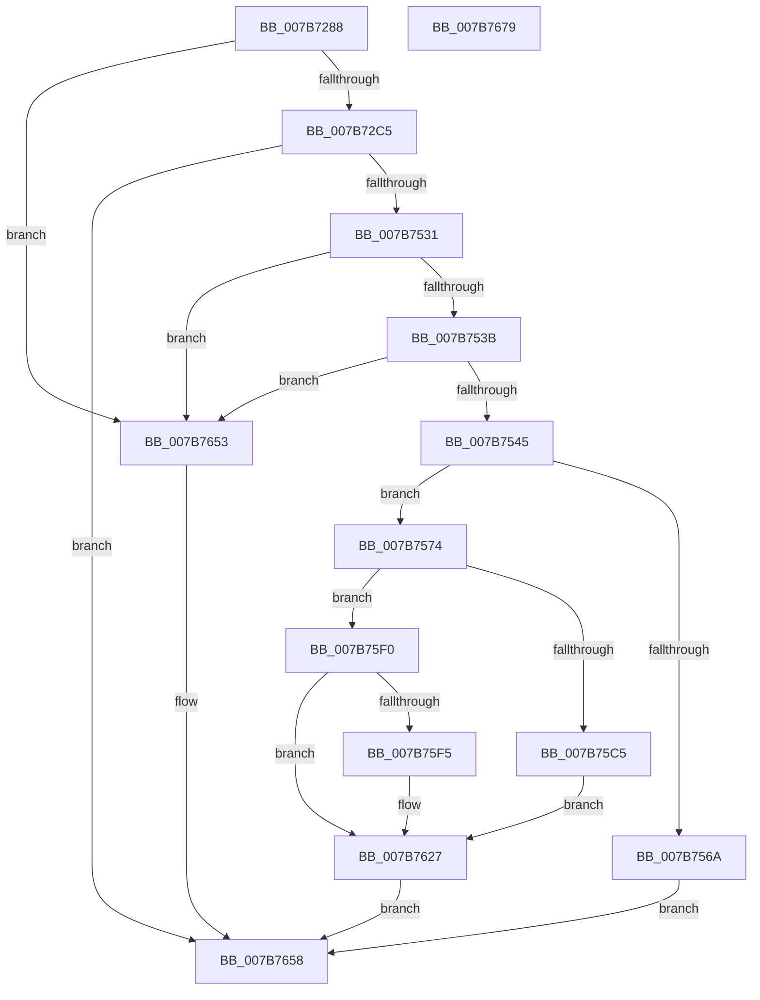

# EtwpLoadMicroarchitecturalProfileSource

- RVA: `0x007B7288`–`0x007B767A` (길이 `1,010` bytes)
- VA: `0x00000001407B7288`
- 실행 섹션: `PAGE`
- PDB 이름 있음: `예`; PDB Function 태그: `아니요`
- unwind 정보 RVA: `0x000D3400`
- 디코드: `226`개 명령, `1,010/1,010` bytes 표시
- 미해석 바이트: `0` (있으면 어셈블리에 `.byte`로 보존)

> 이 문서는 커널 이미지의 기계어와 PDB 기호를 분석해 생성했습니다. 4번과 5번은 함수 원형과 자료형을 바이너리 사용 방식에서 추정한 C 해석이며 원본 소스 복구 결과는 아닙니다.

## 1. Dependencies

- 직접 호출 지점: **11**; 고유 호출 대상: **10**
- 직접 호출자로 확인된 함수: **1**
- RIP 상대 이미지 참조: **13**

### Outgoing calls
- `0x007B72CD` → [wcsnlen](../../text/50/wcsnlen_function_00501D60.md) (function, `0x00501D60`)
- `0x007B731E` → [memset](../../text/6C/memset_function_006C6C40.md) (function, `0x006C6C40`)
- `0x007B7524` → [RtlpQueryRegistryValues](../8C/RtlpQueryRegistryValues_function_008C9050.md) (function, `0x008C9050`)
- `0x007B755D` → [ExAllocatePool2](../../poolcode/B8/ExAllocatePool2_function_00B820F0.md) (function, `0x00B820F0`)
- `0x007B7584` → [wcsncpy_s](../../text/50/wcsncpy_s_function_00506650.md) (function, `0x00506650`)
- `0x007B75A6` → [memset](../../text/6C/memset_function_006C6C40.md) (function, `0x006C6C40`)
- `0x007B75B6` → [KiCopyAffinityEx](../../text/2C/KiCopyAffinityEx_function_002CE860.md) (function, `0x002CE860`)
- `0x007B75BB` → [KiGetCpuVendor](../../pagelk/B7/KiGetCpuVendor_function_00B7D5B4.md) (function, `0x00B7D5B4`)
- `0x007B763F` → [guard_dispatch_icall](../../text/6B/guard_dispatch_icall_function_006BAAD0.md) (function, `0x006BAAD0`)
- `0x007B764A` → [ExFreePoolWithTag](../../poolcode/B8/ExFreePoolWithTag_function_00B82870.md) (function, `0x00B82870`)
- `0x007B7662` → [_security_check_cookie](../../text/6A/_security_check_cookie_function_006AC640.md) (function, `0x006AC640`)

### Direct callers
- [EtwpLoadMicroarchitecturalProfileGroup](EtwpLoadMicroarchitecturalProfileGroup_function_007B6F74.md) at `0x007B7233`

### Static image references
- `0x007B72A2` → RVA `0x00E0A740` (`.data`; read)
- `0x007B7327` → RVA `0x007BEA40` (`EtwpQueryRegistryCallback`; read)
- `0x007B733E` → RVA `0x00B073C0` (` ?? ::NNGAKEGL::`string'`; read)
- `0x007B735C` → RVA `0x00B07410` (` ?? ::NNGAKEGL::`string'`; read)
- `0x007B737C` → RVA `0x00B073F0` (` ?? ::NNGAKEGL::`string'`; read)
- `0x007B739E` → RVA `0x00B07360` (` ?? ::NNGAKEGL::`string'`; read)
- `0x007B73C0` → RVA `0x00B07350` (` ?? ::NNGAKEGL::`string'`; read)
- `0x007B73E2` → RVA `0x00B073A0` (` ?? ::NNGAKEGL::`string'`; read)
- `0x007B7404` → RVA `0x00B07380` (` ?? ::NNGAKEGL::`string'`; read)
- `0x007B748C` → RVA `0x00B07300` (` ?? ::NNGAKEGL::`string'`; read)
- `0x007B74B5` → RVA `0x00B072E0` (` ?? ::NNGAKEGL::`string'`; read)
- `0x007B74D7` → RVA `0x00B07340` (` ?? ::NNGAKEGL::`string'`; read)
- `0x007B7633` → RVA `0x00E00640` (`.data`; read)

## 2. Other-region calls and transfers

- 다른 실행 섹션으로 향하는 call: **10**
  - `0x007B72CD` → [wcsnlen](../../text/50/wcsnlen_function_00501D60.md) (`PAGE` → `.text`)
  - `0x007B731E` → [memset](../../text/6C/memset_function_006C6C40.md) (`PAGE` → `.text`)
  - `0x007B755D` → [ExAllocatePool2](../../poolcode/B8/ExAllocatePool2_function_00B820F0.md) (`PAGE` → `POOLCODE`)
  - `0x007B7584` → [wcsncpy_s](../../text/50/wcsncpy_s_function_00506650.md) (`PAGE` → `.text`)
  - `0x007B75A6` → [memset](../../text/6C/memset_function_006C6C40.md) (`PAGE` → `.text`)
  - `0x007B75B6` → [KiCopyAffinityEx](../../text/2C/KiCopyAffinityEx_function_002CE860.md) (`PAGE` → `.text`)
  - `0x007B75BB` → [KiGetCpuVendor](../../pagelk/B7/KiGetCpuVendor_function_00B7D5B4.md) (`PAGE` → `PAGELK`)
  - `0x007B763F` → [guard_dispatch_icall](../../text/6B/guard_dispatch_icall_function_006BAAD0.md) (`PAGE` → `.text`)
  - `0x007B764A` → [ExFreePoolWithTag](../../poolcode/B8/ExFreePoolWithTag_function_00B82870.md) (`PAGE` → `POOLCODE`)
  - `0x007B7662` → [_security_check_cookie](../../text/6A/_security_check_cookie_function_006AC640.md) (`PAGE` → `.text`)
- 별도 외부 분기/꼬리 이동을 확인하지 못했습니다.

## 3. Assembly (complete function range)

```asm
007B7288  40 55                           push rbp
007B728A  53                              push rbx
007B728B  56                              push rsi
007B728C  57                              push rdi
007B728D  41 55                           push r13
007B728F  41 56                           push r14
007B7291  41 57                           push r15
007B7293  48 8D AC 24 70 FD FF FF         lea rbp, [rsp - 0x290]
007B729B  48 81 EC 90 03 00 00            sub rsp, 0x390
007B72A2  48 8B 05 97 34 65 00            mov rax, qword ptr [rip + 0x653497]
007B72A9  48 33 C4                        xor rax, rsp
007B72AC  48 89 85 80 02 00 00            mov qword ptr [rbp + 0x280], rax
007B72B3  49 8B D8                        mov rbx, r8
007B72B6  4C 8B FA                        mov r15, rdx
007B72B9  48 8B F9                        mov rdi, rcx
007B72BC  4D 85 C0                        test r8, r8
007B72BF  0F 84 8E 03 00 00               je 0x1407b7653
007B72C5  BA FE 00 00 00                  mov edx, 0xfe
007B72CA  48 8B CB                        mov rcx, rbx
007B72CD  E8 8E AA D4 FF                  call 0x140501d60
007B72D2  83 64 24 54 00                  and dword ptr [rsp + 0x54], 0
007B72D7  48 8D 4D 10                     lea rcx, [rbp + 0x10]
007B72DB  83 64 24 44 00                  and dword ptr [rsp + 0x44], 0
007B72E0  83 CE FF                        or esi, 0xffffffff
007B72E3  83 64 24 38 00                  and dword ptr [rsp + 0x38], 0
007B72E8  41 BD 01 00 00 00               mov r13d, 1
007B72EE  83 64 24 3C 00                  and dword ptr [rsp + 0x3c], 0
007B72F3  33 D2                           xor edx, edx
007B72F5  83 64 24 40 00                  and dword ptr [rsp + 0x40], 0
007B72FA  41 B8 68 02 00 00               mov r8d, 0x268
007B7300  83 64 24 48 00                  and dword ptr [rsp + 0x48], 0
007B7305  83 64 24 4C 00                  and dword ptr [rsp + 0x4c], 0
007B730A  46 8D 34 28                     lea r14d, [rax + r13]
007B730E  89 74 24 30                     mov dword ptr [rsp + 0x30], esi
007B7312  89 74 24 34                     mov dword ptr [rsp + 0x34], esi
007B7316  C7 44 24 50 00 00 01 00         mov dword ptr [rsp + 0x50], 0x10000
007B731E  E8 1D F9 F0 FF                  call 0x1406c6c40
007B7323  41 8D 55 03                     lea edx, [r13 + 3]
007B7327  48 8D 0D 12 77 00 00            lea rcx, [rip + 0x7712]
007B732E  89 55 30                        mov dword ptr [rbp + 0x30], edx
007B7331  48 8D 44 24 60                  lea rax, [rsp + 0x60]
007B7336  48 89 4D 10                     mov qword ptr [rbp + 0x10], rcx
007B733A  48 89 45 28                     mov qword ptr [rbp + 0x28], rax
007B733E  48 8D 05 7B 00 35 00            lea rax, [rip + 0x35007b]
007B7345  48 89 45 20                     mov qword ptr [rbp + 0x20], rax
007B7349  48 8D 44 24 30                  lea rax, [rsp + 0x30]
007B734E  48 89 44 24 68                  mov qword ptr [rsp + 0x68], rax
007B7353  48 8D 44 24 70                  lea rax, [rsp + 0x70]
007B7358  48 89 45 60                     mov qword ptr [rbp + 0x60], rax
007B735C  48 8D 05 AD 00 35 00            lea rax, [rip + 0x3500ad]
007B7363  48 89 45 58                     mov qword ptr [rbp + 0x58], rax
007B7367  48 8D 44 24 34                  lea rax, [rsp + 0x34]
007B736C  48 89 44 24 78                  mov qword ptr [rsp + 0x78], rax
007B7371  48 8D 45 80                     lea rax, [rbp - 0x80]
007B7375  48 89 85 98 00 00 00            mov qword ptr [rbp + 0x98], rax
007B737C  48 8D 05 6D 00 35 00            lea rax, [rip + 0x35006d]
007B7383  48 89 85 90 00 00 00            mov qword ptr [rbp + 0x90], rax
007B738A  48 8D 44 24 50                  lea rax, [rsp + 0x50]
007B738F  48 89 45 88                     mov qword ptr [rbp - 0x78], rax
007B7393  48 8D 45 90                     lea rax, [rbp - 0x70]
007B7397  48 89 85 D0 00 00 00            mov qword ptr [rbp + 0xd0], rax
007B739E  48 8D 05 BB FF 34 00            lea rax, [rip + 0x34ffbb]
007B73A5  48 89 85 C8 00 00 00            mov qword ptr [rbp + 0xc8], rax
007B73AC  48 8D 44 24 54                  lea rax, [rsp + 0x54]
007B73B1  48 89 45 98                     mov qword ptr [rbp - 0x68], rax
007B73B5  48 8D 45 A0                     lea rax, [rbp - 0x60]
007B73B9  48 89 85 08 01 00 00            mov qword ptr [rbp + 0x108], rax
007B73C0  48 8D 05 89 FF 34 00            lea rax, [rip + 0x34ff89]
007B73C7  48 89 85 00 01 00 00            mov qword ptr [rbp + 0x100], rax
007B73CE  48 8D 44 24 38                  lea rax, [rsp + 0x38]
007B73D3  48 89 45 A8                     mov qword ptr [rbp - 0x58], rax
007B73D7  48 8D 45 B0                     lea rax, [rbp - 0x50]
007B73DB  48 89 85 40 01 00 00            mov qword ptr [rbp + 0x140], rax
007B73E2  48 8D 05 B7 FF 34 00            lea rax, [rip + 0x34ffb7]
007B73E9  48 89 85 38 01 00 00            mov qword ptr [rbp + 0x138], rax
007B73F0  48 8D 44 24 40                  lea rax, [rsp + 0x40]
007B73F5  48 89 45 B8                     mov qword ptr [rbp - 0x48], rax
007B73F9  48 8D 45 C0                     lea rax, [rbp - 0x40]
007B73FD  48 89 85 78 01 00 00            mov qword ptr [rbp + 0x178], rax
007B7404  48 8D 05 75 FF 34 00            lea rax, [rip + 0x34ff75]
007B740B  48 89 85 70 01 00 00            mov qword ptr [rbp + 0x170], rax
007B7412  89 54 24 60                     mov dword ptr [rsp + 0x60], edx
007B7416  48 89 4D 48                     mov qword ptr [rbp + 0x48], rcx
007B741A  89 55 68                        mov dword ptr [rbp + 0x68], edx
007B741D  89 54 24 70                     mov dword ptr [rsp + 0x70], edx
007B7421  48 89 8D 80 00 00 00            mov qword ptr [rbp + 0x80], rcx
007B7428  89 95 A0 00 00 00               mov dword ptr [rbp + 0xa0], edx
007B742E  89 55 80                        mov dword ptr [rbp - 0x80], edx
007B7431  48 89 8D B8 00 00 00            mov qword ptr [rbp + 0xb8], rcx
007B7438  89 95 D8 00 00 00               mov dword ptr [rbp + 0xd8], edx
007B743E  89 55 90                        mov dword ptr [rbp - 0x70], edx
007B7441  48 89 8D F0 00 00 00            mov qword ptr [rbp + 0xf0], rcx
007B7448  89 95 10 01 00 00               mov dword ptr [rbp + 0x110], edx
007B744E  89 55 A0                        mov dword ptr [rbp - 0x60], edx
007B7451  48 89 8D 28 01 00 00            mov qword ptr [rbp + 0x128], rcx
007B7458  89 95 48 01 00 00               mov dword ptr [rbp + 0x148], edx
007B745E  89 55 B0                        mov dword ptr [rbp - 0x50], edx
007B7461  48 89 8D 60 01 00 00            mov qword ptr [rbp + 0x160], rcx
007B7468  48 8D 44 24 44                  lea rax, [rsp + 0x44]
007B746D  89 95 80 01 00 00               mov dword ptr [rbp + 0x180], edx
007B7473  48 89 45 C8                     mov qword ptr [rbp - 0x38], rax
007B7477  4C 8D 45 10                     lea r8, [rbp + 0x10]
007B747B  48 8D 45 D0                     lea rax, [rbp - 0x30]
007B747F  89 55 C0                        mov dword ptr [rbp - 0x40], edx
007B7482  48 89 85 B0 01 00 00            mov qword ptr [rbp + 0x1b0], rax
007B7489  45 33 C9                        xor r9d, r9d
007B748C  48 8D 05 6D FE 34 00            lea rax, [rip + 0x34fe6d]
007B7493  48 89 8D 98 01 00 00            mov qword ptr [rbp + 0x198], rcx
007B749A  48 89 85 A8 01 00 00            mov qword ptr [rbp + 0x1a8], rax
007B74A1  48 8D 44 24 3C                  lea rax, [rsp + 0x3c]
007B74A6  48 89 45 D8                     mov qword ptr [rbp - 0x28], rax
007B74AA  48 8D 45 E0                     lea rax, [rbp - 0x20]
007B74AE  48 89 85 E8 01 00 00            mov qword ptr [rbp + 0x1e8], rax
007B74B5  48 8D 05 24 FE 34 00            lea rax, [rip + 0x34fe24]
007B74BC  48 89 85 E0 01 00 00            mov qword ptr [rbp + 0x1e0], rax
007B74C3  48 8D 44 24 48                  lea rax, [rsp + 0x48]
007B74C8  48 89 45 E8                     mov qword ptr [rbp - 0x18], rax
007B74CC  48 8D 45 F0                     lea rax, [rbp - 0x10]
007B74D0  48 89 85 20 02 00 00            mov qword ptr [rbp + 0x220], rax
007B74D7  48 8D 05 62 FE 34 00            lea rax, [rip + 0x34fe62]
007B74DE  48 89 85 18 02 00 00            mov qword ptr [rbp + 0x218], rax
007B74E5  48 8D 44 24 4C                  lea rax, [rsp + 0x4c]
007B74EA  89 95 B8 01 00 00               mov dword ptr [rbp + 0x1b8], edx
007B74F0  89 55 D0                        mov dword ptr [rbp - 0x30], edx
007B74F3  48 89 8D D0 01 00 00            mov qword ptr [rbp + 0x1d0], rcx
007B74FA  89 95 F0 01 00 00               mov dword ptr [rbp + 0x1f0], edx
007B7500  89 55 E0                        mov dword ptr [rbp - 0x20], edx
007B7503  48 89 8D 08 02 00 00            mov qword ptr [rbp + 0x208], rcx
007B750A  B9 00 00 00 40                  mov ecx, 0x40000000
007B750F  89 95 28 02 00 00               mov dword ptr [rbp + 0x228], edx
007B7515  89 55 F0                        mov dword ptr [rbp - 0x10], edx
007B7518  48 8B D7                        mov rdx, rdi
007B751B  48 89 45 F8                     mov qword ptr [rbp - 8], rax
007B751F  44 88 6C 24 28                  mov byte ptr [rsp + 0x28], r13b
007B7524  E8 27 1B 11 00                  call 0x1408c9050
007B7529  85 C0                           test eax, eax
007B752B  0F 88 27 01 00 00               js 0x1407b7658
007B7531  39 74 24 30                     cmp dword ptr [rsp + 0x30], esi
007B7535  0F 84 18 01 00 00               je 0x1407b7653
007B753B  39 74 24 34                     cmp dword ptr [rsp + 0x34], esi
007B753F  0F 84 0E 01 00 00               je 0x1407b7653
007B7545  42 8D 34 75 18 01 00 00         lea esi, [r14*2 + 0x118]
007B754D  41 BD 45 74 77 50               mov r13d, 0x50777445
007B7553  8B D6                           mov edx, esi
007B7555  45 8B C5                        mov r8d, r13d
007B7558  B9 00 01 00 00                  mov ecx, 0x100
007B755D  E8 8E AB 3C 00                  call 0x140b820f0
007B7562  48 8B F8                        mov rdi, rax
007B7565  48 85 C0                        test rax, rax
007B7568  75 0A                           jne 0x1407b7574
007B756A  B8 17 00 00 C0                  mov eax, 0xc0000017
007B756F  E9 E4 00 00 00                  jmp 0x1407b7658
007B7574  41 8B D6                        mov edx, r14d
007B7577  48 8D 88 18 01 00 00            lea rcx, [rax + 0x118]
007B757E  45 8B CE                        mov r9d, r14d
007B7581  4C 8B C3                        mov r8, rbx
007B7584  E8 C7 F0 D4 FF                  call 0x140506650
007B7589  83 67 14 00                     and dword ptr [rdi + 0x14], 0
007B758D  48 8D 4F 18                     lea rcx, [rdi + 0x18]
007B7591  33 D2                           xor edx, edx
007B7593  C7 47 10 01 00 20 00            mov dword ptr [rdi + 0x10], 0x200001
007B759A  41 B8 00 01 00 00               mov r8d, 0x100
007B75A0  41 BE 01 00 00 00               mov r14d, 1
007B75A6  E8 95 F6 F0 FF                  call 0x1406c6c40
007B75AB  0F B7 57 12                     movzx edx, word ptr [rdi + 0x12]
007B75AF  48 8D 4F 10                     lea rcx, [rdi + 0x10]
007B75B3  4D 8B C7                        mov r8, r15
007B75B6  E8 A5 72 B1 FF                  call 0x1402ce860
007B75BB  E8 F4 5F 3C 00                  call 0x140b7d5b4
007B75C0  83 F8 02                        cmp eax, 2
007B75C3  75 2B                           jne 0x1407b75f0
007B75C5  8A 44 24 30                     mov al, byte ptr [rsp + 0x30]
007B75C9  88 07                           mov byte ptr [rdi], al
007B75CB  8A 44 24 34                     mov al, byte ptr [rsp + 0x34]
007B75CF  88 47 01                        mov byte ptr [rdi + 1], al
007B75D2  8A 44 24 38                     mov al, byte ptr [rsp + 0x38]
007B75D6  88 47 02                        mov byte ptr [rdi + 2], al
007B75D9  8A 44 24 3C                     mov al, byte ptr [rsp + 0x3c]
007B75DD  88 47 03                        mov byte ptr [rdi + 3], al
007B75E0  8A 44 24 44                     mov al, byte ptr [rsp + 0x44]
007B75E4  88 47 04                        mov byte ptr [rdi + 4], al
007B75E7  8A 44 24 40                     mov al, byte ptr [rsp + 0x40]
007B75EB  88 47 05                        mov byte ptr [rdi + 5], al
007B75EE  EB 37                           jmp 0x1407b7627
007B75F0  41 3B C6                        cmp eax, r14d
007B75F3  75 32                           jne 0x1407b7627
007B75F5  0F B7 44 24 30                  movzx eax, word ptr [rsp + 0x30]
007B75FA  66 89 07                        mov word ptr [rdi], ax
007B75FD  8A 44 24 34                     mov al, byte ptr [rsp + 0x34]
007B7601  88 47 02                        mov byte ptr [rdi + 2], al
007B7604  8A 44 24 38                     mov al, byte ptr [rsp + 0x38]
007B7608  88 47 03                        mov byte ptr [rdi + 3], al
007B760B  8A 44 24 3C                     mov al, byte ptr [rsp + 0x3c]
007B760F  88 47 04                        mov byte ptr [rdi + 4], al
007B7612  8A 44 24 40                     mov al, byte ptr [rsp + 0x40]
007B7616  88 47 05                        mov byte ptr [rdi + 5], al
007B7619  8A 44 24 48                     mov al, byte ptr [rsp + 0x48]
007B761D  88 47 06                        mov byte ptr [rdi + 6], al
007B7620  8A 44 24 4C                     mov al, byte ptr [rsp + 0x4c]
007B7624  88 47 07                        mov byte ptr [rdi + 7], al
007B7627  8B 44 24 50                     mov eax, dword ptr [rsp + 0x50]
007B762B  4C 8B C7                        mov r8, rdi
007B762E  89 47 08                        mov dword ptr [rdi + 8], eax
007B7631  8B D6                           mov edx, esi
007B7633  48 8B 05 06 90 64 00            mov rax, qword ptr [rip + 0x649006]
007B763A  B9 14 00 00 00                  mov ecx, 0x14
007B763F  E8 8C 34 F0 FF                  call 0x1406baad0
007B7644  41 8B D5                        mov edx, r13d
007B7647  48 8B CF                        mov rcx, rdi
007B764A  E8 21 B2 3C 00                  call 0x140b82870
007B764F  33 C0                           xor eax, eax
007B7651  EB 05                           jmp 0x1407b7658
007B7653  B8 01 00 00 C0                  mov eax, 0xc0000001
007B7658  48 8B 8D 80 02 00 00            mov rcx, qword ptr [rbp + 0x280]
007B765F  48 33 CC                        xor rcx, rsp
007B7662  E8 D9 4F EF FF                  call 0x1406ac640
007B7667  48 81 C4 90 03 00 00            add rsp, 0x390
007B766E  41 5F                           pop r15
007B7670  41 5E                           pop r14
007B7672  41 5D                           pop r13
007B7674  5F                              pop rdi
007B7675  5E                              pop rsi
007B7676  5B                              pop rbx
007B7677  5D                              pop rbp
007B7678  C3                              ret
007B7679  CC                              int3
```

## 4. C-style interpretation (structured pseudocode)

```c
__int64 __fastcall EtwpLoadMicroarchitecturalProfileSource(__int64 a1, __int64 a2, __int64 a3, int a4)
{
    __int64 result;
    __int64 v_rsi;
    __int64 v_rsp;
    unsigned int v_stack_m110;
    unsigned __int64 v_stack_m118;
    unsigned __int64 v_stack_m120;
    unsigned __int64 v_stack_m130;
    unsigned int v_stack_m148;
    unsigned __int64 v_stack_m150;
    unsigned __int64 v_stack_m158;
    unsigned __int64 v_stack_m168;
    unsigned int v_stack_m180;
    unsigned __int64 v_stack_m188;
    unsigned __int64 v_stack_m190;
    unsigned __int64 v_stack_m1A0;
    unsigned int v_stack_m1B8;
    unsigned __int64 v_stack_m1C0;
    unsigned __int64 v_stack_m1C8;
    unsigned __int64 v_stack_m1D8;
    unsigned int v_stack_m1F0;
    unsigned __int64 v_stack_m1F8;
    unsigned __int64 v_stack_m200;
    unsigned __int64 v_stack_m210;
    unsigned int v_stack_m228;
    unsigned __int64 v_stack_m230;
    unsigned __int64 v_stack_m238;
    unsigned __int64 v_stack_m248;
    unsigned int v_stack_m260;
    unsigned __int64 v_stack_m268;
    unsigned __int64 v_stack_m270;
    unsigned __int64 v_stack_m280;
    unsigned int v_stack_m298;
    unsigned __int64 v_stack_m2A0;
    unsigned __int64 v_stack_m2A8;
    unsigned __int64 v_stack_m2B8;
    unsigned __int64 v_stack_m2C8;
    unsigned __int64 v_stack_m2D0;
    unsigned __int64 v_stack_m2D8;
    unsigned __int64 v_stack_m2E0;
    unsigned __int64 v_stack_m2E8;
    unsigned __int64 v_stack_m2F0;
    unsigned __int64 v_stack_m2F8;
    unsigned __int64 v_stack_m300;
    unsigned __int64 v_stack_m308;
    unsigned __int64 v_stack_m310;
    unsigned __int64 v_stack_m318;
    unsigned __int64 v_stack_m320;
    unsigned __int64 v_stack_m328;
    unsigned __int64 v_stack_m330;
    unsigned __int64 v_stack_m338;
    unsigned __int64 v_stack_m340;
    unsigned __int64 v_stack_m348;
    unsigned __int64 v_stack_m350;
    unsigned __int64 v_stack_m358;
    unsigned __int64 v_stack_m360;
    unsigned __int64 v_stack_m368;
    unsigned int v_stack_m374;
    unsigned int v_stack_m378;
    unsigned int v_stack_m37C;
    unsigned int v_stack_m380;
    unsigned int v_stack_m384;
    unsigned int v_stack_m388;
    unsigned int v_stack_m38C;
    unsigned int v_stack_m390;
    unsigned int v_stack_m394;
    unsigned int v_stack_m398;
    unsigned __int8 v_stack_m3A0;
    unsigned __int64 v_stack_m48;
    unsigned int v_stack_mA0;
    unsigned __int64 v_stack_mA8;
    unsigned __int64 v_stack_mB0;
    unsigned __int64 v_stack_mC0;
    unsigned int v_stack_mD8;
    unsigned __int64 v_stack_mE0;
    unsigned __int64 v_stack_mE8;
    unsigned __int64 v_stack_mF8;

    v_rsp = (v_rsp) - (912);
    result = (*(unsigned __int64 *)(v_rip + 6632599)) ^ (v_rsp);
    v_stack_m48 = result;
    if (a3 == 0) goto loc_007B7653;
    result = wcsnlen(a3, 254, a3, a4);
    v_rsi = (unsigned int)((v_rsi) | (0xFFFFFFFFULL));
    a2 = 0;
    v_stack_m398 = (unsigned int)(v_rsi);
    v_stack_m394 = (unsigned int)(v_rsi);
    v_stack_m378 = 0x10000ULL;
    result = memset(v_stack_m2B8, a2, 616, a4);
    v_stack_m298 = (unsigned int)(1 + 3);
    v_stack_m2B8 = v_rip + 30482;
    v_stack_m2A0 = v_stack_m368;
    v_stack_m2A8 = v_rip + 3473531;
    v_stack_m360 = v_stack_m398;
    v_stack_m268 = v_stack_m358;
    v_stack_m270 = v_rip + 3473581;
    v_stack_m350 = v_stack_m394;
    v_stack_m230 = v_stack_m348;
    v_stack_m238 = v_rip + 3473517;
    v_stack_m340 = v_stack_m378;
    v_stack_m1F8 = v_stack_m338;
    v_stack_m200 = v_rip + 3473339;
    v_stack_m330 = v_stack_m374;
    v_stack_m1C0 = v_stack_m328;
    v_stack_m1C8 = v_rip + 3473289;
    v_stack_m320 = v_stack_m390;
    v_stack_m188 = v_stack_m318;
    v_stack_m190 = v_rip + 3473335;
    v_stack_m310 = v_stack_m388;
    v_stack_m150 = v_stack_m308;
    v_stack_m158 = v_rip + 3473269;
    v_stack_m368 = (unsigned int)(1 + 3);
    v_stack_m280 = v_rip + 30482;
    v_stack_m260 = (unsigned int)(1 + 3);
    v_stack_m358 = (unsigned int)(1 + 3);
    v_stack_m248 = v_rip + 30482;
    v_stack_m228 = (unsigned int)(1 + 3);
    v_stack_m348 = (unsigned int)(1 + 3);
    v_stack_m210 = v_rip + 30482;
    v_stack_m1F0 = (unsigned int)(1 + 3);
    v_stack_m338 = (unsigned int)(1 + 3);
    v_stack_m1D8 = v_rip + 30482;
    v_stack_m1B8 = (unsigned int)(1 + 3);
    v_stack_m328 = (unsigned int)(1 + 3);
    v_stack_m1A0 = v_rip + 30482;
    v_stack_m180 = (unsigned int)(1 + 3);
    v_stack_m318 = (unsigned int)(1 + 3);
    v_stack_m168 = v_rip + 30482;
    v_stack_m148 = (unsigned int)(1 + 3);
    v_stack_m300 = v_stack_m384;
    v_stack_m308 = (unsigned int)(1 + 3);
    v_stack_m118 = v_stack_m2F8;
    a4 = 0;
    v_stack_m130 = v_rip + 30482;
    v_stack_m120 = v_rip + 3473005;
    v_stack_m2F0 = v_stack_m38C;
    v_stack_mE0 = v_stack_m2E8;
    v_stack_mE8 = v_rip + 3472932;
    v_stack_m2E0 = v_stack_m380;
    v_stack_mA8 = v_stack_m2D8;
    v_stack_mB0 = v_rip + 3472994;
    v_stack_m110 = (unsigned int)(1 + 3);
    v_stack_m2F8 = (unsigned int)(1 + 3);
    v_stack_mF8 = v_rip + 30482;
    v_stack_mD8 = (unsigned int)(1 + 3);
    v_stack_m2E8 = (unsigned int)(1 + 3);
    v_stack_mC0 = v_rip + 30482;
    v_stack_mA0 = (unsigned int)(1 + 3);
    v_stack_m2D8 = (unsigned int)(1 + 3);
    v_stack_m2D0 = v_stack_m37C;
    v_stack_m3A0 = 1;
    result = RtlpQueryRegistryValues((unsigned int)(0x40000000ULL), a1, v_stack_m2B8, a4);
    if (sign_flag) goto loc_007B7658;
    if (v_stack_m398 == ((unsigned int)(v_rsi))) goto loc_007B7653;
    if (v_stack_m394 == ((unsigned int)(v_rsi))) goto loc_007B7653;
    result = ExAllocatePool2(256, (unsigned int)((unsigned int)(result + 1 * 1 * 2 + 280)), (unsigned int)((unsigned int)((unsigned int)(0x50777445ULL))), a4);
    if (result != 0) goto loc_007B7574;
    goto loc_007B7658;
loc_007B7574:
    result = wcsncpy_s((unsigned int)(0xC0000017ULL) + 280, (unsigned int)((unsigned int)(result + 1 * 1)), a3, (unsigned int)((unsigned int)(result + 1 * 1)));
    a2 = 0;
    *(unsigned int *)(result + 16) = 0x200001ULL;
    result = memset(result + 24, a2, 256, (unsigned int)((unsigned int)(result + 1 * 1)));
    result = KiCopyAffinityEx(result + 16, *(unsigned __int16 *)(result + 18), 0, (unsigned int)((unsigned int)(result + 1 * 1)));
    result = KiGetCpuVendor(result + 16, *(unsigned __int16 *)(result + 18), 0, (unsigned int)((unsigned int)(result + 1 * 1)));
    if (((unsigned int)(result)) != 2) goto loc_007B75F0;
    *(unsigned __int8 *)(result) = (unsigned __int8)(v_stack_m398);
    *(unsigned __int8 *)(result + 1) = (unsigned __int8)(v_stack_m394);
    *(unsigned __int8 *)(result + 2) = (unsigned __int8)(v_stack_m390);
    *(unsigned __int8 *)(result + 3) = (unsigned __int8)(v_stack_m38C);
    *(unsigned __int8 *)(result + 4) = (unsigned __int8)(v_stack_m384);
    *(unsigned __int8 *)(result + 5) = (unsigned __int8)(v_stack_m388);
    goto loc_007B7627;
loc_007B75F0:
    result = v_stack_m388;
    if (((unsigned int)(v_stack_m388)) == 1) {
        result = v_stack_m398;
        *(unsigned __int16 *)(result) = (unsigned __int16)(result);
        result = v_stack_m394;
        *(unsigned __int8 *)(result + 2) = (unsigned __int8)(result);
        result = v_stack_m390;
        *(unsigned __int8 *)(result + 3) = (unsigned __int8)(result);
        result = v_stack_m38C;
        *(unsigned __int8 *)(result + 4) = (unsigned __int8)(result);
        result = v_stack_m388;
        *(unsigned __int8 *)(result + 5) = (unsigned __int8)(result);
        result = v_stack_m380;
        *(unsigned __int8 *)(result + 6) = (unsigned __int8)(result);
        result = v_stack_m37C;
        *(unsigned __int8 *)(result + 7) = (unsigned __int8)(result);
    }
    *(unsigned int *)(result + 8) = (unsigned int)((unsigned int)(v_stack_m378));
    result = guard_dispatch_icall(20, (unsigned int)((unsigned int)(result + 1 * 1 * 2 + 280)), result, (unsigned int)((unsigned int)(result + 1 * 1)));
    result = ExFreePoolWithTag(result, (unsigned int)((unsigned int)((unsigned int)(0x50777445ULL))), result, (unsigned int)((unsigned int)(result + 1 * 1)));
    result = 0;
    goto loc_007B7658;
loc_007B7653:
loc_007B7658:
    a1 = (v_stack_m48) ^ (v_rsp);
    result = _security_check_cookie(a1, (unsigned int)((unsigned int)((unsigned int)(0x50777445ULL))), result, (unsigned int)((unsigned int)(result + 1 * 1)));
    v_rsp = (v_rsp) + (912);
    return result;
}
```

## 5. (Beta) C Style

```c
int64_t EtwpLoadMicroarchitecturalProfileSource(int64_t Arg1, int64_t Arg2, int64_t Arg3, int32_t Arg4)
{
    int64_t result;
    int64_t local_rsi;
    int64_t local_rsp;
    uint32_t v_stack_m110;
    uint64_t v_stack_m118;
    uint64_t v_stack_m120;
    uint64_t v_stack_m130;
    uint32_t v_stack_m148;
    uint64_t v_stack_m150;
    uint64_t v_stack_m158;
    uint64_t v_stack_m168;
    uint32_t v_stack_m180;
    uint64_t v_stack_m188;
    uint64_t v_stack_m190;
    uint64_t v_stack_m1A0;
    uint32_t v_stack_m1B8;
    uint64_t v_stack_m1C0;
    uint64_t v_stack_m1C8;
    uint64_t v_stack_m1D8;
    uint32_t v_stack_m1F0;
    uint64_t v_stack_m1F8;
    uint64_t v_stack_m200;
    uint64_t v_stack_m210;
    uint32_t v_stack_m228;
    uint64_t v_stack_m230;
    uint64_t v_stack_m238;
    uint64_t v_stack_m248;
    uint32_t v_stack_m260;
    uint64_t v_stack_m268;
    uint64_t v_stack_m270;
    uint64_t v_stack_m280;
    uint32_t v_stack_m298;
    uint64_t v_stack_m2A0;
    uint64_t v_stack_m2A8;
    uint64_t v_stack_m2B8;
    uint64_t v_stack_m2C8;
    uint64_t v_stack_m2D0;
    uint64_t v_stack_m2D8;
    uint64_t v_stack_m2E0;
    uint64_t v_stack_m2E8;
    uint64_t v_stack_m2F0;
    uint64_t v_stack_m2F8;
    uint64_t v_stack_m300;
    uint64_t v_stack_m308;
    uint64_t v_stack_m310;
    uint64_t v_stack_m318;
    uint64_t v_stack_m320;
    uint64_t v_stack_m328;
    uint64_t v_stack_m330;
    uint64_t v_stack_m338;
    uint64_t v_stack_m340;
    uint64_t v_stack_m348;
    uint64_t v_stack_m350;
    uint64_t v_stack_m358;
    uint64_t v_stack_m360;
    uint64_t v_stack_m368;
    uint32_t v_stack_m374;
    uint32_t v_stack_m378;
    uint32_t v_stack_m37C;
    uint32_t v_stack_m380;
    uint32_t v_stack_m384;
    uint32_t v_stack_m388;
    uint32_t v_stack_m38C;
    uint32_t v_stack_m390;
    uint32_t v_stack_m394;
    uint32_t v_stack_m398;
    uint8_t v_stack_m3A0;
    uint64_t v_stack_m48;
    uint32_t v_stack_mA0;
    uint64_t v_stack_mA8;
    uint64_t v_stack_mB0;
    uint64_t v_stack_mC0;
    uint32_t v_stack_mD8;
    uint64_t v_stack_mE0;
    uint64_t v_stack_mE8;
    uint64_t v_stack_mF8;

    local_rsp = (local_rsp) - (912);
    result = (*(uint64_t *)(v_rip + 0x653497)) ^ (local_rsp);
    v_stack_m48 = result;
    if (Arg3 == 0) goto loc_007B7653;
    result = wcsnlen(Arg3, 254, Arg3, Arg4);
    local_rsi = (uint32_t)((local_rsi) | (0xFFFFFFFFULL));
    Arg2 = 0;
    v_stack_m398 = (uint32_t)(local_rsi);
    v_stack_m394 = (uint32_t)(local_rsi);
    v_stack_m378 = 0x10000ULL;
    result = memset(v_stack_m2B8, Arg2, 616, Arg4);
    v_stack_m298 = (uint32_t)(1 + 3);
    v_stack_m2B8 = v_rip + 30482;
    v_stack_m2A0 = v_stack_m368;
    v_stack_m2A8 = v_rip + 3473531;
    v_stack_m360 = v_stack_m398;
    v_stack_m268 = v_stack_m358;
    v_stack_m270 = v_rip + 3473581;
    v_stack_m350 = v_stack_m394;
    v_stack_m230 = v_stack_m348;
    v_stack_m238 = v_rip + 3473517;
    v_stack_m340 = v_stack_m378;
    v_stack_m1F8 = v_stack_m338;
    v_stack_m200 = v_rip + 3473339;
    v_stack_m330 = v_stack_m374;
    v_stack_m1C0 = v_stack_m328;
    v_stack_m1C8 = v_rip + 3473289;
    v_stack_m320 = v_stack_m390;
    v_stack_m188 = v_stack_m318;
    v_stack_m190 = v_rip + 3473335;
    v_stack_m310 = v_stack_m388;
    v_stack_m150 = v_stack_m308;
    v_stack_m158 = v_rip + 3473269;
    v_stack_m368 = (uint32_t)(1 + 3);
    v_stack_m280 = v_rip + 30482;
    v_stack_m260 = (uint32_t)(1 + 3);
    v_stack_m358 = (uint32_t)(1 + 3);
    v_stack_m248 = v_rip + 30482;
    v_stack_m228 = (uint32_t)(1 + 3);
    v_stack_m348 = (uint32_t)(1 + 3);
    v_stack_m210 = v_rip + 30482;
    v_stack_m1F0 = (uint32_t)(1 + 3);
    v_stack_m338 = (uint32_t)(1 + 3);
    v_stack_m1D8 = v_rip + 30482;
    v_stack_m1B8 = (uint32_t)(1 + 3);
    v_stack_m328 = (uint32_t)(1 + 3);
    v_stack_m1A0 = v_rip + 30482;
    v_stack_m180 = (uint32_t)(1 + 3);
    v_stack_m318 = (uint32_t)(1 + 3);
    v_stack_m168 = v_rip + 30482;
    v_stack_m148 = (uint32_t)(1 + 3);
    v_stack_m300 = v_stack_m384;
    v_stack_m308 = (uint32_t)(1 + 3);
    v_stack_m118 = v_stack_m2F8;
    Arg4 = 0;
    v_stack_m130 = v_rip + 30482;
    v_stack_m120 = v_rip + 3473005;
    v_stack_m2F0 = v_stack_m38C;
    v_stack_mE0 = v_stack_m2E8;
    v_stack_mE8 = v_rip + 3472932;
    v_stack_m2E0 = v_stack_m380;
    v_stack_mA8 = v_stack_m2D8;
    v_stack_mB0 = v_rip + 3472994;
    v_stack_m110 = (uint32_t)(1 + 3);
    v_stack_m2F8 = (uint32_t)(1 + 3);
    v_stack_mF8 = v_rip + 30482;
    v_stack_mD8 = (uint32_t)(1 + 3);
    v_stack_m2E8 = (uint32_t)(1 + 3);
    v_stack_mC0 = v_rip + 30482;
    v_stack_mA0 = (uint32_t)(1 + 3);
    v_stack_m2D8 = (uint32_t)(1 + 3);
    v_stack_m2D0 = v_stack_m37C;
    v_stack_m3A0 = 1;
    result = RtlpQueryRegistryValues((uint32_t)(0x40000000ULL), Arg1, v_stack_m2B8, Arg4);
    if (sign_flag) goto loc_007B7658;
    if (v_stack_m398 == ((uint32_t)(local_rsi))) goto loc_007B7653;
    if (v_stack_m394 == ((uint32_t)(local_rsi))) goto loc_007B7653;
    result = ExAllocatePool2(256, (uint32_t)((uint32_t)(result + 1 * 1 * 2 + 280)), (uint32_t)((uint32_t)((uint32_t)(0x50777445ULL))), Arg4);
    if (result != 0) goto loc_007B7574;
    goto loc_007B7658;
loc_007B7574:
    result = wcsncpy_s((uint32_t)(0xC0000017ULL) + 280, (uint32_t)((uint32_t)(result + 1 * 1)), Arg3, (uint32_t)((uint32_t)(result + 1 * 1)));
    Arg2 = 0;
    *(uint32_t *)(result + 0x10) = 0x200001ULL;
    result = memset(result + 24, Arg2, 256, (uint32_t)((uint32_t)(result + 1 * 1)));
    result = KiCopyAffinityEx(result + 16, *(uint16_t *)(result + 0x12), 0, (uint32_t)((uint32_t)(result + 1 * 1)));
    result = KiGetCpuVendor(result + 16, *(uint16_t *)(result + 0x12), 0, (uint32_t)((uint32_t)(result + 1 * 1)));
    if (((uint32_t)(result)) != 2) goto loc_007B75F0;
    *(uint8_t *)(result) = (uint8_t)(v_stack_m398);
    *(uint8_t *)(result + 0x1) = (uint8_t)(v_stack_m394);
    *(uint8_t *)(result + 0x2) = (uint8_t)(v_stack_m390);
    *(uint8_t *)(result + 0x3) = (uint8_t)(v_stack_m38C);
    *(uint8_t *)(result + 0x4) = (uint8_t)(v_stack_m384);
    *(uint8_t *)(result + 0x5) = (uint8_t)(v_stack_m388);
    goto loc_007B7627;
loc_007B75F0:
    result = v_stack_m388;
    if (((uint32_t)(v_stack_m388)) == 1) {
        result = v_stack_m398;
        *(uint16_t *)(result) = (uint16_t)(result);
        result = v_stack_m394;
        *(uint8_t *)(result + 0x2) = (uint8_t)(result);
        result = v_stack_m390;
        *(uint8_t *)(result + 0x3) = (uint8_t)(result);
        result = v_stack_m38C;
        *(uint8_t *)(result + 0x4) = (uint8_t)(result);
        result = v_stack_m388;
        *(uint8_t *)(result + 0x5) = (uint8_t)(result);
        result = v_stack_m380;
        *(uint8_t *)(result + 0x6) = (uint8_t)(result);
        result = v_stack_m37C;
        *(uint8_t *)(result + 0x7) = (uint8_t)(result);
    }
    *(uint32_t *)(result + 0x8) = (uint32_t)((uint32_t)(v_stack_m378));
    result = guard_dispatch_icall(20, (uint32_t)((uint32_t)(result + 1 * 1 * 2 + 280)), result, (uint32_t)((uint32_t)(result + 1 * 1)));
    result = ExFreePoolWithTag(result, (uint32_t)((uint32_t)((uint32_t)(0x50777445ULL))), result, (uint32_t)((uint32_t)(result + 1 * 1)));
    result = 0;
    goto loc_007B7658;
loc_007B7653:
loc_007B7658:
    Arg1 = (v_stack_m48) ^ (local_rsp);
    result = _security_check_cookie(Arg1, (uint32_t)((uint32_t)((uint32_t)(0x50777445ULL))), result, (uint32_t)((uint32_t)(result + 1 * 1)));
    local_rsp = (local_rsp) + (912);
    return result;
}
```

## 6. Execution-region graph

[열기: 2D/3D 그래프와 함수 탐색 컨트롤 패널](../../../control-panel.html?section=page&rva=0x007B7288&view=graph)

- 2D 그래프는 위에서 아래로 흐르고, 3D 그래프는 빈 공간을 드래그해 회전합니다. Shift+드래그는 이동, 휠은 확대·축소, 함수 노드 선택은 대상 보고서 이동입니다.

### Static fallback


