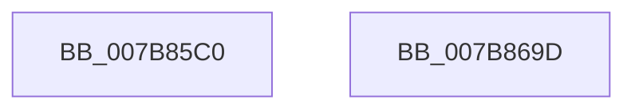

# EtwpLogProcessPerfCtrs

- RVA: `0x007B85C0`–`0x007B869E` (길이 `222` bytes)
- VA: `0x00000001407B85C0`
- 실행 섹션: `PAGE`
- PDB 이름 있음: `예`; PDB Function 태그: `아니요`
- unwind 정보 RVA: `0x000C5DF4`
- 디코드: `51`개 명령, `222/222` bytes 표시
- 미해석 바이트: `0` (있으면 어셈블리에 `.byte`로 보존)

> 이 문서는 커널 이미지의 기계어와 PDB 기호를 분석해 생성했습니다. 4번과 5번은 함수 원형과 자료형을 바이너리 사용 방식에서 추정한 C 해석이며 원본 소스 복구 결과는 아닙니다.

## 1. Dependencies

- 직접 호출 지점: **4**; 고유 호출 대상: **4**
- 직접 호출자로 확인된 함수: **1**
- RIP 상대 이미지 참조: **1**

### Outgoing calls
- `0x007B85F6` → [memset](../../text/6C/memset_function_006C6C40.md) (function, `0x006C6C40`)
- `0x007B8655` → [PsGetProcessServerSilo](../../text/44/PsGetProcessServerSilo_function_0044BEE0.md) (function, `0x0044BEE0`)
- `0x007B8677` → [EtwTraceSiloKernelEvent](../../text/22/EtwTraceSiloKernelEvent_function_002242A0.md) (function, `0x002242A0`)
- `0x007B8683` → [_security_check_cookie](../../text/6A/_security_check_cookie_function_006AC640.md) (function, `0x006AC640`)

### Direct callers
- [EtwTraceProcess](../8A/EtwTraceProcess_function_008A4004.md) at `0x008A41C7`

### Static image references
- `0x007B85D7` → RVA `0x00E0A740` (`.data`; read)

## 2. Other-region calls and transfers

- 다른 실행 섹션으로 향하는 call: **4**
  - `0x007B85F6` → [memset](../../text/6C/memset_function_006C6C40.md) (`PAGE` → `.text`)
  - `0x007B8655` → [PsGetProcessServerSilo](../../text/44/PsGetProcessServerSilo_function_0044BEE0.md) (`PAGE` → `.text`)
  - `0x007B8677` → [EtwTraceSiloKernelEvent](../../text/22/EtwTraceSiloKernelEvent_function_002242A0.md) (`PAGE` → `.text`)
  - `0x007B8683` → [_security_check_cookie](../../text/6A/_security_check_cookie_function_006AC640.md) (`PAGE` → `.text`)
- 별도 외부 분기/꼬리 이동을 확인하지 못했습니다.

## 3. Assembly (complete function range)

```asm
007B85C0  48 89 5C 24 10                  mov qword ptr [rsp + 0x10], rbx
007B85C5  48 89 7C 24 18                  mov qword ptr [rsp + 0x18], rdi
007B85CA  55                              push rbp
007B85CB  48 8D 6C 24 A9                  lea rbp, [rsp - 0x57]
007B85D0  48 81 EC C0 00 00 00            sub rsp, 0xc0
007B85D7  48 8B 05 62 21 65 00            mov rax, qword ptr [rip + 0x652162]
007B85DE  48 33 C4                        xor rax, rsp
007B85E1  48 89 45 47                     mov qword ptr [rbp + 0x47], rax
007B85E5  48 8B D9                        mov rbx, rcx
007B85E8  BF 68 00 00 00                  mov edi, 0x68
007B85ED  44 8B C7                        mov r8d, edi
007B85F0  48 8D 4D D7                     lea rcx, [rbp - 0x29]
007B85F4  33 D2                           xor edx, edx
007B85F6  E8 45 E6 F0 FF                  call 0x1406c6c40
007B85FB  8B 83 D0 01 00 00               mov eax, dword ptr [rbx + 0x1d0]
007B8601  48 8B CB                        mov rcx, rbx
007B8604  89 45 D7                        mov dword ptr [rbp - 0x29], eax
007B8607  48 8B 83 20 02 00 00            mov rax, qword ptr [rbx + 0x220]
007B860E  48 89 45 E7                     mov qword ptr [rbp - 0x19], rax
007B8612  48 8B 83 A0 04 00 00            mov rax, qword ptr [rbx + 0x4a0]
007B8619  48 C1 E0 0C                     shl rax, 0xc
007B861D  48 89 45 EF                     mov qword ptr [rbp - 0x11], rax
007B8621  48 8B 83 E0 03 00 00            mov rax, qword ptr [rbx + 0x3e0]
007B8628  48 C1 E0 0C                     shl rax, 0xc
007B862C  48 89 45 F7                     mov qword ptr [rbp - 9], rax
007B8630  48 8B 83 18 02 00 00            mov rax, qword ptr [rbx + 0x218]
007B8637  48 89 45 FF                     mov qword ptr [rbp - 1], rax
007B863B  48 8B 83 10 02 00 00            mov rax, qword ptr [rbx + 0x210]
007B8642  83 65 D3 00                     and dword ptr [rbp - 0x2d], 0
007B8646  48 89 45 07                     mov qword ptr [rbp + 7], rax
007B864A  48 8D 45 D7                     lea rax, [rbp - 0x29]
007B864E  48 89 45 C7                     mov qword ptr [rbp - 0x39], rax
007B8652  89 7D CF                        mov dword ptr [rbp - 0x31], edi
007B8655  E8 86 38 C9 FF                  call 0x14044bee0
007B865A  44 8D 47 99                     lea r8d, [rdi - 0x67]
007B865E  C7 44 24 28 02 18 60 00         mov dword ptr [rsp + 0x28], 0x601802
007B8666  45 8B C8                        mov r9d, r8d
007B8669  66 C7 44 24 20 20 03            mov word ptr [rsp + 0x20], 0x320
007B8670  48 8B C8                        mov rcx, rax
007B8673  48 8D 55 C7                     lea rdx, [rbp - 0x39]
007B8677  E8 24 BC A6 FF                  call 0x1402242a0
007B867C  48 8B 4D 47                     mov rcx, qword ptr [rbp + 0x47]
007B8680  48 33 CC                        xor rcx, rsp
007B8683  E8 B8 3F EF FF                  call 0x1406ac640
007B8688  4C 8D 9C 24 C0 00 00 00         lea r11, [rsp + 0xc0]
007B8690  49 8B 5B 18                     mov rbx, qword ptr [r11 + 0x18]
007B8694  49 8B 7B 20                     mov rdi, qword ptr [r11 + 0x20]
007B8698  49 8B E3                        mov rsp, r11
007B869B  5D                              pop rbp
007B869C  C3                              ret
007B869D  CC                              int3
```

## 4. C-style interpretation (structured pseudocode)

```c
__int64 __fastcall EtwpLogProcessPerfCtrs(__int64 a1, int a2)
{
    __int64 result;
    __int64 v_rsp;
    unsigned __int64 v_stack_m18;
    unsigned __int64 v_stack_m58;
    unsigned __int64 v_stack_m5F;
    unsigned __int64 v_stack_m60;
    unsigned __int64 v_stack_m68;
    unsigned __int64 v_stack_m70;
    unsigned __int64 v_stack_m78;
    unsigned __int64 v_stack_m8;
    unsigned __int64 v_stack_m88;
    unsigned int v_stack_m8C;
    unsigned int v_stack_m90;
    unsigned __int64 v_stack_m98;
    unsigned int v_stack_mA0;
    unsigned __int16 v_stack_mA8;
    unsigned __int64 v_stack_p10;
    unsigned __int64 v_stack_p18;

    v_stack_p10 = v_rbx;
    v_stack_p18 = v_rdi;
    v_rsp = (v_rsp) - (192);
    result = (*(unsigned __int64 *)(v_rip + 6627682)) ^ (v_rsp);
    v_stack_m18 = result;
    a2 = 0;
    result = memset(v_stack_m88, a2, 104, a4);
    v_stack_m88 = (unsigned int)((unsigned int)(*(unsigned int *)(a1 + 464)));
    v_stack_m78 = *(unsigned __int64 *)(a1 + 544);
    result = (*(unsigned __int64 *)(a1 + 1184)) << (12);
    v_stack_m70 = result;
    result = (*(unsigned __int64 *)(a1 + 992)) << (12);
    v_stack_m68 = result;
    v_stack_m60 = *(unsigned __int64 *)(a1 + 536);
    v_stack_m58 = *(unsigned __int64 *)(a1 + 528);
    v_stack_m98 = v_stack_m88;
    v_stack_m90 = 104;
    result = PsGetProcessServerSilo(a1, a2, 104, a4);
    v_stack_mA0 = 0x601802ULL;
    v_stack_mA8 = 800;
    result = EtwTraceSiloKernelEvent(result, v_stack_m98, 104 - 103, (unsigned int)((unsigned int)(104 - 103)));
    a1 = (v_stack_m18) ^ (v_rsp);
    result = _security_check_cookie(a1, v_stack_m98, 104 - 103, (unsigned int)((unsigned int)(104 - 103)));
    return result;
}
```

## 5. (Beta) C Style

```c
int64_t EtwpLogProcessPerfCtrs(void *Arg1, int32_t Arg2)
{
    uint8_t *arg1 = (uint8_t *)Arg1;

    int64_t result;
    int64_t local_rsp;
    uint64_t v_stack_m18;
    uint64_t v_stack_m58;
    uint64_t v_stack_m5F;
    uint64_t v_stack_m60;
    uint64_t v_stack_m68;
    uint64_t v_stack_m70;
    uint64_t v_stack_m78;
    uint64_t v_stack_m8;
    uint64_t v_stack_m88;
    uint32_t v_stack_m8C;
    uint32_t v_stack_m90;
    uint64_t v_stack_m98;
    uint32_t v_stack_mA0;
    uint16_t v_stack_mA8;
    uint64_t v_stack_p10;
    uint64_t v_stack_p18;

    v_stack_p10 = local_rbx;
    v_stack_p18 = local_rdi;
    local_rsp = (local_rsp) - (192);
    result = (*(uint64_t *)(v_rip + 0x652162)) ^ (local_rsp);
    v_stack_m18 = result;
    Arg2 = 0;
    result = memset(v_stack_m88, Arg2, 104, a4);
    v_stack_m88 = (uint32_t)((uint32_t)(*(uint32_t *)(arg1 + 0x1D0)));
    v_stack_m78 = *(uint64_t *)(arg1 + 0x220);
    result = (*(uint64_t *)(arg1 + 0x4A0)) << (12);
    v_stack_m70 = result;
    result = (*(uint64_t *)(arg1 + 0x3E0)) << (12);
    v_stack_m68 = result;
    v_stack_m60 = *(uint64_t *)(arg1 + 0x218);
    v_stack_m58 = *(uint64_t *)(arg1 + 0x210);
    v_stack_m98 = v_stack_m88;
    v_stack_m90 = 104;
    result = PsGetProcessServerSilo(Arg1, Arg2, 104, a4);
    v_stack_mA0 = 0x601802ULL;
    v_stack_mA8 = 800;
    result = EtwTraceSiloKernelEvent(result, v_stack_m98, 104 - 103, (uint32_t)((uint32_t)(104 - 103)));
    Arg1 = (v_stack_m18) ^ (local_rsp);
    result = _security_check_cookie(Arg1, v_stack_m98, 104 - 103, (uint32_t)((uint32_t)(104 - 103)));
    return result;
}
```

### 관측된 메모리 오프셋

구조체 형식이 확인되지 않은 접근은 인자 기준의 오프셋으로만 기록했습니다.

| 기준 인자 | 오프셋 표현 | 폭 (bit) | 접근 |
|---|---:|---:|---|
| `Arg1` | `+ 0x1D0` | `32` | `R` |
| `Arg1` | `+ 0x210` | `64` | `R` |
| `Arg1` | `+ 0x218` | `64` | `R` |
| `Arg1` | `+ 0x220` | `64` | `R` |
| `Arg1` | `+ 0x3E0` | `64` | `R` |
| `Arg1` | `+ 0x4A0` | `64` | `R` |

## 6. Execution-region graph

[열기: 2D/3D 그래프와 함수 탐색 컨트롤 패널](../../../control-panel.html?section=page&rva=0x007B85C0&view=graph)

- 2D 그래프는 위에서 아래로 흐르고, 3D 그래프는 빈 공간을 드래그해 회전합니다. Shift+드래그는 이동, 휠은 확대·축소, 함수 노드 선택은 대상 보고서 이동입니다.

### Static fallback


