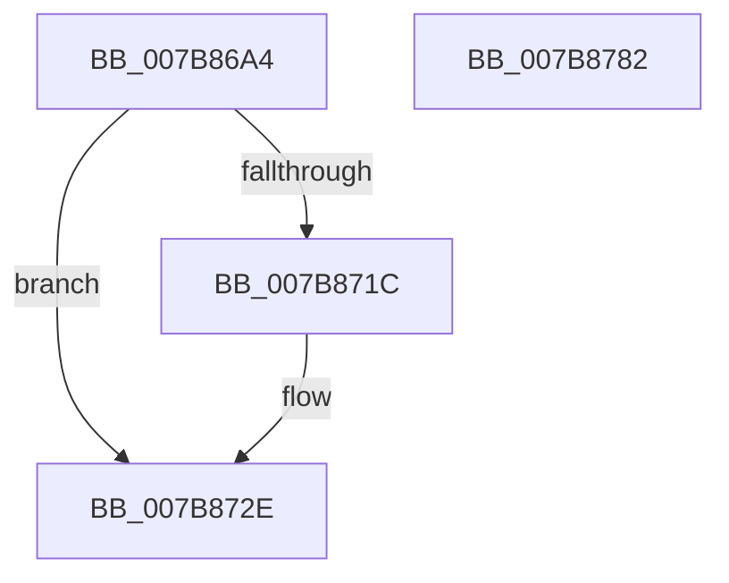

# EtwpLogTxREvent

- RVA: `0x007B86A4`–`0x007B8783` (길이 `223` bytes)
- VA: `0x00000001407B86A4`
- 실행 섹션: `PAGE`
- PDB 이름 있음: `예`; PDB Function 태그: `아니요`
- unwind 정보 RVA: `0x000AEA98`
- 디코드: `54`개 명령, `223/223` bytes 표시
- 미해석 바이트: `0` (있으면 어셈블리에 `.byte`로 보존)

> 이 문서는 커널 이미지의 기계어와 PDB 기호를 분석해 생성했습니다. 4번과 5번은 함수 원형과 자료형을 바이너리 사용 방식에서 추정한 C 해석이며 원본 소스 복구 결과는 아닙니다.

## 1. Dependencies

- 직접 호출 지점: **2**; 고유 호출 대상: **2**
- 직접 호출자로 확인된 함수: **1**
- RIP 상대 이미지 참조: **3**

### Outgoing calls
- `0x007B8768` → [EtwpLogKernelEvent](../../text/25/EtwpLogKernelEvent_function_0025CC00.md) (function, `0x0025CC00`)
- `0x007B8774` → [_security_check_cookie](../../text/6A/_security_check_cookie_function_006AC640.md) (function, `0x006AC640`)

### Direct callers
- [EtwpTraceRegistryTransaction](../AC/EtwpTraceRegistryTransaction_function_00AC1DB0.md) at `0x00AC1E51`

### Static image references
- `0x007B86B2` → RVA `0x00E0A740` (`.data`; read)
- `0x007B8731` → RVA `0x000105E0` (`.rdata`; read)
- `0x007B8761` → RVA `0x00FC6AA8` (`ALMOSTRO`; read)

## 2. Other-region calls and transfers

- 다른 실행 섹션으로 향하는 call: **2**
  - `0x007B8768` → [EtwpLogKernelEvent](../../text/25/EtwpLogKernelEvent_function_0025CC00.md) (`PAGE` → `.text`)
  - `0x007B8774` → [_security_check_cookie](../../text/6A/_security_check_cookie_function_006AC640.md) (`PAGE` → `.text`)
- 별도 외부 분기/꼬리 이동을 확인하지 못했습니다.

## 3. Assembly (complete function range)

```asm
007B86A4  40 55                           push rbp
007B86A6  48 8D 6C 24 C1                  lea rbp, [rsp - 0x3f]
007B86AB  48 81 EC 90 00 00 00            sub rsp, 0x90
007B86B2  48 8B 05 87 20 65 00            mov rax, qword ptr [rip + 0x652087]
007B86B9  48 33 C4                        xor rax, rsp
007B86BC  48 89 45 37                     mov qword ptr [rbp + 0x37], rax
007B86C0  41 0F 10 00                     movups xmm0, xmmword ptr [r8]
007B86C4  48 83 65 FF 00                  and qword ptr [rbp - 1], 0
007B86C9  44 8B D9                        mov r11d, ecx
007B86CC  83 65 13 00                     and dword ptr [rbp + 0x13], 0
007B86D0  B8 00 09 00 00                  mov eax, 0x900
007B86D5  44 0F B6 D2                     movzx r10d, dl
007B86D9  66 44 0B D0                     or r10w, ax
007B86DD  44 89 4D F7                     mov dword ptr [rbp - 9], r9d
007B86E1  48 8B 45 77                     mov rax, qword ptr [rbp + 0x77]
007B86E5  41 B9 01 00 00 00               mov r9d, 1
007B86EB  F3 0F 7F 45 E7                  movdqu xmmword ptr [rbp - 0x19], xmm0
007B86F0  C7 45 0F 20 00 00 00            mov dword ptr [rbp + 0xf], 0x20
007B86F7  48 8B 08                        mov rcx, qword ptr [rax]
007B86FA  41 8D 51 01                     lea edx, [r9 + 1]
007B86FE  8B 45 6F                        mov eax, dword ptr [rbp + 0x6f]
007B8701  89 45 FB                        mov dword ptr [rbp - 5], eax
007B8704  48 8D 45 DF                     lea rax, [rbp - 0x21]
007B8708  48 89 4D DF                     mov qword ptr [rbp - 0x21], rcx
007B870C  48 89 45 07                     mov qword ptr [rbp + 7], rax
007B8710  48 8B 45 7F                     mov rax, qword ptr [rbp + 0x7f]
007B8714  0F B7 08                        movzx ecx, word ptr [rax]
007B8717  83 E1 FE                        and ecx, 0xfffffffe
007B871A  76 12                           jbe 0x1407b872e
007B871C  48 8B 40 08                     mov rax, qword ptr [rax + 8]
007B8720  44 8B CA                        mov r9d, edx
007B8723  83 65 23 00                     and dword ptr [rbp + 0x23], 0
007B8727  48 89 45 17                     mov qword ptr [rbp + 0x17], rax
007B872B  89 4D 1F                        mov dword ptr [rbp + 0x1f], ecx
007B872E  41 8B C1                        mov eax, r9d
007B8731  48 8D 0D A8 7E 85 FF            lea rcx, [rip - 0x7a8158]
007B8738  48 03 C0                        add rax, rax
007B873B  C7 44 24 28 02 19 60 00         mov dword ptr [rsp + 0x28], 0x601902
007B8743  45 8B C3                        mov r8d, r11d
007B8746  66 44 89 54 24 20               mov word ptr [rsp + 0x20], r10w
007B874C  83 64 C5 13 00                  and dword ptr [rbp + rax*8 + 0x13], 0
007B8751  48 89 4C C5 07                  mov qword ptr [rbp + rax*8 + 7], rcx
007B8756  41 FF C1                        inc r9d
007B8759  89 54 C5 0F                     mov dword ptr [rbp + rax*8 + 0xf], edx
007B875D  48 8D 4D 07                     lea rcx, [rbp + 7]
007B8761  48 8B 15 40 E3 80 00            mov rdx, qword ptr [rip + 0x80e340]
007B8768  E8 93 44 AA FF                  call 0x14025cc00
007B876D  48 8B 4D 37                     mov rcx, qword ptr [rbp + 0x37]
007B8771  48 33 CC                        xor rcx, rsp
007B8774  E8 C7 3E EF FF                  call 0x1406ac640
007B8779  48 81 C4 90 00 00 00            add rsp, 0x90
007B8780  5D                              pop rbp
007B8781  C3                              ret
007B8782  CC                              int3
```

## 4. C-style interpretation (structured pseudocode)

```c
__int64 __fastcall EtwpLogTxREvent(int a1, unsigned __int8 a2, __int64 a3, int a4, unsigned int a5, __int64 a6, __int64 a7)
{
    __int64 result;
    __int64 v_r10;
    __int64 v_rsp;
    unsigned __int64 v_stack_m10;
    unsigned int v_stack_m24;
    unsigned int v_stack_m28;
    unsigned __int64 v_stack_m30;
    unsigned int v_stack_m34;
    unsigned int v_stack_m38;
    unsigned __int64 v_stack_m40;
    unsigned __int64 v_stack_m47;
    unsigned __int64 v_stack_m48;
    unsigned int v_stack_m4C;
    unsigned int v_stack_m50;
    unsigned __int64 v_stack_m60;
    unsigned __int64 v_stack_m68;
    unsigned int v_stack_m70;
    unsigned __int16 v_stack_m78;

    v_rsp = (v_rsp) - (144);
    result = (*(unsigned __int64 *)(v_rip + 6627463)) ^ (v_rsp);
    v_stack_m10 = result;
    v_r10 = (unsigned __int16)((a2) | ((unsigned __int16)((unsigned int)(0x900ULL))));
    v_stack_m50 = a4;
    v_stack_m60 = v_xmm0;
    v_stack_m38 = 32;
    v_stack_m4C = (unsigned int)((unsigned int)(a5));
    v_stack_m68 = *(unsigned __int64 *)(a6);
    v_stack_m40 = v_stack_m68;
    a1 = (unsigned int)((*(unsigned __int16 *)(a7)) & (0xFFFFFFFEULL));
    result = a7;
    if (!(condition_is_below_or_equal)) {
        result = *(unsigned __int64 *)(a7 + 8);
        a4 = (unsigned int)(1 + 1);
        v_stack_m30 = result;
        v_stack_m28 = a1;
    }
    result = ((unsigned int)(a4)) + ((unsigned int)(a4));
    v_stack_m70 = 0x601902ULL;
    v_stack_m78 = (unsigned __int16)(v_r10);
    *(unsigned __int64 *)(v_stack_m47 + result * 8 + 7) = v_rip - 8028504;
    a4 = (unsigned int)((a4) + 1);
    *(unsigned int *)(v_stack_m47 + result * 8 + 15) = (unsigned int)(1 + 1);
    result = EtwpLogKernelEvent(v_stack_m40, *(unsigned __int64 *)(v_rip + 8446784), (unsigned int)((unsigned int)((unsigned int)(a1))), a4);
    a1 = (v_stack_m10) ^ (v_rsp);
    result = _security_check_cookie(a1, *(unsigned __int64 *)(v_rip + 8446784), (unsigned int)((unsigned int)((unsigned int)(a1))), a4);
    v_rsp = (v_rsp) + (144);
    return result;
}
```

## 5. (Beta) C Style

```c
int64_t EtwpLogTxREvent(int32_t Arg1, uint8_t Arg2, void *Arg3, int32_t Arg4, uint32_t Arg5, void *Arg6, void *Arg7)
{
    uint8_t *arg3 = (uint8_t *)Arg3;
    uint8_t *arg6 = (uint8_t *)Arg6;
    uint8_t *arg7 = (uint8_t *)Arg7;

    int64_t result;
    int64_t local_r10;
    int64_t local_rsp;
    uint64_t v_stack_m10;
    uint32_t v_stack_m24;
    uint32_t v_stack_m28;
    uint64_t v_stack_m30;
    uint32_t v_stack_m34;
    uint32_t v_stack_m38;
    uint64_t v_stack_m40;
    uint64_t v_stack_m47;
    uint64_t v_stack_m48;
    uint32_t v_stack_m4C;
    uint32_t v_stack_m50;
    uint64_t v_stack_m60;
    uint64_t v_stack_m68;
    uint32_t v_stack_m70;
    uint16_t v_stack_m78;

    local_rsp = (local_rsp) - (144);
    result = (*(uint64_t *)(v_rip + 0x652087)) ^ (local_rsp);
    v_stack_m10 = result;
    local_r10 = (uint16_t)((Arg2) | ((uint16_t)((uint32_t)(0x900ULL))));
    v_stack_m50 = Arg4;
    v_stack_m60 = v_xmm0;
    v_stack_m38 = 32;
    v_stack_m4C = (uint32_t)((uint32_t)(Arg5));
    v_stack_m68 = *(uint64_t *)(arg6);
    v_stack_m40 = v_stack_m68;
    Arg1 = (uint32_t)((*(uint16_t *)(arg7)) & (0xFFFFFFFEULL));
    result = Arg7;
    if (!(condition_is_below_or_equal)) {
        result = *(uint64_t *)(arg7 + 0x8);
        Arg4 = (uint32_t)(1 + 1);
        v_stack_m30 = result;
        v_stack_m28 = Arg1;
    }
    result = ((uint32_t)(Arg4)) + ((uint32_t)(Arg4));
    v_stack_m70 = 0x601902ULL;
    v_stack_m78 = (uint16_t)(local_r10);
    *(uint64_t *)(v_stack_m47 + result * 8 + 0x7) = v_rip - 8028504;
    Arg4 = (uint32_t)((Arg4) + 1);
    *(uint32_t *)(v_stack_m47 + result * 8 + 0xF) = (uint32_t)(1 + 1);
    result = EtwpLogKernelEvent(v_stack_m40, *(uint64_t *)(v_rip + 0x80E340), (uint32_t)((uint32_t)((uint32_t)(Arg1))), Arg4);
    Arg1 = (v_stack_m10) ^ (local_rsp);
    result = _security_check_cookie(Arg1, *(uint64_t *)(v_rip + 0x80E340), (uint32_t)((uint32_t)((uint32_t)(Arg1))), Arg4);
    local_rsp = (local_rsp) + (144);
    return result;
}
```

### 관측된 메모리 오프셋

구조체 형식이 확인되지 않은 접근은 인자 기준의 오프셋으로만 기록했습니다.

| 기준 인자 | 오프셋 표현 | 폭 (bit) | 접근 |
|---|---:|---:|---|
| `Arg3` | `+ 0x0` | `128` | `R` |
| `Arg6` | `+ 0x0` | `64` | `R` |
| `Arg7` | `+ 0x0` | `16` | `R` |
| `Arg7` | `+ 0x8` | `64` | `R` |

## 6. Execution-region graph

[열기: 2D/3D 그래프와 함수 탐색 컨트롤 패널](../../../control-panel.html?section=page&rva=0x007B86A4&view=graph)

- 2D 그래프는 위에서 아래로 흐르고, 3D 그래프는 빈 공간을 드래그해 회전합니다. Shift+드래그는 이동, 휠은 확대·축소, 함수 노드 선택은 대상 보고서 이동입니다.

### Static fallback


