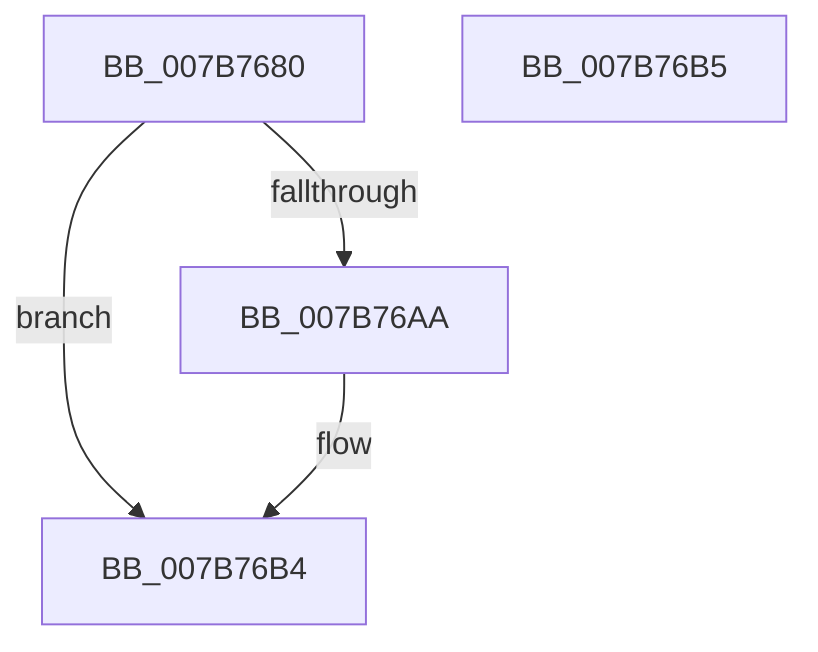

# EtwpMdlInit

- RVA: `0x007B7680`–`0x007B76B6` (길이 `54` bytes)
- VA: `0x00000001407B7680`
- 실행 섹션: `PAGE`
- PDB 이름 있음: `예`; PDB Function 태그: `아니요`
- unwind 정보 RVA: `0x000DB714`
- 디코드: `16`개 명령, `54/54` bytes 표시
- 미해석 바이트: `0` (있으면 어셈블리에 `.byte`로 보존)

> 이 문서는 커널 이미지의 기계어와 PDB 기호를 분석해 생성했습니다. 4번과 5번은 함수 원형과 자료형을 바이너리 사용 방식에서 추정한 C 해석이며 원본 소스 복구 결과는 아닙니다.

## 1. Dependencies

- 직접 호출 지점: **0**; 고유 호출 대상: **0**
- 직접 호출자로 확인된 함수: **3**
- RIP 상대 이미지 참조: **0**

### Outgoing calls
- 직접 디코드된 call 명령이 없습니다.

### Direct callers
- [EtwpFreeTraceBuffer](../../text/3E/EtwpFreeTraceBuffer_function_003EB978.md) at `0x003EB9E2`
- [sub_006EAD16](../../text/6E/Unknown_function_006EAD16.md) at `0x006EAD5D`
- [EtwpFreePfnArray](EtwpFreePfnArray_function_007B66A8.md) at `0x007B66F7`
- [EtwpFreePfnArray](EtwpFreePfnArray_function_007B66A8.md) at `0x007B671C`

### Static image references
- 디코드된 RIP-relative 메모리 참조가 없습니다.

## 2. Other-region calls and transfers

- 다른 실행 섹션으로 향하는 call: **0**
- 별도 외부 분기/꼬리 이동을 확인하지 못했습니다.

## 3. Assembly (complete function range)

```asm
007B7680  0F 57 C0                        xorps xmm0, xmm0
007B7683  8D 42 06                        lea eax, [rdx + 6]
007B7686  0F 11 01                        movups xmmword ptr [rcx], xmm0
007B7689  66 C1 E0 03                     shl ax, 3
007B768D  0F 11 41 10                     movups xmmword ptr [rcx + 0x10], xmm0
007B7691  C1 E2 0C                        shl edx, 0xc
007B7694  0F 11 41 20                     movups xmmword ptr [rcx + 0x20], xmm0
007B7698  66 89 41 08                     mov word ptr [rcx + 8], ax
007B769C  89 51 28                        mov dword ptr [rcx + 0x28], edx
007B769F  66 C7 41 0A 0A 20               mov word ptr [rcx + 0xa], 0x200a
007B76A5  4D 85 C0                        test r8, r8
007B76A8  74 0A                           je 0x1407b76b4
007B76AA  4C 89 41 18                     mov qword ptr [rcx + 0x18], r8
007B76AE  66 C7 41 0A 0B 20               mov word ptr [rcx + 0xa], 0x200b
007B76B4  C3                              ret
007B76B5  CC                              int3
```

## 4. C-style interpretation (structured pseudocode)

```c
__int64 __fastcall EtwpMdlInit(__int64 a1, __int64 a2, __int64 a3)
{
    __int64 result;

    *(unsigned __int64 *)(a1) = v_xmm0;
    result = (unsigned __int16)((a2 + 6) << (3));
    *(unsigned __int64 *)(a1 + 16) = v_xmm0;
    a2 = (unsigned int)((a2) << (12));
    *(unsigned __int64 *)(a1 + 32) = v_xmm0;
    *(unsigned __int16 *)(a1 + 8) = (unsigned __int16)(result);
    *(unsigned int *)(a1 + 40) = (unsigned int)(a2);
    *(unsigned __int16 *)(a1 + 10) = 0x200AULL;
    if (a3 != 0) {
        *(unsigned __int64 *)(a1 + 24) = a3;
        *(unsigned __int16 *)(a1 + 10) = 0x200BULL;
    }
    return result;
}
```

## 5. (Beta) C Style

```c
int64_t EtwpMdlInit(void *Arg1, void *Arg2, int64_t Arg3)
{
    uint8_t *arg1 = (uint8_t *)Arg1;
    uint8_t *arg2 = (uint8_t *)Arg2;

    int64_t result;

    *(uint64_t *)(arg1) = v_xmm0;
    result = (uint16_t)((Arg2 + 6) << (3));
    *(uint64_t *)(arg1 + 0x10) = v_xmm0;
    Arg2 = (uint32_t)((Arg2) << (12));
    *(uint64_t *)(arg1 + 0x20) = v_xmm0;
    *(uint16_t *)(arg1 + 0x8) = (uint16_t)(result);
    *(uint32_t *)(arg1 + 0x28) = (uint32_t)(Arg2);
    *(uint16_t *)(arg1 + 0xA) = 0x200AULL;
    if (Arg3 != 0) {
        *(uint64_t *)(arg1 + 0x18) = Arg3;
        *(uint16_t *)(arg1 + 0xA) = 0x200BULL;
    }
    return result;
}
```

### 관측된 메모리 오프셋

구조체 형식이 확인되지 않은 접근은 인자 기준의 오프셋으로만 기록했습니다.

| 기준 인자 | 오프셋 표현 | 폭 (bit) | 접근 |
|---|---:|---:|---|
| `Arg1` | `+ 0x0` | `128` | `R` |
| `Arg1` | `+ 0x8` | `16` | `W` |
| `Arg1` | `+ 0xA` | `16` | `W` |
| `Arg1` | `+ 0x10` | `128` | `R` |
| `Arg1` | `+ 0x18` | `64` | `W` |
| `Arg1` | `+ 0x20` | `128` | `R` |
| `Arg1` | `+ 0x28` | `32` | `W` |
| `Arg2` | `+ 0x6` | `32` | `R` |

## 6. Execution-region graph

[열기: 2D/3D 그래프와 함수 탐색 컨트롤 패널](../../../control-panel.html?section=page&rva=0x007B7680&view=graph)

- 2D 그래프는 위에서 아래로 흐르고, 3D 그래프는 빈 공간을 드래그해 회전합니다. Shift+드래그는 이동, 휠은 확대·축소, 함수 노드 선택은 대상 보고서 이동입니다.

### Static fallback


