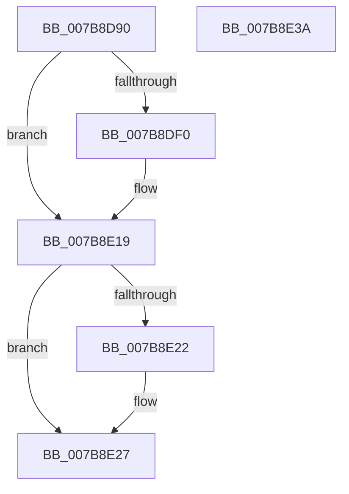

# EtwpNotifyProcessTracingChange

- RVA: `0x007B8D90`–`0x007B8E3B` (길이 `171` bytes)
- VA: `0x00000001407B8D90`
- 실행 섹션: `PAGE`
- PDB 이름 있음: `예`; PDB Function 태그: `아니요`
- unwind 정보 RVA: `0x000D39AC`
- 디코드: `43`개 명령, `171/171` bytes 표시
- 미해석 바이트: `0` (있으면 어셈블리에 `.byte`로 보존)

> 이 문서는 커널 이미지의 기계어와 PDB 기호를 분석해 생성했습니다. 4번과 5번은 함수 원형과 자료형을 바이너리 사용 방식에서 추정한 C 해석이며 원본 소스 복구 결과는 아닙니다.

## 1. Dependencies

- 직접 호출 지점: **3**; 고유 호출 대상: **3**
- 직접 호출자로 확인된 함수: **1**
- RIP 상대 이미지 참조: **1**

### Outgoing calls
- `0x007B8DE5` → [ZwOpenProcess](../../text/6A/ZwOpenProcess_function_006AD590.md) (function, `0x006AD590`)
- `0x007B8E12` → [ZwUpdateWnfStateData](../../text/6B/ZwUpdateWnfStateData_function_006B0D10.md) (function, `0x006B0D10`)
- `0x007B8E22` → [ZwClose](../../text/6A/ZwClose_function_006AD2B0.md) (function, `0x006AD2B0`)

### Direct callers
- [EtwpUpdateProcessTracingCallback](EtwpUpdateProcessTracingCallback_function_007B8F40.md) at `0x007B903E`

### Static image references
- `0x007B8DF5` → RVA `0x00020A18` (`.rdata`; read)

## 2. Other-region calls and transfers

- 다른 실행 섹션으로 향하는 call: **3**
  - `0x007B8DE5` → [ZwOpenProcess](../../text/6A/ZwOpenProcess_function_006AD590.md) (`PAGE` → `.text`)
  - `0x007B8E12` → [ZwUpdateWnfStateData](../../text/6B/ZwUpdateWnfStateData_function_006B0D10.md) (`PAGE` → `.text`)
  - `0x007B8E22` → [ZwClose](../../text/6A/ZwClose_function_006AD2B0.md) (`PAGE` → `.text`)
- 별도 외부 분기/꼬리 이동을 확인하지 못했습니다.

## 3. Assembly (complete function range)

```asm
007B8D90  48 89 5C 24 10                  mov qword ptr [rsp + 0x10], rbx
007B8D95  55                              push rbp
007B8D96  48 8B EC                        mov rbp, rsp
007B8D99  48 81 EC 80 00 00 00            sub rsp, 0x80
007B8DA0  83 65 EC 00                     and dword ptr [rbp - 0x14], 0
007B8DA4  4C 8D 4D C0                     lea r9, [rbp - 0x40]
007B8DA8  48 83 65 10 00                  and qword ptr [rbp + 0x10], 0
007B8DAD  4C 8D 45 D0                     lea r8, [rbp - 0x30]
007B8DB1  48 83 65 C8 00                  and qword ptr [rbp - 0x38], 0
007B8DB6  0F 57 C0                        xorps xmm0, xmm0
007B8DB9  48 83 65 D8 00                  and qword ptr [rbp - 0x28], 0
007B8DBE  33 D2                           xor edx, edx
007B8DC0  48 83 65 E0 00                  and qword ptr [rbp - 0x20], 0
007B8DC5  48 89 4D C0                     mov qword ptr [rbp - 0x40], rcx
007B8DC9  48 8D 4D 10                     lea rcx, [rbp + 0x10]
007B8DCD  48 C7 45 D0 30 00 00 00         mov qword ptr [rbp - 0x30], 0x30
007B8DD5  83 65 D4 00                     and dword ptr [rbp - 0x2c], 0
007B8DD9  F3 0F 7F 45 F0                  movdqu xmmword ptr [rbp - 0x10], xmm0
007B8DDE  C7 45 E8 00 02 00 00            mov dword ptr [rbp - 0x18], 0x200
007B8DE5  E8 A6 47 EF FF                  call 0x1406ad590
007B8DEA  8B D8                           mov ebx, eax
007B8DEC  85 C0                           test eax, eax
007B8DEE  78 29                           js 0x1407b8e19
007B8DF0  83 64 24 30 00                  and dword ptr [rsp + 0x30], 0
007B8DF5  48 8D 0D 1C 7C 86 FF            lea rcx, [rip - 0x7983e4]
007B8DFC  48 8B 45 10                     mov rax, qword ptr [rbp + 0x10]
007B8E00  45 33 C9                        xor r9d, r9d
007B8E03  83 64 24 28 00                  and dword ptr [rsp + 0x28], 0
007B8E08  45 33 C0                        xor r8d, r8d
007B8E0B  33 D2                           xor edx, edx
007B8E0D  48 89 44 24 20                  mov qword ptr [rsp + 0x20], rax
007B8E12  E8 F9 7E EF FF                  call 0x1406b0d10
007B8E17  8B D8                           mov ebx, eax
007B8E19  48 8B 4D 10                     mov rcx, qword ptr [rbp + 0x10]
007B8E1D  48 85 C9                        test rcx, rcx
007B8E20  74 05                           je 0x1407b8e27
007B8E22  E8 89 44 EF FF                  call 0x1406ad2b0
007B8E27  8B C3                           mov eax, ebx
007B8E29  48 8B 9C 24 98 00 00 00         mov rbx, qword ptr [rsp + 0x98]
007B8E31  48 81 C4 80 00 00 00            add rsp, 0x80
007B8E38  5D                              pop rbp
007B8E39  C3                              ret
007B8E3A  CC                              int3
```

## 4. C-style interpretation (structured pseudocode)

```c
__int64 __fastcall EtwpNotifyProcessTracingChange(__int64 a1, int a2)
{
    __int64 result;
    __int64 v_rbx;
    __int64 v_rsp;
    unsigned __int64 v_stack_m18;
    unsigned int v_stack_m1C;
    unsigned int v_stack_m20;
    unsigned __int64 v_stack_m28;
    unsigned __int64 v_stack_m30;
    unsigned int v_stack_m34;
    unsigned __int64 v_stack_m38;
    unsigned __int64 v_stack_m40;
    unsigned __int64 v_stack_m48;
    unsigned int v_stack_m58;
    unsigned int v_stack_m60;
    unsigned __int64 v_stack_m68;
    unsigned __int64 v_stack_p10;
    unsigned __int64 v_stack_p8;

    v_stack_p10 = v_rbx;
    v_rsp = (v_rsp) - (128);
    a2 = 0;
    v_stack_m48 = a1;
    v_stack_m38 = 48;
    v_stack_m18 = v_xmm0;
    v_stack_m20 = 512;
    result = ZwOpenProcess(v_stack_p8, a2, v_stack_m38, v_stack_m48);
    v_rbx = (unsigned int)((unsigned int)(result));
    if (!(sign_flag)) {
        a1 = v_rip - 7963620;
        result = v_stack_p8;
        a4 = 0;
        a3 = 0;
        a2 = 0;
        v_stack_m68 = result;
        result = ZwUpdateWnfStateData(a1, a2, a3, a4);
        v_rbx = (unsigned int)(result);
    }
    if (v_stack_p8 != 0) {
        result = ZwClose(v_stack_p8, a2, a3, a4);
    }
    v_rsp = (v_rsp) + (128);
    return (unsigned int)((unsigned int)(v_rbx));
}
```

## 5. (Beta) C Style

```c
int64_t EtwpNotifyProcessTracingChange(int64_t Arg1, int32_t Arg2)
{
    int64_t result;
    int64_t local_rbx;
    int64_t local_rsp;
    uint64_t v_stack_m18;
    uint32_t v_stack_m1C;
    uint32_t v_stack_m20;
    uint64_t v_stack_m28;
    uint64_t v_stack_m30;
    uint32_t v_stack_m34;
    uint64_t v_stack_m38;
    uint64_t v_stack_m40;
    uint64_t v_stack_m48;
    uint32_t v_stack_m58;
    uint32_t v_stack_m60;
    uint64_t v_stack_m68;
    uint64_t v_stack_p10;
    uint64_t v_stack_p8;

    v_stack_p10 = local_rbx;
    local_rsp = (local_rsp) - (128);
    Arg2 = 0;
    v_stack_m48 = Arg1;
    v_stack_m38 = 48;
    v_stack_m18 = v_xmm0;
    v_stack_m20 = 512;
    result = ZwOpenProcess(v_stack_p8, Arg2, v_stack_m38, v_stack_m48);
    local_rbx = (uint32_t)((uint32_t)(result));
    if (!(sign_flag)) {
        Arg1 = v_rip - 7963620;
        result = v_stack_p8;
        a4 = 0;
        a3 = 0;
        Arg2 = 0;
        v_stack_m68 = result;
        result = ZwUpdateWnfStateData(Arg1, Arg2, a3, a4);
        local_rbx = (uint32_t)(result);
    }
    if (v_stack_p8 != 0) {
        result = ZwClose(v_stack_p8, Arg2, a3, a4);
    }
    local_rsp = (local_rsp) + (128);
    return (uint32_t)((uint32_t)(local_rbx));
}
```

## 6. Execution-region graph

[열기: 2D/3D 그래프와 함수 탐색 컨트롤 패널](../../../control-panel.html?section=page&rva=0x007B8D90&view=graph)

- 2D 그래프는 위에서 아래로 흐르고, 3D 그래프는 빈 공간을 드래그해 회전합니다. Shift+드래그는 이동, 휠은 확대·축소, 함수 노드 선택은 대상 보고서 이동입니다.

### Static fallback


