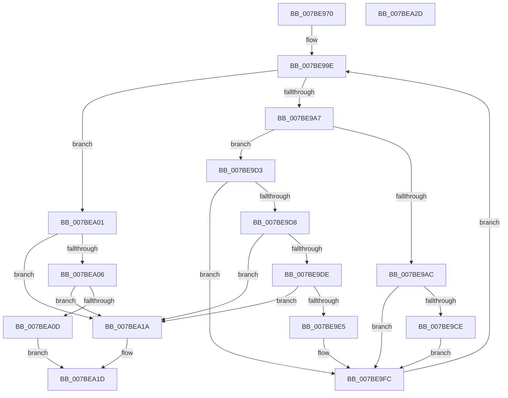

# EtwpParsePoolTagFilter

- RVA: `0x007BE970`–`0x007BEA2E` (길이 `190` bytes)
- VA: `0x00000001407BE970`
- 실행 섹션: `PAGE`
- PDB 이름 있음: `예`; PDB Function 태그: `아니요`
- unwind 정보 RVA: `0x0005C8E4`
- 디코드: `57`개 명령, `190/190` bytes 표시
- 미해석 바이트: `0` (있으면 어셈블리에 `.byte`로 보존)

> 이 문서는 커널 이미지의 기계어와 PDB 기호를 분석해 생성했습니다. 4번과 5번은 함수 원형과 자료형을 바이너리 사용 방식에서 추정한 C 해석이며 원본 소스 복구 결과는 아닙니다.

## 1. Dependencies

- 직접 호출 지점: **0**; 고유 호출 대상: **0**
- 직접 호출자로 확인된 함수: **1**
- RIP 상대 이미지 참조: **0**

### Outgoing calls
- 직접 디코드된 call 명령이 없습니다.

### Direct callers
- [EtwStartAutoLogger](EtwStartAutoLogger_function_007BD2F8.md) at `0x007BDE91`

### Static image references
- 디코드된 RIP-relative 메모리 참조가 없습니다.

## 2. Other-region calls and transfers

- 다른 실행 섹션으로 향하는 call: **0**
- 별도 외부 분기/꼬리 이동을 확인하지 못했습니다.

## 3. Assembly (complete function range)

```asm
007BE970  48 89 5C 24 10                  mov qword ptr [rsp + 0x10], rbx
007BE975  48 89 74 24 18                  mov qword ptr [rsp + 0x18], rsi
007BE97A  48 89 7C 24 20                  mov qword ptr [rsp + 0x20], rdi
007BE97F  4C 8B 51 08                     mov r10, qword ptr [rcx + 8]
007BE983  33 DB                           xor ebx, ebx
007BE985  BE 01 00 00 00                  mov esi, 1
007BE98A  89 5C 24 08                     mov dword ptr [rsp + 8], ebx
007BE98E  44 8B CE                        mov r9d, esi
007BE991  44 0F B7 C3                     movzx r8d, bx
007BE995  44 0F B7 DB                     movzx r11d, bx
007BE999  8B C3                           mov eax, ebx
007BE99B  8D 7E 01                        lea edi, [rsi + 1]
007BE99E  41 0F B7 0A                     movzx ecx, word ptr [r10]
007BE9A2  66 85 C9                        test cx, cx
007BE9A5  74 5A                           je 0x1407bea01
007BE9A7  44 3B CE                        cmp r9d, esi
007BE9AA  75 27                           jne 0x1407be9d3
007BE9AC  41 8A 02                        mov al, byte ptr [r10]
007BE9AF  66 83 F9 2A                     cmp cx, 0x2a
007BE9B3  49 0F BF CB                     movsx rcx, r11w
007BE9B7  44 0F 44 CF                     cmove r9d, edi
007BE9BB  66 44 03 DE                     add r11w, si
007BE9BF  88 44 0C 08                     mov byte ptr [rsp + rcx + 8], al
007BE9C3  8B 44 24 08                     mov eax, dword ptr [rsp + 8]
007BE9C7  66 41 83 FB 04                  cmp r11w, 4
007BE9CC  75 2E                           jne 0x1407be9fc
007BE9CE  44 8B CF                        mov r9d, edi
007BE9D1  EB 29                           jmp 0x1407be9fc
007BE9D3  44 3B CF                        cmp r9d, edi
007BE9D6  75 24                           jne 0x1407be9fc
007BE9D8  66 83 F9 3B                     cmp cx, 0x3b
007BE9DC  75 3C                           jne 0x1407bea1a
007BE9DE  66 41 83 F8 04                  cmp r8w, 4
007BE9E3  73 35                           jae 0x1407bea1a
007BE9E5  41 0F B7 C8                     movzx ecx, r8w
007BE9E9  44 8B DB                        mov r11d, ebx
007BE9EC  66 44 03 C6                     add r8w, si
007BE9F0  89 5C 24 08                     mov dword ptr [rsp + 8], ebx
007BE9F4  44 8B CE                        mov r9d, esi
007BE9F7  89 04 8A                        mov dword ptr [rdx + rcx*4], eax
007BE9FA  8B C3                           mov eax, ebx
007BE9FC  4C 03 D7                        add r10, rdi
007BE9FF  EB 9D                           jmp 0x1407be99e
007BEA01  44 3B CF                        cmp r9d, edi
007BEA04  75 14                           jne 0x1407bea1a
007BEA06  66 41 83 F8 04                  cmp r8w, 4
007BEA0B  73 0D                           jae 0x1407bea1a
007BEA0D  41 0F B7 C8                     movzx ecx, r8w
007BEA11  89 04 8A                        mov dword ptr [rdx + rcx*4], eax
007BEA14  42 8D 04 06                     lea eax, [rsi + r8]
007BEA18  EB 03                           jmp 0x1407bea1d
007BEA1A  0F B7 C3                        movzx eax, bx
007BEA1D  48 8B 5C 24 10                  mov rbx, qword ptr [rsp + 0x10]
007BEA22  48 8B 74 24 18                  mov rsi, qword ptr [rsp + 0x18]
007BEA27  48 8B 7C 24 20                  mov rdi, qword ptr [rsp + 0x20]
007BEA2C  C3                              ret
007BEA2D  CC                              int3
```

## 4. C-style interpretation (structured pseudocode)

```c
__int64 __fastcall EtwpParsePoolTagFilter(__int64 a1, __int64 a2)
{
    __int64 v_r10;
    __int64 v_r11;
    __int64 v_rbx;
    unsigned __int64 v_stack_p10;
    unsigned __int64 v_stack_p18;
    unsigned __int64 v_stack_p20;
    unsigned int v_stack_p8;

    v_stack_p10 = v_rbx;
    v_stack_p18 = v_rsi;
    v_stack_p20 = v_rdi;
    v_rbx = 0;
    v_stack_p8 = 0;
loc_007BE99E:
    if ((unsigned __int16)(*(unsigned __int16 *)(*(unsigned __int64 *)(a1 + 8))) == 0) goto loc_007BEA01;
    if (1 != 1) goto loc_007BE9D3;
    a4 = 1;
    if (((unsigned __int16)(*(unsigned __int16 *)(*(unsigned __int64 *)(a1 + 8)))) == 42) { a4 = (unsigned int)(1 + 1); }
    v_r11 = (unsigned __int16)((0) + (1));
    *(unsigned __int8 *)(v_rsp + (__int16)(0) * 1 + 8) = (unsigned __int8)(*(unsigned __int8 *)(*(unsigned __int64 *)(a1 + 8)));
    if (((unsigned __int16)(v_r11)) != 4) goto loc_007BE9FC;
    goto loc_007BE9FC;
loc_007BE9D3:
    if (((unsigned int)((unsigned int)((unsigned int)(1 + 1)))) != ((unsigned int)(1 + 1))) goto loc_007BE9FC;
    if (((unsigned __int16)((__int16)(0))) != 59) goto loc_007BEA1A;
    if (0 >= 4) goto loc_007BEA1A;
    a3 = (unsigned __int16)((0) + (1));
    v_stack_p8 = 0;
    *(unsigned int *)(a2 + 0 * 4) = (unsigned int)((unsigned int)(v_stack_p8));
loc_007BE9FC:
    v_r10 = (*(unsigned __int64 *)(a1 + 8)) + (1 + 1);
    goto loc_007BE99E;
loc_007BEA01:
    if (1 != ((unsigned int)(1 + 1))) goto loc_007BEA1A;
    if (((unsigned __int16)(a3)) >= 4) goto loc_007BEA1A;
    *(unsigned int *)(a2 + (unsigned __int16)(a3) * 4) = 0;
    goto loc_007BEA1D;
loc_007BEA1A:
loc_007BEA1D:
    return 0;
}
```

## 5. (Beta) C Style

```c
int64_t EtwpParsePoolTagFilter(void *Arg1, void *Arg2)
{
    uint8_t *arg1 = (uint8_t *)Arg1;
    uint8_t *arg2 = (uint8_t *)Arg2;

    int64_t local_r10;
    int64_t local_r11;
    int64_t local_rbx;
    uint64_t v_stack_p10;
    uint64_t v_stack_p18;
    uint64_t v_stack_p20;
    uint32_t v_stack_p8;

    v_stack_p10 = local_rbx;
    v_stack_p18 = local_rsi;
    v_stack_p20 = local_rdi;
    local_rbx = 0;
    v_stack_p8 = 0;
loc_007BE99E:
    if ((uint16_t)(*(uint16_t *)(*(uint64_t *)(arg1 + 0x8))) == 0) goto loc_007BEA01;
    if (1 != 1) goto loc_007BE9D3;
    a4 = 1;
    if (((uint16_t)(*(uint16_t *)(*(uint64_t *)(arg1 + 0x8)))) == 42) { a4 = (uint32_t)(1 + 1); }
    local_r11 = (uint16_t)((0) + (1));
    *(uint8_t *)(local_rsp + (int16_t)(0) * 1 + 0x8) = (uint8_t)(*(uint8_t *)(*(uint64_t *)(arg1 + 0x8)));
    if (((uint16_t)(local_r11)) != 4) goto loc_007BE9FC;
    goto loc_007BE9FC;
loc_007BE9D3:
    if (((uint32_t)((uint32_t)((uint32_t)(1 + 1)))) != ((uint32_t)(1 + 1))) goto loc_007BE9FC;
    if (((uint16_t)((int16_t)(0))) != 59) goto loc_007BEA1A;
    if (0 >= 4) goto loc_007BEA1A;
    a3 = (uint16_t)((0) + (1));
    v_stack_p8 = 0;
    *(uint32_t *)(arg2 + 0x0 * 4) = (uint32_t)((uint32_t)(v_stack_p8));
loc_007BE9FC:
    local_r10 = (*(uint64_t *)(arg1 + 0x8)) + (1 + 1);
    goto loc_007BE99E;
loc_007BEA01:
    if (1 != ((uint32_t)(1 + 1))) goto loc_007BEA1A;
    if (((uint16_t)(a3)) >= 4) goto loc_007BEA1A;
    *(uint32_t *)(arg2 + (uint16_t)(a3) * 4) = 0;
    goto loc_007BEA1D;
loc_007BEA1A:
loc_007BEA1D:
    return 0;
}
```

### 관측된 메모리 오프셋

구조체 형식이 확인되지 않은 접근은 인자 기준의 오프셋으로만 기록했습니다.

| 기준 인자 | 오프셋 표현 | 폭 (bit) | 접근 |
|---|---:|---:|---|
| `Arg1` | `+ 0x8` | `64` | `R` |
| `Arg2` | `+ 0x0 + rcx*4` | `32` | `W` |

## 6. Execution-region graph

[열기: 2D/3D 그래프와 함수 탐색 컨트롤 패널](../../../control-panel.html?section=page&rva=0x007BE970&view=graph)

- 2D 그래프는 위에서 아래로 흐르고, 3D 그래프는 빈 공간을 드래그해 회전합니다. Shift+드래그는 이동, 휠은 확대·축소, 함수 노드 선택은 대상 보고서 이동입니다.

### Static fallback


