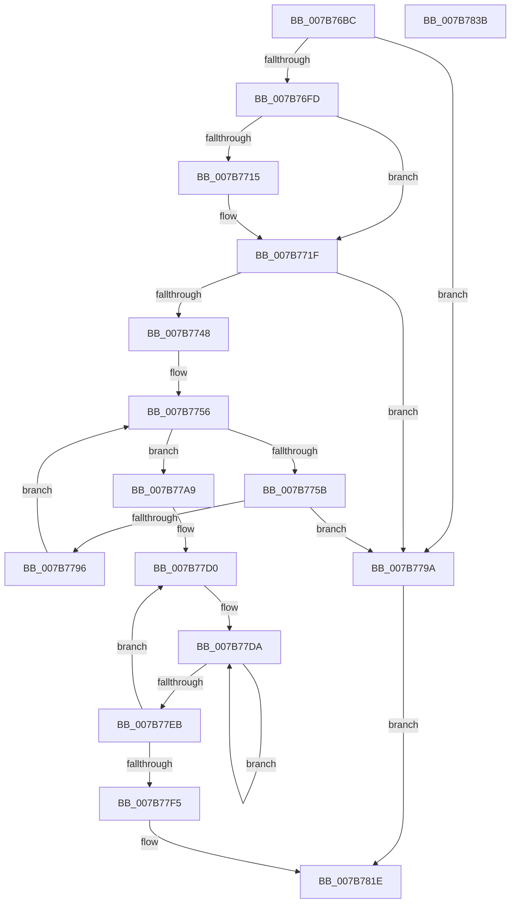

# EtwpPreInitializeSiloState

- RVA: `0x007B76BC`–`0x007B783C` (길이 `384` bytes)
- VA: `0x00000001407B76BC`
- 실행 섹션: `PAGE`
- PDB 이름 있음: `예`; PDB Function 태그: `아니요`
- unwind 정보 RVA: `0x0005E6B4`
- 디코드: `97`개 명령, `384/384` bytes 표시
- 미해석 바이트: `0` (있으면 어셈블리에 `.byte`로 보존)

> 이 문서는 커널 이미지의 기계어와 PDB 기호를 분석해 생성했습니다. 4번과 5번은 함수 원형과 자료형을 바이너리 사용 방식에서 추정한 C 해석이며 원본 소스 복구 결과는 아닙니다.

## 1. Dependencies

- 직접 호출 지점: **7**; 고유 호출 대상: **5**
- 직접 호출자로 확인된 함수: **2**
- RIP 상대 이미지 참조: **1**

### Outgoing calls
- `0x007B76EC` → [ExAllocatePool2](../../poolcode/B8/ExAllocatePool2_function_00B820F0.md) (function, `0x00B820F0`)
- `0x007B7703` → [PsGetServerSiloGlobals](../../text/22/PsGetServerSiloGlobals_function_002250A0.md) (function, `0x002250A0`)
- `0x007B7734` → [ExAllocatePool2](../../poolcode/B8/ExAllocatePool2_function_00B820F0.md) (function, `0x00B820F0`)
- `0x007B7776` → [ExAllocateCacheAwareRundownProtection](../9A/ExAllocateCacheAwareRundownProtection_function_009A5790.md) (function, `0x009A5790`)
- `0x007B77A2` → [EtwpCleanupSiloState](EtwpCleanupSiloState_function_007B59CC.md) (function, `0x007B59CC`)
- `0x007B77B2` → [KeInitializeMutex](../../text/48/KeInitializeMutex_function_004830E0.md) (function, `0x004830E0`)
- `0x007B7812` → [PsGetServerSiloGlobals](../../text/22/PsGetServerSiloGlobals_function_002250A0.md) (function, `0x002250A0`)

### Direct callers
- [PspInitializeServerSiloDeferred](../77/PspInitializeServerSiloDeferred_function_0077FEE0.md) at `0x0078008F`
- [EtwpInitialize](../../init/C4/EtwpInitialize_function_00C4DBCC.md) at `0x00C4DC7B`

### Static image references
- `0x007B77F5` → RVA `0x00011370` (`.rdata`; read)

## 2. Other-region calls and transfers

- 다른 실행 섹션으로 향하는 call: **5**
  - `0x007B76EC` → [ExAllocatePool2](../../poolcode/B8/ExAllocatePool2_function_00B820F0.md) (`PAGE` → `POOLCODE`)
  - `0x007B7703` → [PsGetServerSiloGlobals](../../text/22/PsGetServerSiloGlobals_function_002250A0.md) (`PAGE` → `.text`)
  - `0x007B7734` → [ExAllocatePool2](../../poolcode/B8/ExAllocatePool2_function_00B820F0.md) (`PAGE` → `POOLCODE`)
  - `0x007B77B2` → [KeInitializeMutex](../../text/48/KeInitializeMutex_function_004830E0.md) (`PAGE` → `.text`)
  - `0x007B7812` → [PsGetServerSiloGlobals](../../text/22/PsGetServerSiloGlobals_function_002250A0.md) (`PAGE` → `.text`)
- 별도 외부 분기/꼬리 이동을 확인하지 못했습니다.

## 3. Assembly (complete function range)

```asm
007B76BC  48 8B C4                        mov rax, rsp
007B76BF  48 89 58 08                     mov qword ptr [rax + 8], rbx
007B76C3  48 89 68 10                     mov qword ptr [rax + 0x10], rbp
007B76C7  48 89 70 18                     mov qword ptr [rax + 0x18], rsi
007B76CB  48 89 78 20                     mov qword ptr [rax + 0x20], rdi
007B76CF  41 56                           push r14
007B76D1  48 83 EC 20                     sub rsp, 0x20
007B76D5  8B DA                           mov ebx, edx
007B76D7  4C 8B F1                        mov r14, rcx
007B76DA  33 F6                           xor esi, esi
007B76DC  BD 45 74 77 61                  mov ebp, 0x61777445
007B76E1  44 8B C5                        mov r8d, ebp
007B76E4  BA 48 13 00 00                  mov edx, 0x1348
007B76E9  8D 4E 48                        lea ecx, [rsi + 0x48]
007B76EC  E8 FF A9 3C 00                  call 0x140b820f0
007B76F1  48 8B F8                        mov rdi, rax
007B76F4  48 85 C0                        test rax, rax
007B76F7  0F 84 9D 00 00 00               je 0x1407b779a
007B76FD  49 8B CE                        mov rcx, r14
007B7700  4C 89 30                        mov qword ptr [rax], r14
007B7703  E8 98 D9 A6 FF                  call 0x1402250a0
007B7708  48 89 47 08                     mov qword ptr [rdi + 8], rax
007B770C  B8 00 01 00 00                  mov eax, 0x100
007B7711  3B D8                           cmp ebx, eax
007B7713  77 0A                           ja 0x1407b771f
007B7715  8D 56 20                        lea edx, [rsi + 0x20]
007B7718  8B C3                           mov eax, ebx
007B771A  3B DA                           cmp ebx, edx
007B771C  0F 42 C2                        cmovb eax, edx
007B771F  8D 1C C5 00 00 00 00            lea ebx, [rax*8]
007B7726  89 47 10                        mov dword ptr [rdi + 0x10], eax
007B7729  8D 14 1B                        lea edx, [rbx + rbx]
007B772C  44 8B C5                        mov r8d, ebp
007B772F  B9 48 00 00 00                  mov ecx, 0x48
007B7734  E8 B7 A9 3C 00                  call 0x140b820f0
007B7739  48 89 87 C0 02 00 00            mov qword ptr [rdi + 0x2c0], rax
007B7740  48 8B C8                        mov rcx, rax
007B7743  48 85 C0                        test rax, rax
007B7746  74 52                           je 0x1407b779a
007B7748  8B C3                           mov eax, ebx
007B774A  8B EE                           mov ebp, esi
007B774C  48 03 C1                        add rax, rcx
007B774F  48 89 87 C8 02 00 00            mov qword ptr [rdi + 0x2c8], rax
007B7756  3B 6F 10                        cmp ebp, dword ptr [rdi + 0x10]
007B7759  73 4E                           jae 0x1407b77a9
007B775B  48 8B 87 C8 02 00 00            mov rax, qword ptr [rdi + 0x2c8]
007B7762  BA 45 74 77 63                  mov edx, 0x63777445
007B7767  8B DD                           mov ebx, ebp
007B7769  B9 00 02 00 00                  mov ecx, 0x200
007B776E  48 C7 04 D8 01 00 00 00         mov qword ptr [rax + rbx*8], 1
007B7776  E8 15 E0 1E 00                  call 0x1409a5790
007B777B  48 8B C8                        mov rcx, rax
007B777E  48 8B 87 C0 02 00 00            mov rax, qword ptr [rdi + 0x2c0]
007B7785  48 89 0C D8                     mov qword ptr [rax + rbx*8], rcx
007B7789  48 8B 87 C0 02 00 00            mov rax, qword ptr [rdi + 0x2c0]
007B7790  48 39 34 D8                     cmp qword ptr [rax + rbx*8], rsi
007B7794  74 04                           je 0x1407b779a
007B7796  FF C5                           inc ebp
007B7798  EB BC                           jmp 0x1407b7756
007B779A  48 8B CF                        mov rcx, rdi
007B779D  BE 17 00 00 C0                  mov esi, 0xc0000017
007B77A2  E8 25 E2 FF FF                  call 0x1407b59cc
007B77A7  EB 75                           jmp 0x1407b781e
007B77A9  48 8D 8F 10 13 00 00            lea rcx, [rdi + 0x1310]
007B77B0  33 D2                           xor edx, edx
007B77B2  E8 29 B9 CC FF                  call 0x1404830e0
007B77B7  41 B9 03 00 00 00               mov r9d, 3
007B77BD  48 8D 8F D0 02 00 00            lea rcx, [rdi + 0x2d0]
007B77C4  66 44 89 8F D0 10 00 00         mov word ptr [rdi + 0x10d0], r9w
007B77CC  45 8D 41 3D                     lea r8d, [r9 + 0x3d]
007B77D0  48 89 71 30                     mov qword ptr [rcx + 0x30], rsi
007B77D4  48 8B C1                        mov rax, rcx
007B77D7  49 8B D1                        mov rdx, r9
007B77DA  48 89 40 08                     mov qword ptr [rax + 8], rax
007B77DE  48 89 00                        mov qword ptr [rax], rax
007B77E1  48 83 C0 10                     add rax, 0x10
007B77E5  48 83 EA 01                     sub rdx, 1
007B77E9  75 EF                           jne 0x1407b77da
007B77EB  48 83 C1 38                     add rcx, 0x38
007B77EF  49 83 E8 01                     sub r8, 1
007B77F3  75 DB                           jne 0x1407b77d0
007B77F5  0F 10 05 74 9B 85 FF            movups xmm0, xmmword ptr [rip - 0x7a648c]
007B77FC  49 8B CE                        mov rcx, r14
007B77FF  48 89 B7 B0 02 00 00            mov qword ptr [rdi + 0x2b0], rsi
007B7806  48 89 BF A0 02 00 00            mov qword ptr [rdi + 0x2a0], rdi
007B780D  F3 0F 7F 47 40                  movdqu xmmword ptr [rdi + 0x40], xmm0
007B7812  E8 89 D8 A6 FF                  call 0x1402250a0
007B7817  48 89 B8 40 03 00 00            mov qword ptr [rax + 0x340], rdi
007B781E  48 8B 5C 24 30                  mov rbx, qword ptr [rsp + 0x30]
007B7823  8B C6                           mov eax, esi
007B7825  48 8B 74 24 40                  mov rsi, qword ptr [rsp + 0x40]
007B782A  48 8B 6C 24 38                  mov rbp, qword ptr [rsp + 0x38]
007B782F  48 8B 7C 24 48                  mov rdi, qword ptr [rsp + 0x48]
007B7834  48 83 C4 20                     add rsp, 0x20
007B7838  41 5E                           pop r14
007B783A  C3                              ret
007B783B  CC                              int3
```

## 4. C-style interpretation (structured pseudocode)

```c
__int64 __fastcall EtwpPreInitializeSiloState(__int64 a1, int a2)
{
    __int64 result;
    __int64 v_rbp;
    __int64 v_rsi;
    __int64 v_rsp;
    unsigned __int64 v_stack_p10;
    unsigned __int64 v_stack_p18;
    unsigned __int64 v_stack_p20;
    unsigned __int64 v_stack_p8;

    *(unsigned __int64 *)(v_rsp + 8) = v_rbx;
    *(unsigned __int64 *)(v_rsp + 16) = v_rbp;
    *(unsigned __int64 *)(v_rsp + 24) = v_rsi;
    *(unsigned __int64 *)(v_rsp + 32) = v_rdi;
    v_rsp = (v_rsp) - (32);
    v_rsi = 0;
    result = ExAllocatePool2(v_rsi + 72, (unsigned int)(0x1348ULL), (unsigned int)((unsigned int)((unsigned int)(0x61777445ULL))), a4);
    if (result == 0) goto loc_007B779A;
    *(unsigned __int64 *)(result) = a1;
    result = PsGetServerSiloGlobals(a1, (unsigned int)(0x1348ULL), (unsigned int)((unsigned int)((unsigned int)(0x61777445ULL))), a4);
    *(unsigned __int64 *)(result + 8) = result;
    result = 256;
    if (((unsigned int)((unsigned int)(a2))) <= 256) {
        a2 = v_rsi + 32;
        result = (unsigned int)((unsigned int)(a2));
        if (((unsigned int)((unsigned int)(a2))) < a2) { result = a2; }
    }
    *(unsigned int *)(result + 16) = (unsigned int)(result);
    result = ExAllocatePool2(72, result * 8 + result * 8 * 1, (unsigned int)((unsigned int)((unsigned int)(0x61777445ULL))), a4);
    *(unsigned __int64 *)(result + 704) = result;
    if (result == 0) goto loc_007B779A;
    result = ((unsigned int)((unsigned int)(result * 8))) + (result);
    *(unsigned __int64 *)(result + 712) = result;
loc_007B7756:
    if (0 >= (*(unsigned int *)(result + 16))) goto loc_007B77A9;
    *(unsigned __int64 *)(*(unsigned __int64 *)(result + 712) + 0 * 8) = 1;
    result = ExAllocateCacheAwareRundownProtection(512, (unsigned int)(0x63777445ULL), (unsigned int)((unsigned int)((unsigned int)(0x61777445ULL))), a4);
    *(unsigned __int64 *)(*(unsigned __int64 *)(result + 704) + 0 * 8) = result;
    if ((*(unsigned __int64 *)(*(unsigned __int64 *)(result + 704) + 0 * 8)) == 0) goto loc_007B779A;
    v_rbp = (unsigned int)((0) + 1);
    goto loc_007B7756;
loc_007B779A:
    result = EtwpCleanupSiloState(result, (unsigned int)(0x63777445ULL), (unsigned int)((unsigned int)((unsigned int)(0x61777445ULL))), a4);
    goto loc_007B781E;
loc_007B77A9:
    a2 = 0;
    result = KeInitializeMutex(result + 4880, a2, (unsigned int)((unsigned int)((unsigned int)(0x61777445ULL))), a4);
    *(unsigned __int16 *)(result + 4304) = 3;
loc_007B77D0:
    *(unsigned __int64 *)(result + 720 + 48) = (unsigned int)(0xC0000017ULL);
loc_007B77DA:
    *(unsigned __int64 *)(result + 720 + 8) = result + 720;
    *(unsigned __int64 *)(result + 720) = result + 720;
    result = (result + 720) + (16);
    a2 = (3) - (1);
    if (condition_is_not_equal) goto loc_007B77DA;
    a1 = (result + 720) + (56);
    a3 = (3 + 61) - (1);
    if (condition_is_not_equal) goto loc_007B77D0;
    *(unsigned __int64 *)(result + 688) = (unsigned int)(0xC0000017ULL);
    *(unsigned __int64 *)(result + 672) = result;
    *(unsigned __int64 *)(result + 64) = v_xmm0;
    result = PsGetServerSiloGlobals(a1, a2, a3, 3);
    *(unsigned __int64 *)(result + 832) = result;
loc_007B781E:
    v_rsp = (v_rsp) + (32);
    return (unsigned int)((unsigned int)((unsigned int)(0xC0000017ULL)));
}
```

## 5. (Beta) C Style

```c
int64_t EtwpPreInitializeSiloState(int64_t Arg1, int32_t Arg2)
{
    int64_t result;
    int64_t local_rbp;
    int64_t local_rsi;
    int64_t local_rsp;
    uint64_t v_stack_p10;
    uint64_t v_stack_p18;
    uint64_t v_stack_p20;
    uint64_t v_stack_p8;

    *(uint64_t *)(local_rsp + 0x8) = local_rbx;
    *(uint64_t *)(local_rsp + 0x10) = local_rbp;
    *(uint64_t *)(local_rsp + 0x18) = local_rsi;
    *(uint64_t *)(local_rsp + 0x20) = local_rdi;
    local_rsp = (local_rsp) - (32);
    local_rsi = 0;
    result = ExAllocatePool2(local_rsi + 72, (uint32_t)(0x1348ULL), (uint32_t)((uint32_t)((uint32_t)(0x61777445ULL))), a4);
    if (result == 0) goto loc_007B779A;
    *(uint64_t *)(result) = Arg1;
    result = PsGetServerSiloGlobals(Arg1, (uint32_t)(0x1348ULL), (uint32_t)((uint32_t)((uint32_t)(0x61777445ULL))), a4);
    *(uint64_t *)(result + 0x8) = result;
    result = 256;
    if (((uint32_t)((uint32_t)(Arg2))) <= 256) {
        Arg2 = local_rsi + 32;
        result = (uint32_t)((uint32_t)(Arg2));
        if (((uint32_t)((uint32_t)(Arg2))) < Arg2) { result = Arg2; }
    }
    *(uint32_t *)(result + 0x10) = (uint32_t)(result);
    result = ExAllocatePool2(72, result * 8 + result * 8 * 1, (uint32_t)((uint32_t)((uint32_t)(0x61777445ULL))), a4);
    *(uint64_t *)(result + 0x2C0) = result;
    if (result == 0) goto loc_007B779A;
    result = ((uint32_t)((uint32_t)(result * 8))) + (result);
    *(uint64_t *)(result + 0x2C8) = result;
loc_007B7756:
    if (0 >= (*(uint32_t *)(result + 0x10))) goto loc_007B77A9;
    *(uint64_t *)(*(uint64_t *)(result + 0x2C8) + 0x0 * 8) = 1;
    result = ExAllocateCacheAwareRundownProtection(512, (uint32_t)(0x63777445ULL), (uint32_t)((uint32_t)((uint32_t)(0x61777445ULL))), a4);
    *(uint64_t *)(*(uint64_t *)(result + 0x2C0) + 0x0 * 8) = result;
    if ((*(uint64_t *)(*(uint64_t *)(result + 0x2C0) + 0x0 * 8)) == 0) goto loc_007B779A;
    local_rbp = (uint32_t)((0) + 1);
    goto loc_007B7756;
loc_007B779A:
    result = EtwpCleanupSiloState(result, (uint32_t)(0x63777445ULL), (uint32_t)((uint32_t)((uint32_t)(0x61777445ULL))), a4);
    goto loc_007B781E;
loc_007B77A9:
    Arg2 = 0;
    result = KeInitializeMutex(result + 4880, Arg2, (uint32_t)((uint32_t)((uint32_t)(0x61777445ULL))), a4);
    *(uint16_t *)(result + 0x10D0) = 3;
loc_007B77D0:
    *(uint64_t *)(result + 0x2D0 + 0x30) = (uint32_t)(0xC0000017ULL);
loc_007B77DA:
    *(uint64_t *)(result + 0x2D0 + 0x8) = result + 720;
    *(uint64_t *)(result + 0x2D0) = result + 720;
    result = (result + 720) + (16);
    Arg2 = (3) - (1);
    if (condition_is_not_equal) goto loc_007B77DA;
    Arg1 = (result + 720) + (56);
    a3 = (3 + 61) - (1);
    if (condition_is_not_equal) goto loc_007B77D0;
    *(uint64_t *)(result + 0x2B0) = (uint32_t)(0xC0000017ULL);
    *(uint64_t *)(result + 0x2A0) = result;
    *(uint64_t *)(result + 0x40) = v_xmm0;
    result = PsGetServerSiloGlobals(Arg1, Arg2, a3, 3);
    *(uint64_t *)(result + 0x340) = result;
loc_007B781E:
    local_rsp = (local_rsp) + (32);
    return (uint32_t)((uint32_t)((uint32_t)(0xC0000017ULL)));
}
```

## 6. Execution-region graph

[열기: 2D/3D 그래프와 함수 탐색 컨트롤 패널](../../../control-panel.html?section=page&rva=0x007B76BC&view=graph)

- 2D 그래프는 위에서 아래로 흐르고, 3D 그래프는 빈 공간을 드래그해 회전합니다. Shift+드래그는 이동, 휠은 확대·축소, 함수 노드 선택은 대상 보고서 이동입니다.

### Static fallback


