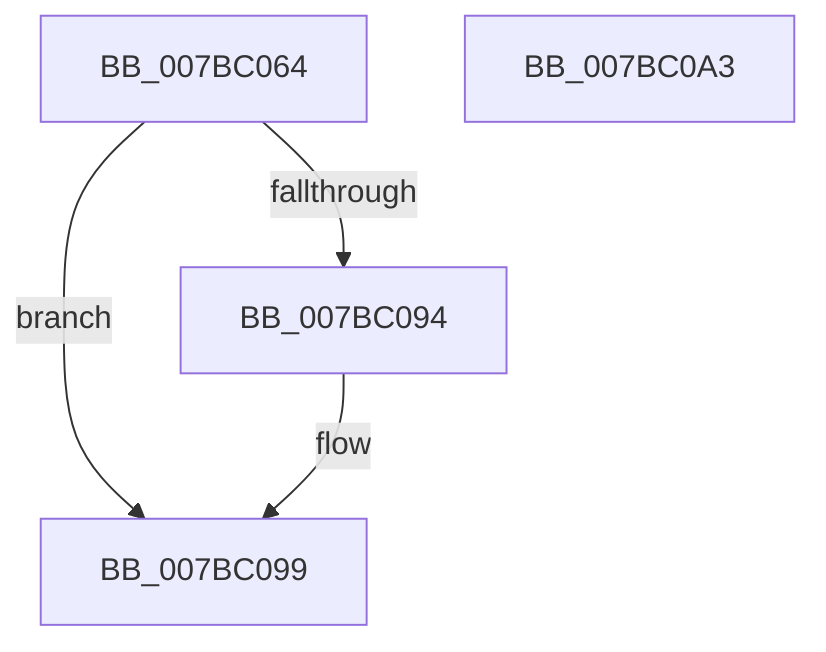

# EtwpPrepareWmitraceLoggerInfo

- RVA: `0x007BC064`–`0x007BC0A4` (길이 `64` bytes)
- VA: `0x00000001407BC064`
- 실행 섹션: `PAGE`
- PDB 이름 있음: `예`; PDB Function 태그: `아니요`
- unwind 정보 RVA: `0x0005CF00`
- 디코드: `18`개 명령, `64/64` bytes 표시
- 미해석 바이트: `0` (있으면 어셈블리에 `.byte`로 보존)

> 이 문서는 커널 이미지의 기계어와 PDB 기호를 분석해 생성했습니다. 4번과 5번은 함수 원형과 자료형을 바이너리 사용 방식에서 추정한 C 해석이며 원본 소스 복구 결과는 아닙니다.

## 1. Dependencies

- 직접 호출 지점: **1**; 고유 호출 대상: **1**
- 직접 호출자로 확인된 함수: **1**
- RIP 상대 이미지 참조: **1**

### Outgoing calls
- `0x007BC075` → [memset](../../text/6C/memset_function_006C6C40.md) (function, `0x006C6C40`)

### Direct callers
- [EtwWmitraceWorker](EtwWmitraceWorker_function_007BBD3C.md) at `0x007BBE18`
- [EtwWmitraceWorker](EtwWmitraceWorker_function_007BBD3C.md) at `0x007BBEB1`
- [EtwWmitraceWorker](EtwWmitraceWorker_function_007BBD3C.md) at `0x007BBEF3`
- [EtwWmitraceWorker](EtwWmitraceWorker_function_007BBD3C.md) at `0x007BBF4F`

### Static image references
- `0x007BC087` → RVA `0x00EFF2C0` (`.data`; read)

## 2. Other-region calls and transfers

- 다른 실행 섹션으로 향하는 call: **1**
  - `0x007BC075` → [memset](../../text/6C/memset_function_006C6C40.md) (`PAGE` → `.text`)
- 별도 외부 분기/꼬리 이동을 확인하지 못했습니다.

## 3. Assembly (complete function range)

```asm
007BC064  40 53                           push rbx
007BC066  48 83 EC 20                     sub rsp, 0x20
007BC06A  33 D2                           xor edx, edx
007BC06C  41 B8 B0 00 00 00               mov r8d, 0xb0
007BC072  48 8B D9                        mov rbx, rcx
007BC075  E8 C6 AB F0 FF                  call 0x1406c6c40
007BC07A  C7 03 B0 00 00 00               mov dword ptr [rbx], 0xb0
007BC080  C7 43 2C 00 00 02 00            mov dword ptr [rbx + 0x2c], 0x20000
007BC087  8B 05 33 32 74 00               mov eax, dword ptr [rip + 0x743233]
007BC08D  85 C0                           test eax, eax
007BC08F  0F B7 C0                        movzx eax, ax
007BC092  75 05                           jne 0x1407bc099
007BC094  B8 FF FF 00 00                  mov eax, 0xffff
007BC099  66 89 43 08                     mov word ptr [rbx + 8], ax
007BC09D  48 83 C4 20                     add rsp, 0x20
007BC0A1  5B                              pop rbx
007BC0A2  C3                              ret
007BC0A3  CC                              int3
```

## 4. C-style interpretation (structured pseudocode)

```c
__int64 __fastcall EtwpPrepareWmitraceLoggerInfo(__int64 a1, int a2)
{
    __int64 result;
    __int64 v_rsp;

    v_rsp = (v_rsp) - (32);
    a2 = 0;
    result = memset(a1, a2, 176, a4);
    *(unsigned int *)(a1) = 176;
    *(unsigned int *)(a1 + 44) = 0x20000ULL;
    result = (unsigned __int16)((unsigned int)(*(unsigned int *)(v_rip + 7615027)));
    if ((unsigned int)((unsigned int)(*(unsigned int *)(v_rip + 7615027))) == 0) {
        result = 0xFFFFULL;
    }
    *(unsigned __int16 *)(a1 + 8) = (unsigned __int16)(result);
    v_rsp = (v_rsp) + (32);
    return result;
}
```

## 5. (Beta) C Style

```c
int64_t EtwpPrepareWmitraceLoggerInfo(void *Arg1, int32_t Arg2)
{
    uint8_t *arg1 = (uint8_t *)Arg1;

    int64_t result;
    int64_t local_rsp;

    local_rsp = (local_rsp) - (32);
    Arg2 = 0;
    result = memset(Arg1, Arg2, 176, a4);
    *(uint32_t *)(arg1) = 176;
    *(uint32_t *)(arg1 + 0x2C) = 0x20000ULL;
    result = (uint16_t)((uint32_t)(*(uint32_t *)(v_rip + 0x743233)));
    if ((uint32_t)((uint32_t)(*(uint32_t *)(v_rip + 0x743233))) == 0) {
        result = 0xFFFFULL;
    }
    *(uint16_t *)(arg1 + 0x8) = (uint16_t)(result);
    local_rsp = (local_rsp) + (32);
    return result;
}
```

### 관측된 메모리 오프셋

구조체 형식이 확인되지 않은 접근은 인자 기준의 오프셋으로만 기록했습니다.

| 기준 인자 | 오프셋 표현 | 폭 (bit) | 접근 |
|---|---:|---:|---|
| `Arg1` | `+ 0x0` | `32` | `W` |
| `Arg1` | `+ 0x8` | `16` | `W` |
| `Arg1` | `+ 0x2C` | `32` | `W` |

## 6. Execution-region graph

[열기: 2D/3D 그래프와 함수 탐색 컨트롤 패널](../../../control-panel.html?section=page&rva=0x007BC064&view=graph)

- 2D 그래프는 위에서 아래로 흐르고, 3D 그래프는 빈 공간을 드래그해 회전합니다. Shift+드래그는 이동, 휠은 확대·축소, 함수 노드 선택은 대상 보고서 이동입니다.

### Static fallback


