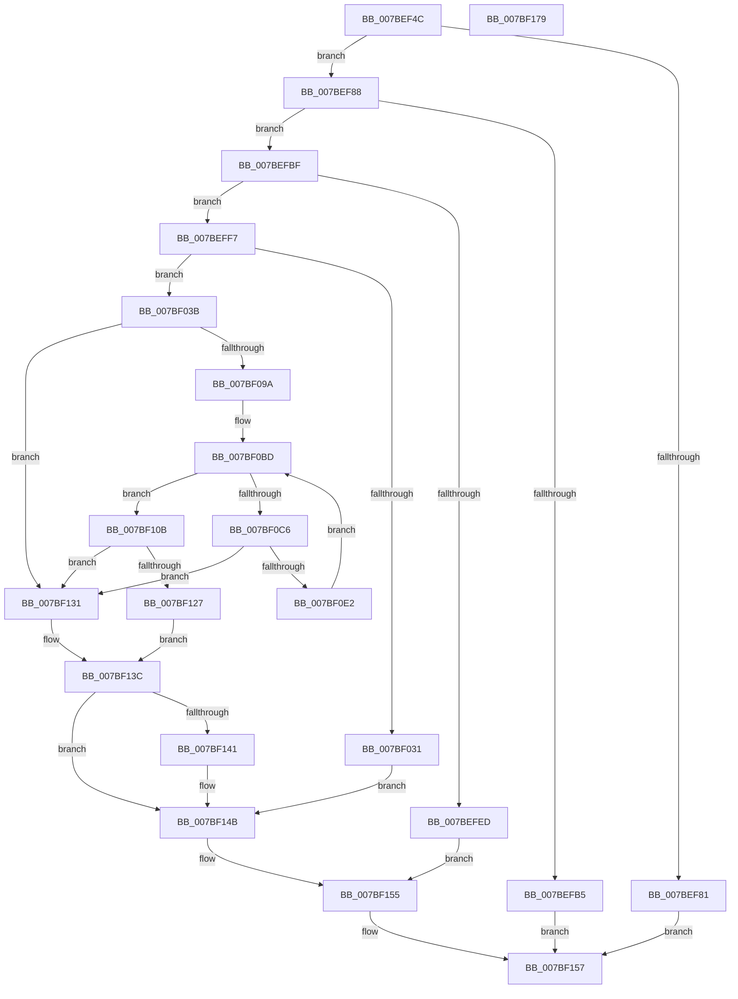

# EtwpPreserveLogger

- RVA: `0x007BEF4C`–`0x007BF17A` (길이 `558` bytes)
- VA: `0x00000001407BEF4C`
- 실행 섹션: `PAGE`
- PDB 이름 있음: `예`; PDB Function 태그: `아니요`
- unwind 정보 RVA: `0x000D3D44`
- 디코드: `147`개 명령, `558/558` bytes 표시
- 미해석 바이트: `0` (있으면 어셈블리에 `.byte`로 보존)

> 이 문서는 커널 이미지의 기계어와 PDB 기호를 분석해 생성했습니다. 4번과 5번은 함수 원형과 자료형을 바이너리 사용 방식에서 추정한 C 해석이며 원본 소스 복구 결과는 아닙니다.

## 1. Dependencies

- 직접 호출 지점: **12**; 고유 호출 대상: **10**
- 직접 호출자로 확인된 함수: **2**
- RIP 상대 이미지 참조: **0**

### Outgoing calls
- `0x007BEFE0` → [ExAllocatePool2](../../poolcode/B8/ExAllocatePool2_function_00B820F0.md) (function, `0x00B820F0`)
- `0x007BF019` → [memcpy](../../text/6C/memcpy_function_006C6840.md) (function, `0x006C6840`)
- `0x007BF024` → [EtwpAllocateTraceBuffer](../../text/3E/EtwpAllocateTraceBuffer_function_003EB070.md) (function, `0x003EB070`)
- `0x007BF041` → [EtwpInitializeBufferHeader](../../text/3E/EtwpInitializeBufferHeader_function_003EB010.md) (function, `0x003EB010`)
- `0x007BF04E` → [EtwpResetBufferHeader](../../text/3E/EtwpResetBufferHeader_function_003EB558.md) (function, `0x003EB558`)
- `0x007BF068` → [EtwpAddLogHeader](../9C/EtwpAddLogHeader_function_009C0BD0.md) (function, `0x009C0BD0`)
- `0x007BF08B` → [EtwpBuildMdlForTraceBuffer](EtwpBuildMdlForTraceBuffer_function_007BEB50.md) (function, `0x007BEB50`)
- `0x007BF0D5` → [EtwpBuildMdlForTraceBuffer](EtwpBuildMdlForTraceBuffer_function_007BEB50.md) (function, `0x007BEB50`)
- `0x007BF11C` → [EtwpPreserveMdlList](EtwpPreserveMdlList_function_007BF180.md) (function, `0x007BF180`)
- `0x007BF137` → [EtwpFreeTraceBuffer](../../text/3E/EtwpFreeTraceBuffer_function_003EB978.md) (function, `0x003EB978`)
- `0x007BF146` → [ExFreePoolWithTag](../../poolcode/B8/ExFreePoolWithTag_function_00B82870.md) (function, `0x00B82870`)
- `0x007BF150` → [ExFreePoolWithTag](../../poolcode/B8/ExFreePoolWithTag_function_00B82870.md) (function, `0x00B82870`)

### Direct callers
- [EtwpKsrCallback](EtwpKsrCallback_function_007BEE10.md) at `0x007BEEDA`
- [EtwpSetSoftRestartInformation](../A5/EtwpSetSoftRestartInformation_function_00A53DB8.md) at `0x00A53F5D`

### Static image references
- 디코드된 RIP-relative 메모리 참조가 없습니다.

## 2. Other-region calls and transfers

- 다른 실행 섹션으로 향하는 call: **8**
  - `0x007BEFE0` → [ExAllocatePool2](../../poolcode/B8/ExAllocatePool2_function_00B820F0.md) (`PAGE` → `POOLCODE`)
  - `0x007BF019` → [memcpy](../../text/6C/memcpy_function_006C6840.md) (`PAGE` → `.text`)
  - `0x007BF024` → [EtwpAllocateTraceBuffer](../../text/3E/EtwpAllocateTraceBuffer_function_003EB070.md) (`PAGE` → `.text`)
  - `0x007BF041` → [EtwpInitializeBufferHeader](../../text/3E/EtwpInitializeBufferHeader_function_003EB010.md) (`PAGE` → `.text`)
  - `0x007BF04E` → [EtwpResetBufferHeader](../../text/3E/EtwpResetBufferHeader_function_003EB558.md) (`PAGE` → `.text`)
  - `0x007BF137` → [EtwpFreeTraceBuffer](../../text/3E/EtwpFreeTraceBuffer_function_003EB978.md) (`PAGE` → `.text`)
  - `0x007BF146` → [ExFreePoolWithTag](../../poolcode/B8/ExFreePoolWithTag_function_00B82870.md) (`PAGE` → `POOLCODE`)
  - `0x007BF150` → [ExFreePoolWithTag](../../poolcode/B8/ExFreePoolWithTag_function_00B82870.md) (`PAGE` → `POOLCODE`)
- 별도 외부 분기/꼬리 이동을 확인하지 못했습니다.

## 3. Assembly (complete function range)

```asm
007BEF4C  48 8B C4                        mov rax, rsp
007BEF4F  48 89 58 20                     mov qword ptr [rax + 0x20], rbx
007BEF53  55                              push rbp
007BEF54  56                              push rsi
007BEF55  57                              push rdi
007BEF56  41 54                           push r12
007BEF58  41 55                           push r13
007BEF5A  41 56                           push r14
007BEF5C  41 57                           push r15
007BEF5E  48 83 EC 50                     sub rsp, 0x50
007BEF62  48 8B A9 48 05 00 00            mov rbp, qword ptr [rcx + 0x548]
007BEF69  45 33 E4                        xor r12d, r12d
007BEF6C  0F 29 70 B8                     movaps xmmword ptr [rax - 0x48], xmm6
007BEF70  48 8B D9                        mov rbx, rcx
007BEF73  0F 29 78 A8                     movaps xmmword ptr [rax - 0x58], xmm7
007BEF77  4C 89 60 10                     mov qword ptr [rax + 0x10], r12
007BEF7B  44 38 65 21                     cmp byte ptr [rbp + 0x21], r12b
007BEF7F  74 07                           je 0x1407bef88
007BEF81  33 C0                           xor eax, eax
007BEF83  E9 CF 01 00 00                  jmp 0x1407bf157
007BEF88  44 8B 71 04                     mov r14d, dword ptr [rcx + 4]
007BEF8C  48 B8 00 F0 FF FF FF 0F 00 00   movabs rax, 0xffffffff000
007BEF96  8B 89 E8 00 00 00               mov ecx, dword ptr [rcx + 0xe8]
007BEF9C  4D 8B FC                        mov r15, r12
007BEF9F  0F 10 7D 10                     movups xmm7, xmmword ptr [rbp + 0x10]
007BEFA3  FF C1                           inc ecx
007BEFA5  49 0F AF CE                     imul rcx, r14
007BEFA9  48 81 E1 00 F0 FF FF            and rcx, 0xfffffffffffff000
007BEFB0  48 3B C8                        cmp rcx, rax
007BEFB3  76 0A                           jbe 0x1407befbf
007BEFB5  B8 BB 00 00 C0                  mov eax, 0xc00000bb
007BEFBA  E9 98 01 00 00                  jmp 0x1407bf157
007BEFBF  66 0F 7E F8                     movd eax, xmm7
007BEFC3  B9 00 01 00 00                  mov ecx, 0x100
007BEFC8  41 B8 45 74 77 4B               mov r8d, 0x4b777445
007BEFCE  0F B7 F8                        movzx edi, ax
007BEFD1  83 C7 02                        add edi, 2
007BEFD4  8D 47 10                        lea eax, [rdi + 0x10]
007BEFD7  8B D0                           mov edx, eax
007BEFD9  89 84 24 90 00 00 00            mov dword ptr [rsp + 0x90], eax
007BEFE0  E8 0B 31 3C 00                  call 0x140b820f0
007BEFE5  48 8B F0                        mov rsi, rax
007BEFE8  48 85 C0                        test rax, rax
007BEFEB  75 0A                           jne 0x1407beff7
007BEFED  BF 9A 00 00 C0                  mov edi, 0xc000009a
007BEFF2  E9 5E 01 00 00                  jmp 0x1407bf155
007BEFF7  8B 43 04                        mov eax, dword ptr [rbx + 4]
007BEFFA  48 8D 4E 10                     lea rcx, [rsi + 0x10]
007BEFFE  66 0F 6F C7                     movdqa xmm0, xmm7
007BF002  44 8B C7                        mov r8d, edi
007BF005  66 0F 73 D8 08                  psrldq xmm0, 8
007BF00A  66 48 0F 7E C2                  movq rdx, xmm0
007BF00F  89 46 08                        mov dword ptr [rsi + 8], eax
007BF012  C7 46 0C 10 00 00 00            mov dword ptr [rsi + 0xc], 0x10
007BF019  E8 22 78 F0 FF                  call 0x1406c6840
007BF01E  41 8B D6                        mov edx, r14d
007BF021  48 8B CB                        mov rcx, rbx
007BF024  E8 47 C0 C2 FF                  call 0x1403eb070
007BF029  4C 8B E8                        mov r13, rax
007BF02C  48 85 C0                        test rax, rax
007BF02F  75 0A                           jne 0x1407bf03b
007BF031  BF 17 00 00 C0                  mov edi, 0xc0000017
007BF036  E9 10 01 00 00                  jmp 0x1407bf14b
007BF03B  49 8B D5                        mov rdx, r13
007BF03E  48 8B CB                        mov rcx, rbx
007BF041  E8 CA BF C2 FF                  call 0x1403eb010
007BF046  BA 04 00 00 00                  mov edx, 4
007BF04B  49 8B CD                        mov rcx, r13
007BF04E  E8 05 C5 C2 FF                  call 0x1403eb558
007BF053  0F 10 B3 98 00 00 00            movups xmm6, xmmword ptr [rbx + 0x98]
007BF05A  49 8B D5                        mov rdx, r13
007BF05D  48 8B CB                        mov rcx, rbx
007BF060  F3 0F 7F BB 98 00 00 00         movdqu xmmword ptr [rbx + 0x98], xmm7
007BF068  E8 63 1B 20 00                  call 0x1409c0bd0
007BF06D  41 8B 45 30                     mov eax, dword ptr [r13 + 0x30]
007BF071  4C 8D 84 24 98 00 00 00         lea r8, [rsp + 0x98]
007BF079  41 89 45 08                     mov dword ptr [r13 + 8], eax
007BF07D  49 8B D5                        mov rdx, r13
007BF080  48 8B CB                        mov rcx, rbx
007BF083  F3 0F 7F B3 98 00 00 00         movdqu xmmword ptr [rbx + 0x98], xmm6
007BF08B  E8 C0 FA FF FF                  call 0x1407beb50
007BF090  8B F8                           mov edi, eax
007BF092  85 C0                           test eax, eax
007BF094  0F 88 97 00 00 00               js 0x1407bf131
007BF09A  FF 46 04                        inc dword ptr [rsi + 4]
007BF09D  4C 8D 63 50                     lea r12, [rbx + 0x50]
007BF0A1  4D 8B 34 24                     mov r14, qword ptr [r12]
007BF0A5  BA 00 00 00 00                  mov edx, 0
007BF0AA  4C 8B BC 24 98 00 00 00         mov r15, qword ptr [rsp + 0x98]
007BF0B2  4D 3B F4                        cmp r14, r12
007BF0B5  4C 89 BC 24 A0 00 00 00         mov qword ptr [rsp + 0xa0], r15
007BF0BD  4C 0F 44 F2                     cmove r14, rdx
007BF0C1  4D 85 F6                        test r14, r14
007BF0C4  74 45                           je 0x1407bf10b
007BF0C6  49 8B 56 10                     mov rdx, qword ptr [r14 + 0x10]
007BF0CA  4C 8D 84 24 98 00 00 00         lea r8, [rsp + 0x98]
007BF0D2  48 8B CB                        mov rcx, rbx
007BF0D5  E8 76 FA FF FF                  call 0x1407beb50
007BF0DA  33 D2                           xor edx, edx
007BF0DC  8B F8                           mov edi, eax
007BF0DE  85 C0                           test eax, eax
007BF0E0  78 4F                           js 0x1407bf131
007BF0E2  48 8B 84 24 98 00 00 00         mov rax, qword ptr [rsp + 0x98]
007BF0EA  48 8B 8C 24 A0 00 00 00         mov rcx, qword ptr [rsp + 0xa0]
007BF0F2  48 89 84 24 A0 00 00 00         mov qword ptr [rsp + 0xa0], rax
007BF0FA  48 89 01                        mov qword ptr [rcx], rax
007BF0FD  FF 46 04                        inc dword ptr [rsi + 4]
007BF100  49 8B 06                        mov rax, qword ptr [r14]
007BF103  4C 8B F0                        mov r14, rax
007BF106  49 3B C4                        cmp rax, r12
007BF109  EB B2                           jmp 0x1407bf0bd
007BF10B  44 8B 84 24 90 00 00 00         mov r8d, dword ptr [rsp + 0x90]
007BF113  4C 8B CD                        mov r9, rbp
007BF116  48 8B D6                        mov rdx, rsi
007BF119  49 8B CF                        mov rcx, r15
007BF11C  E8 5F 00 00 00                  call 0x1407bf180
007BF121  8B F8                           mov edi, eax
007BF123  85 C0                           test eax, eax
007BF125  78 0A                           js 0x1407bf131
007BF127  4C 89 6D 08                     mov qword ptr [rbp + 8], r13
007BF12B  C6 45 21 01                     mov byte ptr [rbp + 0x21], 1
007BF12F  EB 0B                           jmp 0x1407bf13c
007BF131  49 8B D5                        mov rdx, r13
007BF134  48 8B CB                        mov rcx, rbx
007BF137  E8 3C C8 C2 FF                  call 0x1403eb978
007BF13C  4D 85 FF                        test r15, r15
007BF13F  74 0A                           je 0x1407bf14b
007BF141  33 D2                           xor edx, edx
007BF143  49 8B CF                        mov rcx, r15
007BF146  E8 25 37 3C 00                  call 0x140b82870
007BF14B  33 D2                           xor edx, edx
007BF14D  48 8B CE                        mov rcx, rsi
007BF150  E8 1B 37 3C 00                  call 0x140b82870
007BF155  8B C7                           mov eax, edi
007BF157  48 8B 9C 24 A8 00 00 00         mov rbx, qword ptr [rsp + 0xa8]
007BF15F  0F 28 74 24 40                  movaps xmm6, xmmword ptr [rsp + 0x40]
007BF164  0F 28 7C 24 30                  movaps xmm7, xmmword ptr [rsp + 0x30]
007BF169  48 83 C4 50                     add rsp, 0x50
007BF16D  41 5F                           pop r15
007BF16F  41 5E                           pop r14
007BF171  41 5D                           pop r13
007BF173  41 5C                           pop r12
007BF175  5F                              pop rdi
007BF176  5E                              pop rsi
007BF177  5D                              pop rbp
007BF178  C3                              ret
007BF179  CC                              int3
```

## 4. C-style interpretation (structured pseudocode)

```c
__int64 __fastcall EtwpPreserveLogger(__int64 a1)
{
    __int64 result;
    __int64 v_r12;
    __int64 v_r14;
    __int64 v_rdi;
    __int64 v_rsp;
    unsigned __int64 v_stack_m48;
    unsigned __int64 v_stack_m58;
    unsigned __int64 v_stack_p10;
    unsigned __int64 v_stack_p18;
    unsigned __int64 v_stack_p20;
    unsigned int v_stack_p8;

    *(unsigned __int64 *)(v_rsp + 32) = v_rbx;
    v_rsp = (v_rsp) - (80);
    v_r12 = 0;
    *(unsigned __int64 *)(v_rsp - 72) = v_xmm6;
    *(unsigned __int64 *)(v_rsp - 88) = v_xmm7;
    *(unsigned __int64 *)(v_rsp + 16) = 0;
    if ((*(unsigned __int8 *)(*(unsigned __int64 *)(a1 + 1352) + 33)) == 0) goto loc_007BEF88;
    result = 0;
    goto loc_007BF157;
loc_007BEF88:
    a1 = (unsigned int)(((unsigned int)(*(unsigned int *)(a1 + 232))) + 1);
    a1 = (a1) * ((unsigned int)(*(unsigned int *)(a1 + 4)));
    a1 = (a1) & (0xFFFFFFFFFFFFF000ULL);
    if (a1 <= 0) goto loc_007BEFBF;
    goto loc_007BF157;
loc_007BEFBF:
    v_rdi = (unsigned int)(((unsigned __int16)((unsigned int)(0xC00000BBULL))) + (2));
    v_stack_p8 = (unsigned int)(v_rdi + 16);
    result = ExAllocatePool2(256, (unsigned int)((unsigned int)(v_rdi + 16)), (unsigned int)(0x4B777445ULL), a4);
    if (result != 0) goto loc_007BEFF7;
    goto loc_007BF155;
loc_007BEFF7:
    *(unsigned int *)(result + 8) = (unsigned int)((unsigned int)(*(unsigned int *)(a1 + 4)));
    *(unsigned int *)(result + 12) = 16;
    result = memcpy(result + 16, (unsigned int)((unsigned int)(v_rdi + 16)), (unsigned int)((unsigned int)((unsigned int)(0xC000009AULL))), a4);
    result = EtwpAllocateTraceBuffer(a1, (unsigned int)((unsigned int)((unsigned int)(*(unsigned int *)(a1 + 4)))), (unsigned int)((unsigned int)((unsigned int)(0xC000009AULL))), a4);
    if (result != 0) goto loc_007BF03B;
    goto loc_007BF14B;
loc_007BF03B:
    result = EtwpInitializeBufferHeader(a1, result, (unsigned int)((unsigned int)((unsigned int)(0xC000009AULL))), a4);
    result = EtwpResetBufferHeader(result, 4, (unsigned int)((unsigned int)((unsigned int)(0xC000009AULL))), a4);
    *(unsigned __int64 *)(a1 + 152) = v_xmm7;
    result = EtwpAddLogHeader(a1, result, (unsigned int)((unsigned int)((unsigned int)(0xC000009AULL))), a4);
    *(unsigned int *)(result + 8) = (unsigned int)((unsigned int)(*(unsigned int *)(result + 48)));
    *(unsigned __int64 *)(a1 + 152) = v_xmm6;
    result = EtwpBuildMdlForTraceBuffer(a1, result, v_stack_p10, a4);
    if (sign_flag) goto loc_007BF131;
    v_stack_p18 = v_stack_p10;
loc_007BF0BD:
    v_r14 = *(unsigned __int64 *)(a1 + 80);
    if ((*(unsigned __int64 *)(a1 + 80)) == (a1 + 80)) { v_r14 = 0; }
    if (v_r14 == 0) goto loc_007BF10B;
    result = EtwpBuildMdlForTraceBuffer(a1, *(unsigned __int64 *)(v_r14 + 16), v_stack_p10, a4);
    a2 = 0;
    if (sign_flag) goto loc_007BF131;
    v_stack_p18 = v_stack_p10;
    *(unsigned __int64 *)(v_stack_p18) = v_stack_p10;
    goto loc_007BF0BD;
loc_007BF10B:
    result = EtwpPreserveMdlList(v_stack_p10, result, (unsigned int)(v_stack_p8), *(unsigned __int64 *)(a1 + 1352));
    if (sign_flag) goto loc_007BF131;
    *(unsigned __int64 *)(*(unsigned __int64 *)(a1 + 1352) + 8) = result;
    *(unsigned __int8 *)(*(unsigned __int64 *)(a1 + 1352) + 33) = 1;
    goto loc_007BF13C;
loc_007BF131:
    result = EtwpFreeTraceBuffer(a1, result, (unsigned int)(v_stack_p8), *(unsigned __int64 *)(a1 + 1352));
loc_007BF13C:
    if (v_stack_p10 != 0) {
        a2 = 0;
        a1 = v_stack_p10;
        result = ExFreePoolWithTag(a1, a2, (unsigned int)(v_stack_p8), *(unsigned __int64 *)(a1 + 1352));
    }
    a2 = 0;
    result = ExFreePoolWithTag(result, a2, (unsigned int)(v_stack_p8), *(unsigned __int64 *)(a1 + 1352));
loc_007BF155:
loc_007BF157:
    v_rsp = (v_rsp) + (80);
    return (unsigned int)((unsigned int)((unsigned int)((unsigned int)(result))));
}
```

## 5. (Beta) C Style

```c
int64_t EtwpPreserveLogger(void *Arg1)
{
    uint8_t *arg1 = (uint8_t *)Arg1;

    int64_t result;
    int64_t local_r12;
    int64_t local_r14;
    int64_t local_rdi;
    int64_t local_rsp;
    uint64_t v_stack_m48;
    uint64_t v_stack_m58;
    uint64_t v_stack_p10;
    uint64_t v_stack_p18;
    uint64_t v_stack_p20;
    uint32_t v_stack_p8;

    *(uint64_t *)(local_rsp + 0x20) = local_rbx;
    local_rsp = (local_rsp) - (80);
    local_r12 = 0;
    *(uint64_t *)(local_rsp - 0x48) = v_xmm6;
    *(uint64_t *)(local_rsp - 0x58) = v_xmm7;
    *(uint64_t *)(local_rsp + 0x10) = 0;
    if ((*(uint8_t *)(*(uint64_t *)(arg1 + 0x548) + 0x21)) == 0) goto loc_007BEF88;
    result = 0;
    goto loc_007BF157;
loc_007BEF88:
    Arg1 = (uint32_t)(((uint32_t)(*(uint32_t *)(arg1 + 0xE8))) + 1);
    Arg1 = (Arg1) * ((uint32_t)(*(uint32_t *)(arg1 + 0x4)));
    Arg1 = (Arg1) & (0xFFFFFFFFFFFFF000ULL);
    if (Arg1 <= 0) goto loc_007BEFBF;
    goto loc_007BF157;
loc_007BEFBF:
    local_rdi = (uint32_t)(((uint16_t)((uint32_t)(0xC00000BBULL))) + (2));
    v_stack_p8 = (uint32_t)(local_rdi + 16);
    result = ExAllocatePool2(256, (uint32_t)((uint32_t)(local_rdi + 16)), (uint32_t)(0x4B777445ULL), a4);
    if (result != 0) goto loc_007BEFF7;
    goto loc_007BF155;
loc_007BEFF7:
    *(uint32_t *)(result + 0x8) = (uint32_t)((uint32_t)(*(uint32_t *)(arg1 + 0x4)));
    *(uint32_t *)(result + 0xC) = 16;
    result = memcpy(result + 16, (uint32_t)((uint32_t)(local_rdi + 16)), (uint32_t)((uint32_t)((uint32_t)(0xC000009AULL))), a4);
    result = EtwpAllocateTraceBuffer(Arg1, (uint32_t)((uint32_t)((uint32_t)(*(uint32_t *)(arg1 + 0x4)))), (uint32_t)((uint32_t)((uint32_t)(0xC000009AULL))), a4);
    if (result != 0) goto loc_007BF03B;
    goto loc_007BF14B;
loc_007BF03B:
    result = EtwpInitializeBufferHeader(Arg1, result, (uint32_t)((uint32_t)((uint32_t)(0xC000009AULL))), a4);
    result = EtwpResetBufferHeader(result, 4, (uint32_t)((uint32_t)((uint32_t)(0xC000009AULL))), a4);
    *(uint64_t *)(arg1 + 0x98) = v_xmm7;
    result = EtwpAddLogHeader(Arg1, result, (uint32_t)((uint32_t)((uint32_t)(0xC000009AULL))), a4);
    *(uint32_t *)(result + 0x8) = (uint32_t)((uint32_t)(*(uint32_t *)(result + 0x30)));
    *(uint64_t *)(arg1 + 0x98) = v_xmm6;
    result = EtwpBuildMdlForTraceBuffer(Arg1, result, v_stack_p10, a4);
    if (sign_flag) goto loc_007BF131;
    v_stack_p18 = v_stack_p10;
loc_007BF0BD:
    local_r14 = *(uint64_t *)(arg1 + 0x50);
    if ((*(uint64_t *)(arg1 + 0x50)) == (Arg1 + 80)) { local_r14 = 0; }
    if (local_r14 == 0) goto loc_007BF10B;
    result = EtwpBuildMdlForTraceBuffer(Arg1, *(uint64_t *)(local_r14 + 0x10), v_stack_p10, a4);
    a2 = 0;
    if (sign_flag) goto loc_007BF131;
    v_stack_p18 = v_stack_p10;
    *(uint64_t *)(v_stack_p18) = v_stack_p10;
    goto loc_007BF0BD;
loc_007BF10B:
    result = EtwpPreserveMdlList(v_stack_p10, result, (uint32_t)(v_stack_p8), *(uint64_t *)(arg1 + 0x548));
    if (sign_flag) goto loc_007BF131;
    *(uint64_t *)(*(uint64_t *)(arg1 + 0x548) + 0x8) = result;
    *(uint8_t *)(*(uint64_t *)(arg1 + 0x548) + 0x21) = 1;
    goto loc_007BF13C;
loc_007BF131:
    result = EtwpFreeTraceBuffer(Arg1, result, (uint32_t)(v_stack_p8), *(uint64_t *)(arg1 + 0x548));
loc_007BF13C:
    if (v_stack_p10 != 0) {
        a2 = 0;
        Arg1 = v_stack_p10;
        result = ExFreePoolWithTag(Arg1, a2, (uint32_t)(v_stack_p8), *(uint64_t *)(arg1 + 0x548));
    }
    a2 = 0;
    result = ExFreePoolWithTag(result, a2, (uint32_t)(v_stack_p8), *(uint64_t *)(arg1 + 0x548));
loc_007BF155:
loc_007BF157:
    local_rsp = (local_rsp) + (80);
    return (uint32_t)((uint32_t)((uint32_t)((uint32_t)(result))));
}
```

### 관측된 메모리 오프셋

구조체 형식이 확인되지 않은 접근은 인자 기준의 오프셋으로만 기록했습니다.

| 기준 인자 | 오프셋 표현 | 폭 (bit) | 접근 |
|---|---:|---:|---|
| `Arg1` | `+ 0x0` | `64` | `R` |
| `Arg1` | `+ 0x4` | `32` | `R` |
| `Arg1` | `+ 0x50` | `64` | `R` |
| `Arg1` | `+ 0x98` | `128` | `R` |
| `Arg1` | `+ 0x98` | `128` | `W` |
| `Arg1` | `+ 0xE8` | `32` | `R` |
| `Arg1` | `+ 0x548` | `64` | `R` |

## 6. Execution-region graph

[열기: 2D/3D 그래프와 함수 탐색 컨트롤 패널](../../../control-panel.html?section=page&rva=0x007BEF4C&view=graph)

- 2D 그래프는 위에서 아래로 흐르고, 3D 그래프는 빈 공간을 드래그해 회전합니다. Shift+드래그는 이동, 휠은 확대·축소, 함수 노드 선택은 대상 보고서 이동입니다.

### Static fallback


