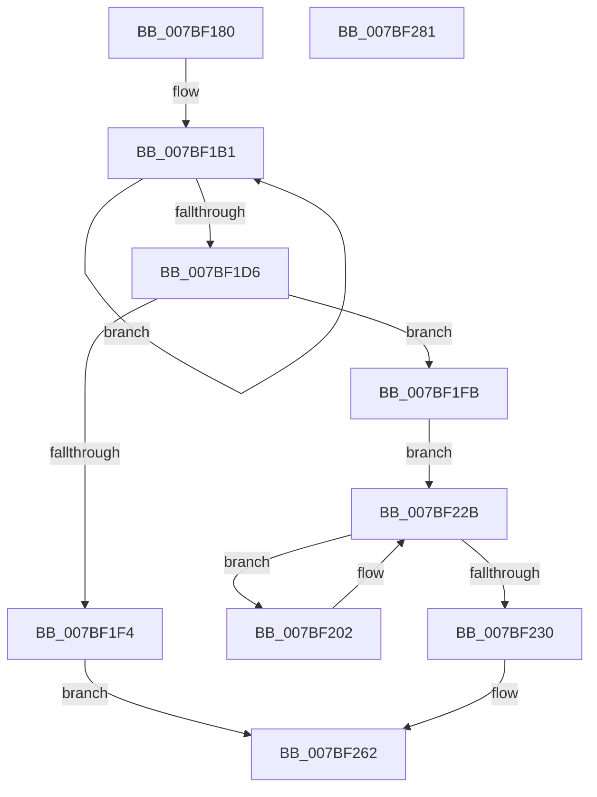

# EtwpPreserveMdlList

- RVA: `0x007BF180`–`0x007BF282` (길이 `258` bytes)
- VA: `0x00000001407BF180`
- 실행 섹션: `PAGE`
- PDB 이름 있음: `예`; PDB Function 태그: `아니요`
- unwind 정보 RVA: `0x0008C2BC`
- 디코드: `76`개 명령, `258/258` bytes 표시
- 미해석 바이트: `0` (있으면 어셈블리에 `.byte`로 보존)

> 이 문서는 커널 이미지의 기계어와 PDB 기호를 분석해 생성했습니다. 4번과 5번은 함수 원형과 자료형을 바이너리 사용 방식에서 추정한 C 해석이며 원본 소스 복구 결과는 아닙니다.

## 1. Dependencies

- 직접 호출 지점: **5**; 고유 호출 대상: **4**
- 직접 호출자로 확인된 함수: **1**
- RIP 상대 이미지 참조: **3**

### Outgoing calls
- `0x007BF1BE` → `ext-ms-win-ntos-ksr-l1-1-5.dll!KsrMdlToMemoryRuns` (import, 간접 대상; import `ext-ms-win-ntos-ksr-l1-1-5.dll!KsrMdlToMemoryRuns`)
- `0x007BF1E7` → [ExAllocatePool2](../../poolcode/B8/ExAllocatePool2_function_00B820F0.md) (function, `0x00B820F0`)
- `0x007BF210` → `ext-ms-win-ntos-ksr-l1-1-5.dll!KsrMdlToMemoryRuns` (import, 간접 대상; import `ext-ms-win-ntos-ksr-l1-1-5.dll!KsrMdlToMemoryRuns`)
- `0x007BF24A` → `ext-ms-win-ntos-ksr-l1-1-5.dll!KsrPersistMemoryWithMetadata` (import, 간접 대상; import `ext-ms-win-ntos-ksr-l1-1-5.dll!KsrPersistMemoryWithMetadata`)
- `0x007BF25D` → [ExFreePoolWithTag](../../poolcode/B8/ExFreePoolWithTag_function_00B82870.md) (function, `0x00B82870`)

### Direct callers
- [EtwpPreserveLogger](EtwpPreserveLogger_function_007BEF4C.md) at `0x007BF11C`

### Static image references
- `0x007BF1BE` → RVA `0x001512E8` (`ext-ms-win-ntos-ksr-l1-1-5.dll!KsrMdlToMemoryRuns (IAT)`; read)
- `0x007BF235` → RVA `0x00B4AEA0` (`EtwpKsrGuid`; read)
- `0x007BF24A` → RVA `0x00151310` (`ext-ms-win-ntos-ksr-l1-1-5.dll!KsrPersistMemoryWithMetadata (IAT)`; read)

## 2. Other-region calls and transfers

- 다른 실행 섹션으로 향하는 call: **2**
  - `0x007BF1E7` → [ExAllocatePool2](../../poolcode/B8/ExAllocatePool2_function_00B820F0.md) (`PAGE` → `POOLCODE`)
  - `0x007BF25D` → [ExFreePoolWithTag](../../poolcode/B8/ExFreePoolWithTag_function_00B82870.md) (`PAGE` → `POOLCODE`)
- 별도 외부 분기/꼬리 이동을 확인하지 못했습니다.

## 3. Assembly (complete function range)

```asm
007BF180  48 8B C4                        mov rax, rsp
007BF183  48 89 58 10                     mov qword ptr [rax + 0x10], rbx
007BF187  48 89 68 18                     mov qword ptr [rax + 0x18], rbp
007BF18B  48 89 70 20                     mov qword ptr [rax + 0x20], rsi
007BF18F  57                              push rdi
007BF190  41 54                           push r12
007BF192  41 55                           push r13
007BF194  41 56                           push r14
007BF196  41 57                           push r15
007BF198  48 83 EC 30                     sub rsp, 0x30
007BF19C  83 60 08 00                     and dword ptr [rax + 8], 0
007BF1A0  4D 8B F9                        mov r15, r9
007BF1A3  33 DB                           xor ebx, ebx
007BF1A5  45 8B E0                        mov r12d, r8d
007BF1A8  4C 8B EA                        mov r13, rdx
007BF1AB  48 8B F1                        mov rsi, rcx
007BF1AE  48 8B F9                        mov rdi, rcx
007BF1B1  4C 8D 4C 24 60                  lea r9, [rsp + 0x60]
007BF1B6  45 33 C0                        xor r8d, r8d
007BF1B9  33 D2                           xor edx, edx
007BF1BB  48 8B CF                        mov rcx, rdi
007BF1BE  48 FF 15 23 21 99 FF            call qword ptr [rip - 0x66dedd]
007BF1C5  0F 1F 44 00 00                  nop dword ptr [rax + rax]
007BF1CA  03 5C 24 60                     add ebx, dword ptr [rsp + 0x60]
007BF1CE  48 8B 3F                        mov rdi, qword ptr [rdi]
007BF1D1  48 85 FF                        test rdi, rdi
007BF1D4  75 DB                           jne 0x1407bf1b1
007BF1D6  8B D3                           mov edx, ebx
007BF1D8  B9 00 01 00 00                  mov ecx, 0x100
007BF1DD  48 C1 E2 03                     shl rdx, 3
007BF1E1  41 B8 45 74 77 4B               mov r8d, 0x4b777445
007BF1E7  E8 04 2F 3C 00                  call 0x140b820f0
007BF1EC  48 8B F8                        mov rdi, rax
007BF1EF  48 85 C0                        test rax, rax
007BF1F2  75 07                           jne 0x1407bf1fb
007BF1F4  BB 17 00 00 C0                  mov ebx, 0xc0000017
007BF1F9  EB 67                           jmp 0x1407bf262
007BF1FB  4C 8B F7                        mov r14, rdi
007BF1FE  8B EB                           mov ebp, ebx
007BF200  EB 29                           jmp 0x1407bf22b
007BF202  4C 8D 4C 24 60                  lea r9, [rsp + 0x60]
007BF207  44 8B C5                        mov r8d, ebp
007BF20A  49 8B D6                        mov rdx, r14
007BF20D  48 8B CE                        mov rcx, rsi
007BF210  48 FF 15 D1 20 99 FF            call qword ptr [rip - 0x66df2f]
007BF217  0F 1F 44 00 00                  nop dword ptr [rax + rax]
007BF21C  8B 44 24 60                     mov eax, dword ptr [rsp + 0x60]
007BF220  2B 6C 24 60                     sub ebp, dword ptr [rsp + 0x60]
007BF224  48 8B 36                        mov rsi, qword ptr [rsi]
007BF227  4D 8D 34 C6                     lea r14, [r14 + rax*8]
007BF22B  48 85 F6                        test rsi, rsi
007BF22E  75 D2                           jne 0x1407bf202
007BF230  4C 89 7C 24 28                  mov qword ptr [rsp + 0x28], r15
007BF235  48 8D 0D 64 BC 38 00            lea rcx, [rip + 0x38bc64]
007BF23C  4D 8B CD                        mov r9, r13
007BF23F  44 89 64 24 20                  mov dword ptr [rsp + 0x20], r12d
007BF244  44 8B C3                        mov r8d, ebx
007BF247  48 8B D7                        mov rdx, rdi
007BF24A  48 FF 15 BF 20 99 FF            call qword ptr [rip - 0x66df41]
007BF251  0F 1F 44 00 00                  nop dword ptr [rax + rax]
007BF256  8B D8                           mov ebx, eax
007BF258  33 D2                           xor edx, edx
007BF25A  48 8B CF                        mov rcx, rdi
007BF25D  E8 0E 36 3C 00                  call 0x140b82870
007BF262  48 8B 6C 24 70                  mov rbp, qword ptr [rsp + 0x70]
007BF267  8B C3                           mov eax, ebx
007BF269  48 8B 5C 24 68                  mov rbx, qword ptr [rsp + 0x68]
007BF26E  48 8B 74 24 78                  mov rsi, qword ptr [rsp + 0x78]
007BF273  48 83 C4 30                     add rsp, 0x30
007BF277  41 5F                           pop r15
007BF279  41 5E                           pop r14
007BF27B  41 5D                           pop r13
007BF27D  41 5C                           pop r12
007BF27F  5F                              pop rdi
007BF280  C3                              ret
007BF281  CC                              int3
```

## 4. C-style interpretation (structured pseudocode)

```c
__int64 __fastcall EtwpPreserveMdlList(__int64 a1, __int64 a2, int a3, __int64 a4)
{
    __int64 result;
    __int64 v_rbp;
    __int64 v_rbx;
    __int64 v_rsp;
    unsigned __int64 v_stack_m30;
    unsigned int v_stack_m38;
    unsigned __int64 v_stack_p10;
    unsigned __int64 v_stack_p18;
    unsigned __int64 v_stack_p20;
    unsigned __int64 v_stack_p8;

    *(unsigned __int64 *)(v_rsp + 16) = v_rbx;
    *(unsigned __int64 *)(v_rsp + 24) = v_rbp;
    *(unsigned __int64 *)(v_rsp + 32) = v_rsi;
    v_rsp = (v_rsp) - (48);
    v_rbx = 0;
loc_007BF1B1:
    a3 = 0;
    a2 = 0;
    result = ext_ms_win_ntos_ksr_l1_1_5_dll_KsrMdlToMemoryRuns(a1, a2, a3, v_stack_p8);
    v_rbx = (unsigned int)((v_rbx) + (v_stack_p8));
    if (*(unsigned __int64 *)(a1) != 0) goto loc_007BF1B1;
    a2 = ((unsigned int)((unsigned int)(v_rbx))) << (3);
    result = ExAllocatePool2(256, a2, (unsigned int)(0x4B777445ULL), v_stack_p8);
    if (result != 0) goto loc_007BF1FB;
    goto loc_007BF262;
loc_007BF1FB:
    goto loc_007BF22B;
loc_007BF202:
    result = ext_ms_win_ntos_ksr_l1_1_5_dll_KsrMdlToMemoryRuns(a1, result, (unsigned int)((unsigned int)((unsigned int)((unsigned int)((unsigned int)(0xC0000017ULL))))), v_stack_p8);
    v_rbp = (unsigned int)(((unsigned int)((unsigned int)((unsigned int)(0xC0000017ULL)))) - (v_stack_p8));
loc_007BF22B:
    if (*(unsigned __int64 *)(a1) != 0) goto loc_007BF202;
    v_stack_m30 = a4;
    v_stack_m38 = (unsigned int)((unsigned int)(a3));
    result = ext_ms_win_ntos_ksr_l1_1_5_dll_KsrPersistMemoryWithMetadata(v_rip + 3718244, result, (unsigned int)((unsigned int)((unsigned int)(0xC0000017ULL))), a2);
    a2 = 0;
    result = ExFreePoolWithTag(result, a2, (unsigned int)((unsigned int)((unsigned int)(0xC0000017ULL))), a2);
loc_007BF262:
    v_rsp = (v_rsp) + (48);
    return (unsigned int)((unsigned int)((unsigned int)((unsigned int)(result))));
}
```

## 5. (Beta) C Style

```c
int64_t EtwpPreserveMdlList(int64_t Arg1, int64_t Arg2, int32_t Arg3, int64_t Arg4)
{
    int64_t result;
    int64_t local_rbp;
    int64_t local_rbx;
    int64_t local_rsp;
    uint64_t v_stack_m30;
    uint32_t v_stack_m38;
    uint64_t v_stack_p10;
    uint64_t v_stack_p18;
    uint64_t v_stack_p20;
    uint64_t v_stack_p8;

    *(uint64_t *)(local_rsp + 0x10) = local_rbx;
    *(uint64_t *)(local_rsp + 0x18) = local_rbp;
    *(uint64_t *)(local_rsp + 0x20) = local_rsi;
    local_rsp = (local_rsp) - (48);
    local_rbx = 0;
loc_007BF1B1:
    Arg3 = 0;
    Arg2 = 0;
    result = kernel_indirect_call(Arg1, Arg2, Arg3, v_stack_p8);
    local_rbx = (uint32_t)((local_rbx) + (v_stack_p8));
    if (*(uint64_t *)(Arg1) != 0) goto loc_007BF1B1;
    Arg2 = ((uint32_t)((uint32_t)(local_rbx))) << (3);
    result = ExAllocatePool2(256, Arg2, (uint32_t)(0x4B777445ULL), v_stack_p8);
    if (result != 0) goto loc_007BF1FB;
    goto loc_007BF262;
loc_007BF1FB:
    goto loc_007BF22B;
loc_007BF202:
    result = kernel_indirect_call(Arg1, result, (uint32_t)((uint32_t)((uint32_t)((uint32_t)((uint32_t)(0xC0000017ULL))))), v_stack_p8);
    local_rbp = (uint32_t)(((uint32_t)((uint32_t)((uint32_t)(0xC0000017ULL)))) - (v_stack_p8));
loc_007BF22B:
    if (*(uint64_t *)(Arg1) != 0) goto loc_007BF202;
    v_stack_m30 = Arg4;
    v_stack_m38 = (uint32_t)((uint32_t)(Arg3));
    result = kernel_indirect_call(v_rip + 3718244, result, (uint32_t)((uint32_t)((uint32_t)(0xC0000017ULL))), Arg2);
    Arg2 = 0;
    result = ExFreePoolWithTag(result, Arg2, (uint32_t)((uint32_t)((uint32_t)(0xC0000017ULL))), Arg2);
loc_007BF262:
    local_rsp = (local_rsp) + (48);
    return (uint32_t)((uint32_t)((uint32_t)((uint32_t)(result))));
}
```

## 6. Execution-region graph

[열기: 2D/3D 그래프와 함수 탐색 컨트롤 패널](../../../control-panel.html?section=page&rva=0x007BF180&view=graph)

- 2D 그래프는 위에서 아래로 흐르고, 3D 그래프는 빈 공간을 드래그해 회전합니다. Shift+드래그는 이동, 휠은 확대·축소, 함수 노드 선택은 대상 보고서 이동입니다.

### Static fallback


