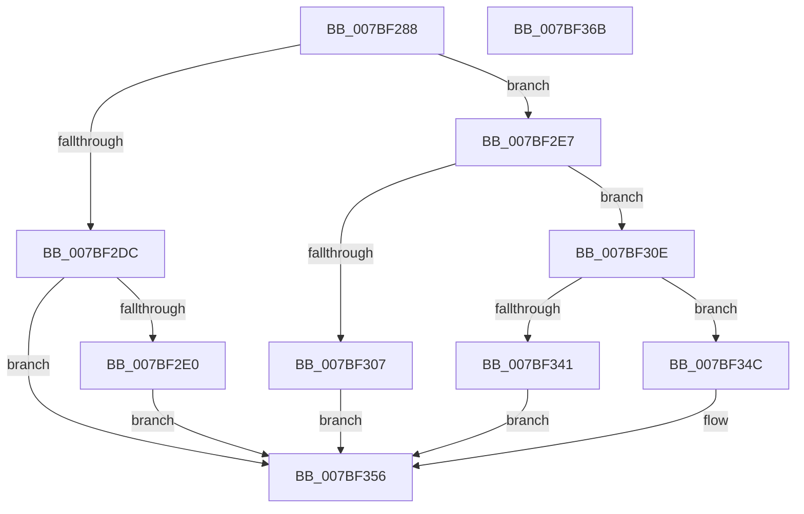

# EtwpQueryPersistedMemory

- RVA: `0x007BF288`–`0x007BF36C` (길이 `228` bytes)
- VA: `0x00000001407BF288`
- 실행 섹션: `PAGE`
- PDB 이름 있음: `예`; PDB Function 태그: `아니요`
- unwind 정보 RVA: `0x000D038C`
- 디코드: `65`개 명령, `228/228` bytes 표시
- 미해석 바이트: `0` (있으면 어셈블리에 `.byte`로 보존)

> 이 문서는 커널 이미지의 기계어와 PDB 기호를 분석해 생성했습니다. 4번과 5번은 함수 원형과 자료형을 바이너리 사용 방식에서 추정한 C 해석이며 원본 소스 복구 결과는 아닙니다.

## 1. Dependencies

- 직접 호출 지점: **4**; 고유 호출 대상: **3**
- 직접 호출자로 확인된 함수: **1**
- RIP 상대 이미지 참조: **2**

### Outgoing calls
- `0x007BF2C7` → `ext-ms-win-ntos-ksr-l1-1-5.dll!KsrClaimPersistedMemory` (import, 간접 대상; import `ext-ms-win-ntos-ksr-l1-1-5.dll!KsrClaimPersistedMemory`)
- `0x007BF2FA` → [ExAllocatePool2](../../poolcode/B8/ExAllocatePool2_function_00B820F0.md) (function, `0x00B820F0`)
- `0x007BF32F` → `ext-ms-win-ntos-ksr-l1-1-5.dll!KsrClaimPersistedMemory` (import, 간접 대상; import `ext-ms-win-ntos-ksr-l1-1-5.dll!KsrClaimPersistedMemory`)
- `0x007BF351` → [ExFreePoolWithTag](../../poolcode/B8/ExFreePoolWithTag_function_00B82870.md) (function, `0x00B82870`)

### Direct callers
- [EtwpSavePersistedLogger](EtwpSavePersistedLogger_function_007BF374.md) at `0x007BF4A7`

### Static image references
- `0x007BF2B4` → RVA `0x00B4AEA0` (`EtwpKsrGuid`; read)
- `0x007BF2C7` → RVA `0x001512F0` (`ext-ms-win-ntos-ksr-l1-1-5.dll!KsrClaimPersistedMemory (IAT)`; read)

## 2. Other-region calls and transfers

- 다른 실행 섹션으로 향하는 call: **2**
  - `0x007BF2FA` → [ExAllocatePool2](../../poolcode/B8/ExAllocatePool2_function_00B820F0.md) (`PAGE` → `POOLCODE`)
  - `0x007BF351` → [ExFreePoolWithTag](../../poolcode/B8/ExFreePoolWithTag_function_00B82870.md) (`PAGE` → `POOLCODE`)
- 별도 외부 분기/꼬리 이동을 확인하지 못했습니다.

## 3. Assembly (complete function range)

```asm
007BF288  48 8B C4                        mov rax, rsp
007BF28B  48 89 58 10                     mov qword ptr [rax + 0x10], rbx
007BF28F  48 89 68 18                     mov qword ptr [rax + 0x18], rbp
007BF293  48 89 48 08                     mov qword ptr [rax + 8], rcx
007BF297  56                              push rsi
007BF298  57                              push rdi
007BF299  41 56                           push r14
007BF29B  48 83 EC 30                     sub rsp, 0x30
007BF29F  83 60 08 00                     and dword ptr [rax + 8], 0
007BF2A3  48 8D 40 08                     lea rax, [rax + 8]
007BF2A7  49 8B F1                        mov rsi, r9
007BF2AA  48 89 44 24 28                  mov qword ptr [rsp + 0x28], rax
007BF2AF  83 64 24 20 00                  and dword ptr [rsp + 0x20], 0
007BF2B4  48 8D 0D E5 BB 38 00            lea rcx, [rip + 0x38bbe5]
007BF2BB  4D 8B F0                        mov r14, r8
007BF2BE  45 33 C9                        xor r9d, r9d
007BF2C1  45 33 C0                        xor r8d, r8d
007BF2C4  48 8B EA                        mov rbp, rdx
007BF2C7  48 FF 15 22 20 99 FF            call qword ptr [rip - 0x66dfde]
007BF2CE  0F 1F 44 00 00                  nop dword ptr [rax + rax]
007BF2D3  8B D8                           mov ebx, eax
007BF2D5  3D 23 00 00 C0                  cmp eax, 0xc0000023
007BF2DA  74 0B                           je 0x1407bf2e7
007BF2DC  85 C0                           test eax, eax
007BF2DE  78 76                           js 0x1407bf356
007BF2E0  BB 01 00 00 C0                  mov ebx, 0xc0000001
007BF2E5  EB 6F                           jmp 0x1407bf356
007BF2E7  8B 54 24 50                     mov edx, dword ptr [rsp + 0x50]
007BF2EB  B9 40 00 00 00                  mov ecx, 0x40
007BF2F0  48 C1 E2 03                     shl rdx, 3
007BF2F4  41 B8 45 74 77 4B               mov r8d, 0x4b777445
007BF2FA  E8 F1 2D 3C 00                  call 0x140b820f0
007BF2FF  48 8B F8                        mov rdi, rax
007BF302  48 85 C0                        test rax, rax
007BF305  75 07                           jne 0x1407bf30e
007BF307  BB 9A 00 00 C0                  mov ebx, 0xc000009a
007BF30C  EB 48                           jmp 0x1407bf356
007BF30E  44 8B 4C 24 50                  mov r9d, dword ptr [rsp + 0x50]
007BF313  48 8D 44 24 50                  lea rax, [rsp + 0x50]
007BF318  48 89 44 24 28                  mov qword ptr [rsp + 0x28], rax
007BF31D  48 8D 0D 7C BB 38 00            lea rcx, [rip + 0x38bb7c]
007BF324  83 64 24 20 00                  and dword ptr [rsp + 0x20], 0
007BF329  4C 8B C7                        mov r8, rdi
007BF32C  48 8B D5                        mov rdx, rbp
007BF32F  48 FF 15 BA 1F 99 FF            call qword ptr [rip - 0x66e046]
007BF336  0F 1F 44 00 00                  nop dword ptr [rax + rax]
007BF33B  8B D8                           mov ebx, eax
007BF33D  85 C0                           test eax, eax
007BF33F  78 0B                           js 0x1407bf34c
007BF341  8B 44 24 50                     mov eax, dword ptr [rsp + 0x50]
007BF345  89 06                           mov dword ptr [rsi], eax
007BF347  49 89 3E                        mov qword ptr [r14], rdi
007BF34A  EB 0A                           jmp 0x1407bf356
007BF34C  33 D2                           xor edx, edx
007BF34E  48 8B CF                        mov rcx, rdi
007BF351  E8 1A 35 3C 00                  call 0x140b82870
007BF356  48 8B 6C 24 60                  mov rbp, qword ptr [rsp + 0x60]
007BF35B  8B C3                           mov eax, ebx
007BF35D  48 8B 5C 24 58                  mov rbx, qword ptr [rsp + 0x58]
007BF362  48 83 C4 30                     add rsp, 0x30
007BF366  41 5E                           pop r14
007BF368  5F                              pop rdi
007BF369  5E                              pop rsi
007BF36A  C3                              ret
007BF36B  CC                              int3
```

## 4. C-style interpretation (structured pseudocode)

```c
__int64 __fastcall EtwpQueryPersistedMemory(__int64 a1, __int64 a2, __int64 a3, __int64 a4)
{
    __int64 result;
    __int64 v_rsp;
    unsigned __int64 v_stack_m20;
    unsigned int v_stack_m28;
    unsigned __int64 v_stack_p10;
    unsigned __int64 v_stack_p18;
    unsigned int v_stack_p8;

    *(unsigned __int64 *)(v_rsp + 16) = v_rbx;
    *(unsigned __int64 *)(v_rsp + 24) = v_rbp;
    *(unsigned __int64 *)(v_rsp + 8) = a1;
    v_rsp = (v_rsp) - (48);
    v_stack_m20 = v_rsp + 8;
    a4 = 0;
    a3 = 0;
    result = ext_ms_win_ntos_ksr_l1_1_5_dll_KsrClaimPersistedMemory(v_rip + 3718117, a2, a3, a4);
    if (((unsigned int)(result)) == 0xC0000023ULL) goto loc_007BF2E7;
    if (sign_flag) goto loc_007BF356;
    goto loc_007BF356;
loc_007BF2E7:
    a2 = ((unsigned int)(v_stack_p8)) << (3);
    result = ExAllocatePool2(64, a2, (unsigned int)(0x4B777445ULL), a4);
    if (result != 0) goto loc_007BF30E;
    goto loc_007BF356;
loc_007BF30E:
    v_stack_m20 = v_stack_p8;
    result = ext_ms_win_ntos_ksr_l1_1_5_dll_KsrClaimPersistedMemory(v_rip + 3718012, a2, result, (unsigned int)(v_stack_p8));
    if (sign_flag) goto loc_007BF34C;
    *(unsigned int *)(a4) = (unsigned int)((unsigned int)(v_stack_p8));
    *(unsigned __int64 *)(a3) = result;
    goto loc_007BF356;
loc_007BF34C:
    a2 = 0;
    result = ExFreePoolWithTag(result, a2, result, (unsigned int)(v_stack_p8));
loc_007BF356:
    v_rsp = (v_rsp) + (48);
    return (unsigned int)((unsigned int)((unsigned int)((unsigned int)(result))));
}
```

## 5. (Beta) C Style

```c
int64_t EtwpQueryPersistedMemory(int64_t Arg1, int64_t Arg2, void *Arg3, void *Arg4)
{
    uint8_t *arg3 = (uint8_t *)Arg3;
    uint8_t *arg4 = (uint8_t *)Arg4;

    int64_t result;
    int64_t local_rsp;
    uint64_t v_stack_m20;
    uint32_t v_stack_m28;
    uint64_t v_stack_p10;
    uint64_t v_stack_p18;
    uint32_t v_stack_p8;

    *(uint64_t *)(local_rsp + 0x10) = local_rbx;
    *(uint64_t *)(local_rsp + 0x18) = local_rbp;
    *(uint64_t *)(local_rsp + 0x8) = Arg1;
    local_rsp = (local_rsp) - (48);
    v_stack_m20 = local_rsp + 8;
    Arg4 = 0;
    Arg3 = 0;
    result = kernel_indirect_call(v_rip + 3718117, Arg2, Arg3, Arg4);
    if (((uint32_t)(result)) == 0xC0000023ULL) goto loc_007BF2E7;
    if (sign_flag) goto loc_007BF356;
    goto loc_007BF356;
loc_007BF2E7:
    Arg2 = ((uint32_t)(v_stack_p8)) << (3);
    result = ExAllocatePool2(64, Arg2, (uint32_t)(0x4B777445ULL), Arg4);
    if (result != 0) goto loc_007BF30E;
    goto loc_007BF356;
loc_007BF30E:
    v_stack_m20 = v_stack_p8;
    result = kernel_indirect_call(v_rip + 3718012, Arg2, result, (uint32_t)(v_stack_p8));
    if (sign_flag) goto loc_007BF34C;
    *(uint32_t *)(arg4) = (uint32_t)((uint32_t)(v_stack_p8));
    *(uint64_t *)(arg3) = result;
    goto loc_007BF356;
loc_007BF34C:
    Arg2 = 0;
    result = ExFreePoolWithTag(result, Arg2, result, (uint32_t)(v_stack_p8));
loc_007BF356:
    local_rsp = (local_rsp) + (48);
    return (uint32_t)((uint32_t)((uint32_t)((uint32_t)(result))));
}
```

### 관측된 메모리 오프셋

구조체 형식이 확인되지 않은 접근은 인자 기준의 오프셋으로만 기록했습니다.

| 기준 인자 | 오프셋 표현 | 폭 (bit) | 접근 |
|---|---:|---:|---|
| `Arg3` | `+ 0x0` | `64` | `W` |
| `Arg4` | `+ 0x0` | `32` | `W` |

## 6. Execution-region graph

[열기: 2D/3D 그래프와 함수 탐색 컨트롤 패널](../../../control-panel.html?section=page&rva=0x007BF288&view=graph)

- 2D 그래프는 위에서 아래로 흐르고, 3D 그래프는 빈 공간을 드래그해 회전합니다. Shift+드래그는 이동, 휠은 확대·축소, 함수 노드 선택은 대상 보고서 이동입니다.

### Static fallback


