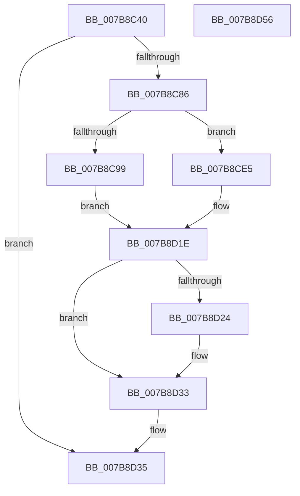

# EtwpQueryPsmKey

- RVA: `0x007B8C40`–`0x007B8D57` (길이 `279` bytes)
- VA: `0x00000001407B8C40`
- 실행 섹션: `PAGE`
- PDB 이름 있음: `예`; PDB Function 태그: `아니요`
- unwind 정보 RVA: `0x000D3960`
- 디코드: `62`개 명령, `279/279` bytes 표시
- 미해석 바이트: `0` (있으면 어셈블리에 `.byte`로 보존)

> 이 문서는 커널 이미지의 기계어와 PDB 기호를 분석해 생성했습니다. 4번과 5번은 함수 원형과 자료형을 바이너리 사용 방식에서 추정한 C 해석이며 원본 소스 복구 결과는 아닙니다.

## 1. Dependencies

- 직접 호출 지점: **4**; 고유 호출 대상: **3**
- 직접 호출자로 확인된 함수: **1**
- RIP 상대 이미지 참조: **3**

### Outgoing calls
- `0x007B8C79` → [RtlpQueryPackageIdentityAttributes](../../text/45/RtlpQueryPackageIdentityAttributes_function_00453C9C.md) (function, `0x00453C9C`)
- `0x007B8CDE` → [RtlStringCbPrintfExW](../../text/46/RtlStringCbPrintfExW_function_00461AD4.md) (function, `0x00461AD4`)
- `0x007B8D19` → [RtlStringCbPrintfExW](../../text/46/RtlStringCbPrintfExW_function_00461AD4.md) (function, `0x00461AD4`)
- `0x007B8D40` → [_security_check_cookie](../../text/6A/_security_check_cookie_function_006AC640.md) (function, `0x006AC640`)

### Direct callers
- [EtwpGetPsmKeyExtendedHeaderItem](../AC/EtwpGetPsmKeyExtendedHeaderItem_function_00AC3EE0.md) at `0x00AC3F5F`

### Static image references
- `0x007B8C4D` → RVA `0x00E0A740` (`.data`; read)
- `0x007B8CB2` → RVA `0x00B07650` (` ?? ::NNGAKEGL::`string'`; read)
- `0x007B8CF5` → RVA `0x00B07630` (` ?? ::NNGAKEGL::`string'`; read)

## 2. Other-region calls and transfers

- 다른 실행 섹션으로 향하는 call: **4**
  - `0x007B8C79` → [RtlpQueryPackageIdentityAttributes](../../text/45/RtlpQueryPackageIdentityAttributes_function_00453C9C.md) (`PAGE` → `.text`)
  - `0x007B8CDE` → [RtlStringCbPrintfExW](../../text/46/RtlStringCbPrintfExW_function_00461AD4.md) (`PAGE` → `.text`)
  - `0x007B8D19` → [RtlStringCbPrintfExW](../../text/46/RtlStringCbPrintfExW_function_00461AD4.md) (`PAGE` → `.text`)
  - `0x007B8D40` → [_security_check_cookie](../../text/6A/_security_check_cookie_function_006AC640.md) (`PAGE` → `.text`)
- 별도 외부 분기/꼬리 이동을 확인하지 못했습니다.

## 3. Assembly (complete function range)

```asm
007B8C40  48 89 5C 24 20                  mov qword ptr [rsp + 0x20], rbx
007B8C45  57                              push rdi
007B8C46  48 81 EC B0 03 00 00            sub rsp, 0x3b0
007B8C4D  48 8B 05 EC 1A 65 00            mov rax, qword ptr [rip + 0x651aec]
007B8C54  48 33 C4                        xor rax, rsp
007B8C57  48 89 84 24 A0 03 00 00         mov qword ptr [rsp + 0x3a0], rax
007B8C5F  48 83 64 24 60 00               and qword ptr [rsp + 0x60], 0
007B8C65  49 8B F8                        mov rdi, r8
007B8C68  48 83 64 24 20 00               and qword ptr [rsp + 0x20], 0
007B8C6E  4C 8D 44 24 70                  lea r8, [rsp + 0x70]
007B8C73  45 33 C9                        xor r9d, r9d
007B8C76  48 8B DA                        mov rbx, rdx
007B8C79  E8 1E B0 C9 FF                  call 0x140453c9c
007B8C7E  85 C0                           test eax, eax
007B8C80  0F 88 AF 00 00 00               js 0x1407b8d35
007B8C86  48 8B 4C 24 78                  mov rcx, qword ptr [rsp + 0x78]
007B8C8B  4C 8D 44 24 60                  lea r8, [rsp + 0x60]
007B8C90  45 33 C9                        xor r9d, r9d
007B8C93  83 79 18 02                     cmp dword ptr [rcx + 0x18], 2
007B8C97  76 4C                           jbe 0x1407b8ce5
007B8C99  48 8B 51 20                     mov rdx, qword ptr [rcx + 0x20]
007B8C9D  48 8D 42 20                     lea rax, [rdx + 0x20]
007B8CA1  48 89 44 24 50                  mov qword ptr [rsp + 0x50], rax
007B8CA6  48 8D 4A 10                     lea rcx, [rdx + 0x10]
007B8CAA  C7 44 24 48 23 00 00 00         mov dword ptr [rsp + 0x48], 0x23
007B8CB2  48 8D 05 97 E9 34 00            lea rax, [rip + 0x34e997]
007B8CB9  48 89 4C 24 40                  mov qword ptr [rsp + 0x40], rcx
007B8CBE  48 8B CB                        mov rcx, rbx
007B8CC1  C7 44 24 38 2B 00 00 00         mov dword ptr [rsp + 0x38], 0x2b
007B8CC9  48 89 54 24 30                  mov qword ptr [rsp + 0x30], rdx
007B8CCE  48 8B 17                        mov rdx, qword ptr [rdi]
007B8CD1  48 89 44 24 28                  mov qword ptr [rsp + 0x28], rax
007B8CD6  C7 44 24 20 00 08 00 00         mov dword ptr [rsp + 0x20], 0x800
007B8CDE  E8 F1 8D CA FF                  call 0x140461ad4
007B8CE3  EB 39                           jmp 0x1407b8d1e
007B8CE5  48 8B 49 20                     mov rcx, qword ptr [rcx + 0x20]
007B8CE9  48 8B 17                        mov rdx, qword ptr [rdi]
007B8CEC  48 8D 41 10                     lea rax, [rcx + 0x10]
007B8CF0  48 89 44 24 40                  mov qword ptr [rsp + 0x40], rax
007B8CF5  48 8D 05 34 E9 34 00            lea rax, [rip + 0x34e934]
007B8CFC  C7 44 24 38 2B 00 00 00         mov dword ptr [rsp + 0x38], 0x2b
007B8D04  48 89 4C 24 30                  mov qword ptr [rsp + 0x30], rcx
007B8D09  48 8B CB                        mov rcx, rbx
007B8D0C  48 89 44 24 28                  mov qword ptr [rsp + 0x28], rax
007B8D11  C7 44 24 20 00 08 00 00         mov dword ptr [rsp + 0x20], 0x800
007B8D19  E8 B6 8D CA FF                  call 0x140461ad4
007B8D1E  8B C8                           mov ecx, eax
007B8D20  85 C0                           test eax, eax
007B8D22  78 0F                           js 0x1407b8d33
007B8D24  48 8B 44 24 60                  mov rax, qword ptr [rsp + 0x60]
007B8D29  48 2B C3                        sub rax, rbx
007B8D2C  48 83 C0 02                     add rax, 2
007B8D30  48 89 07                        mov qword ptr [rdi], rax
007B8D33  8B C1                           mov eax, ecx
007B8D35  48 8B 8C 24 A0 03 00 00         mov rcx, qword ptr [rsp + 0x3a0]
007B8D3D  48 33 CC                        xor rcx, rsp
007B8D40  E8 FB 38 EF FF                  call 0x1406ac640
007B8D45  48 8B 9C 24 D8 03 00 00         mov rbx, qword ptr [rsp + 0x3d8]
007B8D4D  48 81 C4 B0 03 00 00            add rsp, 0x3b0
007B8D54  5F                              pop rdi
007B8D55  C3                              ret
007B8D56  CC                              int3
```

## 4. C-style interpretation (structured pseudocode)

```c
__int64 __fastcall EtwpQueryPsmKey(__int64 a1, __int64 a2, __int64 a3, int a4)
{
    __int64 result;
    __int64 v_rsp;
    unsigned __int64 v_stack_m18;
    unsigned __int64 v_stack_m340;
    unsigned __int64 v_stack_m348;
    unsigned __int64 v_stack_m358;
    unsigned __int64 v_stack_m368;
    unsigned int v_stack_m370;
    unsigned __int64 v_stack_m378;
    unsigned int v_stack_m380;
    unsigned __int64 v_stack_m388;
    unsigned __int64 v_stack_m390;
    unsigned __int64 v_stack_m398;
    unsigned __int64 v_stack_p20;

    v_stack_p20 = v_rbx;
    v_rsp = (v_rsp) - (944);
    result = (*(unsigned __int64 *)(v_rip + 6626028)) ^ (v_rsp);
    v_stack_m18 = result;
    a4 = 0;
    result = RtlpQueryPackageIdentityAttributes(a1, a2, v_stack_m348, a4);
    if (sign_flag) goto loc_007B8D35;
    a4 = 0;
    if ((*(unsigned int *)(v_stack_m340 + 24)) <= 2) goto loc_007B8CE5;
    v_stack_m368 = *(unsigned __int64 *)(v_stack_m340 + 32) + 32;
    v_stack_m370 = 35;
    v_stack_m378 = *(unsigned __int64 *)(v_stack_m340 + 32) + 16;
    v_stack_m380 = 43;
    v_stack_m388 = *(unsigned __int64 *)(v_stack_m340 + 32);
    v_stack_m390 = v_rip + 3467671;
    v_stack_m398 = 0x800ULL;
    result = RtlStringCbPrintfExW(a2, *(unsigned __int64 *)(a3), v_stack_m358, a4);
    goto loc_007B8D1E;
loc_007B8CE5:
    v_stack_m378 = *(unsigned __int64 *)(a2 + 32) + 16;
    v_stack_m380 = 43;
    v_stack_m388 = *(unsigned __int64 *)(a2 + 32);
    v_stack_m390 = v_rip + 3467572;
    v_stack_m398 = 0x800ULL;
    result = RtlStringCbPrintfExW(a2, *(unsigned __int64 *)(a3), v_stack_m358, a4);
loc_007B8D1E:
    if (!(sign_flag)) {
        result = v_stack_m358;
        result = (result) - (a2);
        result = (result) + (2);
        *(unsigned __int64 *)(a3) = result;
    }
loc_007B8D35:
    a1 = (v_stack_m18) ^ (v_rsp);
    result = _security_check_cookie(a1, *(unsigned __int64 *)(a3), v_stack_m358, a4);
    v_rsp = (v_rsp) + (944);
    return result;
}
```

## 5. (Beta) C Style

```c
int64_t EtwpQueryPsmKey(int64_t Arg1, int64_t Arg2, void *Arg3, int32_t Arg4)
{
    uint8_t *arg3 = (uint8_t *)Arg3;

    int64_t result;
    int64_t local_rsp;
    uint64_t v_stack_m18;
    uint64_t v_stack_m340;
    uint64_t v_stack_m348;
    uint64_t v_stack_m358;
    uint64_t v_stack_m368;
    uint32_t v_stack_m370;
    uint64_t v_stack_m378;
    uint32_t v_stack_m380;
    uint64_t v_stack_m388;
    uint64_t v_stack_m390;
    uint64_t v_stack_m398;
    uint64_t v_stack_p20;

    v_stack_p20 = local_rbx;
    local_rsp = (local_rsp) - (944);
    result = (*(uint64_t *)(v_rip + 0x651AEC)) ^ (local_rsp);
    v_stack_m18 = result;
    Arg4 = 0;
    result = RtlpQueryPackageIdentityAttributes(Arg1, Arg2, v_stack_m348, Arg4);
    if (sign_flag) goto loc_007B8D35;
    Arg4 = 0;
    if ((*(uint32_t *)(v_stack_m340 + 0x18)) <= 2) goto loc_007B8CE5;
    v_stack_m368 = *(uint64_t *)(v_stack_m340 + 0x20) + 32;
    v_stack_m370 = 35;
    v_stack_m378 = *(uint64_t *)(v_stack_m340 + 0x20) + 16;
    v_stack_m380 = 43;
    v_stack_m388 = *(uint64_t *)(v_stack_m340 + 0x20);
    v_stack_m390 = v_rip + 3467671;
    v_stack_m398 = 0x800ULL;
    result = RtlStringCbPrintfExW(Arg2, *(uint64_t *)(arg3), v_stack_m358, Arg4);
    goto loc_007B8D1E;
loc_007B8CE5:
    v_stack_m378 = *(uint64_t *)(Arg2 + 0x20) + 16;
    v_stack_m380 = 43;
    v_stack_m388 = *(uint64_t *)(Arg2 + 0x20);
    v_stack_m390 = v_rip + 3467572;
    v_stack_m398 = 0x800ULL;
    result = RtlStringCbPrintfExW(Arg2, *(uint64_t *)(arg3), v_stack_m358, Arg4);
loc_007B8D1E:
    if (!(sign_flag)) {
        result = v_stack_m358;
        result = (result) - (Arg2);
        result = (result) + (2);
        *(uint64_t *)(arg3) = result;
    }
loc_007B8D35:
    Arg1 = (v_stack_m18) ^ (local_rsp);
    result = _security_check_cookie(Arg1, *(uint64_t *)(arg3), v_stack_m358, Arg4);
    local_rsp = (local_rsp) + (944);
    return result;
}
```

### 관측된 메모리 오프셋

구조체 형식이 확인되지 않은 접근은 인자 기준의 오프셋으로만 기록했습니다.

| 기준 인자 | 오프셋 표현 | 폭 (bit) | 접근 |
|---|---:|---:|---|
| `Arg3` | `+ 0x0` | `64` | `R` |
| `Arg3` | `+ 0x0` | `64` | `W` |

## 6. Execution-region graph

[열기: 2D/3D 그래프와 함수 탐색 컨트롤 패널](../../../control-panel.html?section=page&rva=0x007B8C40&view=graph)

- 2D 그래프는 위에서 아래로 흐르고, 3D 그래프는 빈 공간을 드래그해 회전합니다. Shift+드래그는 이동, 휠은 확대·축소, 함수 노드 선택은 대상 보고서 이동입니다.

### Static fallback


