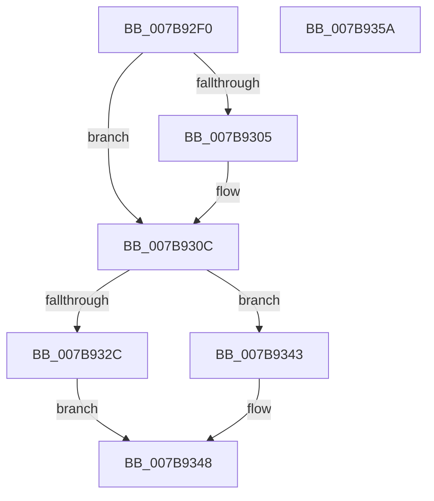

# EtwpQueryReferenceTime

- RVA: `0x007B92F0`–`0x007B935B` (길이 `107` bytes)
- VA: `0x00000001407B92F0`
- 실행 섹션: `PAGE`
- PDB 이름 있음: `예`; PDB Function 태그: `아니요`
- unwind 정보 RVA: `0x0005CAAC`
- 디코드: `29`개 명령, `107/107` bytes 표시
- 미해석 바이트: `0` (있으면 어셈블리에 `.byte`로 보존)

> 이 문서는 커널 이미지의 기계어와 PDB 기호를 분석해 생성했습니다. 4번과 5번은 함수 원형과 자료형을 바이너리 사용 방식에서 추정한 C 해석이며 원본 소스 복구 결과는 아닙니다.

## 1. Dependencies

- 직접 호출 지점: **3**; 고유 호출 대상: **3**
- 직접 호출자로 확인된 함수: **1**
- RIP 상대 이미지 참조: **0**

### Outgoing calls
- `0x007B9320` → [EtwpAcquireLoggerContextByLoggerId](../93/EtwpAcquireLoggerContextByLoggerId_function_00932920.md) (function, `0x00932920`)
- `0x007B933C` → [EtwpReleaseLoggerContext](../A0/EtwpReleaseLoggerContext_function_00A04160.md) (function, `0x00A04160`)
- `0x007B9348` → [KeLeaveCriticalRegion](../../text/25/KeLeaveCriticalRegion_function_0025D8B0.md) (function, `0x0025D8B0`)

### Direct callers
- [NtTraceControl](../A9/NtTraceControl_function_00A9ED40.md) at `0x00A9F3AE`

### Static image references
- 디코드된 RIP-relative 메모리 참조가 없습니다.

## 2. Other-region calls and transfers

- 다른 실행 섹션으로 향하는 call: **1**
  - `0x007B9348` → [KeLeaveCriticalRegion](../../text/25/KeLeaveCriticalRegion_function_0025D8B0.md) (`PAGE` → `.text`)
- 별도 외부 분기/꼬리 이동을 확인하지 못했습니다.

## 3. Assembly (complete function range)

```asm
007B92F0  48 89 5C 24 08                  mov qword ptr [rsp + 8], rbx
007B92F5  57                              push rdi
007B92F6  48 83 EC 20                     sub rsp, 0x20
007B92FA  49 8B F8                        mov rdi, r8
007B92FD  81 FA FF FF 00 00               cmp edx, 0xffff
007B9303  75 07                           jne 0x1407b930c
007B9305  0F B6 91 98 11 00 00            movzx edx, byte ptr [rcx + 0x1198]
007B930C  65 48 8B 04 25 88 01 00 00      mov rax, qword ptr gs:[0x188]
007B9315  45 33 C0                        xor r8d, r8d
007B9318  66 FF 88 E4 01 00 00            dec word ptr [rax + 0x1e4]
007B931F  90                              nop
007B9320  E8 FB 95 17 00                  call 0x140932920
007B9325  33 DB                           xor ebx, ebx
007B9327  48 85 C0                        test rax, rax
007B932A  74 17                           je 0x1407b9343
007B932C  0F 10 80 30 01 00 00            movups xmm0, xmmword ptr [rax + 0x130]
007B9333  33 D2                           xor edx, edx
007B9335  48 8B C8                        mov rcx, rax
007B9338  F3 0F 7F 07                     movdqu xmmword ptr [rdi], xmm0
007B933C  E8 1F AE 24 00                  call 0x140a04160
007B9341  EB 05                           jmp 0x1407b9348
007B9343  BB 96 02 00 C0                  mov ebx, 0xc0000296
007B9348  E8 63 45 AA FF                  call 0x14025d8b0
007B934D  8B C3                           mov eax, ebx
007B934F  48 8B 5C 24 30                  mov rbx, qword ptr [rsp + 0x30]
007B9354  48 83 C4 20                     add rsp, 0x20
007B9358  5F                              pop rdi
007B9359  C3                              ret
007B935A  CC                              int3
```

## 4. C-style interpretation (structured pseudocode)

```c
__int64 __fastcall EtwpQueryReferenceTime(__int64 a1, int a2, __int64 a3)
{
    __int64 result;
    __int64 v_rbx;
    __int64 v_rsp;
    unsigned __int64 v_stack_p8;

    v_stack_p8 = v_rbx;
    v_rsp = (v_rsp) - (32);
    if (a2 == 0xFFFFULL) {
        a2 = *(unsigned __int8 *)(a1 + 4504);
    }
    a3 = 0;
    result = EtwpAcquireLoggerContextByLoggerId(a1, a2, a3, a4);
    v_rbx = 0;
    if (result == 0) goto loc_007B9343;
    a2 = 0;
    *(unsigned __int64 *)(a3) = v_xmm0;
    result = EtwpReleaseLoggerContext(result, a2, a3, a4);
    goto loc_007B9348;
loc_007B9343:
loc_007B9348:
    result = KeLeaveCriticalRegion(result, a2, a3, a4);
    v_rsp = (v_rsp) + (32);
    return (unsigned int)((unsigned int)((unsigned int)(0xC0000296ULL)));
}
```

## 5. (Beta) C Style

```c
int64_t EtwpQueryReferenceTime(void *Arg1, int32_t Arg2, void *Arg3)
{
    uint8_t *arg1 = (uint8_t *)Arg1;
    uint8_t *arg3 = (uint8_t *)Arg3;

    int64_t result;
    int64_t local_rbx;
    int64_t local_rsp;
    uint64_t v_stack_p8;

    v_stack_p8 = local_rbx;
    local_rsp = (local_rsp) - (32);
    if (Arg2 == 0xFFFFULL) {
        Arg2 = *(uint8_t *)(arg1 + 0x1198);
    }
    Arg3 = 0;
    result = EtwpAcquireLoggerContextByLoggerId(Arg1, Arg2, Arg3, a4);
    local_rbx = 0;
    if (result == 0) goto loc_007B9343;
    Arg2 = 0;
    *(uint64_t *)(arg3) = v_xmm0;
    result = EtwpReleaseLoggerContext(result, Arg2, Arg3, a4);
    goto loc_007B9348;
loc_007B9343:
loc_007B9348:
    result = KeLeaveCriticalRegion(result, Arg2, Arg3, a4);
    local_rsp = (local_rsp) + (32);
    return (uint32_t)((uint32_t)((uint32_t)(0xC0000296ULL)));
}
```

### 관측된 메모리 오프셋

구조체 형식이 확인되지 않은 접근은 인자 기준의 오프셋으로만 기록했습니다.

| 기준 인자 | 오프셋 표현 | 폭 (bit) | 접근 |
|---|---:|---:|---|
| `Arg1` | `+ 0x1198` | `8` | `R` |
| `Arg3` | `+ 0x0` | `128` | `W` |

## 6. Execution-region graph

[열기: 2D/3D 그래프와 함수 탐색 컨트롤 패널](../../../control-panel.html?section=page&rva=0x007B92F0&view=graph)

- 2D 그래프는 위에서 아래로 흐르고, 3D 그래프는 빈 공간을 드래그해 회전합니다. Shift+드래그는 이동, 휠은 확대·축소, 함수 노드 선택은 대상 보고서 이동입니다.

### Static fallback


