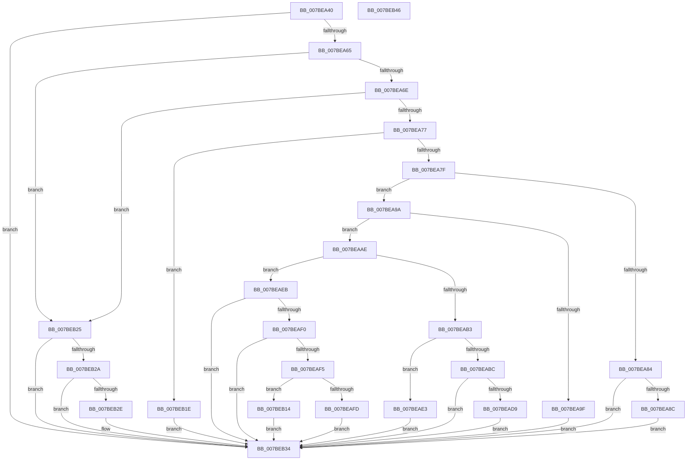

# EtwpQueryRegistryCallback

- RVA: `0x007BEA40`–`0x007BEB47` (길이 `263` bytes)
- VA: `0x00000001407BEA40`
- 실행 섹션: `PAGE`
- PDB 이름 있음: `예`; PDB Function 태그: `아니요`
- unwind 정보 RVA: `0x00060BC4`
- 디코드: `82`개 명령, `263/263` bytes 표시
- 미해석 바이트: `0` (있으면 어셈블리에 `.byte`로 보존)

> 이 문서는 커널 이미지의 기계어와 PDB 기호를 분석해 생성했습니다. 4번과 5번은 함수 원형과 자료형을 바이너리 사용 방식에서 추정한 C 해석이며 원본 소스 복구 결과는 아닙니다.

## 1. Dependencies

- 직접 호출 지점: **3**; 고유 호출 대상: **3**
- 직접 호출자로 확인된 함수: **0**
- RIP 상대 이미지 참조: **0**

### Outgoing calls
- `0x007BEAC3` → [RtlCreateUnicodeString](../9B/RtlCreateUnicodeString_function_009BD860.md) (function, `0x009BD860`)
- `0x007BEADC` → [ExFreePool](../../poolcode/B8/ExFreePool_function_00B82850.md) (function, `0x00B82850`)
- `0x007BEB07` → [memcpy](../../text/6C/memcpy_function_006C6840.md) (function, `0x006C6840`)

### Direct callers
- 이 함수 시작 RVA로 연결되는 직접 call은 확인되지 않았습니다. 간접 호출은 완전히 역산할 수 없습니다.

### Static image references
- 디코드된 RIP-relative 메모리 참조가 없습니다.

## 2. Other-region calls and transfers

- 다른 실행 섹션으로 향하는 call: **2**
  - `0x007BEADC` → [ExFreePool](../../poolcode/B8/ExFreePool_function_00B82850.md) (`PAGE` → `POOLCODE`)
  - `0x007BEB07` → [memcpy](../../text/6C/memcpy_function_006C6840.md) (`PAGE` → `.text`)
- 별도 외부 분기/꼬리 이동을 확인하지 못했습니다.

## 3. Assembly (complete function range)

```asm
007BEA40  48 89 5C 24 08                  mov qword ptr [rsp + 8], rbx
007BEA45  48 89 74 24 10                  mov qword ptr [rsp + 0x10], rsi
007BEA4A  57                              push rdi
007BEA4B  48 83 EC 20                     sub rsp, 0x20
007BEA4F  48 8B 5C 24 58                  mov rbx, qword ptr [rsp + 0x58]
007BEA54  33 FF                           xor edi, edi
007BEA56  41 8B F1                        mov esi, r9d
007BEA59  49 8B C0                        mov rax, r8
007BEA5C  48 85 DB                        test rbx, rbx
007BEA5F  0F 84 CF 00 00 00               je 0x1407beb34
007BEA65  48 85 C0                        test rax, rax
007BEA68  0F 84 B7 00 00 00               je 0x1407beb25
007BEA6E  45 85 C9                        test r9d, r9d
007BEA71  0F 84 AE 00 00 00               je 0x1407beb25
007BEA77  3B 13                           cmp edx, dword ptr [rbx]
007BEA79  0F 85 9F 00 00 00               jne 0x1407beb1e
007BEA7F  83 FA 04                        cmp edx, 4
007BEA82  75 16                           jne 0x1407bea9a
007BEA84  3B F2                           cmp esi, edx
007BEA86  0F 82 A8 00 00 00               jb 0x1407beb34
007BEA8C  48 8B 4B 08                     mov rcx, qword ptr [rbx + 8]
007BEA90  41 8B 00                        mov eax, dword ptr [r8]
007BEA93  89 01                           mov dword ptr [rcx], eax
007BEA95  E9 9A 00 00 00                  jmp 0x1407beb34
007BEA9A  83 FA 0B                        cmp edx, 0xb
007BEA9D  75 0F                           jne 0x1407beaae
007BEA9F  48 8B 4B 08                     mov rcx, qword ptr [rbx + 8]
007BEAA3  49 8B 00                        mov rax, qword ptr [r8]
007BEAA6  48 89 01                        mov qword ptr [rcx], rax
007BEAA9  E9 86 00 00 00                  jmp 0x1407beb34
007BEAAE  83 FA 01                        cmp edx, 1
007BEAB1  75 38                           jne 0x1407beaeb
007BEAB3  48 8B 4B 08                     mov rcx, qword ptr [rbx + 8]
007BEAB7  83 FE 02                        cmp esi, 2
007BEABA  76 27                           jbe 0x1407beae3
007BEABC  48 8B 59 08                     mov rbx, qword ptr [rcx + 8]
007BEAC0  48 8B D0                        mov rdx, rax
007BEAC3  E8 98 ED 1F 00                  call 0x1409bd860
007BEAC8  F6 D8                           neg al
007BEACA  1B FF                           sbb edi, edi
007BEACC  F7 D7                           not edi
007BEACE  81 E7 17 00 00 C0               and edi, 0xc0000017
007BEAD4  48 85 DB                        test rbx, rbx
007BEAD7  74 5B                           je 0x1407beb34
007BEAD9  48 8B CB                        mov rcx, rbx
007BEADC  E8 6F 3D 3C 00                  call 0x140b82850
007BEAE1  EB 51                           jmp 0x1407beb34
007BEAE3  0F 57 C0                        xorps xmm0, xmm0
007BEAE6  0F 11 01                        movups xmmword ptr [rcx], xmm0
007BEAE9  EB 49                           jmp 0x1407beb34
007BEAEB  83 FA 03                        cmp edx, 3
007BEAEE  75 44                           jne 0x1407beb34
007BEAF0  83 FE 04                        cmp esi, 4
007BEAF3  72 3F                           jb 0x1407beb34
007BEAF5  48 8B 4B 08                     mov rcx, qword ptr [rbx + 8]
007BEAF9  3B 31                           cmp esi, dword ptr [rcx]
007BEAFB  77 17                           ja 0x1407beb14
007BEAFD  48 8B 49 08                     mov rcx, qword ptr [rcx + 8]
007BEB01  4C 8B C6                        mov r8, rsi
007BEB04  48 8B D0                        mov rdx, rax
007BEB07  E8 34 7D F0 FF                  call 0x1406c6840
007BEB0C  48 8B 43 08                     mov rax, qword ptr [rbx + 8]
007BEB10  89 30                           mov dword ptr [rax], esi
007BEB12  EB 20                           jmp 0x1407beb34
007BEB14  83 21 00                        and dword ptr [rcx], 0
007BEB17  BF 06 02 00 C0                  mov edi, 0xc0000206
007BEB1C  EB 16                           jmp 0x1407beb34
007BEB1E  BF 03 00 00 C0                  mov edi, 0xc0000003
007BEB23  EB 0F                           jmp 0x1407beb34
007BEB25  83 FA 03                        cmp edx, 3
007BEB28  75 0A                           jne 0x1407beb34
007BEB2A  39 13                           cmp dword ptr [rbx], edx
007BEB2C  75 06                           jne 0x1407beb34
007BEB2E  48 8B 4B 08                     mov rcx, qword ptr [rbx + 8]
007BEB32  21 39                           and dword ptr [rcx], edi
007BEB34  48 8B 5C 24 30                  mov rbx, qword ptr [rsp + 0x30]
007BEB39  8B C7                           mov eax, edi
007BEB3B  48 8B 74 24 38                  mov rsi, qword ptr [rsp + 0x38]
007BEB40  48 83 C4 20                     add rsp, 0x20
007BEB44  5F                              pop rdi
007BEB45  C3                              ret
007BEB46  CC                              int3
```

## 4. C-style interpretation (structured pseudocode)

```c
__int64 __fastcall EtwpQueryRegistryCallback(__int64 a1, int a2, __int64 a3, int a4, __int64 a5, __int64 a6)
{
    __int64 result;
    __int64 v_rdi;
    __int64 v_rsp;
    unsigned __int64 v_stack_p10;
    unsigned __int64 v_stack_p8;

    v_stack_p8 = v_rbx;
    v_stack_p10 = v_rsi;
    v_rsp = (v_rsp) - (32);
    v_rdi = 0;
    if (a6 == 0) goto loc_007BEB34;
    if (a3 == 0) goto loc_007BEB25;
    if (a4 == 0) goto loc_007BEB25;
    if (a2 != (*(unsigned int *)(a6))) goto loc_007BEB1E;
    if (a2 != 4) goto loc_007BEA9A;
    if (((unsigned int)((unsigned int)(a4))) < a2) goto loc_007BEB34;
    *(unsigned int *)(*(unsigned __int64 *)(a6 + 8)) = (unsigned int)((unsigned int)(*(unsigned int *)(a3)));
    goto loc_007BEB34;
loc_007BEA9A:
    if (a2 != 11) goto loc_007BEAAE;
    *(unsigned __int64 *)(*(unsigned __int64 *)(a6 + 8)) = *(unsigned __int64 *)(a3);
    goto loc_007BEB34;
loc_007BEAAE:
    if (a2 != 1) goto loc_007BEAEB;
    if (((unsigned int)((unsigned int)(a4))) <= 2) goto loc_007BEAE3;
    result = RtlCreateUnicodeString(*(unsigned __int64 *)(a6 + 8), *(unsigned __int64 *)(a3), a3, a4);
    result = (unsigned __int8)(-(result));
    v_rdi = (unsigned int)(~(v_rdi));
    v_rdi = (unsigned int)((v_rdi) & (0xC0000017ULL));
    if (*(unsigned __int64 *)(*(unsigned __int64 *)(a6 + 8) + 8) == 0) goto loc_007BEB34;
    result = ExFreePool(*(unsigned __int64 *)(*(unsigned __int64 *)(a6 + 8) + 8), *(unsigned __int64 *)(a3), a3, a4);
    goto loc_007BEB34;
loc_007BEAE3:
    *(unsigned __int64 *)(*(unsigned __int64 *)(*(unsigned __int64 *)(a6 + 8) + 8)) = v_xmm0;
    goto loc_007BEB34;
loc_007BEAEB:
    if (((unsigned int)(*(unsigned __int64 *)(a3))) != 3) goto loc_007BEB34;
    if (((unsigned int)((unsigned int)(a4))) < 4) goto loc_007BEB34;
    if (((unsigned int)((unsigned int)(a4))) > (*(unsigned int *)(*(unsigned __int64 *)(*(unsigned __int64 *)(*(unsigned __int64 *)(a6 + 8) + 8) + 8)))) goto loc_007BEB14;
    result = memcpy(*(unsigned __int64 *)(*(unsigned __int64 *)(*(unsigned __int64 *)(*(unsigned __int64 *)(a6 + 8) + 8) + 8) + 8), result, (unsigned int)(a4), a4);
    *(unsigned int *)(*(unsigned __int64 *)(*(unsigned __int64 *)(*(unsigned __int64 *)(a6 + 8) + 8) + 8)) = (unsigned int)((unsigned int)(a4));
    goto loc_007BEB34;
loc_007BEB14:
    goto loc_007BEB34;
loc_007BEB1E:
    goto loc_007BEB34;
loc_007BEB25:
    if (((unsigned int)(result)) != 3) goto loc_007BEB34;
    if ((*(unsigned int *)(*(unsigned __int64 *)(*(unsigned __int64 *)(a6 + 8) + 8))) == ((unsigned int)(result))) {
        a1 = *(unsigned __int64 *)(*(unsigned __int64 *)(*(unsigned __int64 *)(a6 + 8) + 8) + 8);
    }
    v_rsp = (v_rsp) + (32);
    return (unsigned int)((unsigned int)((unsigned int)(0xC0000003ULL)));
}
```

## 5. (Beta) C Style

```c
int64_t EtwpQueryRegistryCallback(int64_t Arg1, int32_t Arg2, void *Arg3, int32_t Arg4, uint64_t Arg5, int64_t Arg6)
{
    uint8_t *arg3 = (uint8_t *)Arg3;

    int64_t result;
    int64_t local_rdi;
    int64_t local_rsp;
    uint64_t v_stack_p10;
    uint64_t v_stack_p8;

    v_stack_p8 = local_rbx;
    v_stack_p10 = local_rsi;
    local_rsp = (local_rsp) - (32);
    local_rdi = 0;
    if (Arg6 == 0) goto loc_007BEB34;
    if (Arg3 == NULL) goto loc_007BEB25;
    if (Arg4 == 0) goto loc_007BEB25;
    if (Arg2 != (*(uint32_t *)(Arg6))) goto loc_007BEB1E;
    if (Arg2 != 4) goto loc_007BEA9A;
    if (((uint32_t)((uint32_t)(Arg4))) < Arg2) goto loc_007BEB34;
    *(uint32_t *)(*(uint64_t *)(Arg6 + 0x8)) = (uint32_t)((uint32_t)(*(uint32_t *)(arg3)));
    goto loc_007BEB34;
loc_007BEA9A:
    if (Arg2 != 11) goto loc_007BEAAE;
    *(uint64_t *)(*(uint64_t *)(Arg6 + 0x8)) = *(uint64_t *)(arg3);
    goto loc_007BEB34;
loc_007BEAAE:
    if (Arg2 != 1) goto loc_007BEAEB;
    if (((uint32_t)((uint32_t)(Arg4))) <= 2) goto loc_007BEAE3;
    result = RtlCreateUnicodeString(*(uint64_t *)(Arg6 + 0x8), *(uint64_t *)(arg3), Arg3, Arg4);
    result = (uint8_t)(-(result));
    local_rdi = (uint32_t)(~(local_rdi));
    local_rdi = (uint32_t)((local_rdi) & (0xC0000017ULL));
    if (*(uint64_t *)(*(uint64_t *)(Arg6 + 0x8) + 0x8) == 0) goto loc_007BEB34;
    result = ExFreePool(*(uint64_t *)(*(uint64_t *)(Arg6 + 0x8) + 0x8), *(uint64_t *)(arg3), Arg3, Arg4);
    goto loc_007BEB34;
loc_007BEAE3:
    *(uint64_t *)(*(uint64_t *)(*(uint64_t *)(Arg6 + 0x8) + 0x8)) = v_xmm0;
    goto loc_007BEB34;
loc_007BEAEB:
    if (((uint32_t)(*(uint64_t *)(arg3))) != 3) goto loc_007BEB34;
    if (((uint32_t)((uint32_t)(Arg4))) < 4) goto loc_007BEB34;
    if (((uint32_t)((uint32_t)(Arg4))) > (*(uint32_t *)(*(uint64_t *)(*(uint64_t *)(*(uint64_t *)(Arg6 + 0x8) + 0x8) + 0x8)))) goto loc_007BEB14;
    result = memcpy(*(uint64_t *)(*(uint64_t *)(*(uint64_t *)(*(uint64_t *)(Arg6 + 0x8) + 0x8) + 0x8) + 0x8), result, (uint32_t)(Arg4), Arg4);
    *(uint32_t *)(*(uint64_t *)(*(uint64_t *)(*(uint64_t *)(Arg6 + 0x8) + 0x8) + 0x8)) = (uint32_t)((uint32_t)(Arg4));
    goto loc_007BEB34;
loc_007BEB14:
    goto loc_007BEB34;
loc_007BEB1E:
    goto loc_007BEB34;
loc_007BEB25:
    if (((uint32_t)(result)) != 3) goto loc_007BEB34;
    if ((*(uint32_t *)(*(uint64_t *)(*(uint64_t *)(Arg6 + 0x8) + 0x8))) == ((uint32_t)(result))) {
        Arg1 = *(uint64_t *)(*(uint64_t *)(*(uint64_t *)(Arg6 + 0x8) + 0x8) + 0x8);
    }
    local_rsp = (local_rsp) + (32);
    return (uint32_t)((uint32_t)((uint32_t)(0xC0000003ULL)));
}
```

### 관측된 메모리 오프셋

구조체 형식이 확인되지 않은 접근은 인자 기준의 오프셋으로만 기록했습니다.

| 기준 인자 | 오프셋 표현 | 폭 (bit) | 접근 |
|---|---:|---:|---|
| `Arg3` | `+ 0x0` | `32` | `R` |
| `Arg3` | `+ 0x0` | `64` | `R` |

## 6. Execution-region graph

[열기: 2D/3D 그래프와 함수 탐색 컨트롤 패널](../../../control-panel.html?section=page&rva=0x007BEA40&view=graph)

- 2D 그래프는 위에서 아래로 흐르고, 3D 그래프는 빈 공간을 드래그해 회전합니다. Shift+드래그는 이동, 휠은 확대·축소, 함수 노드 선택은 대상 보고서 이동입니다.

### Static fallback


