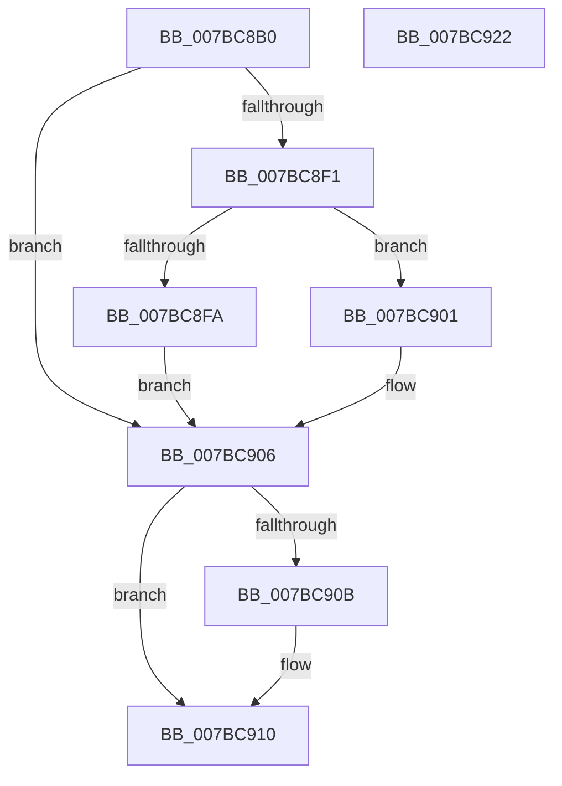

# EtwpQuerySessionDemuxObject

- RVA: `0x007BC8B0`–`0x007BC923` (길이 `115` bytes)
- VA: `0x00000001407BC8B0`
- 실행 섹션: `PAGE`
- PDB 이름 있음: `예`; PDB Function 태그: `아니요`
- unwind 정보 RVA: `0x000733E4`
- 디코드: `36`개 명령, `115/115` bytes 표시
- 미해석 바이트: `0` (있으면 어셈블리에 `.byte`로 보존)

> 이 문서는 커널 이미지의 기계어와 PDB 기호를 분석해 생성했습니다. 4번과 5번은 함수 원형과 자료형을 바이너리 사용 방식에서 추정한 C 해석이며 원본 소스 복구 결과는 아닙니다.

## 1. Dependencies

- 직접 호출 지점: **2**; 고유 호출 대상: **2**
- 직접 호출자로 확인된 함수: **1**
- RIP 상대 이미지 참조: **1**

### Outgoing calls
- `0x007BC8E1` → [ObReferenceObjectByHandle](../86/ObReferenceObjectByHandle_function_00868DB0.md) (function, `0x00868DB0`)
- `0x007BC90B` → [ObfDereferenceObject](../../text/2F/ObfDereferenceObject_function_002F9350.md) (function, `0x002F9350`)

### Direct callers
- [NtTraceControl](../A9/NtTraceControl_function_00A9ED40.md) at `0x00A9F6E0`

### Static image references
- `0x007BC8C0` → RVA `0x00FC7010` (`ALMOSTRO`; read)

## 2. Other-region calls and transfers

- 다른 실행 섹션으로 향하는 call: **1**
  - `0x007BC90B` → [ObfDereferenceObject](../../text/2F/ObfDereferenceObject_function_002F9350.md) (`PAGE` → `.text`)
- 별도 외부 분기/꼬리 이동을 확인하지 못했습니다.

## 3. Assembly (complete function range)

```asm
007BC8B0  4C 8B DC                        mov r11, rsp
007BC8B3  49 89 5B 08                     mov qword ptr [r11 + 8], rbx
007BC8B7  49 89 73 10                     mov qword ptr [r11 + 0x10], rsi
007BC8BB  57                              push rdi
007BC8BC  48 83 EC 30                     sub rsp, 0x30
007BC8C0  4C 8B 05 49 A7 80 00            mov r8, qword ptr [rip + 0x80a749]
007BC8C7  49 8D 43 18                     lea rax, [r11 + 0x18]
007BC8CB  33 F6                           xor esi, esi
007BC8CD  48 8B FA                        mov rdi, rdx
007BC8D0  49 89 73 F0                     mov qword ptr [r11 - 0x10], rsi
007BC8D4  41 B1 01                        mov r9b, 1
007BC8D7  33 D2                           xor edx, edx
007BC8D9  49 89 43 E8                     mov qword ptr [r11 - 0x18], rax
007BC8DD  49 89 73 18                     mov qword ptr [r11 + 0x18], rsi
007BC8E1  E8 CA C4 0A 00                  call 0x140868db0
007BC8E6  48 8B 4C 24 50                  mov rcx, qword ptr [rsp + 0x50]
007BC8EB  8B D8                           mov ebx, eax
007BC8ED  85 C0                           test eax, eax
007BC8EF  78 15                           js 0x1407bc906
007BC8F1  0F B7 41 12                     movzx eax, word ptr [rcx + 0x12]
007BC8F5  66 85 C0                        test ax, ax
007BC8F8  74 07                           je 0x1407bc901
007BC8FA  66 89 07                        mov word ptr [rdi], ax
007BC8FD  8B DE                           mov ebx, esi
007BC8FF  EB 05                           jmp 0x1407bc906
007BC901  BB 96 02 00 C0                  mov ebx, 0xc0000296
007BC906  48 85 C9                        test rcx, rcx
007BC909  74 05                           je 0x1407bc910
007BC90B  E8 40 CA B3 FF                  call 0x1402f9350
007BC910  48 8B 74 24 48                  mov rsi, qword ptr [rsp + 0x48]
007BC915  8B C3                           mov eax, ebx
007BC917  48 8B 5C 24 40                  mov rbx, qword ptr [rsp + 0x40]
007BC91C  48 83 C4 30                     add rsp, 0x30
007BC920  5F                              pop rdi
007BC921  C3                              ret
007BC922  CC                              int3
```

## 4. C-style interpretation (structured pseudocode)

```c
__int64 __fastcall EtwpQuerySessionDemuxObject(__int64 a1, __int64 a2)
{
    __int64 result;
    __int64 v_rsi;
    __int64 v_rsp;
    unsigned __int64 v_stack_p10;
    unsigned __int64 v_stack_p18;
    unsigned __int64 v_stack_p8;

    *(unsigned __int64 *)(v_rsp + 8) = v_rbx;
    *(unsigned __int64 *)(v_rsp + 16) = v_rsi;
    v_rsp = (v_rsp) - (48);
    v_rsi = 0;
    *(unsigned __int64 *)(v_rsp - 16) = 0;
    a2 = 0;
    *(unsigned __int64 *)(v_rsp - 24) = v_rsp + 24;
    *(unsigned __int64 *)(v_rsp + 24) = 0;
    result = ObReferenceObjectByHandle(a1, a2, *(unsigned __int64 *)(v_rip + 8431433), 1);
    if (sign_flag) goto loc_007BC906;
    if ((unsigned __int16)(*(unsigned __int16 *)(v_stack_p18 + 18)) == 0) goto loc_007BC901;
    *(unsigned __int16 *)(a2) = (unsigned __int16)(*(unsigned __int16 *)(v_stack_p18 + 18));
    goto loc_007BC906;
loc_007BC901:
loc_007BC906:
    result = *(unsigned __int16 *)(v_stack_p18 + 18);
    if (v_stack_p18 != 0) {
        result = ObfDereferenceObject(v_stack_p18, a2, *(unsigned __int64 *)(v_rip + 8431433), 1);
    }
    v_rsp = (v_rsp) + (48);
    return (unsigned int)((unsigned int)((unsigned int)(0xC0000296ULL)));
}
```

## 5. (Beta) C Style

```c
int64_t EtwpQuerySessionDemuxObject(int64_t Arg1, void *Arg2)
{
    uint8_t *arg2 = (uint8_t *)Arg2;

    int64_t result;
    int64_t local_rsi;
    int64_t local_rsp;
    uint64_t v_stack_p10;
    uint64_t v_stack_p18;
    uint64_t v_stack_p8;

    *(uint64_t *)(local_rsp + 0x8) = local_rbx;
    *(uint64_t *)(local_rsp + 0x10) = local_rsi;
    local_rsp = (local_rsp) - (48);
    local_rsi = 0;
    *(uint64_t *)(local_rsp - 0x10) = 0;
    Arg2 = 0;
    *(uint64_t *)(local_rsp - 0x18) = local_rsp + 24;
    *(uint64_t *)(local_rsp + 0x18) = 0;
    result = ObReferenceObjectByHandle(Arg1, Arg2, *(uint64_t *)(v_rip + 0x80A749), 1);
    if (sign_flag) goto loc_007BC906;
    if ((uint16_t)(*(uint16_t *)(v_stack_p18 + 0x12)) == 0) goto loc_007BC901;
    *(uint16_t *)(arg2) = (uint16_t)(*(uint16_t *)(v_stack_p18 + 0x12));
    goto loc_007BC906;
loc_007BC901:
loc_007BC906:
    result = *(uint16_t *)(v_stack_p18 + 0x12);
    if (v_stack_p18 != 0) {
        result = ObfDereferenceObject(v_stack_p18, Arg2, *(uint64_t *)(v_rip + 0x80A749), 1);
    }
    local_rsp = (local_rsp) + (48);
    return (uint32_t)((uint32_t)((uint32_t)(0xC0000296ULL)));
}
```

### 관측된 메모리 오프셋

구조체 형식이 확인되지 않은 접근은 인자 기준의 오프셋으로만 기록했습니다.

| 기준 인자 | 오프셋 표현 | 폭 (bit) | 접근 |
|---|---:|---:|---|
| `Arg2` | `+ 0x0` | `16` | `W` |

## 6. Execution-region graph

[열기: 2D/3D 그래프와 함수 탐색 컨트롤 패널](../../../control-panel.html?section=page&rva=0x007BC8B0&view=graph)

- 2D 그래프는 위에서 아래로 흐르고, 3D 그래프는 빈 공간을 드래그해 회전합니다. Shift+드래그는 이동, 휠은 확대·축소, 함수 노드 선택은 대상 보고서 이동입니다.

### Static fallback


