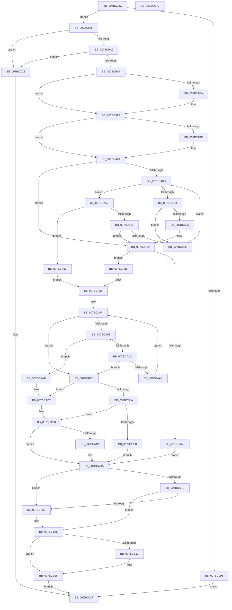

# EtwpRegisterPrivateSession

- RVA: `0x007BC92C`–`0x007BCC43` (길이 `791` bytes)
- VA: `0x00000001407BC92C`
- 실행 섹션: `PAGE`
- PDB 이름 있음: `예`; PDB Function 태그: `아니요`
- unwind 정보 RVA: `0x000D3C30`
- 디코드: `211`개 명령, `791/791` bytes 표시
- 미해석 바이트: `0` (있으면 어셈블리에 `.byte`로 보존)

> 이 문서는 커널 이미지의 기계어와 PDB 기호를 분석해 생성했습니다. 4번과 5번은 함수 원형과 자료형을 바이너리 사용 방식에서 추정한 C 해석이며 원본 소스 복구 결과는 아닙니다.

## 1. Dependencies

- 직접 호출 지점: **15**; 고유 호출 대상: **15**
- 직접 호출자로 확인된 함수: **1**
- RIP 상대 이미지 참조: **1**

### Outgoing calls
- `0x007BC9B4` → [PsGetCurrentProcessId](../../text/43/PsGetCurrentProcessId_function_00433560.md) (function, `0x00433560`)
- `0x007BC9DA` → [KeAbPreAcquire](../../text/21/KeAbPreAcquire_function_00210230.md) (function, `0x00210230`)
- `0x007BC9F3` → [ExfAcquirePushLockExclusiveEx](../../text/20/ExfAcquirePushLockExclusiveEx_function_0020FC90.md) (function, `0x0020FC90`)
- `0x007BCA14` → [PidNodeCompare](PidNodeCompare_function_007BCF10.md) (function, `0x007BCF10`)
- `0x007BCA39` → [ExAllocatePool2](../../poolcode/B8/ExAllocatePool2_function_00B820F0.md) (function, `0x00B820F0`)
- `0x007BCA83` → [RtlRbInsertNodeEx](../../text/2E/RtlRbInsertNodeEx_function_002E4570.md) (function, `0x002E4570`)
- `0x007BCACB` → [RtlRbRemoveNode](../../text/2E/RtlRbRemoveNode_function_002E4C10.md) (function, `0x002E4C10`)
- `0x007BCAD5` → [ExFreePoolWithTag](../../poolcode/B8/ExFreePoolWithTag_function_00B82870.md) (function, `0x00B82870`)
- `0x007BCB06` → [ExfReleasePushLock](../../text/26/ExfReleasePushLock_function_002638D0.md) (function, `0x002638D0`)
- `0x007BCB0E` → [KeAbPostRelease](../../text/2E/KeAbPostRelease_function_002E1600.md) (function, `0x002E1600`)
- `0x007BCB13` → [KeLeaveCriticalRegion](../../text/25/KeLeaveCriticalRegion_function_0025D8B0.md) (function, `0x0025D8B0`)
- `0x007BCB21` → [ObfDereferenceObject](../../text/2F/ObfDereferenceObject_function_002F9350.md) (function, `0x002F9350`)
- `0x007BCB7B` → [ObCreateObjectEx](../89/ObCreateObjectEx_function_0089B1E0.md) (function, `0x0089B1E0`)
- `0x007BCBD1` → [ObReferenceObjectByPointer](../../text/43/ObReferenceObjectByPointer_function_00438D00.md) (function, `0x00438D00`)
- `0x007BCBF9` → [ObInsertObjectEx](../8B/ObInsertObjectEx_function_008B97A0.md) (function, `0x008B97A0`)

### Direct callers
- [NtTraceControl](../A9/NtTraceControl_function_00A9ED40.md) at `0x00A9F71C`

### Static image references
- `0x007BCB2D` → RVA `0x00FC7010` (`ALMOSTRO`; read)

## 2. Other-region calls and transfers

- 다른 실행 섹션으로 향하는 call: **12**
  - `0x007BC9B4` → [PsGetCurrentProcessId](../../text/43/PsGetCurrentProcessId_function_00433560.md) (`PAGE` → `.text`)
  - `0x007BC9DA` → [KeAbPreAcquire](../../text/21/KeAbPreAcquire_function_00210230.md) (`PAGE` → `.text`)
  - `0x007BC9F3` → [ExfAcquirePushLockExclusiveEx](../../text/20/ExfAcquirePushLockExclusiveEx_function_0020FC90.md) (`PAGE` → `.text`)
  - `0x007BCA39` → [ExAllocatePool2](../../poolcode/B8/ExAllocatePool2_function_00B820F0.md) (`PAGE` → `POOLCODE`)
  - `0x007BCA83` → [RtlRbInsertNodeEx](../../text/2E/RtlRbInsertNodeEx_function_002E4570.md) (`PAGE` → `.text`)
  - `0x007BCACB` → [RtlRbRemoveNode](../../text/2E/RtlRbRemoveNode_function_002E4C10.md) (`PAGE` → `.text`)
  - `0x007BCAD5` → [ExFreePoolWithTag](../../poolcode/B8/ExFreePoolWithTag_function_00B82870.md) (`PAGE` → `POOLCODE`)
  - `0x007BCB06` → [ExfReleasePushLock](../../text/26/ExfReleasePushLock_function_002638D0.md) (`PAGE` → `.text`)
  - `0x007BCB0E` → [KeAbPostRelease](../../text/2E/KeAbPostRelease_function_002E1600.md) (`PAGE` → `.text`)
  - `0x007BCB13` → [KeLeaveCriticalRegion](../../text/25/KeLeaveCriticalRegion_function_0025D8B0.md) (`PAGE` → `.text`)
  - `0x007BCB21` → [ObfDereferenceObject](../../text/2F/ObfDereferenceObject_function_002F9350.md) (`PAGE` → `.text`)
  - `0x007BCBD1` → [ObReferenceObjectByPointer](../../text/43/ObReferenceObjectByPointer_function_00438D00.md) (`PAGE` → `.text`)
- 별도 외부 분기/꼬리 이동을 확인하지 못했습니다.

## 3. Assembly (complete function range)

```asm
007BC92C  48 8B C4                        mov rax, rsp
007BC92F  48 89 58 10                     mov qword ptr [rax + 0x10], rbx
007BC933  4C 89 48 20                     mov qword ptr [rax + 0x20], r9
007BC937  4C 89 40 18                     mov qword ptr [rax + 0x18], r8
007BC93B  48 89 48 08                     mov qword ptr [rax + 8], rcx
007BC93F  55                              push rbp
007BC940  56                              push rsi
007BC941  57                              push rdi
007BC942  41 54                           push r12
007BC944  41 55                           push r13
007BC946  41 56                           push r14
007BC948  41 57                           push r15
007BC94A  48 8D 68 A1                     lea rbp, [rax - 0x5f]
007BC94E  48 81 EC A0 00 00 00            sub rsp, 0xa0
007BC955  45 33 FF                        xor r15d, r15d
007BC958  4C 8D A1 00 11 00 00            lea r12, [rcx + 0x1100]
007BC95F  33 C0                           xor eax, eax
007BC961  4C 89 7D E7                     mov qword ptr [rbp - 0x19], r15
007BC965  4C 89 7D EF                     mov qword ptr [rbp - 0x11], r15
007BC969  0F 57 C0                        xorps xmm0, xmm0
007BC96C  48 89 45 17                     mov qword ptr [rbp + 0x17], rax
007BC970  44 0F B7 F2                     movzx r14d, dx
007BC974  89 45 1F                        mov dword ptr [rbp + 0x1f], eax
007BC977  65 48 8B 04 25 88 01 00 00      mov rax, qword ptr gs:[0x188]
007BC980  4C 89 7D DF                     mov qword ptr [rbp - 0x21], r15
007BC984  0F 11 45 F7                     movups xmmword ptr [rbp - 9], xmm0
007BC988  80 B8 32 02 00 00 01            cmp byte ptr [rax + 0x232], 1
007BC98F  0F 11 45 07                     movups xmmword ptr [rbp + 7], xmm0
007BC993  74 0A                           je 0x1407bc99f
007BC995  B8 BB 00 00 C0                  mov eax, 0xc00000bb
007BC99A  E9 88 02 00 00                  jmp 0x1407bcc27
007BC99F  66 45 85 F6                     test r14w, r14w
007BC9A3  0F 88 79 02 00 00               js 0x1407bcc22
007BC9A9  66 41 83 FE 08                  cmp r14w, 8
007BC9AE  0F 87 6E 02 00 00               ja 0x1407bcc22
007BC9B4  E8 A7 6B C7 FF                  call 0x140433560
007BC9B9  89 45 D7                        mov dword ptr [rbp - 0x29], eax
007BC9BC  49 8D 5C 24 10                  lea rbx, [r12 + 0x10]
007BC9C1  65 48 8B 04 25 88 01 00 00      mov rax, qword ptr gs:[0x188]
007BC9CA  45 33 C0                        xor r8d, r8d
007BC9CD  33 D2                           xor edx, edx
007BC9CF  48 8B CB                        mov rcx, rbx
007BC9D2  66 FF 88 E4 01 00 00            dec word ptr [rax + 0x1e4]
007BC9D9  90                              nop
007BC9DA  E8 51 38 A5 FF                  call 0x140210230
007BC9DF  F0 48 0F BA 2B 00               lock bts qword ptr [rbx], 0
007BC9E5  48 8B F8                        mov rdi, rax
007BC9E8  73 0E                           jae 0x1407bc9f8
007BC9EA  4C 8B C3                        mov r8, rbx
007BC9ED  48 8B D0                        mov rdx, rax
007BC9F0  48 8B CB                        mov rcx, rbx
007BC9F3  E8 98 32 A5 FF                  call 0x14020fc90
007BC9F8  48 85 FF                        test rdi, rdi
007BC9FB  74 04                           je 0x1407bca01
007BC9FD  C6 47 0A 01                     mov byte ptr [rdi + 0xa], 1
007BCA01  49 8B 3C 24                     mov rdi, qword ptr [r12]
007BCA05  41 8A F7                        mov sil, r15b
007BCA08  48 85 FF                        test rdi, rdi
007BCA0B  74 1C                           je 0x1407bca29
007BCA0D  48 8B D7                        mov rdx, rdi
007BCA10  48 8D 4D D7                     lea rcx, [rbp - 0x29]
007BCA14  E8 F7 04 00 00                  call 0x1407bcf10
007BCA19  85 C0                           test eax, eax
007BCA1B  7E 35                           jle 0x1407bca52
007BCA1D  48 8B 47 08                     mov rax, qword ptr [rdi + 8]
007BCA21  48 85 C0                        test rax, rax
007BCA24  75 36                           jne 0x1407bca5c
007BCA26  40 B6 01                        mov sil, 1
007BCA29  BA 30 00 00 00                  mov edx, 0x30
007BCA2E  B9 00 01 00 00                  mov ecx, 0x100
007BCA33  41 B8 45 74 77 48               mov r8d, 0x48777445
007BCA39  E8 B2 56 3C 00                  call 0x140b820f0
007BCA3E  48 8B D8                        mov rbx, rax
007BCA41  48 85 C0                        test rax, rax
007BCA44  75 20                           jne 0x1407bca66
007BCA46  BF 17 00 00 C0                  mov edi, 0xc0000017
007BCA4B  33 F6                           xor esi, esi
007BCA4D  E9 88 00 00 00                  jmp 0x1407bcada
007BCA52  79 0D                           jns 0x1407bca61
007BCA54  48 8B 07                        mov rax, qword ptr [rdi]
007BCA57  48 85 C0                        test rax, rax
007BCA5A  74 CD                           je 0x1407bca29
007BCA5C  48 8B F8                        mov rdi, rax
007BCA5F  EB AC                           jmp 0x1407bca0d
007BCA61  48 8B DF                        mov rbx, rdi
007BCA64  EB 22                           jmp 0x1407bca88
007BCA66  8B 45 D7                        mov eax, dword ptr [rbp - 0x29]
007BCA69  4C 8B CB                        mov r9, rbx
007BCA6C  89 43 18                        mov dword ptr [rbx + 0x18], eax
007BCA6F  44 8A C6                        mov r8b, sil
007BCA72  48 8D 43 20                     lea rax, [rbx + 0x20]
007BCA76  48 8B D7                        mov rdx, rdi
007BCA79  49 8B CC                        mov rcx, r12
007BCA7C  48 89 40 08                     mov qword ptr [rax + 8], rax
007BCA80  48 89 00                        mov qword ptr [rax], rax
007BCA83  E8 E8 7A B2 FF                  call 0x1402e4570
007BCA88  48 8D 4B 20                     lea rcx, [rbx + 0x20]
007BCA8C  48 8B 31                        mov rsi, qword ptr [rcx]
007BCA8F  4C 8B EE                        mov r13, rsi
007BCA92  48 3B F1                        cmp rsi, rcx
007BCA95  0F 84 92 00 00 00               je 0x1407bcb2d
007BCA9B  66 44 39 76 10                  cmp word ptr [rsi + 0x10], r14w
007BCAA0  74 0B                           je 0x1407bcaad
007BCAA2  0F 87 85 00 00 00               ja 0x1407bcb2d
007BCAA8  48 8B 36                        mov rsi, qword ptr [rsi]
007BCAAB  EB E2                           jmp 0x1407bca8f
007BCAAD  BF 0D 00 00 C0                  mov edi, 0xc000000d
007BCAB2  4C 8B 75 67                     mov r14, qword ptr [rbp + 0x67]
007BCAB6  33 F6                           xor esi, esi
007BCAB8  48 8D 43 20                     lea rax, [rbx + 0x20]
007BCABC  48 39 00                        cmp qword ptr [rax], rax
007BCABF  75 19                           jne 0x1407bcada
007BCAC1  49 8D 8E 00 11 00 00            lea rcx, [r14 + 0x1100]
007BCAC8  48 8B D3                        mov rdx, rbx
007BCACB  E8 40 81 B2 FF                  call 0x1402e4c10
007BCAD0  33 D2                           xor edx, edx
007BCAD2  48 8B CB                        mov rcx, rbx
007BCAD5  E8 96 5D 3C 00                  call 0x140b82870
007BCADA  49 8D 5C 24 10                  lea rbx, [r12 + 0x10]
007BCADF  0F 0D 0B                        prefetchw byte ptr [rbx]
007BCAE2  48 8B 03                        mov rax, qword ptr [rbx]
007BCAE5  48 8B C8                        mov rcx, rax
007BCAE8  48 83 E1 F0                     and rcx, 0xfffffffffffffff0
007BCAEC  48 83 F9 10                     cmp rcx, 0x10
007BCAF0  48 8D 50 F0                     lea rdx, [rax - 0x10]
007BCAF4  48 0F 46 D6                     cmovbe rdx, rsi
007BCAF8  A8 02                           test al, 2
007BCAFA  75 07                           jne 0x1407bcb03
007BCAFC  F0 48 0F B1 13                  lock cmpxchg qword ptr [rbx], rdx
007BCB01  74 08                           je 0x1407bcb0b
007BCB03  48 8B CB                        mov rcx, rbx
007BCB06  E8 C5 6D AA FF                  call 0x1402638d0
007BCB0B  48 8B CB                        mov rcx, rbx
007BCB0E  E8 ED 4A B2 FF                  call 0x1402e1600
007BCB13  E8 98 0D AA FF                  call 0x14025d8b0
007BCB18  48 8B 4D DF                     mov rcx, qword ptr [rbp - 0x21]
007BCB1C  48 85 C9                        test rcx, rcx
007BCB1F  74 05                           je 0x1407bcb26
007BCB21  E8 2A C8 B3 FF                  call 0x1402f9350
007BCB26  8B C7                           mov eax, edi
007BCB28  E9 FA 00 00 00                  jmp 0x1407bcc27
007BCB2D  48 8B 15 DC A4 80 00            mov rdx, qword ptr [rip + 0x80a4dc]
007BCB34  48 8D 45 DF                     lea rax, [rbp - 0x21]
007BCB38  4C 89 7C 24 48                  mov qword ptr [rsp + 0x48], r15
007BCB3D  4C 8D 45 F7                     lea r8, [rbp - 9]
007BCB41  48 89 44 24 40                  mov qword ptr [rsp + 0x40], rax
007BCB46  0F 57 C0                        xorps xmm0, xmm0
007BCB49  44 89 7C 24 38                  mov dword ptr [rsp + 0x38], r15d
007BCB4E  41 B1 01                        mov r9b, 1
007BCB51  44 89 7C 24 30                  mov dword ptr [rsp + 0x30], r15d
007BCB56  33 C9                           xor ecx, ecx
007BCB58  C7 44 24 28 20 00 00 00         mov dword ptr [rsp + 0x28], 0x20
007BCB60  C7 45 F7 30 00 00 00            mov dword ptr [rbp - 9], 0x30
007BCB67  4C 89 7D FF                     mov qword ptr [rbp - 1], r15
007BCB6B  C7 45 0F 40 00 00 00            mov dword ptr [rbp + 0xf], 0x40
007BCB72  4C 89 7D 07                     mov qword ptr [rbp + 7], r15
007BCB76  F3 0F 7F 45 17                  movdqu xmmword ptr [rbp + 0x17], xmm0
007BCB7B  E8 60 E6 0D 00                  call 0x14089b1e0
007BCB80  8B F8                           mov edi, eax
007BCB82  85 C0                           test eax, eax
007BCB84  0F 85 28 FF FF FF               jne 0x1407bcab2
007BCB8A  4C 8B 7D DF                     mov r15, qword ptr [rbp - 0x21]
007BCB8E  45 33 C9                        xor r9d, r9d
007BCB91  33 D2                           xor edx, edx
007BCB93  49 8B CF                        mov rcx, r15
007BCB96  66 45 89 77 10                  mov word ptr [r15 + 0x10], r14w
007BCB9B  4C 8B 75 67                     mov r14, qword ptr [rbp + 0x67]
007BCB9F  66 41 FF 86 18 11 00 00         inc word ptr [r14 + 0x1118]
007BCBA7  41 0F B7 86 18 11 00 00         movzx eax, word ptr [r14 + 0x1118]
007BCBAF  66 41 89 47 14                  mov word ptr [r15 + 0x14], ax
007BCBB4  49 89 5F 18                     mov qword ptr [r15 + 0x18], rbx
007BCBB8  48 8B 46 08                     mov rax, qword ptr [rsi + 8]
007BCBBC  4D 89 7D 08                     mov qword ptr [r13 + 8], r15
007BCBC0  4C 89 38                        mov qword ptr [rax], r15
007BCBC3  49 89 47 08                     mov qword ptr [r15 + 8], rax
007BCBC7  4D 89 2F                        mov qword ptr [r15], r13
007BCBCA  4C 8B 05 3F A4 80 00            mov r8, qword ptr [rip + 0x80a43f]
007BCBD1  E8 2A C1 C7 FF                  call 0x140438d00
007BCBD6  48 8D 45 E7                     lea rax, [rbp - 0x19]
007BCBDA  33 F6                           xor esi, esi
007BCBDC  48 89 44 24 30                  mov qword ptr [rsp + 0x30], rax
007BCBE1  45 33 C9                        xor r9d, r9d
007BCBE4  48 8D 45 EF                     lea rax, [rbp - 0x11]
007BCBE8  45 33 C0                        xor r8d, r8d
007BCBEB  48 89 44 24 28                  mov qword ptr [rsp + 0x28], rax
007BCBF0  33 D2                           xor edx, edx
007BCBF2  49 8B CF                        mov rcx, r15
007BCBF5  89 74 24 20                     mov dword ptr [rsp + 0x20], esi
007BCBF9  E8 A2 CB 0F 00                  call 0x1408b97a0
007BCBFE  8B F8                           mov edi, eax
007BCC00  85 C0                           test eax, eax
007BCC02  0F 85 B0 FE FF FF               jne 0x1407bcab8
007BCC08  41 0F B7 47 14                  movzx eax, word ptr [r15 + 0x14]
007BCC0D  48 8B 4D 77                     mov rcx, qword ptr [rbp + 0x77]
007BCC11  66 89 01                        mov word ptr [rcx], ax
007BCC14  48 8B 4D 7F                     mov rcx, qword ptr [rbp + 0x7f]
007BCC18  8B 45 E7                        mov eax, dword ptr [rbp - 0x19]
007BCC1B  89 01                           mov dword ptr [rcx], eax
007BCC1D  E9 B8 FE FF FF                  jmp 0x1407bcada
007BCC22  B8 0D 00 00 C0                  mov eax, 0xc000000d
007BCC27  48 8B 9C 24 E8 00 00 00         mov rbx, qword ptr [rsp + 0xe8]
007BCC2F  48 81 C4 A0 00 00 00            add rsp, 0xa0
007BCC36  41 5F                           pop r15
007BCC38  41 5E                           pop r14
007BCC3A  41 5D                           pop r13
007BCC3C  41 5C                           pop r12
007BCC3E  5F                              pop rdi
007BCC3F  5E                              pop rsi
007BCC40  5D                              pop rbp
007BCC41  C3                              ret
007BCC42  CC                              int3
```

## 4. C-style interpretation (structured pseudocode)

```c
__int64 __fastcall EtwpRegisterPrivateSession(__int64 a1, int a2, __int64 a3, __int64 a4)
{
    __int64 result;
    __int64 v_r15;
    __int64 v_rsi;
    __int64 v_rsp;
    unsigned __int64 v_stack_m90;
    unsigned __int64 v_stack_m98;
    unsigned int v_stack_mA0;
    unsigned int v_stack_mA8;
    unsigned int v_stack_mB0;
    unsigned int v_stack_mB8;
    unsigned __int64 v_stack_p10;

    *(unsigned __int64 *)(v_rsp + 16) = v_rbx;
    *(unsigned __int64 *)(v_rsp + 32) = a4;
    *(unsigned __int64 *)(v_rsp + 24) = a3;
    *(unsigned __int64 *)(v_rsp + 8) = a1;
    v_rsp = (v_rsp) - (160);
    v_r15 = 0;
    result = 0;
    *(unsigned __int64 *)(v_rsp - 95 - 25) = 0;
    *(unsigned __int64 *)(v_rsp - 95 - 17) = 0;
    *(unsigned __int64 *)(v_rsp - 95 + 23) = 0;
    *(unsigned int *)(v_rsp - 95 + 31) = 0;
    *(unsigned __int64 *)(v_rsp - 95 - 33) = 0;
    *(unsigned __int64 *)(v_rsp - 95 - 9) = v_xmm0;
    *(unsigned __int64 *)(v_rsp - 95 + 7) = v_xmm0;
    if ((*(unsigned __int8 *)(*(unsigned __int64 *)(gs_base + (0 + 392)) + 562)) == 1) goto loc_007BC99F;
    goto loc_007BCC27;
loc_007BC99F:
    if (sign_flag) goto loc_007BCC22;
    if (((unsigned __int16)((unsigned __int16)(a2))) > 8) goto loc_007BCC22;
    result = PsGetCurrentProcessId(a1, a2, a3, a4);
    *(unsigned int *)(v_rsp - 95 - 41) = (unsigned int)(result);
    a3 = 0;
    a2 = 0;
    result = KeAbPreAcquire(a1 + 4352 + 16, a2, a3, a4);
    if (!(condition_is_above_or_equal)) {
        a3 = a1 + 4352 + 16;
        a2 = result;
        a1 = a1 + 4352 + 16;
        result = ExfAcquirePushLockExclusiveEx(a1, a2, a3, a4);
    }
    if (result != 0) {
        *(unsigned __int8 *)(result + 10) = 1;
    }
    if (*(unsigned __int64 *)(a1 + 4352) == 0) goto loc_007BCA29;
loc_007BCA0D:
    result = PidNodeCompare(v_rsp - 95 - 41, *(unsigned __int64 *)(a1 + 4352), a3, a4);
    if (condition_is_less_or_equal) goto loc_007BCA52;
    if (*(unsigned __int64 *)(*(unsigned __int64 *)(a1 + 4352) + 8) != 0) goto loc_007BCA5C;
loc_007BCA29:
    result = ExAllocatePool2(256, 48, (unsigned int)(0x48777445ULL), a4);
    if (result != 0) goto loc_007BCA66;
    v_rsi = 0;
    goto loc_007BCADA;
loc_007BCA52:
    if (!sign_flag) goto loc_007BCA61;
    if (*(unsigned __int64 *)((unsigned int)(0xC0000017ULL)) == 0) goto loc_007BCA29;
loc_007BCA5C:
    goto loc_007BCA0D;
loc_007BCA61:
    goto loc_007BCA88;
loc_007BCA66:
    *(unsigned int *)(*(unsigned __int64 *)((unsigned int)(0xC0000017ULL)) + 24) = (unsigned int)((unsigned int)(*(unsigned int *)(v_rsp - 95 - 41)));
    *(unsigned __int64 *)(*(unsigned __int64 *)((unsigned int)(0xC0000017ULL)) + 32 + 8) = *(unsigned __int64 *)((unsigned int)(0xC0000017ULL)) + 32;
    *(unsigned __int64 *)(*(unsigned __int64 *)((unsigned int)(0xC0000017ULL)) + 32) = *(unsigned __int64 *)((unsigned int)(0xC0000017ULL)) + 32;
    result = RtlRbInsertNodeEx(a1 + 4352, *(unsigned __int64 *)((unsigned int)(0xC0000017ULL)), 0, *(unsigned __int64 *)((unsigned int)(0xC0000017ULL)));
loc_007BCA88:
loc_007BCA8F:
    if ((*(unsigned __int64 *)(*(unsigned __int64 *)((unsigned int)(0xC0000017ULL)) + 32)) == (*(unsigned __int64 *)((unsigned int)(0xC0000017ULL)) + 32)) goto loc_007BCB2D;
    if ((*(unsigned __int16 *)(*(unsigned __int64 *)(*(unsigned __int64 *)((unsigned int)(0xC0000017ULL)) + 32) + 16)) == ((unsigned __int16)((unsigned __int16)(a2)))) goto loc_007BCAAD;
    if ((*(unsigned __int16 *)(*(unsigned __int64 *)(*(unsigned __int64 *)((unsigned int)(0xC0000017ULL)) + 32) + 16)) > ((unsigned __int16)((unsigned __int16)(a2)))) goto loc_007BCB2D;
    goto loc_007BCA8F;
loc_007BCAAD:
loc_007BCAB2:
    v_rsi = 0;
loc_007BCAB8:
    result = *(unsigned __int64 *)((unsigned int)(0xC0000017ULL)) + 32;
    if ((*(unsigned __int64 *)(*(unsigned __int64 *)((unsigned int)(0xC0000017ULL)) + 32)) == (*(unsigned __int64 *)((unsigned int)(0xC0000017ULL)) + 32)) {
        a1 = *(unsigned __int64 *)(v_rsp - 95 + 103) + 4352;
        a2 = *(unsigned __int64 *)((unsigned int)(0xC0000017ULL));
        result = RtlRbRemoveNode(a1, a2, 0, *(unsigned __int64 *)((unsigned int)(0xC0000017ULL)));
        a2 = 0;
        a1 = *(unsigned __int64 *)((unsigned int)(0xC0000017ULL));
        result = ExFreePoolWithTag(a1, a2, 0, *(unsigned __int64 *)((unsigned int)(0xC0000017ULL)));
    }
    a1 = (*(unsigned __int64 *)(a1 + 4352 + 16)) & (-16);
    a2 = *(unsigned __int64 *)(a1 + 4352 + 16) - 16;
    if (a1 <= 16) { a2 = 0; }
    if ((((unsigned __int8)(*(unsigned __int64 *)(a1 + 4352 + 16))) & (2)) != 0) goto loc_007BCB03;
    result = *(unsigned __int64 *)(a1 + 4352 + 16);
    if ((((unsigned __int8)(*(unsigned __int64 *)(a1 + 4352 + 16))) & (2)) != 0) {
        a1 = a1 + 4352 + 16;
        result = ExfReleasePushLock(a1, a2, 0, *(unsigned __int64 *)((unsigned int)(0xC0000017ULL)));
    }
    result = KeAbPostRelease(a1 + 4352 + 16, a2, 0, *(unsigned __int64 *)((unsigned int)(0xC0000017ULL)));
    result = KeLeaveCriticalRegion(a1 + 4352 + 16, a2, 0, *(unsigned __int64 *)((unsigned int)(0xC0000017ULL)));
    if (*(unsigned __int64 *)(v_rsp - 95 - 33) != 0) {
        result = ObfDereferenceObject(*(unsigned __int64 *)(v_rsp - 95 - 33), a2, 0, *(unsigned __int64 *)((unsigned int)(0xC0000017ULL)));
    }
    goto loc_007BCC27;
loc_007BCB2D:
    v_stack_m90 = 0;
    v_stack_m98 = v_rsp - 95 - 33;
    v_stack_mA0 = 0;
    v_stack_mA8 = 0;
    a1 = 0;
    v_stack_mB0 = 32;
    *(unsigned int *)(v_rsp - 95 - 9) = 48;
    *(unsigned __int64 *)(v_rsp - 95 - 1) = 0;
    *(unsigned int *)(v_rsp - 95 + 15) = 64;
    *(unsigned __int64 *)(v_rsp - 95 + 7) = 0;
    *(unsigned __int64 *)(v_rsp - 95 + 23) = v_xmm0;
    result = ObCreateObjectEx(a1, *(unsigned __int64 *)(v_rip + 8430812), v_rsp - 95 - 9, 1);
    if ((unsigned int)(result) != 0) goto loc_007BCAB2;
    a4 = 0;
    a2 = 0;
    *(unsigned __int16 *)(*(unsigned __int64 *)(v_rsp - 95 - 33) + 16) = (unsigned __int16)(*(unsigned __int64 *)(v_rsp - 95 + 103));
    *(unsigned __int16 *)(*(unsigned __int64 *)(v_rsp - 95 - 33) + 20) = (unsigned __int16)(*(unsigned __int16 *)(*(unsigned __int64 *)(v_rsp - 95 + 103) + 4376));
    *(unsigned __int64 *)(*(unsigned __int64 *)(v_rsp - 95 - 33) + 24) = a1 + 4352 + 16;
    *(unsigned __int64 *)(*(unsigned __int64 *)(*(unsigned __int64 *)((unsigned int)(0xC0000017ULL)) + 32) + 8) = *(unsigned __int64 *)(v_rsp - 95 - 33);
    *(unsigned __int64 *)(*(unsigned __int64 *)(v_rsi + 8)) = *(unsigned __int64 *)(v_rsp - 95 - 33);
    *(unsigned __int64 *)(*(unsigned __int64 *)(v_rsp - 95 - 33) + 8) = *(unsigned __int64 *)(v_rsi + 8);
    *(unsigned __int64 *)(*(unsigned __int64 *)(v_rsp - 95 - 33)) = *(unsigned __int64 *)(*(unsigned __int64 *)((unsigned int)(0xC0000017ULL)) + 32);
    result = ObReferenceObjectByPointer(*(unsigned __int64 *)(v_rsp - 95 - 33), a2, *(unsigned __int64 *)(v_rip + 8430655), a4);
    v_rsi = 0;
    v_stack_mA8 = v_rsp - 95 - 25;
    a4 = 0;
    a3 = 0;
    v_stack_mB0 = v_rsp - 95 - 17;
    a2 = 0;
    v_stack_mB8 = 0;
    result = ObInsertObjectEx(*(unsigned __int64 *)(v_rsp - 95 - 33), a2, a3, a4);
    if ((unsigned int)(result) != 0) goto loc_007BCAB8;
    *(unsigned __int16 *)(*(unsigned __int64 *)(v_rsp - 95 + 119)) = (unsigned __int16)(*(unsigned __int16 *)(*(unsigned __int64 *)(v_rsp - 95 - 33) + 20));
    *(unsigned int *)(*(unsigned __int64 *)(v_rsp - 95 + 127)) = (unsigned int)((unsigned int)(*(unsigned int *)(v_rsp - 95 - 25)));
    goto loc_007BCADA;
loc_007BCC22:
loc_007BCC27:
    v_rsp = (v_rsp) + (160);
    return (unsigned int)(0xC000000DULL);
}
```

## 5. (Beta) C Style

```c
int64_t EtwpRegisterPrivateSession(void *Arg1, int32_t Arg2, int64_t Arg3, int64_t Arg4)
{
    uint8_t *arg1 = (uint8_t *)Arg1;

    int64_t result;
    int64_t local_r15;
    int64_t local_rsi;
    int64_t local_rsp;
    uint64_t v_stack_m90;
    uint64_t v_stack_m98;
    uint32_t v_stack_mA0;
    uint32_t v_stack_mA8;
    uint32_t v_stack_mB0;
    uint32_t v_stack_mB8;
    uint64_t v_stack_p10;

    *(uint64_t *)(local_rsp + 0x10) = local_rbx;
    *(uint64_t *)(local_rsp + 0x20) = Arg4;
    *(uint64_t *)(local_rsp + 0x18) = Arg3;
    *(void **)(local_rsp + 0x8) = Arg1;
    local_rsp = (local_rsp) - (160);
    local_r15 = 0;
    result = 0;
    *(uint64_t *)(local_rsp - 0x5F - 0x19) = 0;
    *(uint64_t *)(local_rsp - 0x5F - 0x11) = 0;
    *(uint64_t *)(local_rsp - 0x5F + 0x17) = 0;
    *(uint32_t *)(local_rsp - 0x5F + 0x1F) = 0;
    *(uint64_t *)(local_rsp - 0x5F - 0x21) = 0;
    *(uint64_t *)(local_rsp - 0x5F - 0x9) = v_xmm0;
    *(uint64_t *)(local_rsp - 0x5F + 0x7) = v_xmm0;
    if ((*(uint8_t *)(*(uint64_t *)(gs_base + (0 + 0x188)) + 0x232)) == 1) goto loc_007BC99F;
    goto loc_007BCC27;
loc_007BC99F:
    if (sign_flag) goto loc_007BCC22;
    if (((uint16_t)((uint16_t)(Arg2))) > 8) goto loc_007BCC22;
    result = PsGetCurrentProcessId(Arg1, Arg2, Arg3, Arg4);
    *(uint32_t *)(local_rsp - 0x5F - 0x29) = (uint32_t)(result);
    Arg3 = 0;
    Arg2 = 0;
    result = KeAbPreAcquire(Arg1 + 4352 + 16, Arg2, Arg3, Arg4);
    if (!(condition_is_above_or_equal)) {
        Arg3 = Arg1 + 4352 + 16;
        Arg2 = result;
        Arg1 = Arg1 + 4352 + 16;
        result = ExfAcquirePushLockExclusiveEx(Arg1, Arg2, Arg3, Arg4);
    }
    if (result != 0) {
        *(uint8_t *)(result + 0xA) = 1;
    }
    if (*(uint64_t *)(arg1 + 0x1100) == 0) goto loc_007BCA29;
loc_007BCA0D:
    result = PidNodeCompare(local_rsp - 95 - 41, *(uint64_t *)(arg1 + 0x1100), Arg3, Arg4);
    if (condition_is_less_or_equal) goto loc_007BCA52;
    if (*(uint64_t *)(*(uint64_t *)(arg1 + 0x1100) + 0x8) != 0) goto loc_007BCA5C;
loc_007BCA29:
    result = ExAllocatePool2(256, 48, (uint32_t)(0x48777445ULL), Arg4);
    if (result != 0) goto loc_007BCA66;
    local_rsi = 0;
    goto loc_007BCADA;
loc_007BCA52:
    if (!sign_flag) goto loc_007BCA61;
    if (*(uint64_t *)((uint32_t)(0xC0000017ULL)) == 0) goto loc_007BCA29;
loc_007BCA5C:
    goto loc_007BCA0D;
loc_007BCA61:
    goto loc_007BCA88;
loc_007BCA66:
    *(uint32_t *)(*(uint64_t *)((uint32_t)(0xC0000017ULL)) + 0x18) = (uint32_t)((uint32_t)(*(uint32_t *)(local_rsp - 0x5F - 0x29)));
    *(uint64_t *)(*(uint64_t *)((uint32_t)(0xC0000017ULL)) + 0x20 + 0x8) = *(uint64_t *)((uint32_t)(0xC0000017ULL)) + 32;
    *(uint64_t *)(*(uint64_t *)((uint32_t)(0xC0000017ULL)) + 0x20) = *(uint64_t *)((uint32_t)(0xC0000017ULL)) + 32;
    result = RtlRbInsertNodeEx(Arg1 + 4352, *(uint64_t *)((uint32_t)(0xC0000017ULL)), 0, *(uint64_t *)((uint32_t)(0xC0000017ULL)));
loc_007BCA88:
loc_007BCA8F:
    if ((*(uint64_t *)(*(uint64_t *)((uint32_t)(0xC0000017ULL)) + 0x20)) == (*(uint64_t *)((uint32_t)(0xC0000017ULL)) + 32)) goto loc_007BCB2D;
    if ((*(uint16_t *)(*(uint64_t *)(*(uint64_t *)((uint32_t)(0xC0000017ULL)) + 0x20) + 0x10)) == ((uint16_t)((uint16_t)(Arg2)))) goto loc_007BCAAD;
    if ((*(uint16_t *)(*(uint64_t *)(*(uint64_t *)((uint32_t)(0xC0000017ULL)) + 0x20) + 0x10)) > ((uint16_t)((uint16_t)(Arg2)))) goto loc_007BCB2D;
    goto loc_007BCA8F;
loc_007BCAAD:
loc_007BCAB2:
    local_rsi = 0;
loc_007BCAB8:
    result = *(uint64_t *)((uint32_t)(0xC0000017ULL)) + 32;
    if ((*(uint64_t *)(*(uint64_t *)((uint32_t)(0xC0000017ULL)) + 0x20)) == (*(uint64_t *)((uint32_t)(0xC0000017ULL)) + 32)) {
        Arg1 = *(uint64_t *)(local_rsp - 0x5F + 0x67) + 4352;
        Arg2 = *(uint64_t *)((uint32_t)(0xC0000017ULL));
        result = RtlRbRemoveNode(Arg1, Arg2, 0, *(uint64_t *)((uint32_t)(0xC0000017ULL)));
        Arg2 = 0;
        Arg1 = *(uint64_t *)((uint32_t)(0xC0000017ULL));
        result = ExFreePoolWithTag(Arg1, Arg2, 0, *(uint64_t *)((uint32_t)(0xC0000017ULL)));
    }
    Arg1 = (*(uint64_t *)(arg1 + 0x1100 + 0x10)) & (-16);
    Arg2 = *(uint64_t *)(arg1 + 0x1100 + 0x10) - 16;
    if (Arg1 <= 16) { Arg2 = 0; }
    if ((((uint8_t)(*(uint64_t *)(arg1 + 0x1100 + 0x10))) & (2)) != 0) goto loc_007BCB03;
    result = *(uint64_t *)(arg1 + 0x1100 + 0x10);
    if ((((uint8_t)(*(uint64_t *)(arg1 + 0x1100 + 0x10))) & (2)) != 0) {
        Arg1 = Arg1 + 4352 + 16;
        result = ExfReleasePushLock(Arg1, Arg2, 0, *(uint64_t *)((uint32_t)(0xC0000017ULL)));
    }
    result = KeAbPostRelease(Arg1 + 4352 + 16, Arg2, 0, *(uint64_t *)((uint32_t)(0xC0000017ULL)));
    result = KeLeaveCriticalRegion(Arg1 + 4352 + 16, Arg2, 0, *(uint64_t *)((uint32_t)(0xC0000017ULL)));
    if (*(uint64_t *)(local_rsp - 0x5F - 0x21) != 0) {
        result = ObfDereferenceObject(*(uint64_t *)(local_rsp - 0x5F - 0x21), Arg2, 0, *(uint64_t *)((uint32_t)(0xC0000017ULL)));
    }
    goto loc_007BCC27;
loc_007BCB2D:
    v_stack_m90 = 0;
    v_stack_m98 = local_rsp - 95 - 33;
    v_stack_mA0 = 0;
    v_stack_mA8 = 0;
    Arg1 = 0;
    v_stack_mB0 = 32;
    *(uint32_t *)(local_rsp - 0x5F - 0x9) = 48;
    *(uint64_t *)(local_rsp - 0x5F - 0x1) = 0;
    *(uint32_t *)(local_rsp - 0x5F + 0xF) = 64;
    *(uint64_t *)(local_rsp - 0x5F + 0x7) = 0;
    *(uint64_t *)(local_rsp - 0x5F + 0x17) = v_xmm0;
    result = ObCreateObjectEx(Arg1, *(uint64_t *)(v_rip + 0x80A4DC), local_rsp - 95 - 9, 1);
    if ((uint32_t)(result) != 0) goto loc_007BCAB2;
    Arg4 = 0;
    Arg2 = 0;
    *(uint16_t *)(*(uint64_t *)(local_rsp - 0x5F - 0x21) + 0x10) = (uint16_t)(*(uint64_t *)(local_rsp - 0x5F + 0x67));
    *(uint16_t *)(*(uint64_t *)(local_rsp - 0x5F - 0x21) + 0x14) = (uint16_t)(*(uint16_t *)(*(uint64_t *)(local_rsp - 0x5F + 0x67) + 0x1118));
    *(void **)(*(uint64_t *)(local_rsp - 0x5F - 0x21) + 0x18) = Arg1 + 4352 + 16;
    *(uint64_t *)(*(uint64_t *)(*(uint64_t *)((uint32_t)(0xC0000017ULL)) + 0x20) + 0x8) = *(uint64_t *)(local_rsp - 0x5F - 0x21);
    *(uint64_t *)(*(uint64_t *)(local_rsi + 0x8)) = *(uint64_t *)(local_rsp - 0x5F - 0x21);
    *(uint64_t *)(*(uint64_t *)(local_rsp - 0x5F - 0x21) + 0x8) = *(uint64_t *)(local_rsi + 0x8);
    *(uint64_t *)(*(uint64_t *)(local_rsp - 0x5F - 0x21)) = *(uint64_t *)(*(uint64_t *)((uint32_t)(0xC0000017ULL)) + 0x20);
    result = ObReferenceObjectByPointer(*(uint64_t *)(local_rsp - 0x5F - 0x21), Arg2, *(uint64_t *)(v_rip + 0x80A43F), Arg4);
    local_rsi = 0;
    v_stack_mA8 = local_rsp - 95 - 25;
    Arg4 = 0;
    Arg3 = 0;
    v_stack_mB0 = local_rsp - 95 - 17;
    Arg2 = 0;
    v_stack_mB8 = 0;
    result = ObInsertObjectEx(*(uint64_t *)(local_rsp - 0x5F - 0x21), Arg2, Arg3, Arg4);
    if ((uint32_t)(result) != 0) goto loc_007BCAB8;
    *(uint16_t *)(*(uint64_t *)(local_rsp - 0x5F + 0x77)) = (uint16_t)(*(uint16_t *)(*(uint64_t *)(local_rsp - 0x5F - 0x21) + 0x14));
    *(uint32_t *)(*(uint64_t *)(local_rsp - 0x5F + 0x7F)) = (uint32_t)((uint32_t)(*(uint32_t *)(local_rsp - 0x5F - 0x19)));
    goto loc_007BCADA;
loc_007BCC22:
loc_007BCC27:
    local_rsp = (local_rsp) + (160);
    return (uint32_t)(0xC000000DULL);
}
```

### 관측된 메모리 오프셋

구조체 형식이 확인되지 않은 접근은 인자 기준의 오프셋으로만 기록했습니다.

| 기준 인자 | 오프셋 표현 | 폭 (bit) | 접근 |
|---|---:|---:|---|
| `Arg1` | `+ 0x0` | `8` | `R` |
| `Arg1` | `+ 0x0` | `64` | `R` |
| `Arg1` | `+ 0x0` | `64` | `R/W` |
| `Arg1` | `+ 0x10` | `64` | `R` |
| `Arg1` | `+ 0x1100` | `64` | `R` |

## 6. Execution-region graph

[열기: 2D/3D 그래프와 함수 탐색 컨트롤 패널](../../../control-panel.html?section=page&rva=0x007BC92C&view=graph)

- 2D 그래프는 위에서 아래로 흐르고, 3D 그래프는 빈 공간을 드래그해 회전합니다. Shift+드래그는 이동, 휠은 확대·축소, 함수 노드 선택은 대상 보고서 이동입니다.

### Static fallback


