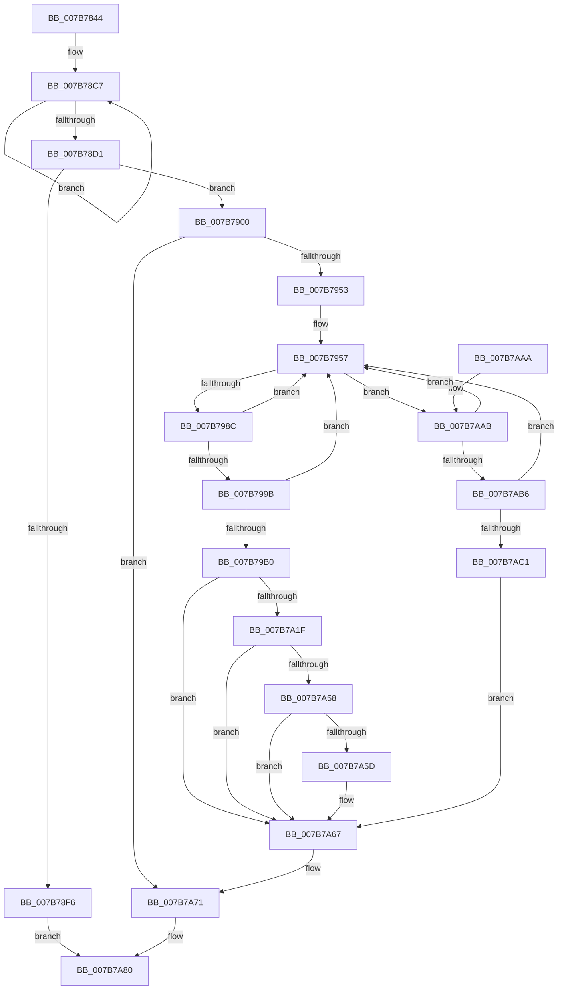

# EtwpRemoveMicroarchitecturalPmcFromPmcGroup

- RVA: `0x007B7844`–`0x007B7AC3` (길이 `639` bytes)
- VA: `0x00000001407B7844`
- 실행 섹션: `PAGE`
- PDB 이름 있음: `예`; PDB Function 태그: `아니요`
- unwind 정보 RVA: `0x000D3370`
- 디코드: `159`개 명령, `639/639` bytes 표시
- 미해석 바이트: `0` (있으면 어셈블리에 `.byte`로 보존)

> 이 문서는 커널 이미지의 기계어와 PDB 기호를 분석해 생성했습니다. 4번과 5번은 함수 원형과 자료형을 바이너리 사용 방식에서 추정한 C 해석이며 원본 소스 복구 결과는 아닙니다.

## 1. Dependencies

- 직접 호출 지점: **16**; 고유 호출 대상: **12**
- 직접 호출자로 확인된 함수: **1**
- RIP 상대 이미지 참조: **2**

### Outgoing calls
- `0x007B789A` → [memset](../../text/6C/memset_function_006C6C40.md) (function, `0x006C6C40`)
- `0x007B78E9` → [ExAllocatePool2](../../poolcode/B8/ExAllocatePool2_function_00B820F0.md) (function, `0x00B820F0`)
- `0x007B7908` → [RtlInitUnicodeString](../../text/42/RtlInitUnicodeString_function_0042A780.md) (function, `0x0042A780`)
- `0x007B7944` → [ZwOpenKey](../../text/6A/ZwOpenKey_function_006AD310.md) (function, `0x006AD310`)
- `0x007B797B` → [ZwEnumerateKey](../../text/6A/ZwEnumerateKey_function_006AD710.md) (function, `0x006AD710`)
- `0x007B79A7` → [wcsncmp](../../text/50/wcsncmp_function_00501CA0.md) (function, `0x00501CA0`)
- `0x007B79C9` → [RtlStringCbPrintfW](../../text/40/RtlStringCbPrintfW_function_0040FB40.md) (function, `0x0040FB40`)
- `0x007B79D6` → [RtlInitUnicodeString](../../text/42/RtlInitUnicodeString_function_0042A780.md) (function, `0x0042A780`)
- `0x007B7A14` → [ZwOpenKey](../../text/6A/ZwOpenKey_function_006AD310.md) (function, `0x006AD310`)
- `0x007B7A24` → [ZwDeleteKey](../../text/6A/ZwDeleteKey_function_006AEC50.md) (function, `0x006AEC50`)
- `0x007B7A2E` → [ZwClose](../../text/6A/ZwClose_function_006AD2B0.md) (function, `0x006AD2B0`)
- `0x007B7A4D` → [ZwQueryKey](../../text/6A/ZwQueryKey_function_006AD390.md) (function, `0x006AD390`)
- `0x007B7A62` → [ZwDeleteKey](../../text/6A/ZwDeleteKey_function_006AEC50.md) (function, `0x006AEC50`)
- `0x007B7A6C` → [ZwClose](../../text/6A/ZwClose_function_006AD2B0.md) (function, `0x006AD2B0`)
- `0x007B7A79` → [ExFreePoolWithTag](../../poolcode/B8/ExFreePoolWithTag_function_00B82870.md) (function, `0x00B82870`)
- `0x007B7A8A` → [_security_check_cookie](../../text/6A/_security_check_cookie_function_006AC640.md) (function, `0x006AC640`)

### Direct callers
- [EtwpRemoveMicroarchitecturalPmcFromRegistry](EtwpRemoveMicroarchitecturalPmcFromRegistry_function_007B7ACC.md) at `0x007B7B5C`

### Static image references
- `0x007B7863` → RVA `0x00E0A740` (`.data`; read)
- `0x007B79B7` → RVA `0x00B07420` (` ?? ::NNGAKEGL::`string'`; read)

## 2. Other-region calls and transfers

- 다른 실행 섹션으로 향하는 call: **16**
  - `0x007B789A` → [memset](../../text/6C/memset_function_006C6C40.md) (`PAGE` → `.text`)
  - `0x007B78E9` → [ExAllocatePool2](../../poolcode/B8/ExAllocatePool2_function_00B820F0.md) (`PAGE` → `POOLCODE`)
  - `0x007B7908` → [RtlInitUnicodeString](../../text/42/RtlInitUnicodeString_function_0042A780.md) (`PAGE` → `.text`)
  - `0x007B7944` → [ZwOpenKey](../../text/6A/ZwOpenKey_function_006AD310.md) (`PAGE` → `.text`)
  - `0x007B797B` → [ZwEnumerateKey](../../text/6A/ZwEnumerateKey_function_006AD710.md) (`PAGE` → `.text`)
  - `0x007B79A7` → [wcsncmp](../../text/50/wcsncmp_function_00501CA0.md) (`PAGE` → `.text`)
  - `0x007B79C9` → [RtlStringCbPrintfW](../../text/40/RtlStringCbPrintfW_function_0040FB40.md) (`PAGE` → `.text`)
  - `0x007B79D6` → [RtlInitUnicodeString](../../text/42/RtlInitUnicodeString_function_0042A780.md) (`PAGE` → `.text`)
  - `0x007B7A14` → [ZwOpenKey](../../text/6A/ZwOpenKey_function_006AD310.md) (`PAGE` → `.text`)
  - `0x007B7A24` → [ZwDeleteKey](../../text/6A/ZwDeleteKey_function_006AEC50.md) (`PAGE` → `.text`)
  - `0x007B7A2E` → [ZwClose](../../text/6A/ZwClose_function_006AD2B0.md) (`PAGE` → `.text`)
  - `0x007B7A4D` → [ZwQueryKey](../../text/6A/ZwQueryKey_function_006AD390.md) (`PAGE` → `.text`)
  - `0x007B7A62` → [ZwDeleteKey](../../text/6A/ZwDeleteKey_function_006AEC50.md) (`PAGE` → `.text`)
  - `0x007B7A6C` → [ZwClose](../../text/6A/ZwClose_function_006AD2B0.md) (`PAGE` → `.text`)
  - `0x007B7A79` → [ExFreePoolWithTag](../../poolcode/B8/ExFreePoolWithTag_function_00B82870.md) (`PAGE` → `POOLCODE`)
  - `0x007B7A8A` → [_security_check_cookie](../../text/6A/_security_check_cookie_function_006AC640.md) (`PAGE` → `.text`)
- 별도 외부 분기/꼬리 이동을 확인하지 못했습니다.

## 3. Assembly (complete function range)

```asm
007B7844  48 89 5C 24 20                  mov qword ptr [rsp + 0x20], rbx
007B7849  55                              push rbp
007B784A  56                              push rsi
007B784B  57                              push rdi
007B784C  41 54                           push r12
007B784E  41 55                           push r13
007B7850  41 56                           push r14
007B7852  41 57                           push r15
007B7854  48 8D AC 24 20 FE FF FF         lea rbp, [rsp - 0x1e0]
007B785C  48 81 EC E0 02 00 00            sub rsp, 0x2e0
007B7863  48 8B 05 D6 2E 65 00            mov rax, qword ptr [rip + 0x652ed6]
007B786A  48 33 C4                        xor rax, rsp
007B786D  48 89 85 D0 01 00 00            mov qword ptr [rbp + 0x1d0], rax
007B7874  0F 57 C0                        xorps xmm0, xmm0
007B7877  45 8B E0                        mov r12d, r8d
007B787A  4C 8B EA                        mov r13, rdx
007B787D  4C 8B F9                        mov r15, rcx
007B7880  33 C0                           xor eax, eax
007B7882  48 8D 4D B0                     lea rcx, [rbp - 0x50]
007B7886  33 D2                           xor edx, edx
007B7888  48 89 45 A8                     mov qword ptr [rbp - 0x58], rax
007B788C  41 B8 18 02 00 00               mov r8d, 0x218
007B7892  0F 11 45 88                     movups xmmword ptr [rbp - 0x78], xmm0
007B7896  0F 11 45 98                     movups xmmword ptr [rbp - 0x68], xmm0
007B789A  E8 A1 F3 F0 FF                  call 0x1406c6c40
007B789F  45 33 F6                        xor r14d, r14d
007B78A2  0F 57 C0                        xorps xmm0, xmm0
007B78A5  0F 11 44 24 48                  movups xmmword ptr [rsp + 0x48], xmm0
007B78AA  44 89 74 24 5C                  mov dword ptr [rsp + 0x5c], r14d
007B78AF  48 83 C8 FF                     or rax, 0xffffffffffffffff
007B78B3  44 89 74 24 74                  mov dword ptr [rsp + 0x74], r14d
007B78B8  4C 89 74 24 38                  mov qword ptr [rsp + 0x38], r14
007B78BD  4C 89 74 24 40                  mov qword ptr [rsp + 0x40], r14
007B78C2  44 89 74 24 30                  mov dword ptr [rsp + 0x30], r14d
007B78C7  48 FF C0                        inc rax
007B78CA  66 45 39 34 47                  cmp word ptr [r15 + rax*2], r14w
007B78CF  75 F6                           jne 0x1407b78c7
007B78D1  41 8D 74 24 02                  lea esi, [r12 + 2]
007B78D6  41 B8 45 74 77 50               mov r8d, 0x50777445
007B78DC  03 F0                           add esi, eax
007B78DE  B9 00 01 00 00                  mov ecx, 0x100
007B78E3  48 03 F6                        add rsi, rsi
007B78E6  48 8B D6                        mov rdx, rsi
007B78E9  E8 02 A8 3C 00                  call 0x140b820f0
007B78EE  48 8B F8                        mov rdi, rax
007B78F1  48 85 C0                        test rax, rax
007B78F4  75 0A                           jne 0x1407b7900
007B78F6  B8 17 00 00 C0                  mov eax, 0xc0000017
007B78FB  E9 80 01 00 00                  jmp 0x1407b7a80
007B7900  49 8B D7                        mov rdx, r15
007B7903  48 8D 4C 24 48                  lea rcx, [rsp + 0x48]
007B7908  E8 73 2E C7 FF                  call 0x14042a780
007B790D  48 8D 44 24 48                  lea rax, [rsp + 0x48]
007B7912  C7 44 24 58 30 00 00 00         mov dword ptr [rsp + 0x58], 0x30
007B791A  0F 57 C0                        xorps xmm0, xmm0
007B791D  48 89 44 24 68                  mov qword ptr [rsp + 0x68], rax
007B7922  4C 8D 44 24 58                  lea r8, [rsp + 0x58]
007B7927  4C 89 74 24 60                  mov qword ptr [rsp + 0x60], r14
007B792C  BA 3F 00 0F 00                  mov edx, 0xf003f
007B7931  C7 44 24 70 40 02 00 00         mov dword ptr [rsp + 0x70], 0x240
007B7939  48 8D 4C 24 38                  lea rcx, [rsp + 0x38]
007B793E  F3 0F 7F 44 24 78               movdqu xmmword ptr [rsp + 0x78], xmm0
007B7944  E8 C7 59 EF FF                  call 0x1406ad310
007B7949  8B D8                           mov ebx, eax
007B794B  85 C0                           test eax, eax
007B794D  0F 88 1E 01 00 00               js 0x1407b7a71
007B7953  41 83 CE FF                     or r14d, 0xffffffff
007B7957  48 8B 4C 24 38                  mov rcx, qword ptr [rsp + 0x38]
007B795C  48 8D 44 24 30                  lea rax, [rsp + 0x30]
007B7961  48 89 44 24 28                  mov qword ptr [rsp + 0x28], rax
007B7966  4C 8D 4D B0                     lea r9, [rbp - 0x50]
007B796A  41 FF C6                        inc r14d
007B796D  C7 44 24 20 16 02 00 00         mov dword ptr [rsp + 0x20], 0x216
007B7975  41 8B D6                        mov edx, r14d
007B7978  45 33 C0                        xor r8d, r8d
007B797B  E8 90 5D EF FF                  call 0x1406ad710
007B7980  33 D2                           xor edx, edx
007B7982  8B D8                           mov ebx, eax
007B7984  85 C0                           test eax, eax
007B7986  0F 88 1F 01 00 00               js 0x1407b7aab
007B798C  8B 45 BC                        mov eax, dword ptr [rbp - 0x44]
007B798F  4B 8D 0C 24                     lea rcx, [r12 + r12]
007B7993  4D 8B C4                        mov r8, r12
007B7996  48 3B C1                        cmp rax, rcx
007B7999  75 BC                           jne 0x1407b7957
007B799B  66 89 54 0D C0                  mov word ptr [rbp + rcx - 0x40], dx
007B79A0  48 8D 55 C0                     lea rdx, [rbp - 0x40]
007B79A4  49 8B CD                        mov rcx, r13
007B79A7  E8 F4 A2 D4 FF                  call 0x140501ca0
007B79AC  85 C0                           test eax, eax
007B79AE  75 A7                           jne 0x1407b7957
007B79B0  48 8D 45 C0                     lea rax, [rbp - 0x40]
007B79B4  4D 8B CF                        mov r9, r15
007B79B7  4C 8D 05 62 FA 34 00            lea r8, [rip + 0x34fa62]
007B79BE  48 89 44 24 20                  mov qword ptr [rsp + 0x20], rax
007B79C3  48 8B D6                        mov rdx, rsi
007B79C6  48 8B CF                        mov rcx, rdi
007B79C9  E8 72 81 C5 FF                  call 0x14040fb40
007B79CE  48 8B D7                        mov rdx, rdi
007B79D1  48 8D 4C 24 48                  lea rcx, [rsp + 0x48]
007B79D6  E8 A5 2D C7 FF                  call 0x14042a780
007B79DB  48 8D 44 24 48                  lea rax, [rsp + 0x48]
007B79E0  C7 44 24 58 30 00 00 00         mov dword ptr [rsp + 0x58], 0x30
007B79E8  0F 57 C0                        xorps xmm0, xmm0
007B79EB  48 89 44 24 68                  mov qword ptr [rsp + 0x68], rax
007B79F0  33 F6                           xor esi, esi
007B79F2  C7 44 24 70 40 02 00 00         mov dword ptr [rsp + 0x70], 0x240
007B79FA  4C 8D 44 24 58                  lea r8, [rsp + 0x58]
007B79FF  48 89 74 24 60                  mov qword ptr [rsp + 0x60], rsi
007B7A04  BA 3F 00 0F 00                  mov edx, 0xf003f
007B7A09  48 8D 4C 24 40                  lea rcx, [rsp + 0x40]
007B7A0E  F3 0F 7F 44 24 78               movdqu xmmword ptr [rsp + 0x78], xmm0
007B7A14  E8 F7 58 EF FF                  call 0x1406ad310
007B7A19  8B D8                           mov ebx, eax
007B7A1B  85 C0                           test eax, eax
007B7A1D  78 48                           js 0x1407b7a67
007B7A1F  48 8B 4C 24 40                  mov rcx, qword ptr [rsp + 0x40]
007B7A24  E8 27 72 EF FF                  call 0x1406aec50
007B7A29  48 8B 4C 24 40                  mov rcx, qword ptr [rsp + 0x40]
007B7A2E  E8 7D 58 EF FF                  call 0x1406ad2b0
007B7A33  48 8B 4C 24 38                  mov rcx, qword ptr [rsp + 0x38]
007B7A38  48 8D 44 24 30                  lea rax, [rsp + 0x30]
007B7A3D  44 8D 4E 28                     lea r9d, [rsi + 0x28]
007B7A41  48 89 44 24 20                  mov qword ptr [rsp + 0x20], rax
007B7A46  4C 8D 45 88                     lea r8, [rbp - 0x78]
007B7A4A  8D 56 04                        lea edx, [rsi + 4]
007B7A4D  E8 3E 59 EF FF                  call 0x1406ad390
007B7A52  8B D8                           mov ebx, eax
007B7A54  85 C0                           test eax, eax
007B7A56  78 0F                           js 0x1407b7a67
007B7A58  39 75 94                        cmp dword ptr [rbp - 0x6c], esi
007B7A5B  75 0A                           jne 0x1407b7a67
007B7A5D  48 8B 4C 24 38                  mov rcx, qword ptr [rsp + 0x38]
007B7A62  E8 E9 71 EF FF                  call 0x1406aec50
007B7A67  48 8B 4C 24 38                  mov rcx, qword ptr [rsp + 0x38]
007B7A6C  E8 3F 58 EF FF                  call 0x1406ad2b0
007B7A71  BA 45 74 77 50                  mov edx, 0x50777445
007B7A76  48 8B CF                        mov rcx, rdi
007B7A79  E8 F2 AD 3C 00                  call 0x140b82870
007B7A7E  8B C3                           mov eax, ebx
007B7A80  48 8B 8D D0 01 00 00            mov rcx, qword ptr [rbp + 0x1d0]
007B7A87  48 33 CC                        xor rcx, rsp
007B7A8A  E8 B1 4B EF FF                  call 0x1406ac640
007B7A8F  48 8B 9C 24 38 03 00 00         mov rbx, qword ptr [rsp + 0x338]
007B7A97  48 81 C4 E0 02 00 00            add rsp, 0x2e0
007B7A9E  41 5F                           pop r15
007B7AA0  41 5E                           pop r14
007B7AA2  41 5D                           pop r13
007B7AA4  41 5C                           pop r12
007B7AA6  5F                              pop rdi
007B7AA7  5E                              pop rsi
007B7AA8  5D                              pop rbp
007B7AA9  C3                              ret
007B7AAA  CC                              int3
007B7AAB  3D 23 00 00 C0                  cmp eax, 0xc0000023
007B7AB0  0F 84 A1 FE FF FF               je 0x1407b7957
007B7AB6  3D 05 00 00 80                  cmp eax, 0x80000005
007B7ABB  0F 84 96 FE FF FF               je 0x1407b7957
007B7AC1  EB A4                           jmp 0x1407b7a67
```

## 4. C-style interpretation (structured pseudocode)

```c
__int64 __fastcall EtwpRemoveMicroarchitecturalPmcFromPmcGroup(__int64 a1, __int64 a2, int a3)
{
    __int64 result;
    __int64 v_r14;
    __int64 v_rsi;
    __int64 v_rsp;
    unsigned __int64 v_stack_m218;
    unsigned __int64 v_stack_m258;
    unsigned int v_stack_m25C;
    unsigned __int64 v_stack_m268;
    unsigned __int64 v_stack_m270;
    unsigned __int64 v_stack_m280;
    unsigned int v_stack_m284;
    unsigned __int64 v_stack_m290;
    unsigned __int64 v_stack_m2A0;
    unsigned int v_stack_m2A4;
    unsigned int v_stack_m2A8;
    unsigned __int64 v_stack_m2B0;
    unsigned __int64 v_stack_m2B8;
    unsigned int v_stack_m2BC;
    unsigned int v_stack_m2C0;
    unsigned __int64 v_stack_m2D0;
    unsigned __int64 v_stack_m2D8;
    unsigned __int64 v_stack_m2E0;
    unsigned int v_stack_m2E8;
    unsigned __int64 v_stack_m2F0;
    unsigned int v_stack_m2F8;
    unsigned __int64 v_stack_m48;
    unsigned __int64 v_stack_p20;

    v_stack_p20 = v_rbx;
    v_rsp = (v_rsp) - (736);
    result = (*(unsigned __int64 *)(v_rip + 6631126)) ^ (v_rsp);
    v_stack_m48 = result;
    result = 0;
    a2 = 0;
    v_stack_m270 = 0;
    v_stack_m290 = v_xmm0;
    v_stack_m280 = v_xmm0;
    result = memset(v_stack_m268, a2, 536, a4);
    v_r14 = 0;
    v_stack_m2D0 = v_xmm0;
    v_stack_m2BC = 0;
    result = (result) | (-1);
    v_stack_m2A4 = 0;
    v_stack_m2E0 = 0;
    v_stack_m2D8 = 0;
    v_stack_m2E8 = 0;
loc_007B78C7:
    result = (result) + 1;
    if ((*(unsigned __int16 *)(a1 + result * 2)) != 0) goto loc_007B78C7;
    v_rsi = (unsigned int)(((unsigned int)(a3) + 2) + ((unsigned int)(result)));
    v_rsi = (v_rsi) + (v_rsi);
    result = ExAllocatePool2(256, v_rsi, (unsigned int)(0x50777445ULL), a4);
    if (result != 0) goto loc_007B7900;
    goto loc_007B7A80;
loc_007B7900:
    result = RtlInitUnicodeString(v_stack_m2D0, a1, (unsigned int)(0x50777445ULL), a4);
    v_stack_m2C0 = 48;
    v_stack_m2B0 = v_stack_m2D0;
    v_stack_m2B8 = 0;
    v_stack_m2A8 = 576;
    v_stack_m2A0 = v_xmm0;
    result = ZwOpenKey(v_stack_m2E0, (unsigned int)(0xF003FULL), v_stack_m2C0, a4);
    if (sign_flag) goto loc_007B7A71;
    v_r14 = (unsigned int)((v_r14) | (0xFFFFFFFFULL));
loc_007B7957:
    v_stack_m2F0 = v_stack_m2E8;
    v_r14 = (unsigned int)((v_r14) + 1);
    v_stack_m2F8 = 534;
    a3 = 0;
    result = ZwEnumerateKey(v_stack_m2E0, (unsigned int)((unsigned int)(v_r14)), a3, v_stack_m268);
    a2 = 0;
    if (sign_flag) goto loc_007B7AAB;
    if (((unsigned int)(v_stack_m25C)) != ((unsigned int)(a3) + (unsigned int)(a3) * 1)) goto loc_007B7957;
    *(unsigned __int16 *)(v_stack_m218 + (unsigned int)(a3) + (unsigned int)(a3) * 1 * 1 - 64) = 0;
    result = wcsncmp(0, v_stack_m258, (unsigned int)(a3), v_stack_m268);
    if ((unsigned int)(result) != 0) goto loc_007B7957;
    v_stack_m2F8 = v_stack_m258;
    result = RtlStringCbPrintfW(result, v_rsi, v_rip + 3471970, a1);
    result = RtlInitUnicodeString(v_stack_m2D0, result, v_rip + 3471970, a1);
    v_stack_m2C0 = 48;
    v_stack_m2B0 = v_stack_m2D0;
    v_rsi = 0;
    v_stack_m2A8 = 576;
    v_stack_m2B8 = 0;
    v_stack_m2A0 = v_xmm0;
    result = ZwOpenKey(v_stack_m2D8, (unsigned int)(0xF003FULL), v_stack_m2C0, a1);
    if (sign_flag) goto loc_007B7A67;
    result = ZwDeleteKey(v_stack_m2D8, (unsigned int)(0xF003FULL), v_stack_m2C0, a1);
    result = ZwClose(v_stack_m2D8, (unsigned int)(0xF003FULL), v_stack_m2C0, a1);
    v_stack_m2F8 = v_stack_m2E8;
    result = ZwQueryKey(v_stack_m2E0, v_rsi + 4, v_stack_m290, v_rsi + 40);
    if (sign_flag) goto loc_007B7A67;
    if (v_stack_m284 == 0) {
        a1 = v_stack_m2E0;
        result = ZwDeleteKey(a1, v_rsi + 4, v_stack_m290, v_rsi + 40);
    }
    result = ZwClose(v_stack_m2E0, v_rsi + 4, v_stack_m290, v_rsi + 40);
loc_007B7A71:
    result = ExFreePoolWithTag(result, (unsigned int)(0x50777445ULL), v_stack_m290, v_rsi + 40);
loc_007B7A80:
    a1 = (v_stack_m48) ^ (v_rsp);
    result = _security_check_cookie(a1, (unsigned int)(0x50777445ULL), v_stack_m290, v_rsi + 40);
    v_rsp = (v_rsp) + (736);
    return result;
loc_007B7AAB:
    if (((unsigned int)(result)) == 0xC0000023ULL) goto loc_007B7957;
    if (((unsigned int)(result)) == 0x80000005ULL) goto loc_007B7957;
    goto loc_007B7A67;
}
```

## 5. (Beta) C Style

```c
int64_t EtwpRemoveMicroarchitecturalPmcFromPmcGroup(void *Arg1, int64_t Arg2, void *Arg3)
{
    uint8_t *arg1 = (uint8_t *)Arg1;
    uint8_t *arg3 = (uint8_t *)Arg3;

    int64_t result;
    int64_t local_r14;
    int64_t local_rsi;
    int64_t local_rsp;
    uint64_t v_stack_m218;
    uint64_t v_stack_m258;
    uint32_t v_stack_m25C;
    uint64_t v_stack_m268;
    uint64_t v_stack_m270;
    uint64_t v_stack_m280;
    uint32_t v_stack_m284;
    uint64_t v_stack_m290;
    uint64_t v_stack_m2A0;
    uint32_t v_stack_m2A4;
    uint32_t v_stack_m2A8;
    uint64_t v_stack_m2B0;
    uint64_t v_stack_m2B8;
    uint32_t v_stack_m2BC;
    uint32_t v_stack_m2C0;
    uint64_t v_stack_m2D0;
    uint64_t v_stack_m2D8;
    uint64_t v_stack_m2E0;
    uint32_t v_stack_m2E8;
    uint64_t v_stack_m2F0;
    uint32_t v_stack_m2F8;
    uint64_t v_stack_m48;
    uint64_t v_stack_p20;

    v_stack_p20 = local_rbx;
    local_rsp = (local_rsp) - (736);
    result = (*(uint64_t *)(v_rip + 0x652ED6)) ^ (local_rsp);
    v_stack_m48 = result;
    result = 0;
    Arg2 = 0;
    v_stack_m270 = 0;
    v_stack_m290 = v_xmm0;
    v_stack_m280 = v_xmm0;
    result = memset(v_stack_m268, Arg2, 536, a4);
    local_r14 = 0;
    v_stack_m2D0 = v_xmm0;
    v_stack_m2BC = 0;
    result = (result) | (-1);
    v_stack_m2A4 = 0;
    v_stack_m2E0 = 0;
    v_stack_m2D8 = 0;
    v_stack_m2E8 = 0;
loc_007B78C7:
    result = (result) + 1;
    if ((*(uint16_t *)(arg1 + result * 2)) != 0) goto loc_007B78C7;
    local_rsi = (uint32_t)(((uint32_t)(Arg3) + 2) + ((uint32_t)(result)));
    local_rsi = (local_rsi) + (local_rsi);
    result = ExAllocatePool2(256, local_rsi, (uint32_t)(0x50777445ULL), a4);
    if (result != 0) goto loc_007B7900;
    goto loc_007B7A80;
loc_007B7900:
    result = RtlInitUnicodeString(v_stack_m2D0, Arg1, (uint32_t)(0x50777445ULL), a4);
    v_stack_m2C0 = 48;
    v_stack_m2B0 = v_stack_m2D0;
    v_stack_m2B8 = 0;
    v_stack_m2A8 = 576;
    v_stack_m2A0 = v_xmm0;
    result = ZwOpenKey(v_stack_m2E0, (uint32_t)(0xF003FULL), v_stack_m2C0, a4);
    if (sign_flag) goto loc_007B7A71;
    local_r14 = (uint32_t)((local_r14) | (0xFFFFFFFFULL));
loc_007B7957:
    v_stack_m2F0 = v_stack_m2E8;
    local_r14 = (uint32_t)((local_r14) + 1);
    v_stack_m2F8 = 534;
    Arg3 = 0;
    result = ZwEnumerateKey(v_stack_m2E0, (uint32_t)((uint32_t)(local_r14)), Arg3, v_stack_m268);
    Arg2 = 0;
    if (sign_flag) goto loc_007B7AAB;
    if (((uint32_t)(v_stack_m25C)) != ((uint32_t)(Arg3) + (uint32_t)(Arg3) * 1)) goto loc_007B7957;
    *(uint16_t *)(v_stack_m218 + (uint32_t)(arg3) + (uint32_t)(arg3) * 1 * 1 - 0x40) = 0;
    result = wcsncmp(0, v_stack_m258, (uint32_t)(Arg3), v_stack_m268);
    if ((uint32_t)(result) != 0) goto loc_007B7957;
    v_stack_m2F8 = v_stack_m258;
    result = RtlStringCbPrintfW(result, local_rsi, v_rip + 3471970, Arg1);
    result = RtlInitUnicodeString(v_stack_m2D0, result, v_rip + 3471970, Arg1);
    v_stack_m2C0 = 48;
    v_stack_m2B0 = v_stack_m2D0;
    local_rsi = 0;
    v_stack_m2A8 = 576;
    v_stack_m2B8 = 0;
    v_stack_m2A0 = v_xmm0;
    result = ZwOpenKey(v_stack_m2D8, (uint32_t)(0xF003FULL), v_stack_m2C0, Arg1);
    if (sign_flag) goto loc_007B7A67;
    result = ZwDeleteKey(v_stack_m2D8, (uint32_t)(0xF003FULL), v_stack_m2C0, Arg1);
    result = ZwClose(v_stack_m2D8, (uint32_t)(0xF003FULL), v_stack_m2C0, Arg1);
    v_stack_m2F8 = v_stack_m2E8;
    result = ZwQueryKey(v_stack_m2E0, local_rsi + 4, v_stack_m290, local_rsi + 40);
    if (sign_flag) goto loc_007B7A67;
    if (v_stack_m284 == 0) {
        Arg1 = v_stack_m2E0;
        result = ZwDeleteKey(Arg1, local_rsi + 4, v_stack_m290, local_rsi + 40);
    }
    result = ZwClose(v_stack_m2E0, local_rsi + 4, v_stack_m290, local_rsi + 40);
loc_007B7A71:
    result = ExFreePoolWithTag(result, (uint32_t)(0x50777445ULL), v_stack_m290, local_rsi + 40);
loc_007B7A80:
    Arg1 = (v_stack_m48) ^ (local_rsp);
    result = _security_check_cookie(Arg1, (uint32_t)(0x50777445ULL), v_stack_m290, local_rsi + 40);
    local_rsp = (local_rsp) + (736);
    return result;
loc_007B7AAB:
    if (((uint32_t)(result)) == 0xC0000023ULL) goto loc_007B7957;
    if (((uint32_t)(result)) == 0x80000005ULL) goto loc_007B7957;
    goto loc_007B7A67;
}
```

### 관측된 메모리 오프셋

구조체 형식이 확인되지 않은 접근은 인자 기준의 오프셋으로만 기록했습니다.

| 기준 인자 | 오프셋 표현 | 폭 (bit) | 접근 |
|---|---:|---:|---|
| `Arg1` | `+ 0x0 + rax*2` | `16` | `R` |
| `Arg3` | `+ 0x0 + r12*1` | `64` | `R` |
| `Arg3` | `+ 0x2` | `32` | `R` |

## 6. Execution-region graph

[열기: 2D/3D 그래프와 함수 탐색 컨트롤 패널](../../../control-panel.html?section=page&rva=0x007B7844&view=graph)

- 2D 그래프는 위에서 아래로 흐르고, 3D 그래프는 빈 공간을 드래그해 회전합니다. Shift+드래그는 이동, 휠은 확대·축소, 함수 노드 선택은 대상 보고서 이동입니다.

### Static fallback


