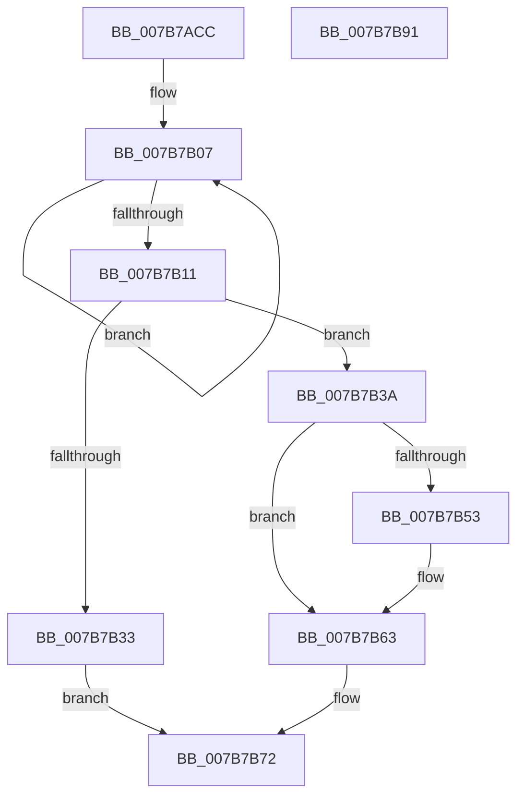

# EtwpRemoveMicroarchitecturalPmcFromRegistry

- RVA: `0x007B7ACC`–`0x007B7B92` (길이 `198` bytes)
- VA: `0x00000001407B7ACC`
- 실행 섹션: `PAGE`
- PDB 이름 있음: `예`; PDB Function 태그: `아니요`
- unwind 정보 RVA: `0x000847EC`
- 디코드: `57`개 명령, `198/198` bytes 표시
- 미해석 바이트: `0` (있으면 어셈블리에 `.byte`로 보존)

> 이 문서는 커널 이미지의 기계어와 PDB 기호를 분석해 생성했습니다. 4번과 5번은 함수 원형과 자료형을 바이너리 사용 방식에서 추정한 C 해석이며 원본 소스 복구 결과는 아닙니다.

## 1. Dependencies

- 직접 호출 지점: **5**; 고유 호출 대상: **5**
- 직접 호출자로 확인된 함수: **1**
- RIP 상대 이미지 참조: **1**

### Outgoing calls
- `0x007B7AF1` → [KiGetCpuVendor](../../pagelk/B7/KiGetCpuVendor_function_00B7D5B4.md) (function, `0x00B7D5B4`)
- `0x007B7B26` → [ExAllocatePool2](../../poolcode/B8/ExAllocatePool2_function_00B820F0.md) (function, `0x00B820F0`)
- `0x007B7B48` → [EtwpFindMatchingPmcRegistryGroup](EtwpFindMatchingPmcRegistryGroup_function_007B644C.md) (function, `0x007B644C`)
- `0x007B7B5C` → [EtwpRemoveMicroarchitecturalPmcFromPmcGroup](EtwpRemoveMicroarchitecturalPmcFromPmcGroup_function_007B7844.md) (function, `0x007B7844`)
- `0x007B7B6B` → [ExFreePoolWithTag](../../poolcode/B8/ExFreePoolWithTag_function_00B82870.md) (function, `0x00B82870`)

### Direct callers
- [sub_00B3C988](../B3/Unknown_function_00B3C988.md) at `0x00B3D097`

### Static image references
- `0x007B7B00` → RVA `0x00B07430` (` ?? ::NNGAKEGL::`string'`; read)

## 2. Other-region calls and transfers

- 다른 실행 섹션으로 향하는 call: **3**
  - `0x007B7AF1` → [KiGetCpuVendor](../../pagelk/B7/KiGetCpuVendor_function_00B7D5B4.md) (`PAGE` → `PAGELK`)
  - `0x007B7B26` → [ExAllocatePool2](../../poolcode/B8/ExAllocatePool2_function_00B820F0.md) (`PAGE` → `POOLCODE`)
  - `0x007B7B6B` → [ExFreePoolWithTag](../../poolcode/B8/ExFreePoolWithTag_function_00B82870.md) (`PAGE` → `POOLCODE`)
- 별도 외부 분기/꼬리 이동을 확인하지 못했습니다.

## 3. Assembly (complete function range)

```asm
007B7ACC  48 8B C4                        mov rax, rsp
007B7ACF  48 89 58 08                     mov qword ptr [rax + 8], rbx
007B7AD3  48 89 68 10                     mov qword ptr [rax + 0x10], rbp
007B7AD7  48 89 70 18                     mov qword ptr [rax + 0x18], rsi
007B7ADB  48 89 78 20                     mov qword ptr [rax + 0x20], rdi
007B7ADF  41 54                           push r12
007B7AE1  41 56                           push r14
007B7AE3  41 57                           push r15
007B7AE5  48 83 EC 30                     sub rsp, 0x30
007B7AE9  4D 8B F0                        mov r14, r8
007B7AEC  8B F2                           mov esi, edx
007B7AEE  48 8B E9                        mov rbp, rcx
007B7AF1  E8 BE 5A 3C 00                  call 0x140b7d5b4
007B7AF6  49 83 C9 FF                     or r9, 0xffffffffffffffff
007B7AFA  44 8B F8                        mov r15d, eax
007B7AFD  45 33 E4                        xor r12d, r12d
007B7B00  48 8D 05 29 F9 34 00            lea rax, [rip + 0x34f929]
007B7B07  49 FF C1                        inc r9
007B7B0A  66 46 39 24 48                  cmp word ptr [rax + r9*2], r12w
007B7B0F  75 F6                           jne 0x1407b7b07
007B7B11  42 8D 3C 4D 02 02 00 00         lea edi, [r9*2 + 0x202]
007B7B19  B9 00 01 00 00                  mov ecx, 0x100
007B7B1E  8B D7                           mov edx, edi
007B7B20  41 B8 45 74 77 50               mov r8d, 0x50777445
007B7B26  E8 C5 A5 3C 00                  call 0x140b820f0
007B7B2B  48 8B D8                        mov rbx, rax
007B7B2E  48 85 C0                        test rax, rax
007B7B31  75 07                           jne 0x1407b7b3a
007B7B33  B8 17 00 00 C0                  mov eax, 0xc0000017
007B7B38  EB 38                           jmp 0x1407b7b72
007B7B3A  44 8B CF                        mov r9d, edi
007B7B3D  48 89 5C 24 20                  mov qword ptr [rsp + 0x20], rbx
007B7B42  4D 8B C6                        mov r8, r14
007B7B45  41 8B D7                        mov edx, r15d
007B7B48  E8 FF E8 FF FF                  call 0x1407b644c
007B7B4D  8B F8                           mov edi, eax
007B7B4F  85 C0                           test eax, eax
007B7B51  78 10                           js 0x1407b7b63
007B7B53  44 8B C6                        mov r8d, esi
007B7B56  48 8B D5                        mov rdx, rbp
007B7B59  48 8B CB                        mov rcx, rbx
007B7B5C  E8 E3 FC FF FF                  call 0x1407b7844
007B7B61  8B F8                           mov edi, eax
007B7B63  BA 45 74 77 50                  mov edx, 0x50777445
007B7B68  48 8B CB                        mov rcx, rbx
007B7B6B  E8 00 AD 3C 00                  call 0x140b82870
007B7B70  8B C7                           mov eax, edi
007B7B72  48 8B 5C 24 50                  mov rbx, qword ptr [rsp + 0x50]
007B7B77  48 8B 6C 24 58                  mov rbp, qword ptr [rsp + 0x58]
007B7B7C  48 8B 74 24 60                  mov rsi, qword ptr [rsp + 0x60]
007B7B81  48 8B 7C 24 68                  mov rdi, qword ptr [rsp + 0x68]
007B7B86  48 83 C4 30                     add rsp, 0x30
007B7B8A  41 5F                           pop r15
007B7B8C  41 5E                           pop r14
007B7B8E  41 5C                           pop r12
007B7B90  C3                              ret
007B7B91  CC                              int3
```

## 4. C-style interpretation (structured pseudocode)

```c
__int64 __fastcall EtwpRemoveMicroarchitecturalPmcFromRegistry(__int64 a1, int a2, __int64 a3, __int64 a4)
{
    __int64 result;
    __int64 v_r12;
    __int64 v_rdi;
    __int64 v_rsp;
    unsigned __int64 v_stack_m28;
    unsigned __int64 v_stack_p10;
    unsigned __int64 v_stack_p18;
    unsigned __int64 v_stack_p20;
    unsigned __int64 v_stack_p8;

    *(unsigned __int64 *)(v_rsp + 8) = v_rbx;
    *(unsigned __int64 *)(v_rsp + 16) = v_rbp;
    *(unsigned __int64 *)(v_rsp + 24) = v_rsi;
    *(unsigned __int64 *)(v_rsp + 32) = v_rdi;
    v_rsp = (v_rsp) - (48);
    result = KiGetCpuVendor(a1, a2, a3, a4);
    a4 = (a4) | (-1);
    v_r12 = 0;
loc_007B7B07:
    a4 = (a4) + 1;
    if ((*(unsigned __int16 *)(v_rip + 3471657 + a4 * 2)) != 0) goto loc_007B7B07;
    result = ExAllocatePool2(256, (unsigned int)((unsigned int)(a4 * 2 + 514)), (unsigned int)(0x50777445ULL), a4);
    if (result != 0) goto loc_007B7B3A;
    goto loc_007B7B72;
loc_007B7B3A:
    v_stack_m28 = result;
    result = EtwpFindMatchingPmcRegistryGroup(256, (unsigned int)((unsigned int)((unsigned int)((unsigned int)(result)))), a3, (unsigned int)((unsigned int)(a4 * 2 + 514)));
    v_rdi = (unsigned int)((unsigned int)(result));
    if (!(sign_flag)) {
        a3 = (unsigned int)((unsigned int)(a2));
        a2 = a1;
        a1 = result;
        result = EtwpRemoveMicroarchitecturalPmcFromPmcGroup(a1, a2, a3, (unsigned int)((unsigned int)(a4 * 2 + 514)));
        v_rdi = (unsigned int)(result);
    }
    result = ExFreePoolWithTag(result, (unsigned int)(0x50777445ULL), a3, (unsigned int)((unsigned int)(a4 * 2 + 514)));
loc_007B7B72:
    v_rsp = (v_rsp) + (48);
    return (unsigned int)((unsigned int)(v_rdi));
}
```

## 5. (Beta) C Style

```c
int64_t EtwpRemoveMicroarchitecturalPmcFromRegistry(int64_t Arg1, int32_t Arg2, int64_t Arg3, int64_t Arg4)
{
    int64_t result;
    int64_t local_r12;
    int64_t local_rdi;
    int64_t local_rsp;
    uint64_t v_stack_m28;
    uint64_t v_stack_p10;
    uint64_t v_stack_p18;
    uint64_t v_stack_p20;
    uint64_t v_stack_p8;

    *(uint64_t *)(local_rsp + 0x8) = local_rbx;
    *(uint64_t *)(local_rsp + 0x10) = local_rbp;
    *(uint64_t *)(local_rsp + 0x18) = local_rsi;
    *(uint64_t *)(local_rsp + 0x20) = local_rdi;
    local_rsp = (local_rsp) - (48);
    result = KiGetCpuVendor(Arg1, Arg2, Arg3, Arg4);
    Arg4 = (Arg4) | (-1);
    local_r12 = 0;
loc_007B7B07:
    Arg4 = (Arg4) + 1;
    if ((*(uint16_t *)(v_rip + 0x34F929 + Arg4 * 2)) != 0) goto loc_007B7B07;
    result = ExAllocatePool2(256, (uint32_t)((uint32_t)(Arg4 * 2 + 514)), (uint32_t)(0x50777445ULL), Arg4);
    if (result != 0) goto loc_007B7B3A;
    goto loc_007B7B72;
loc_007B7B3A:
    v_stack_m28 = result;
    result = EtwpFindMatchingPmcRegistryGroup(256, (uint32_t)((uint32_t)((uint32_t)((uint32_t)(result)))), Arg3, (uint32_t)((uint32_t)(Arg4 * 2 + 514)));
    local_rdi = (uint32_t)((uint32_t)(result));
    if (!(sign_flag)) {
        Arg3 = (uint32_t)((uint32_t)(Arg2));
        Arg2 = Arg1;
        Arg1 = result;
        result = EtwpRemoveMicroarchitecturalPmcFromPmcGroup(Arg1, Arg2, Arg3, (uint32_t)((uint32_t)(Arg4 * 2 + 514)));
        local_rdi = (uint32_t)(result);
    }
    result = ExFreePoolWithTag(result, (uint32_t)(0x50777445ULL), Arg3, (uint32_t)((uint32_t)(Arg4 * 2 + 514)));
loc_007B7B72:
    local_rsp = (local_rsp) + (48);
    return (uint32_t)((uint32_t)(local_rdi));
}
```

## 6. Execution-region graph

[열기: 2D/3D 그래프와 함수 탐색 컨트롤 패널](../../../control-panel.html?section=page&rva=0x007B7ACC&view=graph)

- 2D 그래프는 위에서 아래로 흐르고, 3D 그래프는 빈 공간을 드래그해 회전합니다. Shift+드래그는 이동, 휠은 확대·축소, 함수 노드 선택은 대상 보고서 이동입니다.

### Static fallback


