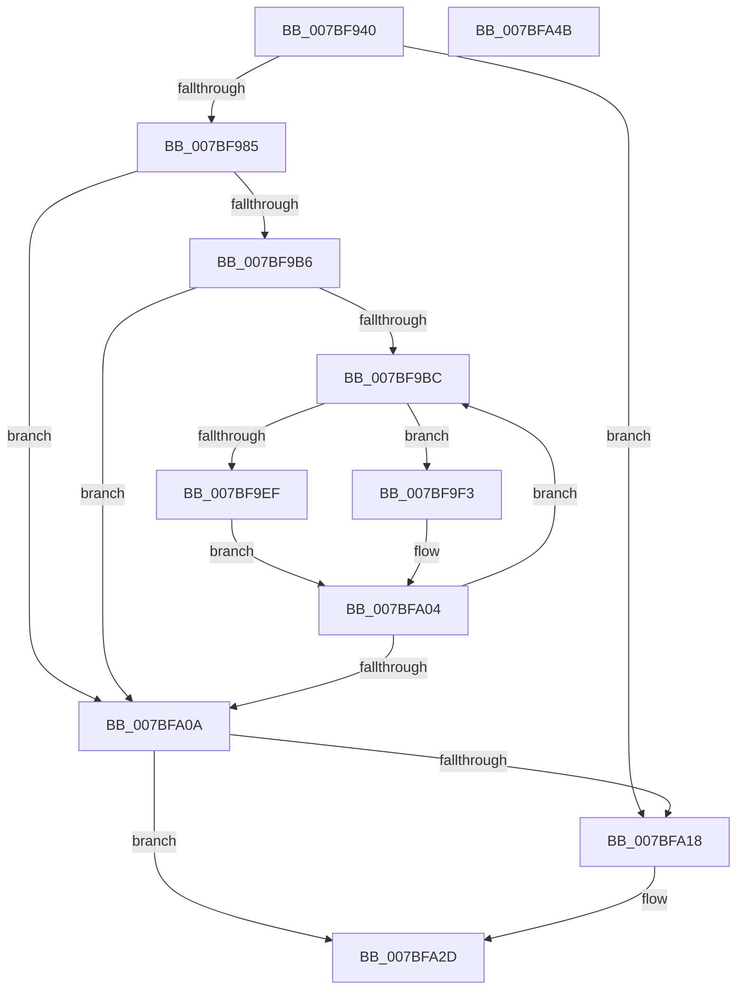

# EtwpSavePersistedLoggersWorker

- RVA: `0x007BF940`–`0x007BFA4C` (길이 `268` bytes)
- VA: `0x00000001407BF940`
- 실행 섹션: `PAGE`
- PDB 이름 있음: `예`; PDB Function 태그: `아니요`
- unwind 정보 RVA: `0x000B8D7C`
- 디코드: `69`개 명령, `268/268` bytes 표시
- 미해석 바이트: `0` (있으면 어셈블리에 `.byte`로 보존)

> 이 문서는 커널 이미지의 기계어와 PDB 기호를 분석해 생성했습니다. 4번과 5번은 함수 원형과 자료형을 바이너리 사용 방식에서 추정한 C 해석이며 원본 소스 복구 결과는 아닙니다.

## 1. Dependencies

- 직접 호출 지점: **6**; 고유 호출 대상: **6**
- 직접 호출자로 확인된 함수: **1**
- RIP 상대 이미지 참조: **7**

### Outgoing calls
- `0x007BF974` → [ExAllocatePool2](../../poolcode/B8/ExAllocatePool2_function_00B820F0.md) (function, `0x00B820F0`)
- `0x007BF9A4` → `ext-ms-win-ntos-ksr-l1-1-5.dll!KsrEnumeratePersistedMemory` (import, 간접 대상; import `ext-ms-win-ntos-ksr-l1-1-5.dll!KsrEnumeratePersistedMemory`)
- `0x007BF9DF` → `ext-ms-win-ntos-ksr-l1-1-5.dll!KsrQueryMetadata` (import, 간접 대상; import `ext-ms-win-ntos-ksr-l1-1-5.dll!KsrQueryMetadata`)
- `0x007BF9FF` → [EtwpSavePersistedLogger](EtwpSavePersistedLogger_function_007BF374.md) (function, `0x007BF374`)
- `0x007BFA0F` → [ExFreePoolWithTag](../../poolcode/B8/ExFreePoolWithTag_function_00B82870.md) (function, `0x00B82870`)
- `0x007BFA21` → `ext-ms-win-ntos-ksr-l1-1-5.dll!KsrFreePersistedMemory` (import, 간접 대상; import `ext-ms-win-ntos-ksr-l1-1-5.dll!KsrFreePersistedMemory`)

### Direct callers
- [EtwpSavePersistedLoggers](EtwpSavePersistedLoggers_function_007BF910.md) at `0x007BF92E`

### Static image references
- `0x007BF952` → RVA `0x00FC6AA8` (`ALMOSTRO`; read)
- `0x007BF993` → RVA `0x007BEF20` (`EtwpKsrMemoryEnumCallback`; read)
- `0x007BF99A` → RVA `0x00B4AEA0` (`EtwpKsrGuid`; read)
- `0x007BF9A4` → RVA `0x00151330` (`ext-ms-win-ntos-ksr-l1-1-5.dll!KsrEnumeratePersistedMemory (IAT)`; read)
- `0x007BF9DF` → RVA `0x00151328` (`ext-ms-win-ntos-ksr-l1-1-5.dll!KsrQueryMetadata (IAT)`; read)
- `0x007BFA21` → RVA `0x00151308` (`ext-ms-win-ntos-ksr-l1-1-5.dll!KsrFreePersistedMemory (IAT)`; read)
- `0x007BFA37` → RVA `0x00FD9E10` (`PAGEDATA`; read/write)

## 2. Other-region calls and transfers

- 다른 실행 섹션으로 향하는 call: **2**
  - `0x007BF974` → [ExAllocatePool2](../../poolcode/B8/ExAllocatePool2_function_00B820F0.md) (`PAGE` → `POOLCODE`)
  - `0x007BFA0F` → [ExFreePoolWithTag](../../poolcode/B8/ExFreePoolWithTag_function_00B82870.md) (`PAGE` → `POOLCODE`)
- 별도 외부 분기/꼬리 이동을 확인하지 못했습니다.

## 3. Assembly (complete function range)

```asm
007BF940  48 89 5C 24 10                  mov qword ptr [rsp + 0x10], rbx
007BF945  48 89 6C 24 18                  mov qword ptr [rsp + 0x18], rbp
007BF94A  56                              push rsi
007BF94B  57                              push rdi
007BF94C  41 56                           push r14
007BF94E  48 83 EC 30                     sub rsp, 0x30
007BF952  48 8B 05 4F 71 80 00            mov rax, qword ptr [rip + 0x80714f]
007BF959  B9 00 01 00 00                  mov ecx, 0x100
007BF95E  83 64 24 50 00                  and dword ptr [rsp + 0x50], 0
007BF963  41 B8 45 74 77 4B               mov r8d, 0x4b777445
007BF969  8B 50 10                        mov edx, dword ptr [rax + 0x10]
007BF96C  48 8D 14 D5 10 10 00 00         lea rdx, [rdx*8 + 0x1010]
007BF974  E8 77 27 3C 00                  call 0x140b820f0
007BF979  48 8B D8                        mov rbx, rax
007BF97C  48 85 C0                        test rax, rax
007BF97F  0F 84 93 00 00 00               je 0x1407bfa18
007BF985  83 20 00                        and dword ptr [rax], 0
007BF988  48 8D 88 10 10 00 00            lea rcx, [rax + 0x1010]
007BF98F  48 89 48 08                     mov qword ptr [rax + 8], rcx
007BF993  48 8D 15 86 F5 FF FF            lea rdx, [rip - 0xa7a]
007BF99A  48 8D 0D FF B4 38 00            lea rcx, [rip + 0x38b4ff]
007BF9A1  4C 8B C0                        mov r8, rax
007BF9A4  48 FF 15 85 19 99 FF            call qword ptr [rip - 0x66e67b]
007BF9AB  0F 1F 44 00 00                  nop dword ptr [rax + rax]
007BF9B0  8B F0                           mov esi, eax
007BF9B2  85 C0                           test eax, eax
007BF9B4  78 54                           js 0x1407bfa0a
007BF9B6  33 FF                           xor edi, edi
007BF9B8  39 3B                           cmp dword ptr [rbx], edi
007BF9BA  76 4E                           jbe 0x1407bfa0a
007BF9BC  48 8B 53 08                     mov rdx, qword ptr [rbx + 8]
007BF9C0  48 8D 44 24 50                  lea rax, [rsp + 0x50]
007BF9C5  41 B9 00 10 00 00               mov r9d, 0x1000
007BF9CB  48 89 44 24 20                  mov qword ptr [rsp + 0x20], rax
007BF9D0  4C 8D 43 10                     lea r8, [rbx + 0x10]
007BF9D4  48 8D 0D C5 B4 38 00            lea rcx, [rip + 0x38b4c5]
007BF9DB  48 8B 14 FA                     mov rdx, qword ptr [rdx + rdi*8]
007BF9DF  48 FF 15 42 19 99 FF            call qword ptr [rip - 0x66e6be]
007BF9E6  0F 1F 44 00 00                  nop dword ptr [rax + rax]
007BF9EB  85 C0                           test eax, eax
007BF9ED  79 04                           jns 0x1407bf9f3
007BF9EF  8B F0                           mov esi, eax
007BF9F1  EB 11                           jmp 0x1407bfa04
007BF9F3  48 8B 53 08                     mov rdx, qword ptr [rbx + 8]
007BF9F7  48 8D 4B 10                     lea rcx, [rbx + 0x10]
007BF9FB  48 8B 14 FA                     mov rdx, qword ptr [rdx + rdi*8]
007BF9FF  E8 70 F9 FF FF                  call 0x1407bf374
007BFA04  FF C7                           inc edi
007BFA06  3B 3B                           cmp edi, dword ptr [rbx]
007BFA08  72 B2                           jb 0x1407bf9bc
007BFA0A  33 D2                           xor edx, edx
007BFA0C  48 8B CB                        mov rcx, rbx
007BFA0F  E8 5C 2E 3C 00                  call 0x140b82870
007BFA14  85 F6                           test esi, esi
007BFA16  79 15                           jns 0x1407bfa2d
007BFA18  B2 01                           mov dl, 1
007BFA1A  48 8D 0D 7F B4 38 00            lea rcx, [rip + 0x38b47f]
007BFA21  48 FF 15 E0 18 99 FF            call qword ptr [rip - 0x66e720]
007BFA28  0F 1F 44 00 00                  nop dword ptr [rax + rax]
007BFA2D  48 8B 5C 24 58                  mov rbx, qword ptr [rsp + 0x58]
007BFA32  B8 02 00 00 00                  mov eax, 2
007BFA37  87 05 D3 A3 81 00               xchg dword ptr [rip + 0x81a3d3], eax
007BFA3D  48 8B 6C 24 60                  mov rbp, qword ptr [rsp + 0x60]
007BFA42  48 83 C4 30                     add rsp, 0x30
007BFA46  41 5E                           pop r14
007BFA48  5F                              pop rdi
007BFA49  5E                              pop rsi
007BFA4A  C3                              ret
007BFA4B  CC                              int3
```

## 4. C-style interpretation (structured pseudocode)

```c
__int64 __fastcall EtwpSavePersistedLoggersWorker(void)
{
    __int64 result;
    __int64 v_rdi;
    __int64 v_rsp;
    unsigned __int64 v_stack_m28;
    unsigned __int64 v_stack_p10;
    unsigned __int64 v_stack_p18;
    unsigned int v_stack_p8;

    v_stack_p10 = v_rbx;
    v_stack_p18 = v_rbp;
    v_rsp = (v_rsp) - (48);
    result = ExAllocatePool2(256, (unsigned int)(*(unsigned int *)(*(unsigned __int64 *)(v_rip + 8417615) + 16)) * 8 + 4112, (unsigned int)(0x4B777445ULL), a4);
    if (result == 0) goto loc_007BFA18;
    *(unsigned __int64 *)(result + 8) = result + 4112;
    result = ext_ms_win_ntos_ksr_l1_1_5_dll_KsrEnumeratePersistedMemory(v_rip + 3716351, v_rip - 2682, result, a4);
    if (sign_flag) goto loc_007BFA0A;
    v_rdi = 0;
    if ((*(unsigned int *)(result)) <= 0) goto loc_007BFA0A;
loc_007BF9BC:
    v_stack_m28 = v_stack_p8;
    result = ext_ms_win_ntos_ksr_l1_1_5_dll_KsrQueryMetadata(v_rip + 3716293, *(unsigned __int64 *)(*(unsigned __int64 *)(result + 8) + v_rdi * 8), result + 16, (unsigned int)(0x1000ULL));
    if (!sign_flag) goto loc_007BF9F3;
    goto loc_007BFA04;
loc_007BF9F3:
    result = EtwpSavePersistedLogger(result + 16, *(unsigned __int64 *)(*(unsigned __int64 *)(result + 8) + v_rdi * 8), result + 16, (unsigned int)(0x1000ULL));
loc_007BFA04:
    v_rdi = (unsigned int)((v_rdi) + 1);
    if (((unsigned int)(v_rdi)) < (*(unsigned int *)(result))) goto loc_007BF9BC;
loc_007BFA0A:
    a2 = 0;
    result = ExFreePoolWithTag(result, a2, result + 16, (unsigned int)(0x1000ULL));
    if (sign_flag) {
        a2 = 1;
        a1 = v_rip + 3716223;
        result = ext_ms_win_ntos_ksr_l1_1_5_dll_KsrFreePersistedMemory(a1, a2, result + 16, (unsigned int)(0x1000ULL));
    }
    v_rsp = (v_rsp) + (48);
    return 2;
}
```

## 5. (Beta) C Style

```c
void EtwpSavePersistedLoggersWorker(void)
{
    int64_t result;
    int64_t local_rdi;
    int64_t local_rsp;
    uint64_t v_stack_m28;
    uint64_t v_stack_p10;
    uint64_t v_stack_p18;
    uint32_t v_stack_p8;

    v_stack_p10 = local_rbx;
    v_stack_p18 = local_rbp;
    local_rsp = (local_rsp) - (48);
    result = ExAllocatePool2(256, (uint32_t)(*(uint32_t *)(*(uint64_t *)(v_rip + 0x80714F) + 0x10)) * 8 + 4112, (uint32_t)(0x4B777445ULL), a4);
    if (result == 0) goto loc_007BFA18;
    *(uint64_t *)(result + 0x8) = result + 4112;
    result = kernel_indirect_call(v_rip + 3716351, v_rip - 2682, result, a4);
    if (sign_flag) goto loc_007BFA0A;
    local_rdi = 0;
    if ((*(uint32_t *)(result)) <= 0) goto loc_007BFA0A;
loc_007BF9BC:
    v_stack_m28 = v_stack_p8;
    result = kernel_indirect_call(v_rip + 3716293, *(uint64_t *)(*(uint64_t *)(result + 0x8) + local_rdi * 8), result + 16, (uint32_t)(0x1000ULL));
    if (!sign_flag) goto loc_007BF9F3;
    goto loc_007BFA04;
loc_007BF9F3:
    result = EtwpSavePersistedLogger(result + 16, *(uint64_t *)(*(uint64_t *)(result + 0x8) + local_rdi * 8), result + 16, (uint32_t)(0x1000ULL));
loc_007BFA04:
    local_rdi = (uint32_t)((local_rdi) + 1);
    if (((uint32_t)(local_rdi)) < (*(uint32_t *)(result))) goto loc_007BF9BC;
loc_007BFA0A:
    a2 = 0;
    result = ExFreePoolWithTag(result, a2, result + 16, (uint32_t)(0x1000ULL));
    if (sign_flag) {
        a2 = 1;
        a1 = v_rip + 3716223;
        result = kernel_indirect_call(a1, a2, result + 16, (uint32_t)(0x1000ULL));
    }
    local_rsp = (local_rsp) + (48);
    return 2;
}
```

## 6. Execution-region graph

[열기: 2D/3D 그래프와 함수 탐색 컨트롤 패널](../../../control-panel.html?section=page&rva=0x007BF940&view=graph)

- 2D 그래프는 위에서 아래로 흐르고, 3D 그래프는 빈 공간을 드래그해 회전합니다. Shift+드래그는 이동, 휠은 확대·축소, 함수 노드 선택은 대상 보고서 이동입니다.

### Static fallback


