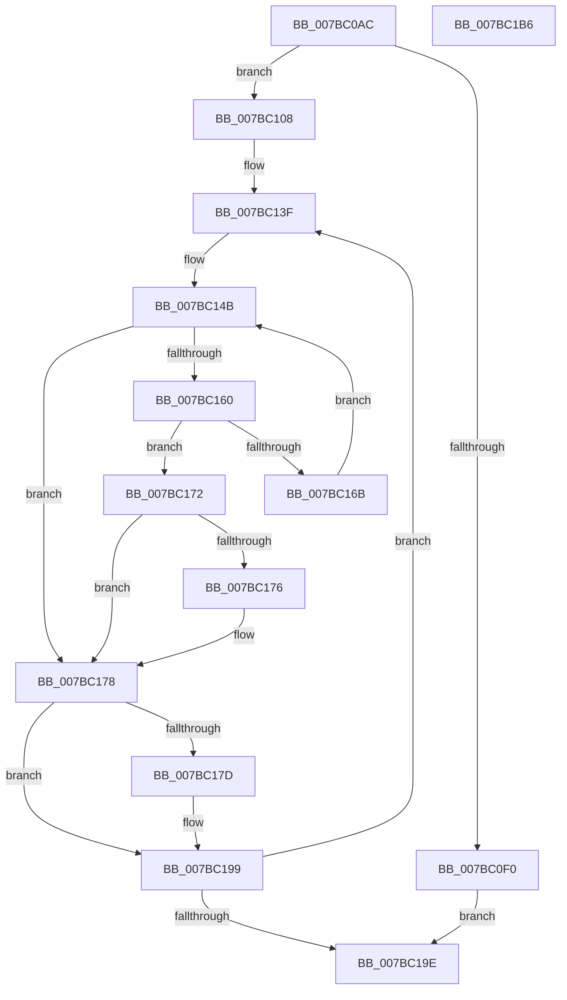

# EtwpSendBufferToDebugger

- RVA: `0x007BC0AC`–`0x007BC1B7` (길이 `267` bytes)
- VA: `0x00000001407BC0AC`
- 실행 섹션: `PAGE`
- PDB 이름 있음: `예`; PDB Function 태그: `아니요`
- unwind 정보 RVA: `0x000CBC98`
- 디코드: `80`개 명령, `267/267` bytes 표시
- 미해석 바이트: `0` (있으면 어셈블리에 `.byte`로 보존)

> 이 문서는 커널 이미지의 기계어와 PDB 기호를 분석해 생성했습니다. 4번과 5번은 함수 원형과 자료형을 바이너리 사용 방식에서 추정한 C 해석이며 원본 소스 복구 결과는 아닙니다.

## 1. Dependencies

- 직접 호출 지점: **4**; 고유 호출 대상: **3**
- 직접 호출자로 확인된 함수: **1**
- RIP 상대 이미지 참조: **1**

### Outgoing calls
- `0x007BC0D7` → [memset](../../text/6C/memset_function_006C6C40.md) (function, `0x006C6C40`)
- `0x007BC0FE` → [KdSendTraceData](../../pagekd/B8/KdSendTraceData_function_00B86F48.md) (function, `0x00B86F48`)
- `0x007BC154` → [EtwpGetNextEventOffsetType](../../text/4B/EtwpGetNextEventOffsetType_function_004B6F8C.md) (function, `0x004B6F8C`)
- `0x007BC194` → [KdSendTraceData](../../pagekd/B8/KdSendTraceData_function_00B86F48.md) (function, `0x00B86F48`)

### Direct callers
- [EtwpSendDbgId](EtwpSendDbgId_function_007BC1C0.md) at `0x007BC2BC`

### Static image references
- `0x007BC0DC` → RVA `0x00E0AA48` (`.data`; read)

## 2. Other-region calls and transfers

- 다른 실행 섹션으로 향하는 call: **4**
  - `0x007BC0D7` → [memset](../../text/6C/memset_function_006C6C40.md) (`PAGE` → `.text`)
  - `0x007BC0FE` → [KdSendTraceData](../../pagekd/B8/KdSendTraceData_function_00B86F48.md) (`PAGE` → `PAGEKD`)
  - `0x007BC154` → [EtwpGetNextEventOffsetType](../../text/4B/EtwpGetNextEventOffsetType_function_004B6F8C.md) (`PAGE` → `.text`)
  - `0x007BC194` → [KdSendTraceData](../../pagekd/B8/KdSendTraceData_function_00B86F48.md) (`PAGE` → `PAGEKD`)
- 별도 외부 분기/꼬리 이동을 확인하지 못했습니다.

## 3. Assembly (complete function range)

```asm
007BC0AC  48 89 5C 24 10                  mov qword ptr [rsp + 0x10], rbx
007BC0B1  48 89 74 24 18                  mov qword ptr [rsp + 0x18], rsi
007BC0B6  55                              push rbp
007BC0B7  57                              push rdi
007BC0B8  41 56                           push r14
007BC0BA  48 8D 6C 24 B9                  lea rbp, [rsp - 0x47]
007BC0BF  48 81 EC 90 00 00 00            sub rsp, 0x90
007BC0C6  48 8B F9                        mov rdi, rcx
007BC0C9  BB 48 00 00 00                  mov ebx, 0x48
007BC0CE  44 8B C3                        mov r8d, ebx
007BC0D1  48 8D 4D F7                     lea rcx, [rbp - 9]
007BC0D5  33 D2                           xor edx, edx
007BC0D7  E8 64 AB F0 FF                  call 0x1406c6c40
007BC0DC  8B 35 66 E9 64 00               mov esi, dword ptr [rip + 0x64e966]
007BC0E2  83 65 67 00                     and dword ptr [rbp + 0x67], 0
007BC0E6  83 C6 C0                        add esi, -0x40
007BC0E9  8B 4F 30                        mov ecx, dword ptr [rdi + 0x30]
007BC0EC  3B CE                           cmp ecx, esi
007BC0EE  77 18                           ja 0x1407bc108
007BC0F0  89 4D DF                        mov dword ptr [rbp - 0x21], ecx
007BC0F3  8D 53 B9                        lea edx, [rbx - 0x47]
007BC0F6  48 8D 4D D7                     lea rcx, [rbp - 0x29]
007BC0FA  48 89 7D D7                     mov qword ptr [rbp - 0x29], rdi
007BC0FE  E8 45 AE 3C 00                  call 0x140b86f48
007BC103  E9 96 00 00 00                  jmp 0x1407bc19e
007BC108  0F 10 07                        movups xmm0, xmmword ptr [rdi]
007BC10B  48 8D 45 F7                     lea rax, [rbp - 9]
007BC10F  89 5D DF                        mov dword ptr [rbp - 0x21], ebx
007BC112  0F 10 4F 10                     movups xmm1, xmmword ptr [rdi + 0x10]
007BC116  83 C6 B8                        add esi, -0x48
007BC119  48 89 45 D7                     mov qword ptr [rbp - 0x29], rax
007BC11D  0F 29 45 F7                     movaps xmmword ptr [rbp - 9], xmm0
007BC121  0F 10 47 20                     movups xmm0, xmmword ptr [rdi + 0x20]
007BC125  0F 29 4D 07                     movaps xmmword ptr [rbp + 7], xmm1
007BC129  0F 10 4F 30                     movups xmm1, xmmword ptr [rdi + 0x30]
007BC12D  0F 29 45 17                     movaps xmmword ptr [rbp + 0x17], xmm0
007BC131  F2 0F 10 47 40                  movsd xmm0, qword ptr [rdi + 0x40]
007BC136  F2 0F 11 45 37                  movsd qword ptr [rbp + 0x37], xmm0
007BC13B  0F 29 4D 27                     movaps xmmword ptr [rbp + 0x27], xmm1
007BC13F  45 33 C9                        xor r9d, r9d
007BC142  8B C3                           mov eax, ebx
007BC144  48 03 C7                        add rax, rdi
007BC147  48 89 45 E7                     mov qword ptr [rbp - 0x19], rax
007BC14B  4C 8D 45 67                     lea r8, [rbp + 0x67]
007BC14F  8B D3                           mov edx, ebx
007BC151  48 8B CF                        mov rcx, rdi
007BC154  E8 33 AE CF FF                  call 0x1404b6f8c
007BC159  44 8B F0                        mov r14d, eax
007BC15C  85 C0                           test eax, eax
007BC15E  74 18                           je 0x1407bc178
007BC160  8B 4D 67                        mov ecx, dword ptr [rbp + 0x67]
007BC163  41 8D 14 09                     lea edx, [r9 + rcx]
007BC167  3B D6                           cmp edx, esi
007BC169  77 07                           ja 0x1407bc172
007BC16B  03 D9                           add ebx, ecx
007BC16D  44 8B CA                        mov r9d, edx
007BC170  EB D9                           jmp 0x1407bc14b
007BC172  3B CE                           cmp ecx, esi
007BC174  76 02                           jbe 0x1407bc178
007BC176  03 D9                           add ebx, ecx
007BC178  45 85 C9                        test r9d, r9d
007BC17B  74 1C                           je 0x1407bc199
007BC17D  41 8D 41 48                     lea eax, [r9 + 0x48]
007BC181  44 89 4D EF                     mov dword ptr [rbp - 0x11], r9d
007BC185  BA 02 00 00 00                  mov edx, 2
007BC18A  89 45 27                        mov dword ptr [rbp + 0x27], eax
007BC18D  48 8D 4D D7                     lea rcx, [rbp - 0x29]
007BC191  89 45 F7                        mov dword ptr [rbp - 9], eax
007BC194  E8 AF AD 3C 00                  call 0x140b86f48
007BC199  45 85 F6                        test r14d, r14d
007BC19C  75 A1                           jne 0x1407bc13f
007BC19E  4C 8D 9C 24 90 00 00 00         lea r11, [rsp + 0x90]
007BC1A6  49 8B 5B 28                     mov rbx, qword ptr [r11 + 0x28]
007BC1AA  49 8B 73 30                     mov rsi, qword ptr [r11 + 0x30]
007BC1AE  49 8B E3                        mov rsp, r11
007BC1B1  41 5E                           pop r14
007BC1B3  5F                              pop rdi
007BC1B4  5D                              pop rbp
007BC1B5  C3                              ret
007BC1B6  CC                              int3
```

## 4. C-style interpretation (structured pseudocode)

```c
__int64 __fastcall EtwpSendBufferToDebugger(__int64 a1, int a2, __int64 a3, int a4)
{
    __int64 result;
    __int64 v_rbx;
    __int64 v_rsi;
    __int64 v_rsp;
    unsigned __int64 v_stack_m18;
    unsigned __int64 v_stack_m28;
    unsigned __int64 v_stack_m38;
    unsigned __int64 v_stack_m48;
    unsigned __int64 v_stack_m58;
    unsigned __int64 v_stack_m5F;
    unsigned __int64 v_stack_m68;
    unsigned int v_stack_m70;
    unsigned __int64 v_stack_m78;
    unsigned int v_stack_m80;
    unsigned __int64 v_stack_m88;
    unsigned __int64 v_stack_p10;
    unsigned __int64 v_stack_p18;
    unsigned int v_stack_p8;

    v_stack_p10 = v_rbx;
    v_stack_p18 = v_rsi;
    v_rsp = (v_rsp) - (144);
    a2 = 0;
    result = memset(v_stack_m68, a2, 72, a4);
    v_rsi = (unsigned int)(((unsigned int)(*(unsigned int *)(v_rip + 6613350))) + (-64));
    if (((unsigned int)((unsigned int)(*(unsigned int *)(a1 + 48)))) > ((unsigned int)(v_rsi))) goto loc_007BC108;
    v_stack_m80 = (unsigned int)((unsigned int)(*(unsigned int *)(a1 + 48)));
    v_stack_m88 = a1;
    result = KdSendTraceData(v_stack_m88, 72 - 71, 72, a4);
    goto loc_007BC19E;
loc_007BC108:
    v_stack_m80 = 72;
    v_rsi = (unsigned int)((v_rsi) + (-72));
    v_stack_m88 = v_stack_m68;
    v_stack_m68 = v_xmm0;
    v_stack_m58 = v_xmm1;
    v_stack_m48 = v_xmm0;
    v_stack_m28 = v_xmm0;
    v_stack_m38 = v_xmm1;
loc_007BC13F:
    a4 = 0;
    result = (72) + (a1);
    v_stack_m78 = result;
loc_007BC14B:
    result = EtwpGetNextEventOffsetType(a1, 72, v_stack_p8, a4);
    if ((unsigned int)(result) == 0) goto loc_007BC178;
    if (((unsigned int)(a4 + (unsigned int)(v_stack_p8) * 1)) > ((unsigned int)(v_rsi))) goto loc_007BC172;
    v_rbx = (unsigned int)((72) + ((unsigned int)((unsigned int)(v_stack_p8))));
    goto loc_007BC14B;
loc_007BC172:
    if (((unsigned int)((unsigned int)(v_stack_p8))) >= = ((unsigned int)(v_rsi))) {
        v_rbx = (unsigned int)((v_rbx) + ((unsigned int)((unsigned int)(v_stack_p8))));
    }
    if ((unsigned int)((unsigned int)((unsigned int)(a4 + (unsigned int)(v_stack_p8) * 1))) != 0) {
        result = (unsigned int)((unsigned int)(a4 + (unsigned int)(v_stack_p8) * 1)) + 72;
        v_stack_m70 = (unsigned int)((unsigned int)((unsigned int)(a4 + (unsigned int)(v_stack_p8) * 1)));
        a2 = 2;
        v_stack_m38 = (unsigned int)(result);
        a1 = v_stack_m88;
        v_stack_m68 = (unsigned int)(result);
        result = KdSendTraceData(a1, a2, v_stack_p8, (unsigned int)((unsigned int)(a4 + (unsigned int)(v_stack_p8) * 1)));
    }
    if ((unsigned int)((unsigned int)((unsigned int)(result))) != 0) goto loc_007BC13F;
loc_007BC19E:
    return result;
}
```

## 5. (Beta) C Style

```c
int64_t EtwpSendBufferToDebugger(void *Arg1, int32_t Arg2, int64_t Arg3, int32_t Arg4)
{
    uint8_t *arg1 = (uint8_t *)Arg1;

    int64_t result;
    int64_t local_rbx;
    int64_t local_rsi;
    int64_t local_rsp;
    uint64_t v_stack_m18;
    uint64_t v_stack_m28;
    uint64_t v_stack_m38;
    uint64_t v_stack_m48;
    uint64_t v_stack_m58;
    uint64_t v_stack_m5F;
    uint64_t v_stack_m68;
    uint32_t v_stack_m70;
    uint64_t v_stack_m78;
    uint32_t v_stack_m80;
    uint64_t v_stack_m88;
    uint64_t v_stack_p10;
    uint64_t v_stack_p18;
    uint32_t v_stack_p8;

    v_stack_p10 = local_rbx;
    v_stack_p18 = local_rsi;
    local_rsp = (local_rsp) - (144);
    Arg2 = 0;
    result = memset(v_stack_m68, Arg2, 72, Arg4);
    local_rsi = (uint32_t)(((uint32_t)(*(uint32_t *)(v_rip + 0x64E966))) + (-64));
    if (((uint32_t)((uint32_t)(*(uint32_t *)(arg1 + 0x30)))) > ((uint32_t)(local_rsi))) goto loc_007BC108;
    v_stack_m80 = (uint32_t)((uint32_t)(*(uint32_t *)(arg1 + 0x30)));
    v_stack_m88 = Arg1;
    result = KdSendTraceData(v_stack_m88, 72 - 71, 72, Arg4);
    goto loc_007BC19E;
loc_007BC108:
    v_stack_m80 = 72;
    local_rsi = (uint32_t)((local_rsi) + (-72));
    v_stack_m88 = v_stack_m68;
    v_stack_m68 = v_xmm0;
    v_stack_m58 = v_xmm1;
    v_stack_m48 = v_xmm0;
    v_stack_m28 = v_xmm0;
    v_stack_m38 = v_xmm1;
loc_007BC13F:
    Arg4 = 0;
    result = (72) + (Arg1);
    v_stack_m78 = result;
loc_007BC14B:
    result = EtwpGetNextEventOffsetType(Arg1, 72, v_stack_p8, Arg4);
    if ((uint32_t)(result) == 0) goto loc_007BC178;
    if (((uint32_t)(Arg4 + (uint32_t)(v_stack_p8) * 1)) > ((uint32_t)(local_rsi))) goto loc_007BC172;
    local_rbx = (uint32_t)((72) + ((uint32_t)((uint32_t)(v_stack_p8))));
    goto loc_007BC14B;
loc_007BC172:
    if (((uint32_t)((uint32_t)(v_stack_p8))) >= = ((uint32_t)(local_rsi))) {
        local_rbx = (uint32_t)((local_rbx) + ((uint32_t)((uint32_t)(v_stack_p8))));
    }
    if ((uint32_t)((uint32_t)((uint32_t)(Arg4 + (uint32_t)(v_stack_p8) * 1))) != 0) {
        result = (uint32_t)((uint32_t)(Arg4 + (uint32_t)(v_stack_p8) * 1)) + 72;
        v_stack_m70 = (uint32_t)((uint32_t)((uint32_t)(Arg4 + (uint32_t)(v_stack_p8) * 1)));
        Arg2 = 2;
        v_stack_m38 = (uint32_t)(result);
        Arg1 = v_stack_m88;
        v_stack_m68 = (uint32_t)(result);
        result = KdSendTraceData(Arg1, Arg2, v_stack_p8, (uint32_t)((uint32_t)(Arg4 + (uint32_t)(v_stack_p8) * 1)));
    }
    if ((uint32_t)((uint32_t)((uint32_t)(result))) != 0) goto loc_007BC13F;
loc_007BC19E:
    return result;
}
```

### 관측된 메모리 오프셋

구조체 형식이 확인되지 않은 접근은 인자 기준의 오프셋으로만 기록했습니다.

| 기준 인자 | 오프셋 표현 | 폭 (bit) | 접근 |
|---|---:|---:|---|
| `Arg1` | `+ 0x0` | `128` | `R` |
| `Arg1` | `+ 0x10` | `128` | `R` |
| `Arg1` | `+ 0x20` | `128` | `R` |
| `Arg1` | `+ 0x30` | `32` | `R` |
| `Arg1` | `+ 0x30` | `128` | `R` |
| `Arg1` | `+ 0x40` | `64` | `R` |

## 6. Execution-region graph

[열기: 2D/3D 그래프와 함수 탐색 컨트롤 패널](../../../control-panel.html?section=page&rva=0x007BC0AC&view=graph)

- 2D 그래프는 위에서 아래로 흐르고, 3D 그래프는 빈 공간을 드래그해 회전합니다. Shift+드래그는 이동, 휠은 확대·축소, 함수 노드 선택은 대상 보고서 이동입니다.

### Static fallback


