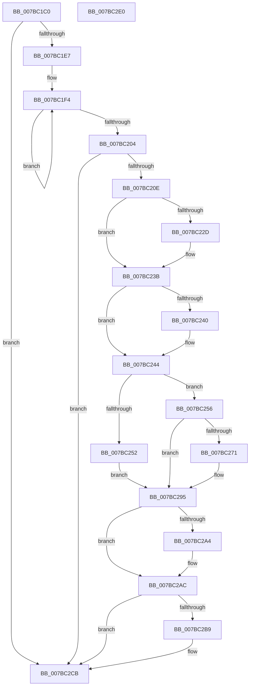

# EtwpSendDbgId

- RVA: `0x007BC1C0`–`0x007BC2E1` (길이 `289` bytes)
- VA: `0x00000001407BC1C0`
- 실행 섹션: `PAGE`
- PDB 이름 있음: `예`; PDB Function 태그: `아니요`
- unwind 정보 RVA: `0x00066400`
- 디코드: `79`개 명령, `289/289` bytes 표시
- 미해석 바이트: `0` (있으면 어셈블리에 `.byte`로 보존)

> 이 문서는 커널 이미지의 기계어와 PDB 기호를 분석해 생성했습니다. 4번과 5번은 함수 원형과 자료형을 바이너리 사용 방식에서 추정한 C 해석이며 원본 소스 복구 결과는 아닙니다.

## 1. Dependencies

- 직접 호출 지점: **10**; 고유 호출 대상: **10**
- 직접 호출자로 확인된 함수: **3**
- RIP 상대 이미지 참조: **0**

### Outgoing calls
- `0x007BC21D` → [KeAbPreAcquire](../../text/21/KeAbPreAcquire_function_00210230.md) (function, `0x00210230`)
- `0x007BC236` → [ExfAcquirePushLockExclusiveEx](../../text/20/ExfAcquirePushLockExclusiveEx_function_0020FC90.md) (function, `0x0020FC90`)
- `0x007BC247` → [EtwpGetMaxTrackingEventBufferSize](../9C/EtwpGetMaxTrackingEventBufferSize_function_009C1E5C.md) (function, `0x009C1E5C`)
- `0x007BC264` → [ExAllocatePool2](../../poolcode/B8/ExAllocatePool2_function_00B820F0.md) (function, `0x00B820F0`)
- `0x007BC27A` → [EtwpInitializeProviderInfoBuffer](../AA/EtwpInitializeProviderInfoBuffer_function_00AACE3C.md) (function, `0x00AACE3C`)
- `0x007BC290` → [EtwpAddDebugInfoEvents](../9C/EtwpAddDebugInfoEvents_function_009C22D0.md) (function, `0x009C22D0`)
- `0x007BC2A7` → [ExfTryToWakePushLock](../../text/26/ExfTryToWakePushLock_function_00265DD0.md) (function, `0x00265DD0`)
- `0x007BC2AF` → [KeAbPostRelease](../../text/2E/KeAbPostRelease_function_002E1600.md) (function, `0x002E1600`)
- `0x007BC2BC` → [EtwpSendBufferToDebugger](EtwpSendBufferToDebugger_function_007BC0AC.md) (function, `0x007BC0AC`)
- `0x007BC2C6` → [ExFreePoolWithTag](../../poolcode/B8/ExFreePoolWithTag_function_00B82870.md) (function, `0x00B82870`)

### Direct callers
- [EtwpSendTraceEvent](../../text/4B/EtwpSendTraceEvent_function_004B6E10.md) at `0x004B6E58`
- [EtwpProviderArrivalCallback](../A0/EtwpProviderArrivalCallback_function_00A03F94.md) at `0x00A040E9`
- [EtwpUpdateTrace](../AB/EtwpUpdateTrace_function_00ABCC7C.md) at `0x00ABD051`

### Static image references
- 디코드된 RIP-relative 메모리 참조가 없습니다.

## 2. Other-region calls and transfers

- 다른 실행 섹션으로 향하는 call: **6**
  - `0x007BC21D` → [KeAbPreAcquire](../../text/21/KeAbPreAcquire_function_00210230.md) (`PAGE` → `.text`)
  - `0x007BC236` → [ExfAcquirePushLockExclusiveEx](../../text/20/ExfAcquirePushLockExclusiveEx_function_0020FC90.md) (`PAGE` → `.text`)
  - `0x007BC264` → [ExAllocatePool2](../../poolcode/B8/ExAllocatePool2_function_00B820F0.md) (`PAGE` → `POOLCODE`)
  - `0x007BC2A7` → [ExfTryToWakePushLock](../../text/26/ExfTryToWakePushLock_function_00265DD0.md) (`PAGE` → `.text`)
  - `0x007BC2AF` → [KeAbPostRelease](../../text/2E/KeAbPostRelease_function_002E1600.md) (`PAGE` → `.text`)
  - `0x007BC2C6` → [ExFreePoolWithTag](../../poolcode/B8/ExFreePoolWithTag_function_00B82870.md) (`PAGE` → `POOLCODE`)
- 별도 외부 분기/꼬리 이동을 확인하지 못했습니다.

## 3. Assembly (complete function range)

```asm
007BC1C0  48 89 5C 24 08                  mov qword ptr [rsp + 8], rbx
007BC1C5  48 89 6C 24 10                  mov qword ptr [rsp + 0x10], rbp
007BC1CA  48 89 74 24 18                  mov qword ptr [rsp + 0x18], rsi
007BC1CF  57                              push rdi
007BC1D0  48 83 EC 30                     sub rsp, 0x30
007BC1D4  8B 81 38 03 00 00               mov eax, dword ptr [rcx + 0x338]
007BC1DA  48 8B D9                        mov rbx, rcx
007BC1DD  0F BA E0 0B                     bt eax, 0xb
007BC1E1  0F 83 E4 00 00 00               jae 0x1407bc2cb
007BC1E7  0F 0D 89 38 03 00 00            prefetchw byte ptr [rcx + 0x338]
007BC1EE  8B 81 38 03 00 00               mov eax, dword ptr [rcx + 0x338]
007BC1F4  8B D0                           mov edx, eax
007BC1F6  0F BA F2 0B                     btr edx, 0xb
007BC1FA  F0 0F B1 91 38 03 00 00         lock cmpxchg dword ptr [rcx + 0x338], edx
007BC202  75 F0                           jne 0x1407bc1f4
007BC204  0F BA E0 0B                     bt eax, 0xb
007BC208  0F 83 BD 00 00 00               jae 0x1407bc2cb
007BC20E  48 8D B9 B0 02 00 00            lea rdi, [rcx + 0x2b0]
007BC215  45 33 C0                        xor r8d, r8d
007BC218  48 8B CF                        mov rcx, rdi
007BC21B  33 D2                           xor edx, edx
007BC21D  E8 0E 40 A5 FF                  call 0x140210230
007BC222  F0 48 0F BA 2F 00               lock bts qword ptr [rdi], 0
007BC228  48 8B F0                        mov rsi, rax
007BC22B  73 0E                           jae 0x1407bc23b
007BC22D  4C 8B C7                        mov r8, rdi
007BC230  48 8B D0                        mov rdx, rax
007BC233  48 8B CF                        mov rcx, rdi
007BC236  E8 55 3A A5 FF                  call 0x14020fc90
007BC23B  48 85 F6                        test rsi, rsi
007BC23E  74 04                           je 0x1407bc244
007BC240  C6 46 0A 01                     mov byte ptr [rsi + 0xa], 1
007BC244  48 8B CB                        mov rcx, rbx
007BC247  E8 10 5C 20 00                  call 0x1409c1e5c
007BC24C  8B E8                           mov ebp, eax
007BC24E  85 C0                           test eax, eax
007BC250  75 04                           jne 0x1407bc256
007BC252  33 F6                           xor esi, esi
007BC254  EB 3F                           jmp 0x1407bc295
007BC256  48 8B D5                        mov rdx, rbp
007BC259  B9 40 00 00 00                  mov ecx, 0x40
007BC25E  41 B8 45 74 77 62               mov r8d, 0x62777445
007BC264  E8 87 5E 3C 00                  call 0x140b820f0
007BC269  48 8B F0                        mov rsi, rax
007BC26C  48 85 C0                        test rax, rax
007BC26F  74 24                           je 0x1407bc295
007BC271  44 8B C5                        mov r8d, ebp
007BC274  48 8B D0                        mov rdx, rax
007BC277  48 8B CB                        mov rcx, rbx
007BC27A  E8 BD 0B 2F 00                  call 0x140aace3c
007BC27F  83 64 24 20 00                  and dword ptr [rsp + 0x20], 0
007BC284  45 33 C9                        xor r9d, r9d
007BC287  44 8B C5                        mov r8d, ebp
007BC28A  48 8B D6                        mov rdx, rsi
007BC28D  48 8B CB                        mov rcx, rbx
007BC290  E8 3B 60 20 00                  call 0x1409c22d0
007BC295  48 83 C8 FF                     or rax, 0xffffffffffffffff
007BC299  F0 48 0F C1 07                  lock xadd qword ptr [rdi], rax
007BC29E  24 06                           and al, 6
007BC2A0  3C 02                           cmp al, 2
007BC2A2  75 08                           jne 0x1407bc2ac
007BC2A4  48 8B CF                        mov rcx, rdi
007BC2A7  E8 24 9B AA FF                  call 0x140265dd0
007BC2AC  48 8B CF                        mov rcx, rdi
007BC2AF  E8 4C 53 B2 FF                  call 0x1402e1600
007BC2B4  48 85 F6                        test rsi, rsi
007BC2B7  74 12                           je 0x1407bc2cb
007BC2B9  48 8B CE                        mov rcx, rsi
007BC2BC  E8 EB FD FF FF                  call 0x1407bc0ac
007BC2C1  33 D2                           xor edx, edx
007BC2C3  48 8B CE                        mov rcx, rsi
007BC2C6  E8 A5 65 3C 00                  call 0x140b82870
007BC2CB  48 8B 5C 24 40                  mov rbx, qword ptr [rsp + 0x40]
007BC2D0  48 8B 6C 24 48                  mov rbp, qword ptr [rsp + 0x48]
007BC2D5  48 8B 74 24 50                  mov rsi, qword ptr [rsp + 0x50]
007BC2DA  48 83 C4 30                     add rsp, 0x30
007BC2DE  5F                              pop rdi
007BC2DF  C3                              ret
007BC2E0  CC                              int3
```

## 4. C-style interpretation (structured pseudocode)

```c
__int64 __fastcall EtwpSendDbgId(__int64 a1, __int64 a2, int a3, int a4)
{
    __int64 result;
    __int64 v_rsi;
    __int64 v_rsp;
    unsigned int v_stack_m18;
    unsigned __int64 v_stack_p10;
    unsigned __int64 v_stack_p18;
    unsigned __int64 v_stack_p8;

    v_stack_p8 = v_rbx;
    v_stack_p10 = v_rbp;
    v_stack_p18 = v_rsi;
    v_rsp = (v_rsp) - (48);
    if (condition_is_above_or_equal) goto loc_007BC2CB;
loc_007BC1F4:
    if (condition_is_not_equal) goto loc_007BC1F4;
    if (condition_is_above_or_equal) goto loc_007BC2CB;
    a3 = 0;
    a2 = 0;
    result = KeAbPreAcquire(a1 + 688, a2, a3, a4);
    if (!(condition_is_above_or_equal)) {
        a3 = a1 + 688;
        a2 = result;
        a1 = a1 + 688;
        result = ExfAcquirePushLockExclusiveEx(a1, a2, a3, a4);
    }
    if (result != 0) {
        *(unsigned __int8 *)(result + 10) = 1;
    }
    result = EtwpGetMaxTrackingEventBufferSize(a1, a2, a3, a4);
    if ((unsigned int)(result) != 0) goto loc_007BC256;
    v_rsi = 0;
    goto loc_007BC295;
loc_007BC256:
    result = ExAllocatePool2(64, (unsigned int)((unsigned int)(result)), (unsigned int)(0x62777445ULL), a4);
    if (result != 0) {
        a3 = (unsigned int)((unsigned int)((unsigned int)(result)));
        a2 = result;
        a1 = a1;
        result = EtwpInitializeProviderInfoBuffer(a1, a2, a3, a4);
        a4 = 0;
        a3 = (unsigned int)((unsigned int)((unsigned int)(result)));
        a2 = result;
        a1 = a1;
        result = EtwpAddDebugInfoEvents(a1, a2, a3, a4);
    }
    result = (result) | (-1);
    result = (unsigned __int8)((result) & (6));
    if (((unsigned __int8)(result)) == 2) {
        a1 = a1 + 688;
        result = ExfTryToWakePushLock(a1, a2, a3, a4);
    }
    result = KeAbPostRelease(a1 + 688, a2, a3, a4);
    if (result != 0) {
        a1 = result;
        result = EtwpSendBufferToDebugger(a1, a2, a3, a4);
        a2 = 0;
        a1 = result;
        result = ExFreePoolWithTag(a1, a2, a3, a4);
    }
    v_rsp = (v_rsp) + (48);
    return result;
}
```

## 5. (Beta) C Style

```c
int64_t EtwpSendDbgId(void *Arg1, int64_t Arg2, int32_t Arg3, int32_t Arg4)
{
    uint8_t *arg1 = (uint8_t *)Arg1;

    int64_t result;
    int64_t local_rsi;
    int64_t local_rsp;
    uint32_t v_stack_m18;
    uint64_t v_stack_p10;
    uint64_t v_stack_p18;
    uint64_t v_stack_p8;

    v_stack_p8 = local_rbx;
    v_stack_p10 = local_rbp;
    v_stack_p18 = local_rsi;
    local_rsp = (local_rsp) - (48);
    if (condition_is_above_or_equal) goto loc_007BC2CB;
loc_007BC1F4:
    if (condition_is_not_equal) goto loc_007BC1F4;
    if (condition_is_above_or_equal) goto loc_007BC2CB;
    Arg3 = 0;
    Arg2 = 0;
    result = KeAbPreAcquire(Arg1 + 688, Arg2, Arg3, Arg4);
    if (!(condition_is_above_or_equal)) {
        Arg3 = Arg1 + 688;
        Arg2 = result;
        Arg1 = Arg1 + 688;
        result = ExfAcquirePushLockExclusiveEx(Arg1, Arg2, Arg3, Arg4);
    }
    if (result != 0) {
        *(uint8_t *)(result + 0xA) = 1;
    }
    result = EtwpGetMaxTrackingEventBufferSize(Arg1, Arg2, Arg3, Arg4);
    if ((uint32_t)(result) != 0) goto loc_007BC256;
    local_rsi = 0;
    goto loc_007BC295;
loc_007BC256:
    result = ExAllocatePool2(64, (uint32_t)((uint32_t)(result)), (uint32_t)(0x62777445ULL), Arg4);
    if (result != 0) {
        Arg3 = (uint32_t)((uint32_t)((uint32_t)(result)));
        Arg2 = result;
        Arg1 = Arg1;
        result = EtwpInitializeProviderInfoBuffer(Arg1, Arg2, Arg3, Arg4);
        Arg4 = 0;
        Arg3 = (uint32_t)((uint32_t)((uint32_t)(result)));
        Arg2 = result;
        Arg1 = Arg1;
        result = EtwpAddDebugInfoEvents(Arg1, Arg2, Arg3, Arg4);
    }
    result = (result) | (-1);
    result = (uint8_t)((result) & (6));
    if (((uint8_t)(result)) == 2) {
        Arg1 = Arg1 + 688;
        result = ExfTryToWakePushLock(Arg1, Arg2, Arg3, Arg4);
    }
    result = KeAbPostRelease(Arg1 + 688, Arg2, Arg3, Arg4);
    if (result != 0) {
        Arg1 = result;
        result = EtwpSendBufferToDebugger(Arg1, Arg2, Arg3, Arg4);
        Arg2 = 0;
        Arg1 = result;
        result = ExFreePoolWithTag(Arg1, Arg2, Arg3, Arg4);
    }
    local_rsp = (local_rsp) + (48);
    return result;
}
```

### 관측된 메모리 오프셋

구조체 형식이 확인되지 않은 접근은 인자 기준의 오프셋으로만 기록했습니다.

| 기준 인자 | 오프셋 표현 | 폭 (bit) | 접근 |
|---|---:|---:|---|
| `Arg1` | `+ 0x0` | `64` | `R/W` |
| `Arg1` | `+ 0x2B0` | `64` | `R` |
| `Arg1` | `+ 0x338` | `8` | `R` |
| `Arg1` | `+ 0x338` | `32` | `R` |

## 6. Execution-region graph

[열기: 2D/3D 그래프와 함수 탐색 컨트롤 패널](../../../control-panel.html?section=page&rva=0x007BC1C0&view=graph)

- 2D 그래프는 위에서 아래로 흐르고, 3D 그래프는 빈 공간을 드래그해 회전합니다. Shift+드래그는 이동, 휠은 확대·축소, 함수 노드 선택은 대상 보고서 이동입니다.

### Static fallback


