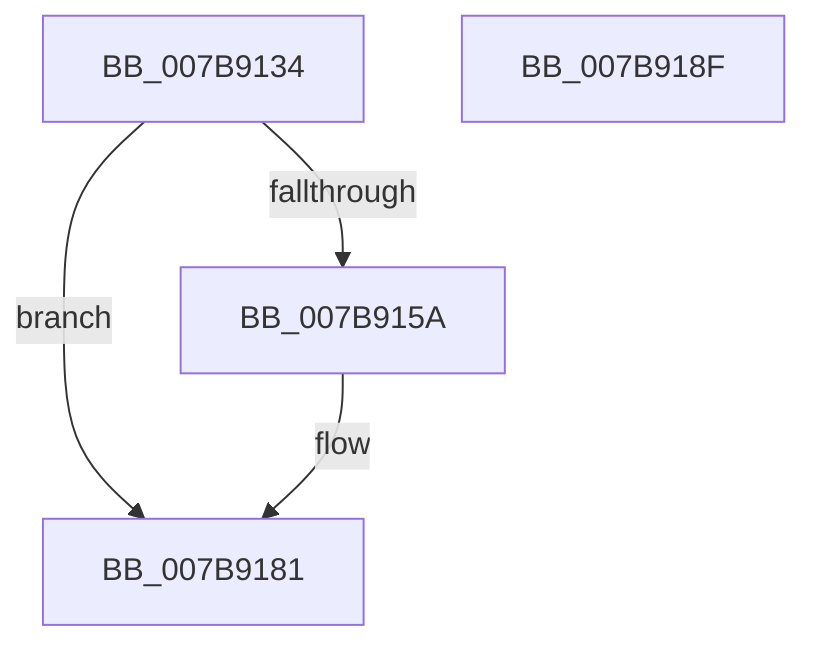

# EtwpSendNoReplyReply

- RVA: `0x007B9134`–`0x007B9190` (길이 `92` bytes)
- VA: `0x00000001407B9134`
- 실행 섹션: `PAGE`
- PDB 이름 있음: `예`; PDB Function 태그: `아니요`
- unwind 정보 RVA: `0x000BA0F0`
- 디코드: `23`개 명령, `92/92` bytes 표시
- 미해석 바이트: `0` (있으면 어셈블리에 `.byte`로 보존)

> 이 문서는 커널 이미지의 기계어와 PDB 기호를 분석해 생성했습니다. 4번과 5번은 함수 원형과 자료형을 바이너리 사용 방식에서 추정한 C 해석이며 원본 소스 복구 결과는 아닙니다.

## 1. Dependencies

- 직접 호출 지점: **2**; 고유 호출 대상: **2**
- 직접 호출자로 확인된 함수: **1**
- RIP 상대 이미지 참조: **0**

### Outgoing calls
- `0x007B914F` → [memset](../../text/6C/memset_function_006C6C40.md) (function, `0x006C6C40`)
- `0x007B917C` → [EtwpQueueReply](../9F/EtwpQueueReply_function_009FEDB0.md) (function, `0x009FEDB0`)

### Direct callers
- [EtwpDeleteRegistrationObject](../8C/EtwpDeleteRegistrationObject_function_008C1F30.md) at `0x008C2272`

### Static image references
- 디코드된 RIP-relative 메모리 참조가 없습니다.

## 2. Other-region calls and transfers

- 다른 실행 섹션으로 향하는 call: **1**
  - `0x007B914F` → [memset](../../text/6C/memset_function_006C6C40.md) (`PAGE` → `.text`)
- 별도 외부 분기/꼬리 이동을 확인하지 못했습니다.

## 3. Assembly (complete function range)

```asm
007B9134  48 89 5C 24 08                  mov qword ptr [rsp + 8], rbx
007B9139  57                              push rdi
007B913A  48 83 EC 70                     sub rsp, 0x70
007B913E  48 8B FA                        mov rdi, rdx
007B9141  48 8B D9                        mov rbx, rcx
007B9144  33 D2                           xor edx, edx
007B9146  48 8D 4C 24 20                  lea rcx, [rsp + 0x20]
007B914B  44 8D 42 48                     lea r8d, [rdx + 0x48]
007B914F  E8 EC DA F0 FF                  call 0x1406c6c40
007B9154  F6 43 62 20                     test byte ptr [rbx + 0x62], 0x20
007B9158  75 27                           jne 0x1407b9181
007B915A  0F 10 07                        movups xmm0, xmmword ptr [rdi]
007B915D  48 8B 4B 30                     mov rcx, qword ptr [rbx + 0x30]
007B9161  48 8D 54 24 20                  lea rdx, [rsp + 0x20]
007B9166  C7 44 24 24 48 00 00 00         mov dword ptr [rsp + 0x24], 0x48
007B916E  F3 0F 7F 44 24 58               movdqu xmmword ptr [rsp + 0x58], xmm0
007B9174  C7 44 24 20 01 00 00 00         mov dword ptr [rsp + 0x20], 1
007B917C  E8 2F 5C 24 00                  call 0x1409fedb0
007B9181  48 8B 9C 24 80 00 00 00         mov rbx, qword ptr [rsp + 0x80]
007B9189  48 83 C4 70                     add rsp, 0x70
007B918D  5F                              pop rdi
007B918E  C3                              ret
007B918F  CC                              int3
```

## 4. C-style interpretation (structured pseudocode)

```c
__int64 __fastcall EtwpSendNoReplyReply(__int64 a1, __int64 a2)
{
    __int64 result;
    __int64 v_rsp;
    unsigned __int64 v_stack_m20;
    unsigned int v_stack_m54;
    unsigned __int64 v_stack_m58;
    unsigned __int64 v_stack_p8;

    v_stack_p8 = v_rbx;
    v_rsp = (v_rsp) - (112);
    a2 = 0;
    result = memset(v_stack_m58, a2, a2 + 72, a4);
    if (((*(unsigned __int8 *)(a1 + 98)) & (32)) == 0) {
        a1 = *(unsigned __int64 *)(a1 + 48);
        a2 = v_stack_m58;
        v_stack_m54 = 72;
        v_stack_m20 = v_xmm0;
        v_stack_m58 = 1;
        result = EtwpQueueReply(a1, a2, a2 + 72, a4);
    }
    v_rsp = (v_rsp) + (112);
    return result;
}
```

## 5. (Beta) C Style

```c
int64_t EtwpSendNoReplyReply(void *Arg1, void *Arg2)
{
    uint8_t *arg1 = (uint8_t *)Arg1;
    uint8_t *arg2 = (uint8_t *)Arg2;

    int64_t result;
    int64_t local_rsp;
    uint64_t v_stack_m20;
    uint32_t v_stack_m54;
    uint64_t v_stack_m58;
    uint64_t v_stack_p8;

    v_stack_p8 = local_rbx;
    local_rsp = (local_rsp) - (112);
    Arg2 = 0;
    result = memset(v_stack_m58, Arg2, Arg2 + 72, a4);
    if (((*(uint8_t *)(arg1 + 0x62)) & (32)) == 0) {
        Arg1 = *(uint64_t *)(arg1 + 0x30);
        Arg2 = v_stack_m58;
        v_stack_m54 = 72;
        v_stack_m20 = v_xmm0;
        v_stack_m58 = 1;
        result = EtwpQueueReply(Arg1, Arg2, Arg2 + 72, a4);
    }
    local_rsp = (local_rsp) + (112);
    return result;
}
```

### 관측된 메모리 오프셋

구조체 형식이 확인되지 않은 접근은 인자 기준의 오프셋으로만 기록했습니다.

| 기준 인자 | 오프셋 표현 | 폭 (bit) | 접근 |
|---|---:|---:|---|
| `Arg1` | `+ 0x30` | `64` | `R` |
| `Arg1` | `+ 0x62` | `8` | `R` |
| `Arg2` | `+ 0x0` | `128` | `R` |

## 6. Execution-region graph

[열기: 2D/3D 그래프와 함수 탐색 컨트롤 패널](../../../control-panel.html?section=page&rva=0x007B9134&view=graph)

- 2D 그래프는 위에서 아래로 흐르고, 3D 그래프는 빈 공간을 드래그해 회전합니다. Shift+드래그는 이동, 휠은 확대·축소, 함수 노드 선택은 대상 보고서 이동입니다.

### Static fallback


