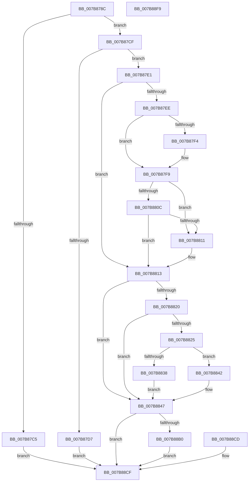

# EtwpSetMark

- RVA: `0x007B878C`–`0x007B88FA` (길이 `366` bytes)
- VA: `0x00000001407B878C`
- 실행 섹션: `PAGE`
- PDB 이름 있음: `예`; PDB Function 태그: `아니요`
- unwind 정보 RVA: `0x000D3730`
- 디코드: `93`개 명령, `366/366` bytes 표시
- 미해석 바이트: `0` (있으면 어셈블리에 `.byte`로 보존)

> 이 문서는 커널 이미지의 기계어와 PDB 기호를 분석해 생성했습니다. 4번과 5번은 함수 원형과 자료형을 바이너리 사용 방식에서 추정한 C 해석이며 원본 소스 복구 결과는 아닙니다.

## 1. Dependencies

- 직접 호출 지점: **6**; 고유 호출 대상: **6**
- 직접 호출자로 확인된 함수: **2**
- RIP 상대 이미지 참조: **3**

### Outgoing calls
- `0x007B87F4` → [ExRaiseDatatypeMisalignment](../89/ExRaiseDatatypeMisalignment_function_00899FD0.md) (function, `0x00899FD0`)
- `0x007B882F` → [SeSinglePrivilegeCheck](../87/SeSinglePrivilegeCheck_function_00871E20.md) (function, `0x00871E20`)
- `0x007B883B` → [MmEmptyAllWorkingSets](../../text/67/MmEmptyAllWorkingSets_function_0067EF2C.md) (function, `0x0067EF2C`)
- `0x007B88A6` → [EtwpLogSystemEventUnsafe](../../text/2F/EtwpLogSystemEventUnsafe_function_002FBF10.md) (function, `0x002FBF10`)
- `0x007B88C6` → [MmIdentifyPhysicalMemory](../AA/MmIdentifyPhysicalMemory_function_00AAD05C.md) (function, `0x00AAD05C`)
- `0x007B88D9` → [_security_check_cookie](../../text/6A/_security_check_cookie_function_006AC640.md) (function, `0x006AC640`)

### Direct callers
- [sub_006DF40E](../../text/6D/Unknown_function_006DF40E.md) at `0x006DF48E`
- [EtwpLogRefSetAutoMark](../7C/EtwpLogRefSetAutoMark_function_007C01A8.md) at `0x007C021B`

### Static image references
- `0x007B87A5` → RVA `0x00E0A740` (`.data`; read)
- `0x007B8828` → RVA `0x00FD9A80` (`PAGEDATA`; read)
- `0x007B885C` → RVA `0x000105E0` (`.rdata`; read)

## 2. Other-region calls and transfers

- 다른 실행 섹션으로 향하는 call: **3**
  - `0x007B883B` → [MmEmptyAllWorkingSets](../../text/67/MmEmptyAllWorkingSets_function_0067EF2C.md) (`PAGE` → `.text`)
  - `0x007B88A6` → [EtwpLogSystemEventUnsafe](../../text/2F/EtwpLogSystemEventUnsafe_function_002FBF10.md) (`PAGE` → `.text`)
  - `0x007B88D9` → [_security_check_cookie](../../text/6A/_security_check_cookie_function_006AC640.md) (`PAGE` → `.text`)
- 별도 외부 분기/꼬리 이동을 확인하지 못했습니다.

## 3. Assembly (complete function range)

```asm
007B878C  48 89 5C 24 10                  mov qword ptr [rsp + 0x10], rbx
007B8791  48 89 74 24 18                  mov qword ptr [rsp + 0x18], rsi
007B8796  48 89 7C 24 20                  mov qword ptr [rsp + 0x20], rdi
007B879B  41 54                           push r12
007B879D  41 56                           push r14
007B879F  41 57                           push r15
007B87A1  48 83 EC 70                     sub rsp, 0x70
007B87A5  48 8B 05 94 1F 65 00            mov rax, qword ptr [rip + 0x651f94]
007B87AC  48 33 C4                        xor rax, rsp
007B87AF  48 89 44 24 68                  mov qword ptr [rsp + 0x68], rax
007B87B4  41 8B F0                        mov esi, r8d
007B87B7  48 8B FA                        mov rdi, rdx
007B87BA  4C 8B F9                        mov r15, rcx
007B87BD  33 DB                           xor ebx, ebx
007B87BF  41 83 F8 04                     cmp r8d, 4
007B87C3  77 0A                           ja 0x1407b87cf
007B87C5  BB 0D 00 00 C0                  mov ebx, 0xc000000d
007B87CA  E9 00 01 00 00                  jmp 0x1407b88cf
007B87CF  81 FE DD FF 00 00               cmp esi, 0xffdd
007B87D5  76 0A                           jbe 0x1407b87e1
007B87D7  BB 95 00 00 C0                  mov ebx, 0xc0000095
007B87DC  E9 EE 00 00 00                  jmp 0x1407b88cf
007B87E1  44 8A B4 24 B0 00 00 00         mov r14b, byte ptr [rsp + 0xb0]
007B87E9  45 84 F6                        test r14b, r14b
007B87EC  74 25                           je 0x1407b8813
007B87EE  40 F6 C7 03                     test dil, 3
007B87F2  74 05                           je 0x1407b87f9
007B87F4  E8 D7 17 0E 00                  call 0x140899fd0
007B87F9  48 8D 0C 32                     lea rcx, [rdx + rsi]
007B87FD  48 B8 00 00 FF FF FF 7F 00 00   movabs rax, 0x7fffffff0000
007B8807  48 3B C8                        cmp rcx, rax
007B880A  77 05                           ja 0x1407b8811
007B880C  48 3B CF                        cmp rcx, rdi
007B880F  73 02                           jae 0x1407b8813
007B8811  8A 00                           mov al, byte ptr [rax]
007B8813  8B 02                           mov eax, dword ptr [rdx]
007B8815  89 44 24 40                     mov dword ptr [rsp + 0x40], eax
007B8819  45 32 E4                        xor r12b, r12b
007B881C  A8 01                           test al, 1
007B881E  74 27                           je 0x1407b8847
007B8820  45 84 C9                        test r9b, r9b
007B8823  74 22                           je 0x1407b8847
007B8825  41 8A D6                        mov dl, r14b
007B8828  48 8B 0D 51 12 82 00            mov rcx, qword ptr [rip + 0x821251]
007B882F  E8 EC 95 0B 00                  call 0x140871e20
007B8834  84 C0                           test al, al
007B8836  74 0A                           je 0x1407b8842
007B8838  41 B4 01                        mov r12b, 1
007B883B  E8 EC 66 EC FF                  call 0x14067ef2c
007B8840  EB 05                           jmp 0x1407b8847
007B8842  BB 61 00 00 C0                  mov ebx, 0xc0000061
007B8847  48 8D 47 04                     lea rax, [rdi + 4]
007B884B  48 89 44 24 48                  mov qword ptr [rsp + 0x48], rax
007B8850  8D 46 FC                        lea eax, [rsi - 4]
007B8853  89 44 24 50                     mov dword ptr [rsp + 0x50], eax
007B8857  83 64 24 54 00                  and dword ptr [rsp + 0x54], 0
007B885C  48 8D 05 7D 7D 85 FF            lea rax, [rip - 0x7a8283]
007B8863  48 89 44 24 58                  mov qword ptr [rsp + 0x58], rax
007B8868  B9 02 00 00 00                  mov ecx, 2
007B886D  89 4C 24 60                     mov dword ptr [rsp + 0x60], ecx
007B8871  83 64 24 64 00                  and dword ptr [rsp + 0x64], 0
007B8876  65 4C 8B 04 25 88 01 00 00      mov r8, qword ptr gs:[0x188]
007B887F  44 88 74 24 38                  mov byte ptr [rsp + 0x38], r14b
007B8884  C7 44 24 30 00 31 00 00         mov dword ptr [rsp + 0x30], 0x3100
007B888C  66 C7 44 24 28 22 0F            mov word ptr [rsp + 0x28], 0xf22
007B8893  89 4C 24 20                     mov dword ptr [rsp + 0x20], ecx
007B8897  45 8B 0F                        mov r9d, dword ptr [r15]
007B889A  48 8D 54 24 48                  lea rdx, [rsp + 0x48]
007B889F  49 8B 8F 50 05 00 00            mov rcx, qword ptr [r15 + 0x550]
007B88A6  E8 65 36 B4 FF                  call 0x1402fbf10
007B88AB  45 84 E4                        test r12b, r12b
007B88AE  74 1F                           je 0x1407b88cf
007B88B0  41 B8 75 02 00 00               mov r8d, 0x275
007B88B6  41 B9 01 00 00 00               mov r9d, 1
007B88BC  41 8B 17                        mov edx, dword ptr [r15]
007B88BF  49 8B 8F 50 05 00 00            mov rcx, qword ptr [r15 + 0x550]
007B88C6  E8 91 47 2F 00                  call 0x140aad05c
007B88CB  EB 02                           jmp 0x1407b88cf
007B88CD  8B D8                           mov ebx, eax
007B88CF  8B C3                           mov eax, ebx
007B88D1  48 8B 4C 24 68                  mov rcx, qword ptr [rsp + 0x68]
007B88D6  48 33 CC                        xor rcx, rsp
007B88D9  E8 62 3D EF FF                  call 0x1406ac640
007B88DE  4C 8D 5C 24 70                  lea r11, [rsp + 0x70]
007B88E3  49 8B 5B 28                     mov rbx, qword ptr [r11 + 0x28]
007B88E7  49 8B 73 30                     mov rsi, qword ptr [r11 + 0x30]
007B88EB  49 8B 7B 38                     mov rdi, qword ptr [r11 + 0x38]
007B88EF  49 8B E3                        mov rsp, r11
007B88F2  41 5F                           pop r15
007B88F4  41 5E                           pop r14
007B88F6  41 5C                           pop r12
007B88F8  C3                              ret
007B88F9  CC                              int3
```

## 4. C-style interpretation (structured pseudocode)

```c
__int64 __fastcall EtwpSetMark(__int64 a1, __int64 a2, int a3, unsigned __int8 a4, unsigned __int8 a5)
{
    __int64 result;
    __int64 v_r12;
    __int64 v_rbx;
    __int64 v_rsp;
    unsigned __int64 v_stack_m18;
    unsigned __int64 v_stack_m20;
    unsigned int v_stack_m24;
    unsigned int v_stack_m28;
    unsigned __int64 v_stack_m30;
    unsigned int v_stack_m34;
    unsigned int v_stack_m38;
    unsigned __int64 v_stack_m40;
    unsigned int v_stack_m48;
    unsigned __int8 v_stack_m50;
    unsigned int v_stack_m58;
    unsigned __int16 v_stack_m60;
    unsigned int v_stack_m68;
    unsigned __int64 v_stack_p10;
    unsigned __int64 v_stack_p18;
    unsigned __int64 v_stack_p20;

    v_stack_p10 = v_rbx;
    v_stack_p18 = v_rsi;
    v_stack_p20 = v_rdi;
    v_rsp = (v_rsp) - (112);
    result = (*(unsigned __int64 *)(v_rip + 6627220)) ^ (v_rsp);
    v_stack_m20 = result;
    v_rbx = 0;
    if (a3 > 4) goto loc_007B87CF;
    goto loc_007B88CF;
loc_007B87CF:
    if (((unsigned int)((unsigned int)(a3))) <= 0xFFDDULL) goto loc_007B87E1;
    goto loc_007B88CF;
loc_007B87E1:
    if (a5 == 0) goto loc_007B8813;
    if ((((unsigned __int8)(a2)) & (3)) != 0) {
        result = ExRaiseDatatypeMisalignment(a1, a2, a3, a4);
    }
    if ((a2 + (unsigned int)(a3) * 1) > result) goto loc_007B8811;
    if ((a2 + (unsigned int)(a3) * 1) < a2) {
        result = *(unsigned __int8 *)(result);
    }
    v_stack_m48 = (unsigned int)((unsigned int)(*(unsigned int *)(a2)));
    v_r12 = 0;
    if ((((unsigned __int8)((unsigned int)(*(unsigned int *)(a2)))) & (1)) == 0) goto loc_007B8847;
    if (a4 == 0) goto loc_007B8847;
    result = SeSinglePrivilegeCheck(*(unsigned __int64 *)(v_rip + 8524369), a5, a3, a4);
    if ((unsigned __int8)(result) == 0) goto loc_007B8842;
    result = MmEmptyAllWorkingSets(*(unsigned __int64 *)(v_rip + 8524369), a5, a3, a4);
    goto loc_007B8847;
loc_007B8842:
loc_007B8847:
    v_stack_m40 = a2 + 4;
    v_stack_m38 = (unsigned int)((unsigned int)(a3) - 4);
    v_stack_m30 = v_rip - 8028803;
    v_stack_m28 = 2;
    v_stack_m50 = a5;
    v_stack_m58 = 0x3100ULL;
    v_stack_m60 = 0xF22ULL;
    v_stack_m68 = 2;
    result = EtwpLogSystemEventUnsafe(*(unsigned __int64 *)(a1 + 1360), v_stack_m40, *(unsigned __int64 *)(gs_base + (0 + 392)), (unsigned int)(*(unsigned int *)(a1)));
    if (1 == 0) goto loc_007B88CF;
    result = MmIdentifyPhysicalMemory(*(unsigned __int64 *)(a1 + 1360), (unsigned int)(*(unsigned int *)(a1)), 629, 1);
    goto loc_007B88CF;
loc_007B88CF:
    a1 = (v_stack_m20) ^ (v_rsp);
    result = _security_check_cookie(a1, (unsigned int)(*(unsigned int *)(a1)), 629, 1);
    return result;
}
```

## 5. (Beta) C Style

```c
int64_t EtwpSetMark(void *Arg1, int64_t Arg2, int32_t Arg3, uint8_t Arg4, uint8_t Arg5)
{
    uint8_t *arg1 = (uint8_t *)Arg1;

    int64_t result;
    int64_t local_r12;
    int64_t local_rbx;
    int64_t local_rsp;
    uint64_t v_stack_m18;
    uint64_t v_stack_m20;
    uint32_t v_stack_m24;
    uint32_t v_stack_m28;
    uint64_t v_stack_m30;
    uint32_t v_stack_m34;
    uint32_t v_stack_m38;
    uint64_t v_stack_m40;
    uint32_t v_stack_m48;
    uint8_t v_stack_m50;
    uint32_t v_stack_m58;
    uint16_t v_stack_m60;
    uint32_t v_stack_m68;
    uint64_t v_stack_p10;
    uint64_t v_stack_p18;
    uint64_t v_stack_p20;

    v_stack_p10 = local_rbx;
    v_stack_p18 = local_rsi;
    v_stack_p20 = local_rdi;
    local_rsp = (local_rsp) - (112);
    result = (*(uint64_t *)(v_rip + 0x651F94)) ^ (local_rsp);
    v_stack_m20 = result;
    local_rbx = 0;
    if (Arg3 > 4) goto loc_007B87CF;
    goto loc_007B88CF;
loc_007B87CF:
    if (((uint32_t)((uint32_t)(Arg3))) <= 0xFFDDULL) goto loc_007B87E1;
    goto loc_007B88CF;
loc_007B87E1:
    if (Arg5 == 0) goto loc_007B8813;
    if ((((uint8_t)(Arg2)) & (3)) != 0) {
        result = ExRaiseDatatypeMisalignment(Arg1, Arg2, Arg3, Arg4);
    }
    if ((Arg2 + (uint32_t)(Arg3) * 1) > result) goto loc_007B8811;
    if ((Arg2 + (uint32_t)(Arg3) * 1) < Arg2) {
        result = *(uint8_t *)(result);
    }
    v_stack_m48 = (uint32_t)((uint32_t)(*(uint32_t *)(Arg2)));
    local_r12 = 0;
    if ((((uint8_t)((uint32_t)(*(uint32_t *)(Arg2)))) & (1)) == 0) goto loc_007B8847;
    if (Arg4 == 0) goto loc_007B8847;
    result = SeSinglePrivilegeCheck(*(uint64_t *)(v_rip + 0x821251), Arg5, Arg3, Arg4);
    if ((uint8_t)(result) == 0) goto loc_007B8842;
    result = MmEmptyAllWorkingSets(*(uint64_t *)(v_rip + 0x821251), Arg5, Arg3, Arg4);
    goto loc_007B8847;
loc_007B8842:
loc_007B8847:
    v_stack_m40 = Arg2 + 4;
    v_stack_m38 = (uint32_t)((uint32_t)(Arg3) - 4);
    v_stack_m30 = v_rip - 8028803;
    v_stack_m28 = 2;
    v_stack_m50 = Arg5;
    v_stack_m58 = 0x3100ULL;
    v_stack_m60 = 0xF22ULL;
    v_stack_m68 = 2;
    result = EtwpLogSystemEventUnsafe(*(uint64_t *)(arg1 + 0x550), v_stack_m40, *(uint64_t *)(gs_base + (0 + 0x188)), (uint32_t)(*(uint32_t *)(arg1)));
    if (1 == 0) goto loc_007B88CF;
    result = MmIdentifyPhysicalMemory(*(uint64_t *)(arg1 + 0x550), (uint32_t)(*(uint32_t *)(arg1)), 629, 1);
    goto loc_007B88CF;
loc_007B88CF:
    Arg1 = (v_stack_m20) ^ (local_rsp);
    result = _security_check_cookie(Arg1, (uint32_t)(*(uint32_t *)(arg1)), 629, 1);
    return result;
}
```

### 관측된 메모리 오프셋

구조체 형식이 확인되지 않은 접근은 인자 기준의 오프셋으로만 기록했습니다.

| 기준 인자 | 오프셋 표현 | 폭 (bit) | 접근 |
|---|---:|---:|---|
| `Arg1` | `+ 0x0` | `32` | `R` |
| `Arg1` | `+ 0x550` | `64` | `R` |

## 6. Execution-region graph

[열기: 2D/3D 그래프와 함수 탐색 컨트롤 패널](../../../control-panel.html?section=page&rva=0x007B878C&view=graph)

- 2D 그래프는 위에서 아래로 흐르고, 3D 그래프는 빈 공간을 드래그해 회전합니다. Shift+드래그는 이동, 휠은 확대·축소, 함수 노드 선택은 대상 보고서 이동입니다.

### Static fallback


