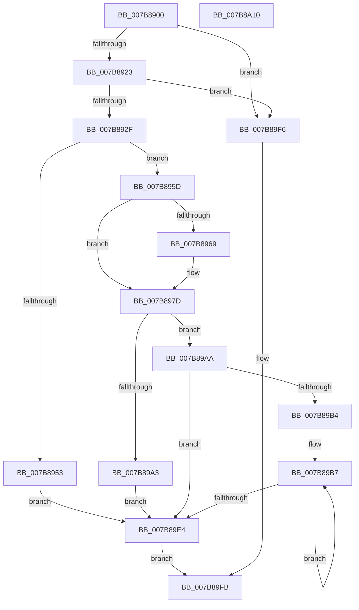

# EtwpSetPmcProfileSource

- RVA: `0x007B8900`–`0x007B8A11` (길이 `273` bytes)
- VA: `0x00000001407B8900`
- 실행 섹션: `PAGE`
- PDB 이름 있음: `예`; PDB Function 태그: `아니요`
- unwind 정보 RVA: `0x00066400`
- 디코드: `67`개 명령, `273/273` bytes 표시
- 미해석 바이트: `0` (있으면 어셈블리에 `.byte`로 보존)

> 이 문서는 커널 이미지의 기계어와 PDB 기호를 분석해 생성했습니다. 4번과 5번은 함수 원형과 자료형을 바이너리 사용 방식에서 추정한 C 해석이며 원본 소스 복구 결과는 아닙니다.

## 1. Dependencies

- 직접 호출 지점: **5**; 고유 호출 대상: **5**
- 직접 호출자로 확인된 함수: **1**
- RIP 상대 이미지 참조: **7**

### Outgoing calls
- `0x007B8942` → [KeWaitForSingleObject](../../text/20/KeWaitForSingleObject_function_0020E6B0.md) (function, `0x0020E6B0`)
- `0x007B896B` → [ExFreePoolWithTag](../../poolcode/B8/ExFreePoolWithTag_function_00B82870.md) (function, `0x00B82870`)
- `0x007B8992` → [ExAllocatePool2](../../poolcode/B8/ExAllocatePool2_function_00B820F0.md) (function, `0x00B820F0`)
- `0x007B89CE` → [KeInitializeProfileCallback](../6F/KeInitializeProfileCallback_function_006FF624.md) (function, `0x006FF624`)
- `0x007B89ED` → [KeReleaseMutex](../../text/39/KeReleaseMutex_function_00396810.md) (function, `0x00396810`)

### Direct callers
- [sub_00B3C988](../B3/Unknown_function_00B3C988.md) at `0x00B3CD03`

### Static image references
- `0x007B8923` → RVA `0x00FD810C` (`PAGEDATA`; read)
- `0x007B8939` → RVA `0x00EFF7A0` (`.data`; read)
- `0x007B8947` → RVA `0x00FC6B04` (`ALMOSTRO`; read)
- `0x007B895D` → RVA `0x00EFF298` (`.data`; read)
- `0x007B8970` → RVA `0x00EFF298` (`.data`; write)
- `0x007B8977` → RVA `0x00EFF290` (`.data`; write)
- `0x007B89BA` → RVA `0x004AFB00` (`EtwpPmcInterrupt`; read)

## 2. Other-region calls and transfers

- 다른 실행 섹션으로 향하는 call: **4**
  - `0x007B8942` → [KeWaitForSingleObject](../../text/20/KeWaitForSingleObject_function_0020E6B0.md) (`PAGE` → `.text`)
  - `0x007B896B` → [ExFreePoolWithTag](../../poolcode/B8/ExFreePoolWithTag_function_00B82870.md) (`PAGE` → `POOLCODE`)
  - `0x007B8992` → [ExAllocatePool2](../../poolcode/B8/ExAllocatePool2_function_00B820F0.md) (`PAGE` → `POOLCODE`)
  - `0x007B89ED` → [KeReleaseMutex](../../text/39/KeReleaseMutex_function_00396810.md) (`PAGE` → `.text`)
- 별도 외부 분기/꼬리 이동을 확인하지 못했습니다.

## 3. Assembly (complete function range)

```asm
007B8900  48 8B C4                        mov rax, rsp
007B8903  48 89 58 08                     mov qword ptr [rax + 8], rbx
007B8907  48 89 68 10                     mov qword ptr [rax + 0x10], rbp
007B890B  48 89 70 18                     mov qword ptr [rax + 0x18], rsi
007B890F  57                              push rdi
007B8910  48 83 EC 30                     sub rsp, 0x30
007B8914  33 DB                           xor ebx, ebx
007B8916  8B FA                           mov edi, edx
007B8918  48 8B F1                        mov rsi, rcx
007B891B  85 D2                           test edx, edx
007B891D  0F 84 D3 00 00 00               je 0x1407b89f6
007B8923  3B 3D E3 F7 81 00               cmp edi, dword ptr [rip + 0x81f7e3]
007B8929  0F 87 C7 00 00 00               ja 0x1407b89f6
007B892F  45 33 C9                        xor r9d, r9d
007B8932  48 89 58 E8                     mov qword ptr [rax - 0x18], rbx
007B8936  45 33 C0                        xor r8d, r8d
007B8939  48 8D 0D 60 6E 74 00            lea rcx, [rip + 0x746e60]
007B8940  33 D2                           xor edx, edx
007B8942  E8 69 5D A5 FF                  call 0x14020e6b0
007B8947  F7 05 B3 E1 80 00 00 04 00 00   test dword ptr [rip + 0x80e1b3], 0x400
007B8951  74 0A                           je 0x1407b895d
007B8953  BB 03 03 00 C0                  mov ebx, 0xc0000303
007B8958  E9 87 00 00 00                  jmp 0x1407b89e4
007B895D  48 8B 0D 34 69 74 00            mov rcx, qword ptr [rip + 0x746934]
007B8964  48 85 C9                        test rcx, rcx
007B8967  74 14                           je 0x1407b897d
007B8969  33 D2                           xor edx, edx
007B896B  E8 00 9F 3C 00                  call 0x140b82870
007B8970  48 89 1D 21 69 74 00            mov qword ptr [rip + 0x746921], rbx
007B8977  89 1D 13 69 74 00               mov dword ptr [rip + 0x746913], ebx
007B897D  48 69 D7 68 02 00 00            imul rdx, rdi, 0x268
007B8984  B9 40 00 00 00                  mov ecx, 0x40
007B8989  41 B8 45 74 77 58               mov r8d, 0x58777445
007B898F  48 8B EF                        mov rbp, rdi
007B8992  E8 59 97 3C 00                  call 0x140b820f0
007B8997  48 89 05 FA 68 74 00            mov qword ptr [rip + 0x7468fa], rax
007B899E  48 85 C0                        test rax, rax
007B89A1  75 07                           jne 0x1407b89aa
007B89A3  BB 17 00 00 C0                  mov ebx, 0xc0000017
007B89A8  EB 3A                           jmp 0x1407b89e4
007B89AA  89 3D E0 68 74 00               mov dword ptr [rip + 0x7468e0], edi
007B89B0  85 FF                           test edi, edi
007B89B2  74 30                           je 0x1407b89e4
007B89B4  48 8B FB                        mov rdi, rbx
007B89B7  44 8B 0E                        mov r9d, dword ptr [rsi]
007B89BA  48 8D 15 3F 71 CF FF            lea rdx, [rip - 0x308ec1]
007B89C1  48 8B 0D D0 68 74 00            mov rcx, qword ptr [rip + 0x7468d0]
007B89C8  45 8B C1                        mov r8d, r9d
007B89CB  48 03 CF                        add rcx, rdi
007B89CE  E8 51 6C F4 FF                  call 0x1406ff624
007B89D3  48 81 C7 68 02 00 00            add rdi, 0x268
007B89DA  48 8D 76 04                     lea rsi, [rsi + 4]
007B89DE  48 83 ED 01                     sub rbp, 1
007B89E2  75 D3                           jne 0x1407b89b7
007B89E4  33 D2                           xor edx, edx
007B89E6  48 8D 0D B3 6D 74 00            lea rcx, [rip + 0x746db3]
007B89ED  E8 1E DE BD FF                  call 0x140396810
007B89F2  8B C3                           mov eax, ebx
007B89F4  EB 05                           jmp 0x1407b89fb
007B89F6  B8 0D 00 00 C0                  mov eax, 0xc000000d
007B89FB  48 8B 5C 24 40                  mov rbx, qword ptr [rsp + 0x40]
007B8A00  48 8B 6C 24 48                  mov rbp, qword ptr [rsp + 0x48]
007B8A05  48 8B 74 24 50                  mov rsi, qword ptr [rsp + 0x50]
007B8A0A  48 83 C4 30                     add rsp, 0x30
007B8A0E  5F                              pop rdi
007B8A0F  C3                              ret
007B8A10  CC                              int3
```

## 4. C-style interpretation (structured pseudocode)

```c
__int64 __fastcall EtwpSetPmcProfileSource(__int64 a1, int a2, int a3, int a4)
{
    __int64 result;
    __int64 v_rbp;
    __int64 v_rbx;
    __int64 v_rdi;
    __int64 v_rsp;
    unsigned __int64 v_stack_p10;
    unsigned __int64 v_stack_p18;
    unsigned __int64 v_stack_p8;

    *(unsigned __int64 *)(v_rsp + 8) = v_rbx;
    *(unsigned __int64 *)(v_rsp + 16) = v_rbp;
    *(unsigned __int64 *)(v_rsp + 24) = v_rsi;
    v_rsp = (v_rsp) - (48);
    v_rbx = 0;
    if (a2 == 0) goto loc_007B89F6;
    if (((unsigned int)((unsigned int)(a2))) > (*(unsigned int *)(v_rip + 8517603))) goto loc_007B89F6;
    a4 = 0;
    *(unsigned __int64 *)(v_rsp - 24) = 0;
    a3 = 0;
    a2 = 0;
    result = KeWaitForSingleObject(v_rip + 7630432, a2, a3, a4);
    if (((*(unsigned int *)(v_rip + 8446387)) & (0x400ULL)) == 0) goto loc_007B895D;
    goto loc_007B89E4;
loc_007B895D:
    if (*(unsigned __int64 *)(v_rip + 7629108) != 0) {
        a2 = 0;
        result = ExFreePoolWithTag(*(unsigned __int64 *)(v_rip + 7629108), a2, a3, a4);
        *(unsigned __int64 *)(v_rip + 7629089) = (unsigned int)(0xC0000303ULL);
        *(unsigned int *)(v_rip + 7629075) = (unsigned int)((unsigned int)(0xC0000303ULL));
    }
    a2 = (a2) * ((unsigned int)(a2));
    result = ExAllocatePool2(64, a2, (unsigned int)(0x58777445ULL), a4);
    *(unsigned __int64 *)(v_rip + 7629050) = result;
    if (result != 0) goto loc_007B89AA;
    goto loc_007B89E4;
loc_007B89AA:
    *(unsigned int *)(v_rip + 7629024) = (unsigned int)((unsigned int)(a2));
    if ((unsigned int)((unsigned int)(a2)) == 0) goto loc_007B89E4;
loc_007B89B7:
    a1 = (*(unsigned __int64 *)(v_rip + 7629008)) + ((unsigned int)(0xC0000017ULL));
    result = KeInitializeProfileCallback(a1, v_rip - 3182273, (unsigned int)((unsigned int)((unsigned int)(*(unsigned int *)(a1)))), (unsigned int)(*(unsigned int *)(a1)));
    v_rdi = ((unsigned int)(0xC0000017ULL)) + (616);
    v_rbp = ((unsigned int)(a2)) - (1);
    if (condition_is_not_equal) goto loc_007B89B7;
loc_007B89E4:
    a2 = 0;
    result = KeReleaseMutex(v_rip + 7630259, a2, (unsigned int)((unsigned int)((unsigned int)(*(unsigned int *)(a1)))), (unsigned int)(*(unsigned int *)(a1)));
    goto loc_007B89FB;
loc_007B89F6:
loc_007B89FB:
    v_rsp = (v_rsp) + (48);
    return (unsigned int)(0xC000000DULL);
}
```

## 5. (Beta) C Style

```c
int64_t EtwpSetPmcProfileSource(void *Arg1, int32_t Arg2, int32_t Arg3, int32_t Arg4)
{
    uint8_t *arg1 = (uint8_t *)Arg1;

    int64_t result;
    int64_t local_rbp;
    int64_t local_rbx;
    int64_t local_rdi;
    int64_t local_rsp;
    uint64_t v_stack_p10;
    uint64_t v_stack_p18;
    uint64_t v_stack_p8;

    *(uint64_t *)(local_rsp + 0x8) = local_rbx;
    *(uint64_t *)(local_rsp + 0x10) = local_rbp;
    *(uint64_t *)(local_rsp + 0x18) = local_rsi;
    local_rsp = (local_rsp) - (48);
    local_rbx = 0;
    if (Arg2 == 0) goto loc_007B89F6;
    if (((uint32_t)((uint32_t)(Arg2))) > (*(uint32_t *)(v_rip + 0x81F7E3))) goto loc_007B89F6;
    Arg4 = 0;
    *(uint64_t *)(local_rsp - 0x18) = 0;
    Arg3 = 0;
    Arg2 = 0;
    result = KeWaitForSingleObject(v_rip + 7630432, Arg2, Arg3, Arg4);
    if (((*(uint32_t *)(v_rip + 0x80E1B3)) & (0x400ULL)) == 0) goto loc_007B895D;
    goto loc_007B89E4;
loc_007B895D:
    if (*(uint64_t *)(v_rip + 0x746934) != 0) {
        Arg2 = 0;
        result = ExFreePoolWithTag(*(uint64_t *)(v_rip + 0x746934), Arg2, Arg3, Arg4);
        *(uint64_t *)(v_rip + 0x746921) = (uint32_t)(0xC0000303ULL);
        *(uint32_t *)(v_rip + 0x746913) = (uint32_t)((uint32_t)(0xC0000303ULL));
    }
    Arg2 = (Arg2) * ((uint32_t)(Arg2));
    result = ExAllocatePool2(64, Arg2, (uint32_t)(0x58777445ULL), Arg4);
    *(uint64_t *)(v_rip + 0x7468FA) = result;
    if (result != 0) goto loc_007B89AA;
    goto loc_007B89E4;
loc_007B89AA:
    *(uint32_t *)(v_rip + 0x7468E0) = (uint32_t)((uint32_t)(Arg2));
    if ((uint32_t)((uint32_t)(Arg2)) == 0) goto loc_007B89E4;
loc_007B89B7:
    Arg1 = (*(uint64_t *)(v_rip + 0x7468D0)) + ((uint32_t)(0xC0000017ULL));
    result = KeInitializeProfileCallback(Arg1, v_rip - 3182273, (uint32_t)((uint32_t)((uint32_t)(*(uint32_t *)(arg1)))), (uint32_t)(*(uint32_t *)(arg1)));
    local_rdi = ((uint32_t)(0xC0000017ULL)) + (616);
    local_rbp = ((uint32_t)(Arg2)) - (1);
    if (condition_is_not_equal) goto loc_007B89B7;
loc_007B89E4:
    Arg2 = 0;
    result = KeReleaseMutex(v_rip + 7630259, Arg2, (uint32_t)((uint32_t)((uint32_t)(*(uint32_t *)(arg1)))), (uint32_t)(*(uint32_t *)(arg1)));
    goto loc_007B89FB;
loc_007B89F6:
loc_007B89FB:
    local_rsp = (local_rsp) + (48);
    return (uint32_t)(0xC000000DULL);
}
```

### 관측된 메모리 오프셋

구조체 형식이 확인되지 않은 접근은 인자 기준의 오프셋으로만 기록했습니다.

| 기준 인자 | 오프셋 표현 | 폭 (bit) | 접근 |
|---|---:|---:|---|
| `Arg1` | `+ 0x0` | `32` | `R` |
| `Arg1` | `+ 0x4` | `64` | `R` |

## 6. Execution-region graph

[열기: 2D/3D 그래프와 함수 탐색 컨트롤 패널](../../../control-panel.html?section=page&rva=0x007B8900&view=graph)

- 2D 그래프는 위에서 아래로 흐르고, 3D 그래프는 빈 공간을 드래그해 회전합니다. Shift+드래그는 이동, 휠은 확대·축소, 함수 노드 선택은 대상 보고서 이동입니다.

### Static fallback


